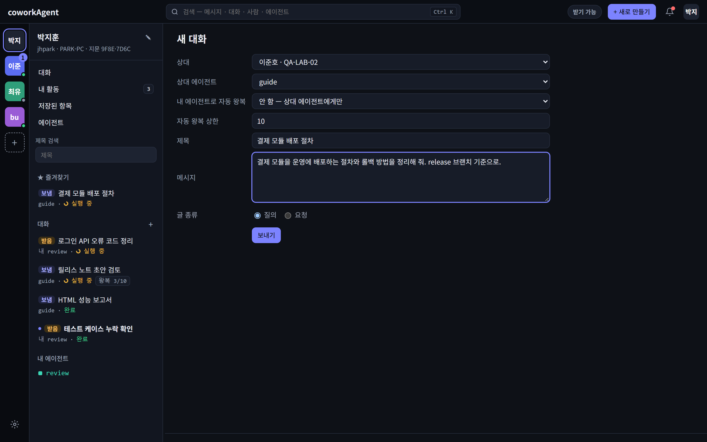
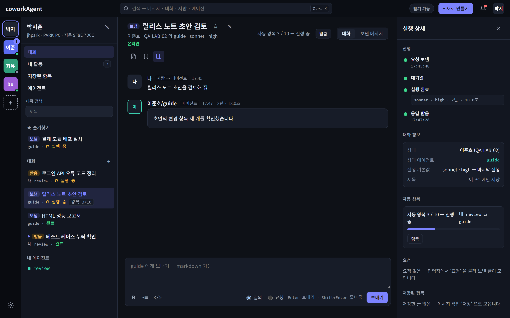
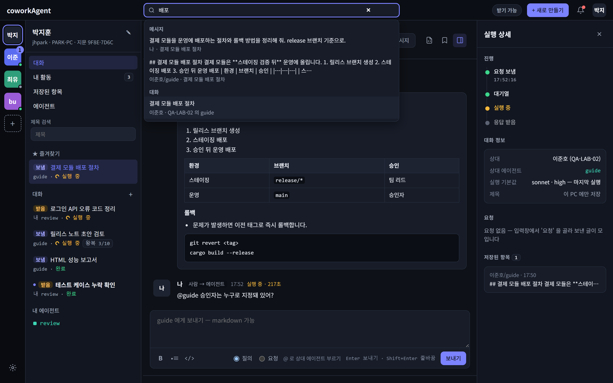
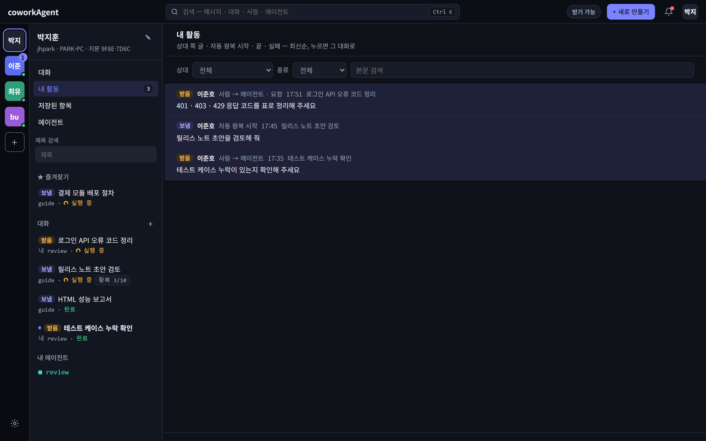

# coworkAgent

같은 사내망에 있는 동료 PC 의 **Claude Code 에이전트에게 그 PC 의 프로젝트를 묻고 답을 받는** Windows 트레이 앱.
중앙 서버 없이 두 PC 가 직접 TLS 로 연결되고, 답은 상대 PC 에서 `claude -p`(헤드리스 Claude Code)가 **읽기 전용**으로 만든다.


> [!NOTE]
> 화면의 이름 · PC · 폴더 · 주소는 모두 가상의 예시다.

## 주요 기능

| 기능 | 설명 |
|---|---|
| **PC 직접 연결** | 초대 메시지로 한 번 페어링 — 중앙 서버 없음, TLS 1.3 + ed25519 공개키 상호 인증 |
| **원격 에이전트 질의** | 상대 PC 에 등록된 에이전트가 그 PC 의 폴더 안에서 Claude Code 로 답한다 — 읽기 전용 · 문의 응답 전용 |
| **이어지는 맥락** | 같은 대화에 이어 쓰면 Claude 세션을 이어서(`--resume`) 앞 대화를 기억한 채 답한다 |
| **@멘션** | 한 대화에서 상대 PC 의 다른 에이전트를 불러 답을 받는다 — 에이전트마다 맥락을 따로 잇는다 |
| **자동 왕복** | 내 에이전트 ⇄ 상대 에이전트가 상한(1 ~ 50, 기본 10)까지 자동으로 주고받는다 |
| **질의 · 요청 · 완료 표시** | 글 종류를 나누고, 받은 요청은 받은 쪽이 완료 표시 — 양쪽 화면이 맞춰진다 |
| **집중 · 접속 상태** | "집중" 이면 새 요청을 받는 순간 거절한다. 상대는 온라인 · 집중 중 · 오프라인으로 보인다 |
| **검색 · 내 활동 · 저장** | Ctrl K 통합 검색(메시지 · 대화 · 사람 · 에이전트), 활동 피드, ★ 즐겨찾기 · 저장된 항목 |
| **알림** | 브라우저 알림 + 트레이 아이콘 주황 점 — 종류별 켜기 · 끄기, 일시 중지 |
| **AI 에이전트용 CLI** | `coworkAgent peers` · `ask` · `history` — 내 AI 에이전트가 명령줄로 묻고 이력을 본다 |

## 통신 메커니즘

PC 마다 coworkAgent **주 인스턴스 하나**가 트레이에 상주하며 서버와 클라이언트를 겸한다. 웹UI 는 각자 자기 PC 의 앱에만 붙고,
PC 사이는 앱끼리 직접 통신한다.


| 구간 | 전송 | 인증 · 보호 | 비고 |
|---|---|---|---|
| 브라우저 ↔ 내 앱 | HTTP `127.0.0.1:{임의 포트}` · 알림은 SSE `/api/events` | 실행마다 새 토큰 → 쿠키 `an_token`(HttpOnly · SameSite=Strict), Host · Origin 검사 | 화면은 5초마다 새로 읽는다 |
| CLI ↔ 내 앱 | 같은 로컬 API | `instance.json` 의 토큰을 `Authorization: Bearer` 로 | 앱이 꺼져 있으면 종료 코드 3 |
| 내 앱 ↔ 상대 앱 | TCP `47100`(사용 중이면 임의 포트) 위 TLS 1.3 — 요청 1건 = 연결 1개 | 양쪽 ed25519 공개키(raw public key) 상호 인증, 페어링 때 상대 키 고정 | 요청 · 응답 전체 10초 상한 |
| 상대 앱 → `claude -p` | 자식 프로세스 표준 입력 → JSON 출력 | 에이전트 폴더(cwd) · 읽기 전용 도구 · 문의 응답 전용 지시 | 실행 1건 30분 상한, 대화마다 순서대로 |
| `claude -p` → 모델 서비스 | HTTPS | 그 PC 의 Claude Code 로그인 | 질문 · 읽은 파일 내용이 사내망 밖으로 나간다 |

### 피어 프로토콜

- **프레임** = 4바이트 big-endian 길이 + JSON(최대 64 KiB). 글 본문은 16 KiB 까지. 요청 1건에 응답 1건을 주고받고 연결을 닫는다.
- **요청** — 페어링 `Hello` · `Approve` · `Remove`, 접속 `Ping`, 대화 `Agents` · `Message` · `Reply` · `Post` · `Relay` · `Done`.
  **응답** — `Hello` · `Ok` · `Pong{focus}` · `Agents{names}` · `Error{code}`.
- 페어링되지 않은 상대는 페어링 요청만 보낼 수 있다. 대화 요청은 양쪽이 승인한 키만 처리한다.
- 수신 제한 — 연결당 3초 · 동시 32 · 출처 IP 당 4. 상대가 준 오류 코드는 정해진 꼴(영소문자 · `_` 1 ~ 32자)만 받는다.

### 페어링 — 초대 한 번


### 질의 1왕복


- **세션** — 대화의 첫 실행은 coworkAgent 가 만든 UUID 로 `--session-id`, 다음부터 `--resume`. 맥락은 답한 PC 의 Claude Code
  기록에만 있고 coworkAgent 는 세션 ID 만 갖는다.
- **자동 왕복** — 대화를 연 쪽이 구동한다. 상대 에이전트의 답을 내 에이전트에게 실행시키고, 그 답을 다시 상대에게 `Message` 로 보낸다.
  상한 · 실패 · 거절 · 집중 · 사람 글 · "멈춤" 중 하나가 생기면 멈춘다.
- **접속 감시** — 30초마다 페어링된 상대에게 `Ping` → `Pong{focus}`. 마지막 응답이 75초 안이면 온라인.

동작 · 세션 · 저장 구조의 전체는 [개발자 가이드](docs/manual/dev/developer-guide.md).
위 그림은 mermaid 를 미리 그린 PNG 다 — 원본 mermaid 는 개발자 가이드 1 · 8 장.

## 요구 사항

| 항목 | 내용 |
|---|---|
| OS | Windows 10/11 x64 (macOS 는 준비 중) |
| 네트워크 | 상대 PC 와 같은 LAN. 수신 포트 TCP 47100 — 방화벽은 사내망 쪽만 허용한다 |
| Claude Code | **답하는 PC**(에이전트를 등록한 PC)에 2.1.267 이상 설치 · 로그인, 그리고 모델 서비스로 가는 인터넷 연결. 묻기만 하는 PC 는 없어도 된다 |
| 빌드 | Rust stable(검증 `rustc 1.95.0` · `x86_64-pc-windows-msvc`) |

## 빌드 · 실행

```powershell
cargo build --release -p coworkagent-app   # target\release\coworkAgent.exe — 설치 없는 단일 실행 파일
.\target\release\coworkAgent.exe           # 트레이에 상주 — 창은 뜨지 않는다
```

- 트레이 아이콘 메뉴 **"열기"** → 기본 브라우저에 웹UI, **"종료"** → 앱 종료. 이미 떠 있을 때 다시 실행해도 웹UI 가 열린다.
- 데이터는 `%LOCALAPPDATA%\coworkAgent\` 에 남는다 — 대화 DB · 신원 키 · 로그.

## 사용 방법

### 1. PC 연결 (페어링) — 처음 한 번

1. 초대를 만드는 쪽: "+ 새로 만들기" → **"초대 생성"** → **"초대 생성"** → **"초대 복사"** → 메신저 등으로 상대에게 보낸다.
   초대는 **5분 안에 한 번**만 쓸 수 있다.
2. 받는 쪽: 레일 "+"(또는 "+ 새로 만들기" → **"초대 수락"**) → 초대 메시지를 통째로 붙여 넣고 **"추가 · 승인"**.
3. 양쪽 "연결 목록" 에 상대가 "페어링됨" 으로 보인다. 처음 잇는 상대라면 "내 정보 → 지문" 이 같은지 전화 · 대면으로 확인한다.


### 2. 내 에이전트 등록 (답하는 쪽)

설정 → 내 에이전트 → **"새 에이전트 등록"** — 상대가 부를 이름, 폴더(절대 경로), 허용 도구(읽기 전용 `Read` · `Grep` · `Glob` ·
`LS` · `NotebookRead`), 추가 지시. 이름은 등록 뒤 바꿀 수 없다.


> [!WARNING]
> 폴더 안에서 읽을 수 있는 내용은 답에 실려 상대에게 갈 수 있고, 답을 만드는 동안 Claude 모델 서비스로도 간다.
> 비밀(키 · 토큰 · 개인정보)이 든 폴더는 등록하지 않는다.

### 3. 새 대화로 묻기

"+ 새로 만들기" → **"새 대화"** → 상대 · 상대 에이전트 · 메시지 → **"보내기"**. 제목을 비우면 첫 메시지 앞부분이 제목이 된다.



- 입력창은 **Enter = 보내기**, Shift+Enter = 줄바꿈, markdown 가능. 글 종류는 **"질의"**(기본) · **"요청"**.
- 진행은 오른쪽 실행 상세 '진행'(요청 보냄 · 대기열 · 실행 완료 · 응답 받음). 답에는 모델 · effort · 턴 · 시간이 함께 남는다.
- 같은 대화에 이어 쓰면 앞 맥락을 이어서 답한다. 입력창에서 `@` 를 치면 상대 PC 의 다른 에이전트를 부른다(맨 위 화면).

### 4. 자동 왕복 대화

"+ 새로 만들기" → **"자동 왕복 대화"** → "내 에이전트로 자동 왕복" 에서 내 에이전트, "자동 왕복 상한" → 첫 글 **"보내기"**.
어느 쪽이든 사람이 글을 쓰거나 **"멈춤"** 을 누르면 멈추고, 연 쪽이 **"재개"** 로 다시 시작한다. 내 에이전트 실행은 내 PC 의 Claude
사용량을 쓴다.



### 5. 검색 · 내 활동

| 통합 검색 (Ctrl K) | 내 활동 (알림 종) |
|---|---|
|  |  |

### 6. 집중 · 알림

- 상단 칩 **"받기 가능"** 을 누르면 **"집중"** — 그동안 상대의 새 요청은 받는 순간 거절되고 상대 화면에는 "상대가 집중 중" 으로 보인다.
- 설정 → 알림 → **"인바운드 요청 알림(브라우저 알림 · 트레이 표시)"** 을 켜면(기본 꺼짐) 새 요청 · 답 · 자동 왕복을 알려 준다.

### 7. AI 에이전트용 CLI

앱이 떠 있는 PC 에서 명령줄로 묻고 이력을 본다. CLI 로 쓴 글은 양쪽 이력에 "AI 에이전트(CLI)" 로 표시된다.

```powershell
coworkAgent peers                                                   # 연결한 상대
coworkAgent ask user-b "이 저장소의 빌드 명령은?" --agent review       # 새 대화로 묻고 답을 기다린다(최대 30분)
coworkAgent ask user-b "둘째 항목의 근거 파일은?" --conv 12           # 대화 12 에 이어 묻기
coworkAgent history user-b --conv 12                                # 대화 이력
```

- `<상대>` 는 `coworkAgent peers` 가 보여 주는 원래 이름(대소문자 무시) 또는 지문 앞 4자 이상. 옵션 `--json` · `--no-wait`.
- 종료 코드 — 0 성공 · 2 사용법 오류 · 3 앱이 실행 중이 아님 · 4 API 거부 또는 전달 여부 불명 · 5 답이 실패 · 6 시간 초과.

## 알아 둘 점

- 상대의 요청은 **답하는 PC 의 Claude 구독 사용량**을 쓴다. 상한은 실행 1번당 30분뿐이다.
- 에이전트는 읽기 전용 도구와 "문의 응답 전용" 규칙으로만 실행된다 — 파일 생성 · 수정 · 삭제, 명령 실행 요청에는 이유를 답한다.
- 질문과 에이전트가 읽은 파일 내용은 답하는 PC 의 Claude 모델 서비스(사내망 밖)로 간다.
- **사내망 전용 도구**다. 앱은 상대 주소가 사내망인지 검사하지 않으므로 수신 포트를 인터넷에 열지 않는다.
- 초대 메시지가 새면 그 5분 안에 다른 PC 가 등록될 수 있다 — 모르는 연결은 연결 목록에서 바로 "삭제" 한다.
- 전달된 대화 이력은 두 PC 에 모두 남고, 메시지 수정 · 삭제는 없다.

## 문서

| 문서 | 내용 |
|---|---|
| [사용자 가이드](docs/manual/user/user-guide.md) | 실행 · 연결 · 에이전트 등록 · 대화 · 자동 왕복 · 알림 · CLI · 내 데이터 · 문제 해결 |
| [개발자 가이드](docs/manual/dev/developer-guide.md) | 프로세스 · 서비스 역할 · 세션 관리 · 저장소 · 워크플로우 · 보안 경계 |
| [masterPlan](docs/masterPlan.md) | 확정 방향(D) · 기능 명세(S) · 로드맵 |
| [PRODUCT.md](PRODUCT.md) | 기술 스택 · 모듈 Layer · 도메인 규칙 |
| [PROJECT.md](PROJECT.md) | 가드레일 · 개발 환경 · 검증 명령 |

## 개발

문서 주도 개발(DDD)로 진행한다 — 시작점은 [CLAUDE.md](CLAUDE.md). 커밋 · 종결 전 검증:

```powershell
cargo test --workspace
cargo clippy --workspace --all-targets -- -D warnings
node --test --test-reporter=tap "crates/app/web/*.test.mjs"
python tools/check_ddd_docs.py
python tools/check_crates.py
```

| 경로 | 담는 것 |
|---|---|
| `crates/core` | 데이터 경로 · SQLite 스키마 · 로그 회전 · 단일 인스턴스 |
| `crates/net` | 신원(ed25519) · TLS 1.3 raw public key · 피어 프레임 · 페어링 · 접속 감시 · 초대 |
| `crates/agent` | `claude -p` 실행기 · 대화 조율(대기열 · 세션 · 자동 왕복 · 멘션 · 완료) |
| `crates/app` | 시작 순서 · 로컬 웹 서버 · API · CLI · 트레이 · 알림 · 웹UI(`web/`, 실행 파일에 임베드) |
| `tools/` | 문서 규약 · gate · 크레이트 경계 체커 · 개발 PC 재빌드 실행(`rebuild_run.py`) |
