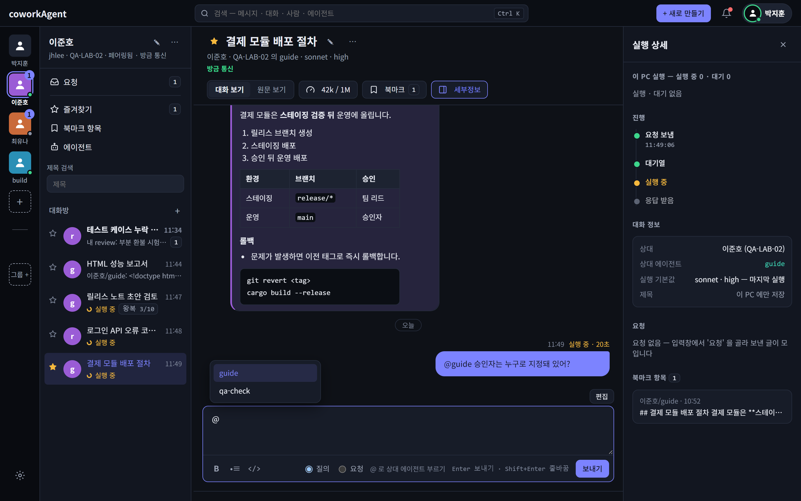
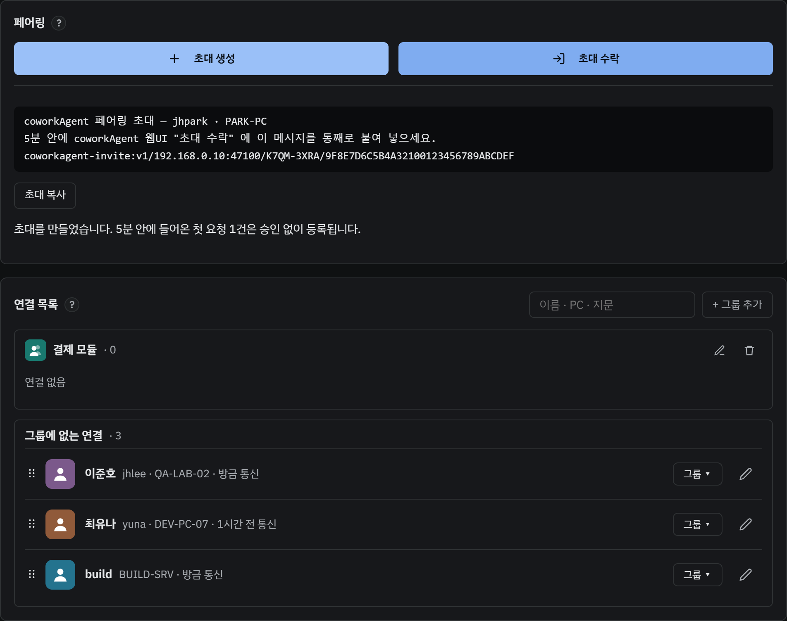
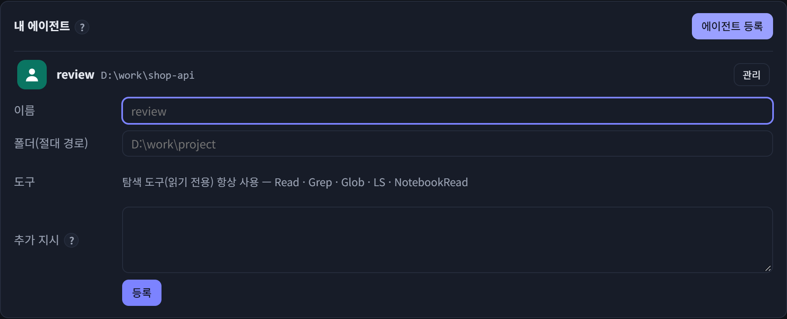

# coworkAgent

동료 PC 의 **Claude Code 에이전트에게 그 PC 의 프로젝트를 묻고 답을 받는** Windows 트레이 앱.
"이 저장소 빌드 명령이 뭐야?", "이 API 는 어디서 호출돼?" — 담당자를 붙잡지 않아도 그 PC 의 에이전트가 코드를 읽고 답한다.

> [!NOTE]
> 화면의 이름 · PC · 폴더 · 주소는 모두 가상의 예시다.

## 왜 coworkAgent 인가

| | |
|---|---|
| **웹 서버 없음** | 띄울 서버도, 관리할 계정도 없다. 각자 PC 의 앱 하나가 같은 사내망의 상대 PC 앱과 직접 연결된다. 실행 파일 하나 — 설치도 없다. |
| **AI API 비용 없음** | API 키 · 사용량 과금이 없다. 답은 답하는 사람이 이미 쓰고 있는 Claude Code 구독으로 만든다. |
| **페어링으로 코워크** | 초대 메시지 한 번으로 동료와 연결 — 서로의 에이전트에게 묻고, 내 에이전트와 상대 에이전트가 직접 주고받게 할 수도 있다. 문서로 정리되지 않은 지식도 그 프로젝트를 아는 에이전트가 답한다. |
| **대화가 서버에 쌓이지 않음** | 대화는 두 PC 에만 남는다. 회사 밖 서버에 대화 이력을 맡기거나 보관 · 삭제 정책을 따로 챙길 부담이 없다. |

## 주요 기능

| 기능 | 한 줄 | 자세히 |
|---|---|---|
| **PC 연결** | 초대 메시지를 붙여 넣으면 끝 — 5분 안에 한 번만 쓰는 초대, 지문으로 상대 확인 | [사용자 가이드 §5](docs/manual/user/user-guide.md) |
| **원격 에이전트에게 묻기** | 상대 PC 에 등록된 에이전트가 그 폴더 안에서 **읽기만으로** 답한다 | [§6 · §7](docs/manual/user/user-guide.md) |
| **이어지는 맥락** | 같은 대화에 이어 쓰면 앞 대화를 기억한 채 답한다 | [§7](docs/manual/user/user-guide.md) |
| **@멘션** | 한 대화에서 상대 PC 의 다른 에이전트를 불러 답을 받는다 | [§8](docs/manual/user/user-guide.md) |
| **자동 왕복** | 내 에이전트 ⇄ 상대 에이전트가 정한 횟수까지 알아서 주고받는다 | [§10](docs/manual/user/user-guide.md) |
| **꺼져 있어도 보관** | 상대 PC 가 꺼져 있으면 내 PC 에 보관했다가 켜지면 보낸다 — "보내는 중" · "보내지 못함" 이 화면에 보인다 | [§7](docs/manual/user/user-guide.md) |
| **처리 경과** | 상대 에이전트가 일하는 동안 "처리 중 — 2턴 · Read 3 · 41초" 처럼 진행이 보인다. 요청이 몰리면 차례를 기다린다 | [§7](docs/manual/user/user-guide.md) |
| **집중 · 접속 상태** | "집중" 이면 새 요청을 받지 않는다. 상대는 "방금 통신" · "n분 전 통신" 으로 보인다 | [§11](docs/manual/user/user-guide.md) |
| **검색 · 알림** | Ctrl K 통합 검색, 내 활동 피드, 브라우저 알림 · 트레이 표시 | [§12](docs/manual/user/user-guide.md) |
| **AI 에이전트용 CLI** | 내 AI 에이전트가 명령줄로 동료 에이전트에게 묻고 답을 기다린다 — 끊겨도 이어서 기다린다 | [§14](docs/manual/user/user-guide.md) |

## 시작하기

**필요한 것** — Windows 10/11 x64, 상대 PC 와 같은 사내망. 답하는 PC(에이전트를 등록한 PC)에는 Claude Code 2.1.267 이상 설치 · 로그인.
묻기만 하는 PC 는 Claude Code 가 없어도 된다.

1. **실행** — `coworkAgent.exe` 를 실행하면 트레이에 상주한다. 트레이 아이콘 **"열기"** → 브라우저에 화면이 열린다.
2. **연결** — 한쪽이 설정 → 연결 → **"초대 생성"** → **"초대 복사"** 로 메신저에 보내고, 상대가 **"초대 수락"** 에 붙여 넣는다.
3. **에이전트 등록**(답하는 쪽) — 설정 → 내 에이전트 → **"새 에이전트 등록"** — 이름 · 프로젝트 폴더.
4. **묻기** — **"+ 새로 만들기"** → **"새 대화"** → 상대 · 에이전트 · 질문 → **"보내기"**.

| 연결 | 에이전트 등록 |
|---|---|
|  |  |

화면별 사용법은 [사용자 가이드](docs/manual/user/user-guide.md), 직접 빌드는 [개발자 가이드](docs/manual/dev/developer-guide.md).

## 알아 둘 점

- 상대의 질문은 **답하는 PC 의 Claude 구독 사용량**을 쓴다.
- 에이전트는 읽기 전용으로만 실행된다 — 파일 수정 · 삭제, 명령 실행 요청에는 할 수 없는 이유를 답한다.
- 질문과 에이전트가 읽은 파일 내용은 답하는 PC 의 Claude 모델 서비스(사내망 밖)로 간다. **비밀이 든 폴더는 에이전트로 등록하지 않는다.**
- **사내망 전용 도구**다. 수신 포트(TCP 47100)를 인터넷에 열지 않는다.
- 초대 메시지가 새면 그 5분 안에 다른 PC 가 연결될 수 있다 — 모르는 연결은 연결 목록에서 바로 "삭제" 한다.

## 문서

| 문서 | 누구에게 |
|---|---|
| [사용자 가이드](docs/manual/user/user-guide.md) | 쓰는 사람 — 연결 · 에이전트 등록 · 대화 · 자동 왕복 · 알림 · CLI · 문제 해결 |
| [개발자 가이드](docs/manual/dev/developer-guide.md) | 만드는 사람 — 통신 구성 · 프로토콜 · 세션 · 저장소 · 보안 경계 · 빌드 · 개발 |
