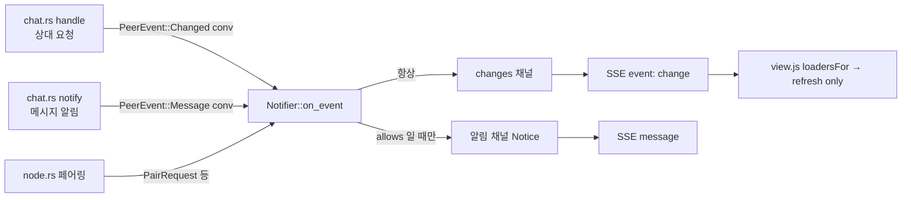

# plan — 1u.scoped-refresh

> 근거: [intent](intent.md)(승인 2026-10-19 — 결정 1 ~ 5). **구현자는 이 문서만 보고 일한다.** D·S 는 [masterPlan](../../masterPlan.md)(D39 ② 개정 2026-10-19).
> 기준 커밋: `3c95734`(main — 1t 종결). plan 승인: 2026-10-19(사용자 "권장방안 승인. 개발 진행" — 결정 2 구현자 해석 · 명세 편차 1 ~ 4 포함).

## 목표

웹UI 가 알림마다 전체를 다시 읽던 것을, 알림과 별개인 **변경 신호**(SSE `event: change`)가 실은 자원만 다시 읽게 바꾼다. 신호는 알림 설정 · 집중과 무관하게 항상 간다. 5초 새로 고침은 그대로.

### 성공 기준(intent 사본)

- A1: `conv` 변경은 연결(접속 표시 — D17 마지막 통신 시각) · 그룹 · 대화 목록 · 열린 대화 본문 · 내 활동 · 요청 · 저장 · 상대 메시지 · 실행 · 건수 로더를 **모두** 고르고, 설정은 고르지 않으며, 다른 대화만 바뀌면 열린 대화 본문은 고르지 않는다(node 시험).
- A2: 빈 `res` · 모르는 종류 · `peer` 는 전체 `refresh()`, 짧은 간격에 온 신호는 한 번으로 합쳐지고 하나라도 전체면 전체다(node 시험).
- A3: 상대 요청 처리 · 메시지 알림 · 페어링이 각각 맞는 자원 키(`conv` + 이 PC 대화 id / `peer`)의 변경 신호를 낸다(Rust 시험).
- A4: 알림이 꺼짐 · 일시 중지 · 집중이어도 변경 신호는 간다, 변경 신호는 트레이 건수를 올리지 않는다(Rust 시험).
- A5: 변경 신호 구독자가 뒤처지면 빈 `res`(전체 다시 읽기) 신호를 받는다, SSE 가 `event: change` 로 흘린다(Rust 시험).
- A6: 회귀 없음 — PROJECT.md 검증 명령 PASS, 5초 새로 고침은 그대로.
- A7: 5초 새로 고침을 끈 상태에서 변경 신호 한 번 뒤 대화 본문 · 목록 · 배지 · 내 활동 · 연결 상태가 일관된다(실화면 — masterPlan Phase 1 후보 줄 성공 기준).

## 설계

### an-net (`crates/net/src/node.rs` · `proto.rs`)

- `PeerEvent::Message` 에 `conv: i64`(이 PC 대화 id) 추가.
- `PeerEvent::Changed { conv: Option<i64> }` 추가 — 알림이 아닌 변경 신호 전용(이 PC 대화 id, 못 찾으면 `None`).
- `Request::conv(&self) -> Option<&str>` — `ids_ok` 와 같은 모양의 match 로 대화 uuid 를 돌려준다(대화 없는 요청은 `None`).

### an-agent (`crates/agent/src/chat.rs`)

- `fn notify` — `PeerEvent::Message` 에 `conv: conversation_id`.
- `fn handle` — `fan` 옆에서 `req.conv()` 를 미리 떠 두고, 처리 뒤 `chat::find(db, uuid, peer.id)` 로 이 PC id 를 찾아 `self.node.emit(PeerEvent::Changed { conv })`(결과가 오류여도 보낸다 — 다시 읽기는 해가 없다).

### an-app (`crates/app/src/notify.rs`)

- `pub struct Change { res: Vec<Res> }`, `pub struct Res { kind: &'static str, #[serde(skip_serializing_if = "Option::is_none")] id: Option<i64> }`. `Change::full()` = 빈 `res`.
- `Notifier` 에 두 번째 broadcast(`changes`, 크기 `BACKLOG`) + `pub fn subscribe_changes()`. 기존 `subscribe()` · `Notice` 는 그대로(공개 시그니처 유지).
- `on_event` — **맨 앞에서** `changes` 로 `change_of(e)` 를 보낸다(켜짐 · `allows` 앞 — 결정 1). `Changed` 면 거기서 끝(건수 · 알림 없음). `change_of`: `Message`/`Changed` → `conv`(+id), 페어링 3종 → `peer`.
- `Prefs::allows` · `notice_with` 의 `Changed` 갈래 — `false` / 쓰이지 않는 빈 `Notice`(`on_event` 가 먼저 돌려보낸다고 주석).
- `pub async fn next_change(rx) -> Option<Change>` — `Lagged` 면 `Change::full()`, `Closed` 면 `None`(시험 가능하게 분리, 결정 5).
- `events` — 알림 스트림(지금 그대로)과 변경 스트림(`Event::default().event("change").json_data(change)`)을 `futures_util::stream::select` 로 합친다.

### 웹UI (`crates/app/web/view.js` · `app.js`)

- `view.js`:
  - `export const CONV_LOADERS = ["peers", "groups", "convs", "current", "activity", "requests", "saved", "peer", "runs", "counts"]`.
  - `export function loadersFor(res, currentId)` — 빈 · 배열 아님 · `conv` 아닌 종류가 하나라도 있으면 `null`(전체). 아니면 `CONV_LOADERS` 집합, 단 `currentId` 가 없거나 `res` 에 그 id · id 없음이 없으면 `"current"` 를 뺀다.
  - `export function mergeChanges(q, res)` — `q` 가 `undefined` 면 `res`, 둘 중 하나가 빈 · 배열 아님이면 `[]`(전체), 아니면 이어 붙임.
- `app.js`:
  - `refresh(only)` — 각 로더를 `!only || only.has(이름)` 일 때만(이름 = `peers` · `groups` · `convs` · `current` · `activity` · `requests` · `saved` · `peer` · `runs` · `settings` · `counts`). 인자 없이 부르면 지금과 같다.
  - `listen()` — 알림 `onmessage` 에서 `refresh()` 를 지운다(상태 줄 · 브라우저 알림만). `es.addEventListener("change", …)` → 50ms 동안 `mergeChanges` 로 모아 `refresh(loadersFor(q, state.current?.id))` 한 번.
  - `setInterval(refresh, 5000)` → `setInterval(() => refresh(), 5000)`(인자 없이 = 전체, 주기 그대로).

### 시험

- Rust `crates/app/tests/notifier.rs`: `change_ignores_prefs`(끔 · 일시 중지 · 집중에서도 `subscribe_changes` 로 옴) · `change_keys_by_source`(`Message` → `conv`+id, 페어링 → `peer`, `Changed{None}` → id 없음) · `change_not_counted`(`Changed` 는 건수 · 알림 없음) · `change_lagged_is_full`(`BACKLOG` 넘게 보낸 뒤 `next_change` = 빈 `res`). 기존 `message()` 생성 함수에 `conv: 1`.
- Rust `crates/app/tests/events_api.rs`: `events_stream_change_event` — SSE 에 `event: change` · `"kind":"peer"` 가 흐른다.
- Rust `crates/agent/tests/message_tidy.rs`: `inbound_edit_signals_change` — 상대가 편집하면 받은 쪽에 `PeerEvent::Changed { conv: Some(그 대화 id) }`. 기존 `tidy_runs_and_notifies_nothing` 의 이벤트 수는 `Changed` 를 빼고 센다(뜻 = "알림 없음" 그대로).
- node `crates/app/web/view.test.mjs`: `loadersFor` 4 건 이상(대화 전부 · 연결 포함 · 설정 없음 · 다른 대화면 본문 제외 / 빈 · 모르는 종류 · `peer` → null) · `mergeChanges` 2 건 이상(이어 붙임 / 하나라도 전체면 전체).

### 문서

- [web-ui](../../manual/dev/web-ui.md) `## 알림` — 알림(상태 줄 · 브라우저 알림)과 변경 신호(다시 읽기)를 가른 한 단락 · 소비자 표 위치.
- [an_app](../../manual/dev/an_app.md) — `/api/events` 가 `event: change` 를 함께 흘린다는 줄(알림 · SSE 를 다루는 절).

## Stage

| stage | 목표 | 산출 | gate |
|---|---|---|---|
| 1 | 서버 변경 신호(net · agent · app) + 웹UI 소비자 표 · 합치기 · 부분 다시 읽기 · 시험 · 문서 | 위 파일 | E1 ~ E10(E10 은 19 인수로 이월 — D28) |

## 평가 항목

- [ ] E1: A6 — 워크스페이스 테스트 전부 통과
  CHECK: cargo test --workspace
  EXPECT: /test result: ok\. [1-9][0-9]* passed; 0 failed/
  EVIDENCE: pending
- [ ] E2: A6 — 경고 0
  CHECK: cargo clippy --workspace --all-targets -- -D warnings
  EXPECT: Finished
  EVIDENCE: pending
- [ ] E3: A6 — 화면 로직 node 테스트 · 실패 0 · 6건 이상 늘어남(기준 124)
  CHECK: node --test --test-reporter=tap "crates/app/web/*.test.mjs"
  EXPECT: /# pass (13[0-9]|1[4-9][0-9])\s+# fail 0/
  EVIDENCE: pending
- [ ] E4: A1·A2 — 소비자 표 · 합치기 node 시험 6건 이상
  CHECK: node --test --test-reporter=tap --test-name-pattern="loadersFor|mergeChanges" crates/app/web/view.test.mjs
  EXPECT: /# pass ([6-9]|[1-9][0-9])\s+# fail 0/
  EVIDENCE: pending
- [ ] E5: A3·A4·A5 — 알림기 변경 신호 시험 4건(설정 무관 · 원천별 키 · 건수 없음 · 뒤처짐)
  CHECK: cargo test -p coworkagent-app --test notifier change_
  EXPECT: test result: ok. 4 passed; 0 failed
  EVIDENCE: pending
- [ ] E6: A5 — SSE 가 `event: change` 를 흘린다
  CHECK: cargo test -p coworkagent-app --test events_api change
  EXPECT: test result: ok. 1 passed; 0 failed
  EVIDENCE: pending
- [ ] E7: A3 — 상대 편집(알림 없음)이 받은 쪽에 그 대화 id 의 변경 신호를 낸다
  CHECK: cargo test -p an-agent --test message_tidy signals_change
  EXPECT: test result: ok. 1 passed; 0 failed
  EVIDENCE: pending
- [ ] E8: A6 — 5초 새로 고침 1곳 그대로 · 변경 신호 구독 1곳 · 알림 처리기에서 `refresh()` 호출 0(대상 함수 존재 함께)
  CHECK: python -c "s=open('crates/app/web/app.js',encoding='utf-8').read();q=chr(34);b=s.split('function listen()')[1].split(chr(10)+'function ')[0] if 'function listen()' in s else '';m=b.split('es.onmessage')[1].split('};')[0] if 'es.onmessage' in b else 'refresh(';p=s.count('setInterval(() => refresh(), 5000)');c=b.count('addEventListener('+q+'change'+q);r=m.count('refresh(');print(f'listen={int(bool(b))} poll={p} change={c} notice_refresh={r}')"
  EXPECT: listen=1 poll=1 change=1 notice_refresh=0
  EVIDENCE: pending
- [ ] E9: A6 — 문서 규약 · 의존 경계
  CHECK: python tools/check_ddd_docs.py && python tools/check_crates.py
  EXPECT: crates=4 edges=6 violations=0
  EVIDENCE: pending
- [ ] E10: A7 — 실화면(두 PC): 5초 새로 고침을 끈 빌드에서 상대가 글 · 편집 · 삭제 · 요청 상태를 바꾼 뒤 변경 신호 한 번으로 대화 본문 · 대화 목록 · 배지 · 내 활동 · 연결 표시가 맞는다. 알림을 끈 · 집중 상태에서도 같다. 프로토타입 인수 Task(D28)로 이월.
  EVIDENCE: pending

## 개정 기록

- 없음
