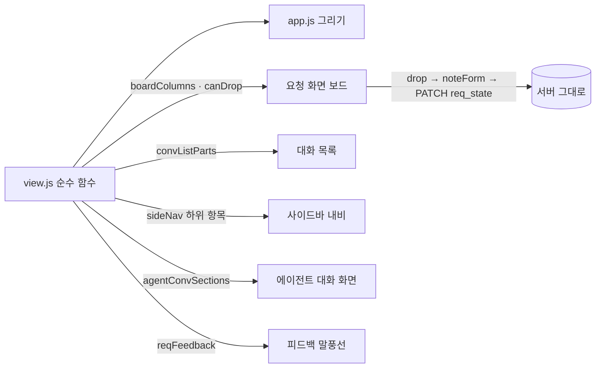

# plan — 1v.notion-design

> 근거: [intent](intent.md)(승인 2026-10-19 — 결정 1 ~ 18). **구현자는 이 문서만 보고 일한다.** D·S 는 [masterPlan](../../masterPlan.md)(D35 · D39 ① · S4 — 종결 때 환류).
> 기준 커밋: `e67b48c`(task/1v-notion-design — intent 라운드 2). plan 승인: 2026-10-19(사용자 "plan 승인. 해석 1~4 승인." — 해석 1 @멘션 기능 유지 · 2 보기 기억 `ui_folded` `reqboard:me` · 3 피드백 쓴 사람 "나" / 상대 이름 · 4 `conv_split_rows` · `share_groups` 그대로).

## 목표

웹UI 만 바꾼다(서버 · 저장 · 프레임 변경 없음): '요청' 화면 목록 / 보드 전환 + 끌어 놓기로 상태 바꾸기, 나 · 상대 타일 대화 목록 = 내 대화만,
사이드바 '에이전트' 아래 "등록된 에이전트" · "에이전트 대화", 요청 아래 피드백 말풍선, 대화 입력창 = 시안 A 모양(안내 문구 없음).

### 성공 기준(intent 사본)

- A1: 보드 열 = 대기 · 수용 · 반려 · 완료 순, 열마다 그 상태 카드 · 머리 건수 = 서버 집계(node 시험).
- A2: 받은 요청 카드는 `reqMoves` 허용 열에만 놓을 수 있고(대기 → 수용 · 반려, 수용 → 완료), 그 밖의 열 · 보낸 요청 카드 · 같은 열은 놓을 수 없다(node 시험).
- A3: 놓으면 메모 칸이 열리고 확인해야 지금의 `req:{상태}` 경로로 간다, 취소면 상태 그대로(실화면 — 19 인수로 미룰 수 있음).
- A4: 목록 / 보드 전환이 되고 목록 보기는 지금 목록과 같다(글자 단추 · 메모 · 다시 알리기 유지).
- A5: 나 · 상대 타일 대화 목록에 `dir = in` 대화가 없고 "내 대화" 머리가 없다, 공유 대화 머리는 남는다, 그룹 타일은 지금대로(node 시험 — `conv_split_rows` · `share_groups` 기대값이 바뀐다).
- A6: 사이드바 '에이전트' 아래 "등록된 에이전트" · "에이전트 대화" 두 항목(나 · 상대 타일), 그룹 타일엔 없음(node 시험 — `sideNav`).
- A7: 에이전트 대화 화면 = 범위의 `dir = in` 대화를 요청한 상대별 절로, 상대 타일이면 그 상대만(node 시험).
- A8: 피드백 말풍선 — 대기면 없고, 수용 · 반려 · 완료면 요청 바로 아래 하나(상태 · 메모 · 시각), 방향 = 받은 쪽 사람 쪽, 요청 말풍선 위에 "메모:" 없음 · 태그는 남음(node 시험).
- A9: 입력창 — 질의 / 요청 세그먼트(라디오 2개 그대로) · `#mention_hint` 없음 · placeholder "메시지 입력" · 최대 폭 860px(node 정적 시험 — index.html · app.css).
- A11: 웹UI 에 편집 모드가 없다 — `index.html` 에 편집 단추(`edit_btn` · `edit-toggle`) · `edit_bar` · `scope_dialog` 없음, `app.js` 에 `setEditMode` 없음(정적 검사).
- A10: 회귀 없음 — PROJECT.md 검증 명령 PASS.

## 설계

### view.js (순수 함수 — 전부 node 시험)

- `export const BOARD_COLS = ["wait", "accepted", "rejected", "done"]`.
- `export function boardColumns(rows, sum)` — `requestRows` 행 · `req_counts` 집계 → `[{ key, name: REQ_STATES[key], count: sum?.[key] ?? 0, rows: rows.filter(r => r.stateKey === key) }]`(열 순서 = `BOARD_COLS`).
- `export function canDrop(row, to)` — `row.moves.some(m => m.to === to)`(보낸 요청 · 끝난 요청은 `moves` 가 비어 늘 거짓, 같은 열은 `moves` 에 없어 거짓).
- `export function convListParts(rows, group)` — `splitByDir` 결과에서 그룹 타일이 아니면(`!group`) `dir = in` 묶음을 빼고, 각 묶음에 `head`(머리를 보일지) = `group ? parts.length > 1 : g.dir !== "out"` 를 붙인다(그룹 타일 = 지금 그대로).
- `export function agentConvSections(convs, paired, peerNames)` — `dir = in` 만 `convRows` → `peerGroups(…, paired, peerNames)` → `[{ key: "agentconvs:{peer}", peer, title, rows }]`. 상대 타일은 `paired = [그 상대]`.
- `sideNav(tile, unseen, waiting, starred, agentUnread = 0)` — '에이전트' 항목을 셋으로: `{ label: "에이전트", icon: "bot", head: true }`(링크 없음) · `{ label: "등록된 에이전트", href: "#agents", icon: "bot", sub: true }` ·
  `{ label: "에이전트 대화", href: "#agents/convs", icon: "chat", sub: true, count: agentUnread }`. 그룹 타일엔 셋 다 없다(지금처럼).
- `route("#agents/convs")` → `{ view: "agentConvs" }`.
- `export function reqFeedback(m)` — 요청(`author = human` · `request`)이고 상태가 대기가 아니면 `{ state: REQ_STATES[…], note: m.req_note ?? "", at: m.req_at ?? m.created_at, side: bubbleSide(m) === "mine" ? "theirs" : "mine", done }`, 아니면 `null`.

### app.js

- **요청 화면**:
  - 보기 = `state.folded.has("reqboard:me")`(보드) — 접힘 저장(`setFolded`)과 같은 길로 이 PC 에 남긴다(`ui_folded` 열쇠 규칙 `{화면}:me` 에 맞음, 서버 변경 없음 — `ponytail:` 주석: 보기 설정이 늘면 전용 설정 키).
  - 머리 `filters` 에 세그먼트 "목록 | 보드"(`.seg` 단추, `aria-pressed`). 보드를 고를 때 개요(`reqBox = null`)면 `reqBox = "theirs"`.
  - 보드면 `req_state` select · 그 label 숨김, 서버 요청에서 `req=` 빼기, `#req_list` 숨기고 `#req_board`(새 `div`) 에 `boardColumns` 를 그린다 — 열 = `section`(머리 = 상태 이름 · 건수), 카드 = 지금 요청 행 내용(이름 · 제목 · 본문 앞부분 · 시각 · 메모 · 글자 단추 · 알리지 못함 — `requestEls` 의 행 부분을 함수로 떼어 함께 쓴다).
  - 끌기: `moves` 가 있는 카드만 `draggable`. 열 `dragover` 에서 `canDrop` 이면 `preventDefault` + 강조 클래스, `drop` 이면 그 카드의 글자 단추 줄에 `noteForm(bar, id, to, label)` — 확인해야 `PATCH /api/messages/{id}`(지금 경로), 취소면 그대로.
- **대화 목록** `renderConvList` — `splitByDir(s.rows)` 대신 `convListParts(s.rows, group)`, 머리는 `g.head` 일 때만. 비면 지금 빈 안내.
- **사이드바** `renderSideNav` — `head` 항목 = 링크 없는 `span`(`nav-head`), `sub` 항목 = 들여쓴 링크(`nav-sub`). 지금 화면 강조는 `route(href).view` 비교 그대로. `agentUnread` = 범위(`scopedConvs()`) `dir = in` 안 읽음 합 — 서명(`unchanged`)에 넣는다.
- **에이전트 대화 화면** — `VIEW_EL.agentConvs = "agent_convs"`, `renderAgentConvs()` = `renderStarred` 모양(절 + `convItem(r, "agentconvs:{peer}")`), 빈 범위면 "에이전트 대화 없음". 대화 목록이 다시 그려질 때 이 화면이면 함께.
- **등록된 에이전트** — `agents_title` = 상대 타일이면 지금처럼 "{이름}의 에이전트", '나' 면 "등록된 에이전트".
- **말풍선** `messageEl` — 메타 줄의 `메모: …` 를 뺀다(태그는 그대로). `messageEls` 가 요청 뒤에 `reqFeedback(m)` 말풍선(`article.msg.feedback side-{side}`, 상태 태그 크게 · 메모 본문 · 시각, 쓴 사람 = `side` 가 `mine` 이면 "나" · 아니면 상대 이름)을 붙인다.
- **입력창** — `renderMentionHint` 에서 `mention_hint` 줄을 지우고 `ask_hint` 만(이름은 `renderAskHint`). 멘션 상자(`mention_box`)는 그대로.

### index.html · app.css

- `#requests` 에 `

`, 보기 세그먼트 자리.
- `#agent_convs` 화면 절(머리 아이콘 `ico-chat` · "에이전트 대화", 몸 `#agent_convs_list`).
- `#mention_hint` 줄 삭제. `ask-kind` 를 세그먼트 모양으로(라디오 입력은 그대로 — 눈에 안 보이게 두고 `label:has(input:checked)` 강조, 초점 고리는 `label:has(input:focus-visible)`).
- `.composer` — `max-width: 860px` · `box-shadow`(옅은 — 토큰 `--shadow` 보다 약한 값, 다크 · 라이트 같은 식) · 바 순서는 지금 DOM 순서 그대로(서식 `margin-right: auto` 가 빈칸 역할).
- `.req-board`(4열 grid, 좁으면 가로 스크롤) · 열 배경 = 지금 상태 색 토큰(`req-*`)의 옅은 층 · 놓기 가능 강조 · `.nav-head` · `.nav-sub` · `.msg.feedback`(일반 말풍선보다 큰 글자 · 상태 색 왼쪽 경계 없이 태그로).

### 편집 모드 삭제(intent 결정 18)

- index.html: `.edit-row`(편집 단추) · `#edit_bar` · `#scope_dialog` 삭제. app.css: 그 클래스(`.edit-row` · `.edit-toggle` · `.edit-bar` · `.msg-pick` · `.msg-edit`) 삭제.
- app.js: `state.editMode` · `picked` · `editing`, `setEditMode` · `renderEditBar` · `askScope` · `deletePicked` · `editBody` · 단추 처리기, `messageEl` 의 체크박스 · 연필, `openConversation` · `renderConvHead` 의 편집 모드 갈래 삭제.
- view.js: `keepPicked` 와 그 시험 삭제(쓰는 곳 없음).
- `crates/app/tests/ux_literals.rs`: 있음 표의 편집 단추 · "@ 로 상대 에이전트 부르기" · 옛 '에이전트' 내비 줄 → 없음 표로, `literal_counts` 의 "편집 단추는 입력창 위" 단언 삭제.

### 시험(node `crates/app/web/view.test.mjs`)

- 새: `req_board_columns`(열 순서 · 건수 · 카드 거르기) · `req_board_drop`(대기 → 수용 · 반려만, 수용 → 완료만, 완료 · 반려 · 보낸 요청 · 같은 열 거짓) · `conv_list_mine`(나 · 상대 = in 없음 · out 머리 없음 · shared 머리, 그룹 = 지금대로) ·
  `side_nav_agents`(하위 두 항목 · href · 안 읽음 수 · 그룹 없음 · `route("#agents/convs")`) · `agent_convs_sections`(요청자별 · 상대 타일 하나 · out · shared 제외) · `req_feedback`(대기 · 질의 · 답 null, 상태별 · 방향 반대 · 메모) ·
  `composer_a`(index.html: `name="ask"` 라디오 2 · `mention_hint` 없음 · `reply_text` placeholder "메시지 입력", app.css: `.composer` 에 `max-width: 860px`).
- 고침: `side_nav`(에이전트 → 머리 + 하위 둘, 상대 타일 `route` 목록에 `agentConvs`) · `menu_icons`(머리 · 하위 아이콘) · `conv_split_rows` · `share_groups`(기대값은 그대로 두고 `convListParts` 쪽을 새 시험으로 — `splitByDir` 는 그룹 타일이 계속 쓴다).

### 문서

- [web-ui](../../manual/dev/web-ui.md) — 요청 화면(목록 / 보드 · 끌어 놓기) · 대화 목록(나 · 상대 = 내 대화만) · 사이드바 에이전트 하위 메뉴 · 에이전트 대화 화면 · 피드백 말풍선 · 입력창.
- PRODUCT.md 웹UI 절 해당 줄.

## Stage

| stage | 목표 | 산출 | gate |
|---|---|---|---|
| 1 | view.js 순수 함수 + 시험 → app.js · index.html · app.css 그리기 · 편집 모드 삭제 → 문서 | 위 파일 | E1 ~ E13(E12 는 19 인수로 이월 — D28) |

## 평가 항목

- [ ] E1: A10 — 워크스페이스 테스트 전부 통과
  CHECK: cargo test --workspace
  EXPECT: /test result: ok\. [1-9][0-9]* passed; 0 failed/
  EVIDENCE: pending
- [ ] E2: A10 — 경고 0
  CHECK: cargo clippy --workspace --all-targets -- -D warnings
  EXPECT: Finished
  EVIDENCE: pending
- [ ] E3: A4·A10 — 화면 로직 node 테스트 · 실패 0 · 7건 이상 늘어남(기준 133)
  CHECK: node --test --test-reporter=tap "crates/app/web/*.test.mjs"
  EXPECT: /# pass (14[0-9]|1[5-9][0-9])\s+# fail 0/
  EVIDENCE: pending
- [ ] E4: A1·A2 — 보드 열 · 놓기 판정 시험
  CHECK: node --test --test-reporter=tap --test-name-pattern="req_board" crates/app/web/view.test.mjs
  EXPECT: /# pass [2-9]\s+# fail 0/
  EVIDENCE: pending
- [ ] E5: A5 — 대화 목록 내 대화만 시험
  CHECK: node --test --test-reporter=tap --test-name-pattern="conv_list_mine" crates/app/web/view.test.mjs
  EXPECT: /# pass [1-9]\s+# fail 0/
  EVIDENCE: pending
- [ ] E6: A6 — 사이드바 에이전트 하위 메뉴 시험
  CHECK: node --test --test-reporter=tap --test-name-pattern="side_nav" crates/app/web/view.test.mjs
  EXPECT: /# pass [4-9]\s+# fail 0/
  EVIDENCE: pending
- [ ] E7: A7 — 에이전트 대화 화면 절 시험
  CHECK: node --test --test-reporter=tap --test-name-pattern="agent_convs" crates/app/web/view.test.mjs
  EXPECT: /# pass [1-9]\s+# fail 0/
  EVIDENCE: pending
- [ ] E8: A8 — 피드백 말풍선 시험
  CHECK: node --test --test-reporter=tap --test-name-pattern="req_feedback" crates/app/web/view.test.mjs
  EXPECT: /# pass [1-9]\s+# fail 0/
  EVIDENCE: pending
- [ ] E9: A8 — 말풍선 메타 줄에 "메모:" 없음 · 피드백 말풍선 그리기 1곳
  CHECK: python -c "s=open('crates/app/web/app.js',encoding='utf-8').read();b=s.split('function messageEl(')[1].split(chr(10)+'function ')[0];print('meta_note=%d feedback=%d'%(b.count(chr(0xba54)+chr(0xbaa8)+':'),s.count('reqFeedback(')))"
  EXPECT: /meta_note=0 feedback=[1-9]/
  EVIDENCE: pending
- [ ] E10: A9 — 입력창 정적 시험
  CHECK: node --test --test-reporter=tap --test-name-pattern="composer_a" crates/app/web/view.test.mjs
  EXPECT: /# pass [1-9]\s+# fail 0/
  EVIDENCE: pending
- [ ] E11: A10 — 문서 규약 · 의존 경계
  CHECK: python tools/check_ddd_docs.py && python tools/check_crates.py
  EXPECT: crates=4 edges=6 violations=0
  EVIDENCE: pending
- [ ] E13: A11 — 편집 모드 흔적 없음
  CHECK: python -c "i=open('crates/app/web/index.html',encoding='utf-8').read();a=open('crates/app/web/app.js',encoding='utf-8').read();print('index=%d app=%d'%(sum(i.count(k) for k in ('edit-toggle','edit_bar','scope_dialog')),a.count('setEditMode')))"
  EXPECT: index=0 app=0
  EVIDENCE: pending
- [ ] E12: A3·A4 — 실화면: 보드에서 대기 카드를 수용 열로 끌면 메모 칸이 열리고 확인 뒤 요청자 PC 에 수용 · 메모가 보인다, 취소면 그대로, 허용 안 된 열엔 놓이지 않는다, 목록 보기는 지금과 같다. 프로토타입 인수 Task(D28)로 이월.
  EVIDENCE: pending

## 개정 기록

- 2026-10-19 · 사용자 "대화프롬프트위의 `편집`버튼 제거 병행" → 웹UI 편집 모드 삭제(intent 결정 18) — A11 · E13 · 설계 "편집 모드 삭제" 추가.
- 2026-10-19 · 구현 중 편차(구현자): ① 세그먼트는 `:has()` 대신 라디오 뒤 `span` 형제 선택자 — web-ui 매뉴얼의 대상 브라우저(macOS 12 Safari 15)에서 `:has()` 는 15.4 부터. ② 같은 `.ask-kind` 를 쓰는 새 대화 화면 질의 / 요청도 같은 세그먼트(마크업이 달라 안 바꾸면 라디오가 안 보임) — 입력칸(`#chat_text`)은 그대로.
