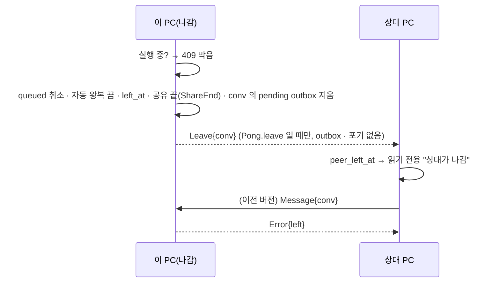

# plan — 1w.conv-leave

> 근거: [intent](intent.md)(승인 2026-10-19 — 결정 1 ~ 15). **구현자는 이 문서만 보고 일한다.** D·S 는 [masterPlan](../../masterPlan.md)(D40 신설 · D37 개정 — 종결 때 환류).
> 기준 커밋: `7c175e2`(task/1w-conv-leave — intent 라운드 4). plan 승인: 2026-10-19.

## 목표

모든 대화의 ⋯ 메뉴에 "나가기" · "삭제"(D40), 그룹 = 대화만(D37 개정) · 설정 '연결 목록' = 그룹 절(대화 줄) + "사용자 목록"(관리 줄 + 대화 트리, 끌어 놓기 = 복사).

### 성공 기준(intent 사본)

- A1: 모든 대화 ⋯ 메뉴에 "나가기" · "삭제"(나간 대화는 "삭제" 만), 확인 뒤 실행(node 시험).
- A2: 나가기 뒤 이력은 그대로, 대화는 "나감" · 읽기 전용, 그 대화로 온 요청은 거절 응답(Rust 시험).
- A3: 상대 PC 는 "나감" 프레임을 받아 그 대화를 읽기 전용으로 표시, 이전 버전 상대는 보낼 때 거절 응답을 받는다(Rust 시험).
- A4: 삭제 뒤 이 PC 에 그 대화 · 글 · 실행 · 에이전트 세션 기록 · 딸린 항목이 없고 상대 PC 사본은 남는다, 같은 대화로 온 글은 거절되어 되살아나지 않는다, 지운 번호를 새 대화가 다시 받지 않는다(Rust 시험).
- A5: 공유 대화(사본) 나가기 = 지금 `share_leave` 와 같다, 삭제 = 나가기 + 사본 삭제(Rust 시험).
- A7: 그룹 소속은 대화만 — 상대 소속 API · 화면 없음, 이전 뒤 옛 상대 소속의 대화가 그룹에 남고 `group_peers` 행은 없다, 그 뒤 생긴 그 상대 대화는 자동으로 들어오지 않는다(Rust 시험).
- A8: 설정 연결 목록 = 그룹 절(대화 줄 · 빼기) + "사용자 목록"(관리 줄 + 대화 트리), 대화 줄을 그룹 절에 놓으면 복사 · 원래 자리 유지 · 이미 있으면 그대로(node 시험).
- A9: 도는 실행이 있으면 나가기 · 삭제가 막히고(안내), 아니면 대기열 글은 취소 · 자동 왕복은 꺼진 뒤 나간다(Rust 시험).
- A6: 회귀 없음 — PROJECT.md 검증 명령 PASS.

## 설계

### 사실(조사 2026-10-19 — 설계가 기대는 것)

- 외래 키 없음(`PRAGMA foreign_keys` 꺼짐) — 대화 삭제는 딸린 표를 손으로 지운다. `conversations.id` · `messages.id` 는 AUTOINCREMENT 아님(지운 가장 큰 번호를 다시 씀).
- `inbound_message` · `inbound_ask` 는 `open_conversation` 으로 없는 대화를 **만든다** → 지운 대화가 되살아난다(묘비 필요). 그 밖의 받기 처리기는 `find_own` 실패 = `unknown`.
- 실행 중단 기능 없음, `record` 는 대화가 있는지 보지 않는다.
- `Pong{focus, ctx, share}` · `knows_share` 모양으로 새 깃발을 단다(`net/src/node.rs` · `proto.rs`).
- 그룹 범위 SQL `Scope::sql`(`agent` 쪽 `chat.rs`) = `group_convs ∪ group_peers` 상대의 대화, 웹UI `inGroup` 도 같은 합.

### an-core

- 스키마 21(`db.rs`, `SCHEMA_VERSION = 21`, 한 트랜잭션):
  1. `conversations` 를 `id INTEGER PRIMARY KEY AUTOINCREMENT` 로 다시 만든다(스키마 17 `peers` 와 같은 방법 — 정의 문자열 바꿔 새 표 → 복사 → 지움 → 이름 바꿈, `sqlite_sequence` = 지금 최대 · 딸린 표의 `conversation_id` · `conv_id` 최대).
  2. 열 추가: `conversations.left_at INTEGER`(내가 나간 시각) · `conversations.peer_left_at INTEGER`(상대가 나간 시각).
  3. 묘비 표 `left_convs(uuid TEXT NOT NULL, peer_id INTEGER NOT NULL, at INTEGER NOT NULL, PRIMARY KEY(uuid, peer_id))` — 지운 대화.
  4. `group_peers` → `group_convs`: `INSERT OR IGNORE INTO group_convs SELECT gp.group_id, c.id FROM group_peers gp JOIN conversations c ON c.peer_id = gp.peer_id`, 그 뒤 `DROP TABLE group_peers`.
- `chat.rs`: `Conversation` 에 `left_at` · `peer_left_at`. `pub fn left(conn, uuid, peer_id) -> bool`(나간 대화 · 묘비). `pub fn leave(tx, conv)`(queued → `error` + `refused = "left"`, `relay_on = 0`, `left_at`), `pub fn set_peer_left(tx, conv)`,
  `pub fn delete_conversation(tx, conv)` — 글마다 `delete_message` 와 같은 정리(cli_tx · relay_events · 읽음 · `activity_seen_*` 낮추기) 를 한 번에 + `agent_sessions` · `ctx_seeds` · `group_convs` · `shares` · `outbox`(그 `conv_id` 의 pending · failed) · `relay_events`(대화) · 대화 행, 묘비 넣기.
  `pub fn running(conn, conv) -> bool`(`state = 'running'`).
- `groups.rs`: `group_peers` 를 쓰는 `list` · `remove` · `change_peers` · `change_peer_groups` · `unknown_peers` 정리(상대 소속 삭제), `list` 의 `peers` 없음.
- `chat.rs` 그룹 범위 SQL `Scope::sql`(core `chat.rs` — `scope_of` 가 쓴다)에서 `group_peers` 갈래 삭제.
- `delete_conversation` 의 outbox 정리 — 끝 프레임(kind `leave`, `share` 중 frame `type = share_end`)은 지우지 않고 `conv_id = NULL` 로 떼어 남긴다(나가기 · 공유 끝이 방금 넣은 행 —
  지우면 상대 · 관람자가 끝 알림을 못 받는다). 구현자 확인: `deliver` · `acked` · `settle` 의 ShareEnd 갈래가 `conv_id` 를 읽으면 그 갈래를 uuid(frame) 기준으로.

### an-net

- `Request::Leave { conv: String }`(`conv()` · `ids_ok` 에 추가), `Response::Pong` 에 `#[serde(default)] leave: bool` · `node.rs` 가 `leave: true` 로 답하고 `knows_leave(peer)`.
- 오류 코드 `left`(proto 주석 목록에 추가).

### an-agent `chat.rs`

- `handle` 맨 앞: `req.conv()` 가 나간 대화 · 묘비(`chat::left`)이고 요청이 `Leave` · `ShareEnd` 가 아니면 `Response::error("left")`(공유 사본은 지금 `live_copy` 규칙 그대로).
- `pub fn leave_conversation(id)` — 공유 사본이면 `share_leave`. 아니면 `running` 이면 `Err(Busy "실행이 끝난 뒤 나갈 수 있습니다")`, 한 트랜잭션: `chat::leave` · 관람자 있으면 `unshare(.., end = true)` 전부 · 그 대화 pending outbox 지움 ·
  `Leave` 를 `enqueue`(kind `leave`, `conv_id = NULL` — 삭제가 지우지 않게, frame 에 uuid). `kick`.
- `pub fn delete_conversation(id)` — 공유 사본이면 `share_leave`(아직이면) 뒤 지움. 아니면 나가기(아직이면 — 같은 막음) 뒤 `chat::delete_conversation`. 이미 상대가 나간 대화도 된다.
- `deliver`: kind `leave` — `knows_leave` 거짓이면 행을 버린다(이전 버전 — 그쪽은 보낼 때 `left` 를 받는다), 포기(`give_up`) 대상에서 뺀다(`ShareEnd` 와 같게).
- `inbound_leave` — `find_own` 대화에 `set_peer_left`(자동 왕복 끔 · queued 취소), `PeerEvent::Changed`. 없으면 `Ok`.
- `refused_by_peer` / `refused()` — 코드 `left` 면 "상대가 대화를 나갔습니다".
- `record` — 대화가 없으면(삭제) 답을 버리고 로그, 나간 대화(`left_at` **또는** `peer_left_at`)면 이력에만(outbox 없음).
- `inbound_leave` 는 그 대화의 내 보낸 글 중 답을 기다리는 것(`queued` · `sent` 등 끝나지 않은 사람 글)을 `error` + `refused = "left"` 로 닫는다(구현자 해석).

### an-app

- `POST /api/conversations/{id}/leave` — 지금 공유 사본만 → 모든 대화(`leave_conversation`). `DELETE /api/conversations/{id}` 새로(`delete_conversation`). 실행 중 = 409 + 메시지.
- 목록 JSON(`summary_json`)과 메시지 JSON 의 `conversation` 요약(요청 화면 · 내 활동이 쓰는 것)에 `left_at` · `peer_left_at`.
- `groups_api.rs`: `PUT /api/groups/{id}/peers` · `PUT /api/peers/{id}/groups` 삭제, `group_json` 의 `peers` 삭제.

### 웹UI

- `view.js`:
  - `export function convMenuItems(conv)` — `[{key:"leave", label:"나가기", icon:"exit"}, {key:"delete", label:"삭제", icon:"trash", danger:true}]`, 나간 대화(`left_at`) · 해제된 공유 사본이면 "삭제" 만.
  - `export function convClosed(conv)` — `left_at` · `peer_left_at` · 해제된 공유 사본이면 그 문구("나감" · "상대가 나감" · "공유 해제됨"), 아니면 `""` — 읽기 전용 · 대화 줄 태그 · 대화 머리.
  - `refusedText` — `left` → "상대가 대화를 나갔습니다".
  - `reqMoves(m, closed = false)` · `reqResend` — 닫힌 대화(`convClosed`)면 빈 목록 · 거짓(읽기 전용 — 말풍선 · 요청 목록 · 보드 끌기 모두). 호출자는 `convClosed(m.conversation ?? state.current)` 를 준다.
  - 그룹: `inGroup` = `g.convs` 만, `peerSections` · `peerMove` · `peerGroupItems` · `NO_PEER_GROUP` 삭제. 새 `export const USER_LIST = "사용자 목록"`,
    `export function settingsGroupSections(groups, convs, peerNames)` = 그룹 순서대로 `{group, title, rows: 그 그룹 대화 줄}` + `{group: null, title: USER_LIST}`,
    `export function convCopy(convId, to, groups)` = `to` 그룹에 없으면 `{add:[convId]}`, 있으면 `null`(복사 — 원래 자리 그대로).
- `app.js`:
  - `openConvMenu` 끝에 구분선 + 나가기 · 삭제(확인 대화 — 공유 사본 나가기 문구 재사용 꼴: 나가기 "더 받지 않습니다. 이력은 읽기 전용으로 남습니다.", 삭제 "이 PC 에서 대화 · 글을 지웁니다. 상대 PC 기록은 남습니다." danger). 지운 뒤 열려 있던 대화면 '개요'로.
  - `showConversation` — 읽기 전용 = 공유 사본 **또는** `convClosed(conv)` (입력창 · 컨텍스트 단추 숨김), 머리 부제에 그 문구. 대화 줄 `convMeta` 태그에도.
  - 레일 상대 타일 메뉴 `peerGroupMenu` · `changePeerGroup` 삭제, 레일에서 상대 타일을 그룹 타일에 놓는 경로가 있으면 삭제.
  - `renderPeerList` 다시: `settingsGroupSections` — 그룹 절 = 대화 줄(상대 타일 · 제목 · "그룹에서 빼기", 끌기 가능) · 이름 바꾸기 · 삭제 도구 그대로, 끝 절 "사용자 목록" = 지금 관리 줄(`manageItem` — "그룹 ▾" 빼고) +
    그 아래 접이식 "대화 n"(`foldEl("settingsconvs:{peer}", …, shut = true)`) 대화 줄(끌기 가능). 끌기 = 대화 줄 → 그룹 절 놓기 → `convCopy` → `PUT /api/groups/{id}/conversations`. 상대 줄 끌기 처리기 삭제.
- `index.html` · `app.css` — 필요한 아이콘(`ico-exit` 없으면 추가) · 설정 대화 줄 · 트리 들여쓰기.

### 시험

- Rust `crates/agent/tests/conv_leave.rs`(두 PC, `common::Side` — 이름 머리 `leave_` · `delete_` 는 gate 거르기, 이전 버전 상대 = `share.rs` `old_peer` 와 같은 꼴): `leave_marks_both_read_only`(A 나가기 → A `left_at` · B `peer_left_at`) ·
  `leave_refuses_inbound`(B 글 → `left`, B 메시지 `refused = left`) · `leave_old_peer_gets_refusal`(B 의 `Pong.leave` 거짓 흉내 — Leave 없음, B 가 보내면 `left`) ·
  `leave_blocked_while_running`(running 이면 Busy, 아니면 queued 취소 · 자동 왕복 꺼짐) · `leave_ends_shares`(관람자 사본 "공유 해제됨") · `leave_shared_copy`(사본 나가기 = ShareEnd) ·
  `delete_cleans_local_keeps_peer`(딸린 표 0 행 · B 그대로 · 묘비) · `delete_not_revived`(같은 uuid Message → `left`, 대화 생기지 않음) · `delete_id_not_reused`(가장 큰 번호 지운 뒤 새 대화 번호 더 큼) ·
  `delete_shared_copy`(사본 없음).
- Rust `crates/core/tests/` 스키마 21 이전 시험 `schema21_group_peers_to_convs`(옛 상대 소속 → 그 상대 대화 행 · `group_peers` 없음 · 이전 뒤 새 대화는 안 들어감) · `schema21_conversations_autoincrement`.
- Rust `crates/app/tests/groups_api.rs` — 상대 소속 시험(`peer_membership` · `group_scope_includes_peer_conversations` · `delete_group_clears_peers` · `peer_groups_move_atomic`) 삭제 → `peer_routes_gone`(두 경로 404 · 405) ·
  `group_json_has_no_peers`. `chat_api.rs` — `leave_and_delete_routes`(나가기 · 삭제 · 실행 중 409).
- node `view.test.mjs`: 새 6 — `conv_menu_items` · `conv_closed` · `refused_left` · `req_moves_closed` · `settings_group_sections` · `conv_copy`. 상대 소속 시험 8(`peer_sections` · `peer_move` · `peer_move_round_trip` ·
  `group_summary_peer_member` · `in_group_peers` · `peer_group_items` · `peer_group_text` · `in_group · group_peers`) 중 대화 단위로 뜻이 남는 것(`in_group*` · `group_summary*`)은 고쳐 쓰고 나머지는 지운다 →
  합계 141 − 지움 + 6 ≥ 141(바닥 = 지금 141 — 지운 수가 6 을 넘으면 E3 을 개정 기록과 함께 고친다).
- `ux_literals.rs` — 상대 그룹 문구(있음 표) → 없음 표, 새 문구(나가기 · 삭제 · "사용자 목록" · "상대가 대화를 나갔습니다").

### 문서

- [web-ui](../../manual/dev/web-ui.md) 대화 메뉴 · 읽기 전용 · 설정 연결 목록, [an_app](../../manual/dev/an_app.md) 경로 · 프레임(`Leave` · `Pong.leave` · 코드 `left`), PRODUCT 그룹 · 대화 나가기 줄.

## Stage

| stage | 목표 | 산출 | gate |
|---|---|---|---|
| 1 | 저장 · 서버 한 덩이 — 스키마 21(`group_peers` 이전 · DROP 포함) · 프레임 · 나가기 · 삭제 · 그룹 서버 정리(`groups.rs` · `Scope::sql` · `groups_api`) + Rust 시험 | 위 an-core · an-net · an-agent · an-app | E1 · E2 · E4 · E5 · E6 · E7 |
| 2 | 웹UI — 그룹 = 대화만 · 설정 연결 목록 · 대화 메뉴 · 읽기 전용 · 문서 | 위 웹UI · 문서 | E3 · E8 ~ E12(E12 는 19 인수로 이월 — D28) |

## 평가 항목

- [ ] E1: A6 — 워크스페이스 테스트 전부 통과
  CHECK: cargo test --workspace
  EXPECT: /test result: ok\. [1-9][0-9]* passed; 0 failed/
  EVIDENCE: pending
- [ ] E2: A6 — 경고 0
  CHECK: cargo clippy --workspace --all-targets -- -D warnings
  EXPECT: Finished
  EVIDENCE: pending
- [ ] E3: A6 — 화면 로직 node 테스트 · 실패 0 · 141 이상
  CHECK: node --test --test-reporter=tap "crates/app/web/*.test.mjs"
  EXPECT: /# pass (14[1-9]|1[5-9][0-9])\s+# fail 0/
  EVIDENCE: pending
- [ ] E4: A2·A3·A9 — 나가기 · 거절 · 이전 버전 · 실행 중 막음(두 PC)
  CHECK: cargo test -p an-agent --test conv_leave leave
  EXPECT: /test result: ok\. [3-9] passed; 0 failed/
  EVIDENCE: pending
- [ ] E5: A4·A5 — 삭제 정리 · 되살아나지 않음 · 번호 재사용 없음 · 공유 사본
  CHECK: cargo test -p an-agent --test conv_leave delete
  EXPECT: /test result: ok\. [3-9] passed; 0 failed/
  EVIDENCE: pending
- [ ] E6: A4·A7 — 스키마 21 이전(상대 소속 → 대화 · AUTOINCREMENT)
  CHECK: cargo test -p an-core schema21
  EXPECT: /test result: ok\. [2-9] passed; 0 failed/
  EVIDENCE: pending
- [ ] E7: A7 — 상대 소속 API 없음 · 그룹 JSON 에 peers 없음 · 나가기 · 삭제 경로
  CHECK: cargo test -p coworkagent-app -- peer_routes_gone group_json_has_no_peers leave_and_delete_routes
  EXPECT: /test result: ok\. [1-9] passed; 0 failed/
  EVIDENCE: pending
- [ ] E8: A1 — 대화 메뉴 · 닫힌 대화 문구 · 거절 문구 node 시험
  CHECK: node --test --test-reporter=tap --test-name-pattern="conv_menu_items|conv_closed|refused_left" crates/app/web/view.test.mjs
  EXPECT: /# pass [3-9]\s+# fail 0/
  EVIDENCE: pending
- [ ] E9: A8 — 설정 그룹 절 · 사용자 목록 · 복사 node 시험
  CHECK: node --test --test-reporter=tap --test-name-pattern="settings_group_sections|conv_copy" crates/app/web/view.test.mjs
  EXPECT: /# pass [2-9]\s+# fail 0/
  EVIDENCE: pending
- [ ] E10: A7 — 상대 소속 흔적 없음(서버 · 웹UI 원문)
  CHECK: python -c "import pathlib;fs=['crates/core/src/groups.rs','crates/core/src/db.rs','crates/agent/src/chat.rs','crates/core/src/chat.rs','crates/app/src/groups_api.rs','crates/app/web/app.js','crates/app/web/view.js'];t={f:pathlib.Path(f).read_text(encoding='utf-8') for f in fs};print('group_peers_live=%d peer_api=%d web=%d'%(sum(v.count('group_peers') for k,v in t.items() if k!='crates/core/src/db.rs'),t['crates/app/src/groups_api.rs'].count('/peers'),t['crates/app/web/app.js'].count('peerGroupMenu')+t['crates/app/web/view.js'].count('NO_PEER_GROUP')))"
  EXPECT: group_peers_live=0 peer_api=0 web=0
  EVIDENCE: pending
- [ ] E11: A6 — 문서 규약 · 의존 경계
  CHECK: python tools/check_ddd_docs.py && python tools/check_crates.py
  EXPECT: crates=4 edges=6 violations=0
  EVIDENCE: pending
- [ ] E12: A1·A2·A3·A8 — 실화면(두 PC): ⋯ 나가기 → 양쪽 읽기 전용("나감" · "상대가 나감"), 삭제 → 목록에서 사라짐 · 상대 그대로, 설정 사용자 목록 대화 트리를 그룹 절로 끌어 복사. 프로토타입 인수 Task(D28)로 이월.
  EVIDENCE: pending

## 개정 기록

- 없음
