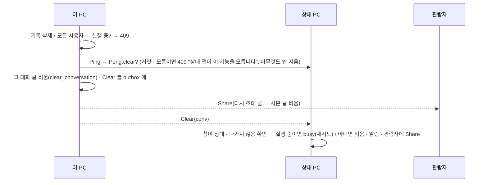

# plan — 1x.session-ui

> 근거: [intent](intent.md)(승인 2026-10-20 — 결정 1 ~ 25, 9 · 10 · 14 는 23 ~ 25 로 대체). **구현자는 이 문서만 보고 일한다.** D·S 는 [masterPlan](../../masterPlan.md)
> (D40 개정 · D26 · S4 기본 테마 개정 · D35 사이드바 · D27 효과음 주석 — 종결 때 환류). 브랜치 `task/1x-session-ui`. 기준 커밋: `fea9fb1`(task/1x-session-ui — plan). plan 승인: 2026-10-20.

## 목표

세션 생성 화면(글 없이 대화방만) · 기록 삭제 ›(내 글만 · 모든 사용자) · 나가기 = 목록에서 삭제 · 사이드바 손잡이 끌기 · 사이드바 머리 정리 · 타일 크기 · 기본 라이트 ·
받은 요청 알림 B안(OS 알림 보강 · 효과음) · 클립보드 이미지 검토.

### 성공 기준(intent 사본)

- A1: 세션 생성 화면 = 제목 "세션 생성" · 메시지 · 메시지 종류 칸 없음 · 단추 "생성", 상대 칸 = 레일에서 고른 상대(node 시험).
- A2: 생성하면 글 없는 대화가 이 PC 에 생기고 그 대화방으로 간다, 첫 글은 대화방 입력창에서 보내지고 상대 PC 는 그때 대화를 받는다, 내 응답 에이전트를 고른 대화는 첫 글부터 자동 왕복(Rust 시험).
- A3: 사용자에게 보이는 "새 대화" 라벨 0건, "세션 생성" 으로(시험 · 검사).
- A4: 입력창에 "실행하지 않고 상대의 요청 목록에 올립니다" 없음(시험).
- A5: "기록 삭제 › 내 글만 삭제" 뒤 대화방 · 그룹 · 즐겨찾기는 그대로, 이 PC 의 그 대화 글 · 실행 · 세션 기록 · 딸린 항목 0건, 다시 글을 보낼 수 있다, 상대 PC 사본은 그대로(Rust 시험).
- A6: "기록 삭제 › 모든 사용자 글 삭제" 뒤 양쪽 대화방은 남고 양쪽 · 관람자 사본의 그 대화 글 0건, 받는 쪽은 그 대화의 참여 상대가 보낸 것만 받는다(다른 대화 · 다른 상대 · 나간 대화는 거절),
  모르는 상대(이전 버전)에게는 그 항목이 비활성(Rust · node 시험).
- A7: 사이드바 대화 줄에 ☆ 없음, 손잡이 끌기로 옮기기 · 그룹 넣기, 끄는 동안 HTML5 끌기 없음(node 시험 + CDP 확인).
- A8: '나' 머리 부제에 지문 없음, 상대 머리 부제에 "페어링 됨" · 접속 문구 없음, 접속 점은 그대로(node 시험).
- A9: 설정 "타일 크기" 보통 · 작게 — 저장 · 읽기 · 틀린 값 400, 작게 = 아이콘 + 한 줄 이름 가로 줄(Rust · node 시험).
- A10: 저장된 테마가 없으면 라이트(Rust 시험).
- A11: 클립보드 이미지 검토 결과가 masterPlan 후보 줄에 있다(문서 검사).
- A13: ⋯ 메뉴 = 내 대화 · 에이전트 대화 "기록 삭제 ›(내 글만 · 모든 사용자)" · "나가기", 나간 대화 "기록 삭제 ›(내 글만)" · "나가기", 관람자 "나가기" 만,
  "삭제" · "이력유지" · "이력삭제" · 하위 나가기 메뉴 없음. 나가기 = 확인 "대화방이 목록에서 삭제됩니다." 뒤 나가며 이 PC 목록 · 글 삭제(지금 삭제와 같다), 관람자는 공유 끝 + 사본 삭제(node · Rust 시험).
- A14: 받은 요청 알림 = 제목 "받은 요청 {n}" · 본문 최근 요청 줄(최대 3 + "외 n건") · 같은 tag · 누르면 `#requests` 보드, 효과음 설정 켜짐 · 집중 아님일 때 한 번 소리(node 시험 + 수동 확인).
- A12: 회귀 없음 — PROJECT.md 검증 명령 PASS.

## 설계

### 사실(조사 2026-10-20 — 설계가 기대는 것)

- 대화 생성 = `Chat::send_with(peer, agent, None, text, opts)`(`open_conversation` + 제목 · 그룹 한 트랜잭션 → `send_human`) · 자동 왕복 = `start_relay_with`(`set_relay` 뒤 `send_human(.., Some(my_agent))`).
  둘 다 본문 1 바이트 이상을 요구한다. 이어 쓰기 `send_with(Some(id))` 는 **사람이 쓰면 자동 왕복을 끈다**(`relay_on(.., false)`).
- 상대 PC 는 첫 글(`Message` · `Ask`)이 올 때 `open_conversation` 으로 대화를 만든다(`inbound_message` · `inbound_ask`) — 이 PC 에만 있는 빈 대화는 상대에게 알릴 것이 없다.
- `chat::delete_conversation`(core) = 묘비 + 딸린 표(cli_tx · relay_events · outbox · agent_sessions · ctx_seeds · group_convs · shares · messages) + 대화 행 + `lower_marks`.
  `Chat::delete_conversation`(agent) = `leave_conversation`(실행 중 막음 · 공유 사본은 `share_leave`) 뒤 core 삭제 — 웹UI "삭제" 가 쓰는 `DELETE /api/conversations/{id}`.
- `Request::Share` 는 "같은 uuid 사본이 있으면 글을 비우고" 다시 받는다(관람자 사본 비우기에 그대로 쓴다). `Pong{focus, ctx, share, leave}` · `Node::knows_*` = 그때 `Ping`(캐시 없음).
- outbox 배달(`deliver`)은 실패를 `backoff` 로 다시 보낸다 — 받는 쪽 `busy` 는 재시도된다(구현자 확인: `busy` 가 포기 대상이 아닌지).
- 받은 요청 알림 = `notify.rs` `MessageKind::Ask` → ("message", "요청 받음 — {agent}"), 본문 = `{name} · {host}` (+ 미리보기 설정이면 `\n{preview}`). 웹UI `listen` 이 `new Notification(title, {body, tag: "coworkagent-" + kind})`.
- 화면 설정 키 = `run_opts::THEME_KEY`(없으면 `dark`) · `RAIL_ORDER_KEY` — `notify.rs` 검증 · 저장 · `settings_json`, 웹UI `applyTheme` · `applyRailOrder`. `index.html` `<html data-theme="dark">`.
- node 시험 지금 142(`# pass 142`).

### an-core

- `chat.rs` `pub fn clear_conversation(conn, id) -> rusqlite::Result<bool>` — `delete_conversation` 의 딸린 표 정리 중 **글에 딸린 것만**(cli_tx · relay_events · 그 대화 글의 outbox · agent_sessions · ctx_seeds · messages)
  + `conversations.session = NULL` + `lower_marks`. 대화 행 · 그룹 · 즐겨찾기 · 공유(`shares`) · 제목 · 자동 왕복 설정은 남긴다. 묘비 없음. 없는 대화면 거짓.
  북마크 · 내 활동 · 요청 항목은 글 행이 지워지면 함께 사라진다(구현자 확인 — 따로 표가 있으면 같이 지운다).
- `chat.rs` `pub fn waiting_requests(conn, limit) -> Vec<(peer_id, preview)>` + 대기 수 — 받은 요청(`dir = in` 사람 글 · `request` · `req_state` 대기) 최근순. 알림 본문용.
- `run_opts.rs`: `theme` 기본 `"light"`. 새 `TILE_SIZE_KEY = "ui_tile_size"` · `TILE_SIZES = ["normal", "small"]` · `pub fn tile_size(conn)`(없거나 틀리면 `normal`).

### an-net

- `Request::Clear { conv: String }`(`conv()` · `ids_ok` 에 추가 — 문서 주석: 모르는 상대는 끊으므로 `Pong.clear` 를 본다), `Response::Pong` 에 `#[serde(default)] clear: bool`, `node.rs` 가 `clear: true` 로 답 · `knows_clear(peer)`.

### an-agent `chat.rs`

- `pub fn open_session(&self, peer_id, agent, relay: Option<(&str, i64)>, opts: Compose) -> io::Result<Conversation>` — 페어링 확인 · 내 에이전트 확인(relay) · 상한 1 ~ 50 · 한 트랜잭션
  `open_conversation(Dir::Out)` + `set_relay`(있으면) + `set_title` + 그룹 넣기. 보내지 않는다.
- `send_with(Some(id))` · `post_with`: 보낸 대화가 **글 0개 + 자동 왕복 설정 있음**이면 첫 글은 `send_human(.., Some(my_agent))`(자동 왕복 시작 — `start_relay_with` 와 같은 길, 요청이면 `REQUEST_NO_RELAY`).
  그 밖은 지금 그대로(사람이 쓰면 자동 왕복 끔).
- `pub fn clear_conversation(&self, id, all: bool) -> io::Result<()>` — 공유 사본이면 `READ_ONLY`. 실행 중이면 Busy(`LEAVE_BUSY` 와 같은 문구 축 "실행이 끝난 뒤 지울 수 있습니다").
  `all`: 대화가 닫혔으면(나감 · 상대가 나감) InvalidInput, `knows_clear(conv.peer_id)` 가 거짓이면 Unsupported "상대 앱이 이 기능을 모릅니다"(아무것도 안 지움), 연결 실패(꺼짐)면 진행(배달은 outbox 가 나중에).
  한 트랜잭션: `chat::clear_conversation` · `all` 이면 `Clear{conv}` 를 outbox(kind `clear`, `conv_id = NULL` — 다음 비우기가 지우지 않게) · 관람자마다 `Share`(다시 초대 꼴) 를 `stage_share`. `kick`.
- `deliver`: kind `clear` — `knows_clear` 거짓이면 행을 버리고 내 활동 기록 "상대 쪽 기록은 지우지 못했습니다"(상대가 그 사이 이전 버전으로 바뀐 경우), 포기 대상 아님.
- `inbound_clear(peer, conv)` — `find_own(conv, peer.id)` 없으면 `unknown`, 닫힌 대화(내가 나감 · 상대가 나감)면 `left`, 실행 중이면 `busy`(보낸 쪽 재시도), 아니면 `chat::clear_conversation` · 관람자마다 `Share` ·
  `PeerEvent` 알림 "{상대} 가 대화 기록을 모두 지웠습니다"(새 `MessageKind::Clear` — 알림 설정 `notify_request` 축) · 변경 신호.
- 나가기: 웹UI 는 `DELETE /api/conversations/{id}` 만 쓴다(지금 삭제 = 나가기 + 삭제). `POST .../leave`(읽기 전용으로 남기는 나가기)는 CLI · API 호환으로 남긴다(웹UI 에서 부르지 않음).

### an-app

- `POST /api/conversations` — `text` 를 `#[serde(default)]` 로, 비었고 `via` 없음 → `open_session`(201 · 대화 JSON · 메시지 없음). `request` 와 함께 비면 400. CLI(`via: cli`)는 지금처럼 본문 필수.
- `POST /api/conversations/{id}/clear` `{all: bool}` — 204, 공유 사본 · 닫힌 대화 + all 400, 실행 중 409, 상대 앱 모름 409(메시지), 없는 대화 404.
- `notify.rs`: `MessageKind::Ask` → kind `"request"`, 제목 `"받은 요청 {대기 수}"`, 본문 = 최근 대기 요청 최대 3줄(미리보기 켜짐: `{표시 이름} · {미리보기 한 줄}`, 꺼짐: `{표시 이름}`) + 넘으면 `"외 {n}건"`.
  `MessageKind::Clear` → ("message", "기록 삭제 — {name}"). 설정 `ui_tile_size` 검증("ui_tile_size 는 normal · small") · 저장 · `settings_json`, 새 알림 설정 `notify_sound`(bool, 없으면 참) 저장 · 읽기.

### 웹UI

- `index.html`:
  - `<html lang="ko" data-theme="light">`.
  - `#new`: `<h1>세션 생성</h1>`, `chat_text` · `chat_ask_label` · 종류 라디오 삭제, 제목 placeholder "비우면 첫 메시지 앞부분" 그대로, 제출 단추 "생성".
  - `reply_form`: `#ask_hint` 삭제.
  - 설정 '화면': "타일 크기" `<select id="ui_tile_size">` 보통(`normal`) · 작게(`small`). 설정 '알림': "효과음" `<input type="checkbox" id="notify_sound">`(받은 요청 줄 아래).
- `view.js`:
  - `convMenuItems(conv, canClearAll = true)` — 공유 사본 → `[{key:"leave", label:"나가기", icon:"exit", danger:true}]`. 닫힌 대화(`convClosed` 비지 않음) →
    `[{key:"clear", label:"기록 삭제", icon:"trash", sub:[{key:"clear_mine", label:"내 글만 삭제"}]}, leave]`. 그 밖 → `clear` 의 `sub` 에 `{key:"clear_all", label:"모든 사용자 글 삭제"}` 더함.
    `leave.confirm = "대화방이 목록에서 삭제됩니다."`. "삭제" · "이력유지" · "이력삭제" 없음.
  - `export const SESSION_NEW = "세션 생성"` — 상단 + 메뉴(`newMenu` 의 "새 대화") · 사이드바 · 에이전트 줄 단추 · 도움말이 쓴다.
  - `export function sideSub(kind, info)` — `me`: `[이름, 별칭이면 호스트]`(지문 없음), `peer`: `[별칭이면 "{이름} · {호스트}" 아니면 호스트]`(peerState · 접속 문구 없음), `group`: 지금 그대로.
  - `export function composeDefaults(railPeer, peers)` — 레일에서 고른 상대가 페어링됐으면 그 id, 아니면 `""`.
  - `export function requestNotice(n)` — 서버 알림에서 `{title, body, tag: "coworkagent-request", href: "#requests"}`(kind `request` 일 때), 그 밖은 지금 그대로.
- `app.js`:
  - `chat_form` 제출 = `{peer_id, agent, title, relay_agent?, relay_cap?, group?}` · `act("생성", …)` → `#c/{id}` 로, 그 대화 입력창에 초점. `fillPeerSelects` 가 비어 있으면 `composeDefaults` 로 채운다(그룹 · 나면 그대로 "상대 선택").
  - `openConvMenu` — `convMenuItems` 의 `sub` 를 하위 메뉴(▸, 오른쪽에 펼침 · ←/→ 키)로. `clear_mine` · `clear_all` 확인 문구 "이 PC 의 대화 기록을 지웁니다. 대화방은 남습니다." ·
    "나와 상대 PC 의 대화 기록을 모두 지웁니다. 대화방은 남습니다." → `POST .../clear`. `leave` 확인 "대화방이 목록에서 삭제됩니다." (확인 단추 "나가기", 위험 색) → `DELETE /api/conversations/{id}` → 열려 있었으면 '개요'.
  - `convItem`: `starButton` 삭제, 왼쪽에 `button.drag-handle`(`ico("grip")`, `aria-label "{제목} 옮기기"`, `pointerdown → convGrab`), 줄 `draggable` 없음 · 링크 `draggable:"false"`.
    `convGrab` = 요청 보드 `boardGrab` 꼴(포인터 캡처 · 유령 · `elementFromPoint`) → 같은 절 줄 위 = `moveItem("conv", …)`, 그룹 타일 위 = `changeGroup`(지금 `drop` 처리와 같은 결과 · 같은 안내). Alt+↑/↓ 그대로.
    `conv_sections` · `agent_convs_list` 의 HTML5 `dragstart` · `dragover` · `drop` 은 대화 줄에서 빠진다(레일 타일 끌기는 그대로 — 범위 밖).
  - `renderSideHead` → `sideSub`. 레일 타일 `aria-label` 의 접속 문구는 남긴다(접근성).
  - `applyTileSize(v)` — `#rail` 에 `tile-small` 클래스. `applyTheme` 기본 `light`.
  - `listen`: `requestNotice` — `silent: true`, 누르면 `pickRail(null)` · `go("#requests")` · 보드 보기. 효과음: `notify_sound` 켜짐 · 집중(`state.settings.focus`) 아님이면 `chime()` 한 번
    (WebAudio 두 음 — 880 Hz → 1320 Hz 각 0.12 초, 음량 0.15, `AudioContext` 를 첫 사용자 입력에서 만들어 둔다 — autoplay 정책). 받은 요청 아닌 알림은 소리 없음.
- `app.css`: `#rail.tile-small` — 레일 폭 `var(--rail-w-small)`(토큰, 약 160px), `.rail-btn` 가로 줄(아이콘 24px + `.tile-name` 오른쪽 한 줄 말줄임, `position: static`), 점 · 배지 자리.
  사이드바 대화 줄 손잡이(요청 보드 `.drag-handle` 재사용). 하위 메뉴 `.menu-sub`. 모든 수치는 `:root` 토큰(`css_tokens.rs`).

### 시험

- Rust `crates/agent/tests/session_open.rs`(두 PC — `common::Side`): `session_open_empty`(대화 생김 · 글 0 · B 에 대화 없음) · `session_first_post_reaches_peer`(첫 글 → B 에 대화) ·
  `session_relay_starts_on_first_post`(자동 왕복 설정 대화의 첫 글 → relay 켜짐 · 내 에이전트 이어 답) · `session_relay_request_refused`.
- Rust `crates/agent/tests/conv_clear.rs`: `clear_mine_keeps_room`(대화 · 그룹 · 즐겨찾기 · 공유 남음, 딸린 표 0 · B 그대로 · 다시 보내기 됨) · `clear_all_both_sides`(A · B 글 0 · 대화 남음) ·
  `clear_all_observer_copy`(관람자 사본 글 0) · `clear_inbound_wrong_peer`(다른 상대가 같은 uuid → `unknown`) · `clear_inbound_left`(나간 대화 → `left`) · `clear_all_old_peer`(Pong.clear 거짓 → Unsupported · 아무것도 안 지움) ·
  `clear_busy_running`(이 PC 실행 중 409 · 받는 쪽 실행 중 → busy 뒤 재시도로 비움).
- Rust `crates/app/tests/ux_api.rs`: `theme_default_light` · `tile_size_setting_persists`(normal · small · 틀린 값 400) · `notify_sound_setting` · `request_notice_text`(제목 "받은 요청 2" · 본문 줄 · "외 n건" · 미리보기 꺼짐) ·
  `create_session_without_text`(201 · 글 0, 요청 + 빈 본문 400, CLI 빈 본문 400) · `clear_route`(204 · 409 · 400 · 404).
- node `view.test.mjs` 새: `conv_menu_items_1x`(세 갈래 · 이름 · confirm) · `side_sub`(지문 · "페어링 됨" · 접속 문구 없음) · `compose_defaults` · `request_notice` · `session_label`. 기존 `conv_menu_items` 는 새 꼴로 고친다.
- `ux_literals.rs` — 있음 표: "세션 생성" · "생성" · "기록 삭제" · "내 글만 삭제" · "모든 사용자 글 삭제" · "대화방이 목록에서 삭제됩니다." · "타일 크기" · "효과음" · "받은 요청", 없음 표: "새 대화" · "메시지 종류" ·
  "실행하지 않고 상대의 요청 목록에 올립니다" · "이력유지" · "이력삭제".

### 문서

- [user-guide](../../manual/user/user-guide.md) — 세션 생성 · 기록 삭제 · 나가기 · 타일 크기 · 알림 효과음 · 사이드바 끌기, "새 대화" 전부 → "세션 생성". README · PRODUCT(1x 줄만 — 다른 세션 수정분 제외) 같은 이름.
- [web-ui](../../manual/dev/web-ui.md) · [an_app](../../manual/dev/an_app.md)(경로 · `Clear` · `Pong.clear`) · [an_core](../../manual/dev/an_core.md)(`clear_conversation` · `ui_tile_size`) · [an_agent](../../manual/dev/an_agent.md).
- masterPlan(종결 환류): D40 개정(나가기 = 목록에서 삭제 · 기록 삭제 › 모든 사용자 = 상대 PC 도 글 비움), S4 · D26 기본 테마 라이트, D35 사이드바 대화 줄 손잡이 · 머리 부제, D27 효과음 주석,
  Phase 1 후보 줄 "클립보드 이미지 붙여넣기" — 조각 전송 프레임(`MAX_FRAME` 64 KiB) · 받는 쪽 데이터 폴더 저장(보낸 쪽 경로 안 씀) · PNG/JPEG 바이트 확인 · 크기 상한 · `--restricted` Read 의 작업 폴더 밖 읽기 실측(안 되면 `--add-dir`).

## Stage

| stage | 목표 | 산출 | gate |
|---|---|---|---|
| 1 | 서버 — 빈 대화 생성 · 첫 글 자동 왕복 · 기록 삭제(내 글 · 모든 사용자 · `Clear` · `Pong.clear` · 관람자) · 설정(테마 기본 · 타일 크기 · 효과음) · 받은 요청 알림 글 + Rust 시험 | an-core · an-net · an-agent · an-app | E1 · E2 · E4 · E5 · E6 |
| 2 | 웹UI · 문서 — 세션 생성 · 메뉴 · 사이드바 손잡이 · 머리 · 타일 크기 · 알림 · 효과음 · 이름 바꾸기 · 매뉴얼 | 웹UI · 문서 | E3 · E7 ~ E12 |

## 평가 항목

- [ ] E1: A12 — 워크스페이스 테스트 전부 통과
  CHECK: cargo test --workspace
  EXPECT: /test result: ok\. [1-9][0-9]* passed; 0 failed/
  EVIDENCE: pending
- [ ] E2: A12 — 경고 0
  CHECK: cargo clippy --workspace --all-targets -- -D warnings
  EXPECT: Finished
  EVIDENCE: pending
- [ ] E3: A12 — 화면 로직 node 테스트 · 실패 0 · 147 이상
  CHECK: node --test --test-reporter=tap "crates/app/web/*.test.mjs"
  EXPECT: /# pass (14[7-9]|1[5-9][0-9])\s+# fail 0/
  EVIDENCE: pending
- [ ] E4: A2 — 빈 대화 생성 · 첫 글 상대 도달 · 첫 글 자동 왕복(두 PC)
  CHECK: cargo test -p an-agent --test session_open session_
  EXPECT: /test result: ok\. [4-9] passed; 0 failed/
  EVIDENCE: pending
- [ ] E5: A5·A6·A13 — 기록 삭제 내 글 · 모든 사용자 · 관람자 · 거절 · 이전 버전 · 실행 중(두 PC)
  CHECK: cargo test -p an-agent --test conv_clear clear_
  EXPECT: /test result: ok\. (1[0-9]|[7-9]) passed; 0 failed/
  EVIDENCE: pending
- [ ] E6: A2·A9·A10·A14 — 서버 경로 · 설정 · 알림 글
  CHECK: cargo test -p coworkagent-app --test ux_api -- theme_default_light tile_size_setting_persists notify_sound_setting request_notice_text create_session_without_text clear_route
  EXPECT: /test result: ok\. 6 passed; 0 failed/
  EVIDENCE: pending
- [ ] E7: A1·A6·A8·A13·A14 — 메뉴 · 머리 부제 · 세션 생성 기본값 · 요청 알림 node 시험
  CHECK: node --test --test-reporter=tap --test-name-pattern="conv_menu_items_1x|side_sub|compose_defaults|request_notice|session_label" crates/app/web/view.test.mjs
  EXPECT: /# pass [5-9]\s+# fail 0/
  EVIDENCE: pending
- [ ] E8: A1·A3·A4·A7 — 화면 원문: "새 대화" · 메시지 종류 · 요청 안내 · 줄 ☆ · 대화 줄 HTML5 끌기 0, 세션 생성 · 손잡이 있음
  CHECK: python -c "import pathlib,re;h=pathlib.Path('crates/app/web/index.html').read_text(encoding='utf-8');j=pathlib.Path('crates/app/web/app.js').read_text(encoding='utf-8');v=pathlib.Path('crates/app/web/view.js').read_text(encoding='utf-8');lit=lambda s,w:len(re.findall(r'[\x22\x27\x60>][^\x22\x27\x60<\n]*'+w,s));ci=j[j.index('function convItem'):j.index('function renderConvList')];print('old=%d kind=%d hint=%d star=%d html5=%d new=%d grip=%d'%(lit(h+j+v,'새 대화'),h[h.index('chat_form'):h.index('</form>',h.index('chat_form'))].count('메시지 종류'),h.count('실행하지 않고'),ci.count('starButton'),ci.count('draggable: \x22true\x22'),min((h+v).count('세션 생성'),1),min(ci.count('drag-handle'),1)))"
  EXPECT: old=0 kind=0 hint=0 star=0 html5=0 new=1 grip=1
  EVIDENCE: pending
- [ ] E9: A3 — 사용자 문서의 "새 대화" 0 · "세션 생성" 있음
  CHECK: python -c "import pathlib;fs=['docs/manual/user/user-guide.md','README.md'];t=''.join(pathlib.Path(f).read_text(encoding='utf-8') for f in fs);print('targets=%d old=%d new=%d'%(len(fs),t.count('새 대화'),min(t.count('세션 생성'),1)))"
  EXPECT: targets=2 old=0 new=1
  EVIDENCE: pending
- [ ] E10: A11 — masterPlan 후보 줄에 클립보드 이미지 검토(조각 전송 · 저장 위치 · 바이트 확인 · 읽기 실측)
  CHECK: python -c "import pathlib;t=[l for l in pathlib.Path('docs/masterPlan.md').read_text(encoding='utf-8').splitlines() if l.startswith('- 후보') and '클립보드 이미지' in l];print('lines=%d frame=%d dir=%d magic=%d add_dir=%d'%(len(t),sum('MAX_FRAME' in l for l in t),sum('데이터 폴더' in l for l in t),sum('PNG' in l for l in t),sum('--add-dir' in l for l in t)))"
  EXPECT: lines=1 frame=1 dir=1 magic=1 add_dir=1
  EVIDENCE: pending
- [ ] E11: A12 — 문서 규약 · 의존 경계 · 화면 문구 표
  CHECK: python tools/check_ddd_docs.py && python tools/check_crates.py && cargo test -p coworkagent-app --test ux_literals
  EXPECT: crates=4 edges=6 violations=0
  EVIDENCE: pending
- [ ] E12: A7·A14 — 실화면: 사이드바 대화 줄 손잡이 끌기(같은 절 옮기기 · 그룹 타일 넣기)를 CDP 로 — `Input.dragIntercepted` 없음 · 순서 바뀜 확인(이 PC), 받은 요청 OS 알림 모양 · 효과음 · 누르면 요청 보드(두 PC — 프로토타입 인수 Task(D28)로 이월).
  EVIDENCE: pending

## 개정 기록

- 2026-10-20 · plan 해석(구현자 — 사용자 승인 2026-10-20, plan 승인과 함께): intent 결정 12 "모르는 상대에게 비활성" 을 **누를 때 확인 · 거절(409 "상대 앱이 이 기능을 모릅니다", 아무것도 안 지움)**으로 구현한다 —
  상대 기능은 그때 `Ping` 으로만 알 수 있고(캐시 없음) 메뉴를 열 때마다 Ping 하면 꺼진 상대에서 메뉴가 늦어진다. 상대가 꺼져 있으면 이 PC 를 비우고 `Clear` 는 outbox 가 나중에 보낸다.
- 2026-10-20 · E8 CHECK 보정(EXPECT 그대로 — eval-protocol 규약 2 "CHECK 는 구현 중 보정 허용"): `kind` 를 index.html 전체 → 세션 생성 폼(`chat_form`) 안으로 좁힌다 —
  대화방 입력창의 질의 | 요청 세그먼트 `aria-label="메시지 종류"` 는 요청 범위 밖(사용자 원문 "새 대화화면 … `메세지`, `메시지 종류` 제거")이라 남는다.
- 2026-10-20 · E5 EXPECT 개정(사용자 승인 2026-10-20 — 종결 승인) — `[7-9] passed` → `(1[0-9]|[7-9]) passed`: 적대적 평가 라운드 1 반영으로 `conv_clear` 에 `clear_` 시험 4개(`clear_resend_idempotent` ·
  `clear_before_later_posts` · `clear_late_old_peer_noted` · `clear_then_leave_still_clears_peer`)가 늘어 11 이 된다(`cleared_message_resend_not_rerun` 은 거르기 밖). 아래쪽 단정(7 이상)은 그대로.
