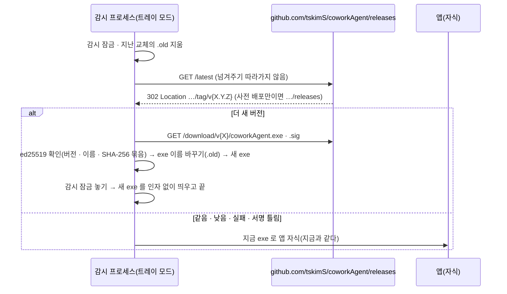

# plan — 1y.data-update

> 근거: [intent](intent.md)(승인 2026-10-20 — 결정 1 ~ 22). **구현자는 이 문서만 보고 일한다.** D·S 는 [masterPlan](../../masterPlan.md)
> (D12 유지 · D36 개정 · D35 보강 · S6 실현 — 종결 때 환류). 브랜치 `task/1y-data-update`. 기준 커밋: `d8a4b5e`(task/1y-data-update — plan). plan 승인: 2026-10-20.

## 목표

주고받은 메시지 보기 기간(1 ~ 12주, 기본 4주) · 요청 archive(완료 7일 뒤 자동 · 손으로 · 기본 숨김 · 따로 보기) · 시작 때 DB VACUUM ·
GitHub 릴리스 자동 업데이트(Windows — 실행 시 확인 · 묻지 않고 교체). (개정 2026-10-20 — 서명 확인 · 서명 도구는 되돌림, 아래 개정 기록)

### 성공 기준(intent 사본)

- A1: 주고받은 메시지 화면에 기간 고르기 1 ~ 12주(기본 4주) — 고른 기간 밖 글은 목록 · 상대별 요약(건수 · 마지막)에 없다, 고른 값은 이 PC 에 남는다, 틀린 값 400(시험).
- A2: 완료 요청은 완료(`req_at`) 7일 뒤 자동으로 archive 되고, 7일 전이라도 손으로 archive 할 수 있다(시험).
- A3: archive 된 요청은 요청 목록 · 보드 · 개요에서 기본 숨김, "archive 항목 보기" 를 고르면 따로 보인다(시험).
- A4: archive 는 이 PC 에만 — 상대 PC 의 요청 · 상태는 그대로(시험).
- A5: 시작 때 조건을 넘으면 VACUUM 하고, 실패해도 앱은 뜬다(시험).
- A6: 자동 업데이트 기능(업데이터 · 감시 연결 · HTTPS 받기 의존 · 시험)이 소스 · 의존에 남지 않는다(사용자 지시로 걷어냄 — 검사).
- A7: 릴리스 절차(손 빌드 사전 배포 — D36)가 개발자 가이드에 있고, 사용자 문서에 자동 업데이트 안내가 없다(문서 검사).
- A8: 1.1.0 이 GitHub 릴리스에 사전 배포로 올라가고 자산 SHA-256 이 빌드한 실행 파일과 같다(수동).
- A9: 회귀 없음 — PROJECT.md 검증 명령 PASS.

## 설계

### 사실(조사 2026-10-20 — 설계가 기대는 것)

- 주고받은 메시지 = `#p`, `loadPeerMessages`(`GET /api/messages/peers` → `chat::peer_message_counts(conn, scope)`) · `loadPeerPage`(`GET /api/messages?side=both&peer=..&limit=20[&before&before_at]`
  → `chat::messages_page(conn, scope, before, limit)`). 머리 `index.html` `#peer` `header.view-head` 에 고르기 없음.
- 요청 = `GET /api/messages?side=theirs|mine&ask=request[&req=]` → `chat::messages_across(.., ask, ..)`(정렬 `created_at`) · 머리 수 `GET /api/messages/req_counts` → `chat::req_counts`
  (`{wait, accepted, rejected, done, total}`). 웹 `loadRequests` → `reqBoxes`(view) → 개요 `reqBoxEl` · 목록 `requestEls` · 보드 `boardEls(boardColumns(rows, sum))`. 대기 배지 `loadCounts`(`req=wait`).
- `req_at` 은 `chat::set_req_state` 만 쓴다(`req_at = unixepoch()`, 상태가 바뀔 때마다) — 받는 쪽 바꾸기 · 요청자 쪽 프레임 받기 둘 다. 만들 때는 NULL.
- 화면 설정 키 = `run_opts` 상수 + `notify.rs` `SettingsPatch`(`deny_unknown_fields`) 필드 · 검증(쓰기 전 전부) · `writes` · `settings_json` · 웹 `PREFS`(입력 id = 키, 바꾸면 `PUT /api/settings`).
- `db::open` 은 `PRAGMA` `page_count` · `freelist_count` · `auto_vacuum` 을 쓰지 않는다. 앱 시작은 `main.rs` `start` 에서 `db::open` 3번(Node · Notifier · Chat).
- 인자 없는 실행 = `main.rs` `supervise(parent)` → `watchdog::acquire`(감시 잠금) → `watchdog::supervise(spawn_app, ..)`. `parent` 있으면 트레이 없는 모드(CLI `start` · `open`).
  감시는 로거 · DB 를 쓰지 않는다. `spawn_app` = `current_exe()` 를 자식으로.
- 릴리스 v1.0.0 · v1.0.1 = 사전 배포, 자산 `coworkAgent.exe` 하나(11 MB). `https://github.com/tskimS/coworkAgent/releases/latest` → `302 Location: …/releases`(정식 없음).
- `ring 0.17` 은 net · agent 에 있다(app 은 없음 — 같은 판 추가, 새 크레이트 아님). HTTPS 클라이언트 없음 → `ureq 3.4.2`(rust-version 1.85, 지금 1.95).

### 구현자 해석(사용자 승인 2026-10-20 — plan 승인과 함께, 1 · 2 · 3 · 8 은 자동 업데이트를 걷어내며 효력 없음)

1. **인증서 확인 = OS 인증서 저장소**(`ureq` feature `platform-verifier`) — intent 결정 19 의 "webpki 루트" 와 다르다. 사내 TLS 검사(사내 루트 인증서)에서도 받기가 되고, 위조 방어는
   ed25519 서명이 맡는다(TLS 는 전송 보호 — 2026-10-20 서명 되돌림 뒤에는 TLS 가 유일한 전송 확인). 기각: webpki 내장 루트(사내 검사 장비 뒤에서 실패).
2. **확인은 트레이 모드 감시만** — CLI `start` · `open` 이 띄운 트레이 없는 모드(`parent` 있음)는 확인하지 않는다(새 exe 를 다시 띄우면 부모 감시 · 준비 확인이 끊긴다). 디버그 빌드도 없음.
3. **(되돌림 2026-10-20 — 결정 7 개정)** **서명 대상 = 버전 · 자산 이름 · SHA-256 묶음** — `"coworkAgent update v1\n{tag}\n{asset}\n{sha256 hex}\n"`. 저장소를 쥔 사람이 옛 서명 파일을 새 태그에 붙여 낮은 버전으로 돌려보내지 못한다.
4. **archive 는 조회 조건으로** — 따로 도는 작업 없이 `req_state = 'done'` 이고 (손으로 archive 했거나 · 자동 대상이고 `req_at` 7일 지남)이면 archive 로 본다. 상태가 바뀌면 손 표시를 지운다
   (결정 14 — 완료가 아니면 바로 목록에, 다시 완료되면 7일 셈을 새로).
5. **기간은 서버가 설정을 읽어 건다** — `side=both` 목록 · 상대별 요약이 `ui_peer_weeks` 를 본다(질의 인자 없음). 이 화면 말고 `side=both` 를 쓰는 곳은 없다.
6. **"archive 항목 보기" 는 기억하지 않는다** — 요청 화면에 들어올 때마다 숨김(원문 "기본적으로 숨김"). 받은 · 보낸 요청 모두, 그룹 · 상대 타일의 요청 화면도 같다.
7. **보완(범위 밖 결함 — 2026-10-20 조사 중 발견)**: 받은 요청을 "대기" 로 되돌리기 — 웹UI(`reqMoves` · 보드)는 네 상태 어디로든(사용자 2026-10-19 "4 상태 자유 이동") 내지만
   `PATCH /api/messages/{id}` 가 `wait` 를 400("req_state 는 accepted · rejected · done")으로 막는다. 서버도 `wait` 를 받게 고친다(agent `set_req_state` 는 이미 받는다). 기각: 이번 범위 밖으로 미룸.
8. **(2026-10-20 — 서명 되돌림 뒤, 사용자 확인 필요)** 받은 파일이 이 PC 의 실행 파일 꼴(PE 머리 · 같은 아키텍처 — 적대적 평가 R1 로 `MZ` 만에서 강화)이 아니면 바꾸지 않는다 — 사내 프록시 · 로그인 페이지가 200 으로
   HTML 을 주면 그것이 exe 자리에 들어가 다음 실행부터 앱이 뜨지 않는다(되돌릴 길 없음). 위조 방어는 아니다. 시험 `update_rejects_non_exe`.

### an-core

- `db.rs` 스키마 23: `messages` 에 `req_archived INTEGER`(NULL = 자동 대상 · 1 = 손으로 archive · 0 = 손으로 해제 — 자동 제외). v14 꼴(`has_column` · 한 트랜잭션), `SCHEMA_VERSION = 23`.
  `pub fn vacuum_if_sparse(conn: &Connection) -> rusqlite::Result<bool>` — `page_count` · `freelist_count` · `page_size` 로 빈 바이트 ≥ `VACUUM_MIN_FREE`(4 MiB) 이고 빈 페이지 × 4 ≥ 전체이면 `VACUUM` · 참.
- `chat.rs`:
  - `pub const ARCHIVE_DAYS: i64 = 7`. 조건 문자열 하나(`fn archived_sql(alias)` 꼴 — 파일 전용 `static` 아님, `pub(crate)` 함수):
    `{m}.req_state = 'done' AND ({m}.req_archived = 1 OR ({m}.req_archived IS NULL AND coalesce({m}.req_at, {m}.created_at) <= unixepoch() - 7 * 86400))`.
  - `messages_across(.., archived: Option<bool>, ..)` — `ask = Some(Request)` 일 때만: `None`/`Some(false)` = archive 제외, `Some(true)` = archive 만. 질의 · 답 · 일반 거르기는 그대로.
  - `req_counts` — `done` · `total` 은 archive 제외, 새 `archived` 수. `ReqCounts.archived`.
  - `pub fn set_req_archived(conn, id, on: bool) -> rusqlite::Result<bool>` — 사람 요청 글(`request = 1`, 공유 사본 아님)만, `on` 이면 `req_state = 'done'` 일 때만(아니면 거짓). 1 · 0 을 쓴다.
  - `set_req_state` — 상태가 바뀌면 `req_archived = NULL`(같은 상태 다시 알리기는 그대로).
  - `Message.archived: bool`(조회 때 조건으로 계산 — `MSG_COLS` · `msg_row`), `messages_page(.., since: Option<i64>, ..)` · `peer_message_counts(.., since)` — `m.created_at >= since`.
- `run_opts.rs`: `PEER_WEEKS_KEY = "ui_peer_weeks"` · `PEER_WEEKS_DEFAULT = 4` · `PEER_WEEKS_MAX = 12` · `pub fn peer_weeks(conn) -> rusqlite::Result<i64>`(없거나 1 ~ 12 밖이면 4).

### an-app

- `chat_api.rs`:
  - `message_page` · `message_peers` — `since = unixepoch() - peer_weeks × 7 × 86400` 를 넘긴다.
  - `MessageQuery.archived: Option<bool>` — `ask=request` 없이 오면 400("archived 는 ask=request 와 함께"). `side=both` 와 함께도 400.
  - `POST /api/messages/{id}/archive` `{archived: bool}` → 200 메시지 JSON. 요청 아님 · 공유 사본 404/400, 완료 아닌데 `true` 409("완료된 요청만 archive 할 수 있습니다"). 이 PC 만(프레임 · outbox 없음).
  - `message_json` 에 `archived`. `req_counts` 응답에 `archived`.
  - 보완(해석 7): `PATCH` 의 `req_state` 가 `wait` 도 받는다(오류 문구 "req_state 는 wait · accepted · rejected · done").
- `notify.rs`: `SettingsPatch.ui_peer_weeks: Option<i64>` — 1 ~ 12 밖 400("ui_peer_weeks 는 1 ~ 12"), 저장 · `settings_json`.
- `main.rs` `start`: 첫 `db::open` 뒤 `match db::vacuum_if_sparse(&conn)` — 참 = `log::info!`, 오류 = `log::warn!` 하고 계속(`?` 아님).
- `update.rs`(새 모듈, `pub mod update`):
  - 상수 `RELEASES = "https://github.com/tskimS/coworkAgent/releases"` · `ASSET = "coworkAgent.exe"`(Windows — 다른 OS 는 `None` → 확인 안 함) · `SIG_EXT = ".sig"` ·
    `PUBLIC_KEY: [u8; 32]`(구현 때 만든 키의 공개 부분) · `MAX_ASSET = 64 MiB` · 연결 5초 · 전체 60초.
  - `pub fn latest_tag(base) -> io::Result<Option<String>>` — `GET {base}/latest`(넘겨주기 끔) · 302 `Location` 이 `/tag/v{X.Y.Z}` 로 끝나면 그 태그, 아니면 `None`.
  - `pub fn newer(tag, current) -> bool` — `v` 뗀 `X.Y.Z` 정수 셋 비교, 엄격히 클 때만(꼴이 틀리면 거짓).
  - `pub fn signed_message(tag, asset, sha256_hex) -> String`(해석 3) · `pub fn verify(key, tag, asset, bytes, sig) -> bool`(`ring::signature::ED25519`).
  - `pub fn swap(exe: &Path, bytes) -> io::Result<()>` — `{exe}.new` 쓰기 → 있으면 `{exe}.old` 지움 → `exe` → `.old` 이름 바꾸기 → `.new` → `exe`(실패면 `.old` 를 되돌린다). `pub fn clean(exe)` = `.old` 지움(오류 무시).
  - `pub fn check(base, current, key, exe) -> Outcome`(`Updated(tag)` · `UpToDate` · `Skipped(사유)`) — 받기 · 확인 · 교체를 묶는다. 실패는 전부 `Skipped`(패닉 없음).
  - 감시가 남기는 기록: `Paths` 의 `update_note`(데이터 폴더 `update.txt`, 한 줄 — 결과 · 시각). 앱 `start` 가 읽어 `log::info!` 뒤 지운다(감시는 로거를 쓰지 않는다 — 지금 규칙).
- `main.rs` `supervise`: 감시 잠금을 잡은 뒤 · `watchdog::supervise` 전에 — 트레이 모드 · 릴리스 빌드 · `ASSET` 있음이면 `update::clean` → `update::check(RELEASES, CARGO_PKG_VERSION, &PUBLIC_KEY, current_exe)`.
  `Updated` 면 잠금을 놓고(`drop`) 새 exe 를 인자 · 감시 변수 없이 띄우고 0 으로 끝(새 감시가 잠금을 잡는다).
- `src/bin/sign-release.rs`(개발용 — 배포하지 않음): `keygen <키 경로>`(있으면 거부 · PKCS#8 · 공개키 16진 출력) · `sign <키 경로> <exe> <태그>`(→ `<exe>.sig` 64 바이트 · SHA-256 출력) · `verify <exe> <태그>`(내장 공개키로).
- `Cargo.toml`(app): `ring = "0.17.14"` · `ureq = { version = "3.4.2", default-features = false, features = ["rustls", "platform-verifier"] }`.
- 개인키: 구현 때 `keygen` 으로 `%USERPROFILE%\.coworkagent-release\release.key` 를 만든다(저장소 밖). `.gitignore` 에 `*.key` 를 더한다(실수 커밋 막기).

### 웹UI

- `index.html` `#peer` 머리: `<label>기간 <select id="ui_peer_weeks">`(1주 ~ 12주, 값 1 ~ 12). 요청 머리(`req_view_*` 옆): `<label><input type="checkbox" id="req_archive"> archive 항목 보기</label>`.
- `view.js`:
  - `export const PEER_WEEKS = [1..12]` · `peerWeeksOptions()` → `[{value, label: "{n}주"}]`.
  - `reqHead(title, sum)` — `sum.archived > 0` 이면 끝에 `· archive {n}`.
  - `reqArchiveAction(m)` → 받은 · 보낸 요청이 완료 · archive 아님 = `{key: "archive", label: "archive"}`, archive 됨 = `{key: "unarchive", label: "archive 해제"}`, 그 밖 `null`.
- `app.js`:
  - `PREFS` 에 `ui_peer_weeks` — 바꾸면 `loadPeerMessages()` 다시.
  - `loadRequests` — `req_archive` 켜짐이면 상자마다 `archived=1` 목록도 받아 개요 · 목록 · 보드 아래에 따로 된 절 "archive"(`foldEl` — 처음 펼침)로 그린다. 꺼짐이면 그 절 없음. 요청 화면에 들어올 때 끔(해석 6).
  - 요청 줄 글자 단추에 `reqArchiveAction` — `POST /api/messages/{id}/archive` 뒤 `loadRequests`.
- `ux_literals.rs` 있음 표: "archive 항목 보기" · "archive 해제" · "기간".

### 시험

- Rust `crates/core/tests/store.rs`: `schema23_req_archived`(22 → 23 · 열 · 값 그대로) · `vacuum_sparse`(큰 행 넣고 지움 → 참 · `freelist_count` 0) · `vacuum_small_skip`(작은 DB → 거짓).
- Rust `crates/app/tests/ux_api.rs`:
  - `peer_weeks_setting_persists`(기본 4 · 1 · 12 저장 · 0 · 13 400 · 다시 열어도 남음) · `peer_messages_within_weeks`(5주 전 글 — 기본 4주 목록 · 요약에 없음, 8주로 바꾸면 보임).
  - `request_archive_auto`(완료 `req_at` 8일 전 → 기본 목록 · `done` 수에 없음 · `archived=1` 에 있음 · `archived` 수 1, 6일 전은 그대로) · `request_archive_manual`(7일 전에 손으로 · 완료 아님 409 ·
    해제 → 다시 보이고 8일 지나도 자동 안 됨) · `request_archive_state_change`(archive 된 요청이 수용으로 → 목록에, 다시 완료 → 7일 셈 새로) · `request_archive_local_only`(두 PC — A 가 archive 해도 B 의
    목록 · 상태 · 수 그대로, outbox 행 없음) · `request_archive_params`(`archived` + `ask` 없음 400 · `side=both` 400) · `req_state_back_to_wait`(보완 — `PATCH {req_state: "wait"}` 200 · 요청자에 반영).
- Rust `crates/app/tests/update.rs`(로컬 HTTP 서버 — 시험 키): `update_applies_newer_signed`(exe 바뀜 · `.old` 남음 · `Updated`) · `update_rejects_bad_sig` · `update_rejects_missing_sig` ·
  `update_rejects_replayed_sig`(v1.0.0 서명을 v9 태그에 — 해석 3) · `update_skips_same_or_lower` · `update_skips_no_latest`(302 → `/releases` — 사전 배포만) · `update_download_fail_keeps_exe` · `update_clean_old`.
- node `view.test.mjs`: `peer_weeks_options` · `req_head_archive` · `req_archive_action`.

### 문서

- [user-guide](../../manual/user/user-guide.md) — 주고받은 메시지 기간 · 요청 archive · 자동 업데이트(실행 때 · 묻지 않음 · 실패면 지금 버전), README 같은 줄.
- [developer-guide](../../manual/dev/developer-guide.md) — 3.1(감시 프로세스의 업데이트 확인), 7.1(`update.txt`), 7.2 스키마 23 `req_archived`, 새 절 **릴리스 · 자동 업데이트**(버전 올림 → 빌드 →
  `sign-release sign` → `gh release create v{X} --latest` 자산 `coworkAgent.exe` · `coworkAgent.exe.sig`, 사전 배포 = 자동 업데이트 대상 아님, 개인키는 저장소 밖 · 백업 · 잃으면 손 설치).
- [web-ui](../../manual/dev/web-ui.md) · [an_app](../../manual/dev/an_app.md)(경로 · `update`) · [an_core](../../manual/dev/an_core.md)(스키마 23 · `vacuum_if_sparse` · archive 조건).
- masterPlan(종결 환류): D12 구현 보강(서명 대상 · 공개키 내장), D36 개정(자동 업데이트 = GitHub 릴리스 · 정식 릴리스만 · 묻지 않고 교체 · 코드 서명 · 파이프라인은 TODO), S6 실현(Windows),
  D35 보강(주고받은 메시지 기간 · 요청 archive). PRODUCT 줄(다른 세션 수정분 제외).

## Stage

| stage | 목표 | 산출 | gate |
|---|---|---|---|
| 1 | 서버 — 스키마 23 · archive · 기간 · VACUUM · 대기 되돌리기 보완 + Rust 시험 | an-core · an-app(chat_api · notify · main) | E1 · E2 · E4 · E5 · E6 |
| 2 | 자동 업데이트 — `update` · 감시 연결 · `sign-release` · 키 · 시험 | an-app(update · main · bin) | E1 · E2 · E7 · E8 |
| 3 | 웹UI · 문서 | 웹UI · 문서 | E3 · E9 ~ E12 |

## 평가 항목

- [ ] E1: A9 — 워크스페이스 테스트 전부 통과
  CHECK: cargo test --workspace
  EXPECT: /test result: ok\. [1-9][0-9]* passed; 0 failed/
  EVIDENCE: pending
- [ ] E2: A9 — 경고 0
  CHECK: cargo clippy --workspace --all-targets -- -D warnings
  EXPECT: Finished
  EVIDENCE: pending
- [ ] E3: A9 — 화면 로직 node 테스트 · 실패 0 · 150 이상
  CHECK: node --test --test-reporter=tap "crates/app/web/*.test.mjs"
  EXPECT: /# pass (15[0-9]|1[6-9][0-9])\s+# fail 0/
  EVIDENCE: pending
- [ ] E4: A1 — 주고받은 메시지 기간 설정 · 거르기
  CHECK: cargo test -p coworkagent-app --test ux_api -- peer_weeks_setting_persists peer_messages_within_weeks
  EXPECT: /test result: ok\. 2 passed; 0 failed/
  EVIDENCE: pending
- [ ] E5: A2·A3·A4 — 요청 archive 자동 · 손 · 상태 바뀜 · 이 PC 만 · 인자 · 대기 되돌리기 보완
  CHECK: cargo test -p coworkagent-app --test ux_api -- request_archive_ req_state_back_to_wait
  EXPECT: /test result: ok\. 6 passed; 0 failed/
  EVIDENCE: pending
- [ ] E6: A5 — 스키마 23 · VACUUM 조건 · 시작 실패 없음(`?` 아님)
  CHECK: cargo test -p an-core --test store -- schema23_req_archived vacuum_ && python -c "import pathlib,re;m=pathlib.Path('crates/app/src/main.rs').read_text(encoding='utf-8');print('vacuum_q=%d vacuum=%d'%(len(re.findall(r'vacuum_if_sparse\([^)]*\)\?',m)),min(m.count('vacuum_if_sparse'),1)))"
  EXPECT: vacuum_q=0 vacuum=1
  EVIDENCE: pending
- [ ] E7: A6·A8 — 자동 업데이트 · 서명 관리 코드 없음(업데이터 · 시험 · 서명 도구 · `ureq` · `ring` 의존 · 감시 연결 · 추적되는 키 파일)
  CHECK: python -c "import pathlib,subprocess;e=lambda f:pathlib.Path(f).exists();c=pathlib.Path('crates/app/Cargo.toml').read_text(encoding='utf-8');m=pathlib.Path('crates/app/src/main.rs').read_text(encoding='utf-8');f=subprocess.run(['git','ls-files'],capture_output=True,text=True).stdout.split();print('update=%d test=%d sign=%d ureq=%d ring=%d hook=%d keys=%d'%(e('crates/app/src/update.rs'),e('crates/app/tests/update.rs'),e('crates/app/src/bin/sign-release.rs'),'ureq' in c,'ring' in c,'update::' in m,sum(x.endswith(('.key','.sig')) for x in f)))"
  EXPECT: update=0 test=0 sign=0 ureq=0 ring=0 hook=0 keys=0
  EVIDENCE: pending
- [ ] E8: A7 — 릴리스 절차(사전 배포) 문서 · 사용자 문서에 자동 업데이트 없음
  CHECK: python -c "import pathlib;g=pathlib.Path('docs/manual/dev/developer-guide.md').read_text(encoding='utf-8');u=''.join(pathlib.Path(f).read_text(encoding='utf-8') for f in ['README.md','docs/manual/user/user-guide.md']);print('release=%d pre=%d user_update=%d'%(min(g.count('### 2.4 릴리스'),1),min(g.count('--prerelease'),1),u.count('자동 업데이트')))"
  EXPECT: release=1 pre=1 user_update=0
  EVIDENCE: pending
- [ ] E9: A1·A3 — 화면 로직: 기간 고르기 · archive 머리 수 · archive 단추
  CHECK: node --test --test-reporter=tap --test-name-pattern="peer_weeks_options|req_head_archive|req_archive_action" crates/app/web/view.test.mjs
  EXPECT: /# pass [3-9]\s+# fail 0/
  EVIDENCE: pending
- [ ] E10: A9 — 문서 규약 · 의존 경계 · 화면 문구 표
  CHECK: python tools/check_ddd_docs.py && python tools/check_crates.py && cargo test -p coworkagent-app --test ux_literals
  EXPECT: crates=4 edges=6 violations=0
  EVIDENCE: pending
- [ ] E11: A3·A1 — 실화면(이 PC, CDP): 주고받은 메시지 기간 고르기 → 목록 다시 · 요청 "archive 항목 보기" → 따로 된 절 · archive / archive 해제 단추.
  EVIDENCE: pending
- [ ] E12: A8 — 1.1.0 사전 배포 등록 · 자산 SHA-256 = 빌드한 실행 파일(수동 — `gh release view`).
  EVIDENCE: pending

## 개정 기록

- 2026-10-20 · 서명 관리 되돌림(intent 결정 7 개정 · 결정 20 없앰 · 성공 기준 A6 · A7 · A8 개정 — 사용자 "서명 관리 기능은 rollback. 왜냐하면 개인 인증서가 아닌 회사 인증서를 사용해야하기 때문임. 인증서 관련 기능은 소스코드 및 key 파일 모두 정리하고 배포 방법만 그대로 유지.",
  확인 답 "확인 없음(HTTPS 만)") — `sign-release` · `PUBLIC_KEY` · `.sig` · `verify` · app 의 `ring` 의존 · `.gitignore` `*.key` · 개인키 파일(`%USERPROFILE%\.coworkagent-release`) 지움,
  릴리스 절차(정식 `--latest`)는 그대로. E7 EXPECT `[8-9]` → `[6-9]`(서명 시험 3 빠지고 `update_rejects_non_exe` 하나), E8 CHECK · EXPECT 새로(서명 관리 없음 확인). 해석 3 되돌림 · 해석 8 더함.
- 2026-10-20 · 적대적 평가 라운드 1 반영 — 새 버전이 뜨지 못하면 지난 버전으로 되돌림(`rollback` · `pending` · `settled` · `update-skip.txt`), 실행 파일 꼴 강화(`is_native_pe`),
  주고받은 메시지 받아 둔 꼬리도 기간 안만(`mergePage` `since`). E7 EXPECT `[6-9]` 그대로(8 passed).
- 2026-10-20 · 자동 업데이트 걷어냄(intent 개정 — 사용자 "git release 에 신규파일 등록 시 자동 배포되는 기능은 삭제.") — `update.rs` · `tests/update.rs` · 감시 연결 · `Paths` 업데이트 파일 · `ureq` 의존 · 문서(개발자 가이드 2.4 →
  "릴리스" 사전 배포 절차 · 3.1 · 4.1 · 7.1 · 9 · 사용자 가이드 · README · an_app · an_core · PRODUCT) 지움. 성공 기준 A6 · A7 · A8 개정, E7 · E8 · E12 새로. 적대적 평가 R1 · R2 의
  업데이트 지적(R1-H1 · R1-H2 · R2-H1 · R2-H2)은 대상 코드가 없어 닫힘.
