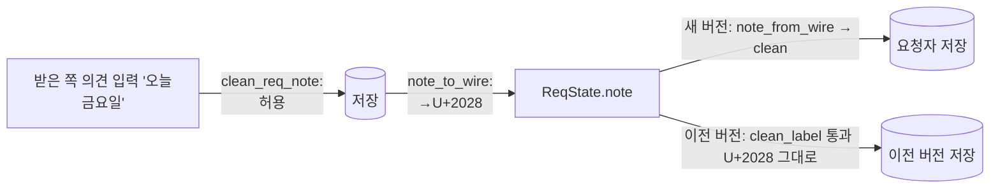

# plan — 1z.chat-look

> 근거: [intent](intent.md)(승인 2026-10-21 — 결정 1 ~ 8). **구현자는 이 문서만 보고 일한다.** D·S 는 [masterPlan](../../masterPlan.md)
> (S4 말풍선 · 입력창 개정 · S1 메모 → 의견 · D35 레일 끌기 — 종결 때 환류). 브랜치 `task/1z-chat-look`. 기준 커밋: `2b68dbc`(main). plan 승인: 2026-10-21(사용자 "plan 후 바로 구현").

## 목표

사람 ↔ 에이전트 구분(말풍선 A · 에이전트 아이콘 · 목록 카드 A · 줄 아이콘) · 입력창 여백 · 간격 · 높이 · 요청 "의견"(용어 · 큰 칸 · 줄바꿈 · 호환) · 레일 끌기로 타일 크기.

### 성공 기준(intent 사본)

- A1: 사람 글과 에이전트 글의 말풍선이 다르다 — 에이전트 글은 흰 면 + 에이전트 색 테두리 + "에이전트" 칩, 사람 상대 글은 `--recv-bg` 면, 내 사람 글은 강조색 층(검사 · 시험).
- A2: 에이전트 글 말풍선 옆에 로봇 아이콘 아바타가 있다 — 내 쪽 에이전트 답 포함(검사 · 실 화면).
- A3: 대화 목록 줄이 카드 모양이고 미리보기 앞에 마지막 발화자 종류 아이콘(에이전트 · 사람)이 붙는다(node 시험 · 검사).
- A4: 주고받은 메시지 · 활동 등 메시지 줄에 사람 / 에이전트 구분 아이콘이 붙는다(node 시험 · 검사).
- A5: 입력창 좌우 여백 `max(48px, 8%)`(말풍선 영역과 같음) · 글 칸 최소 44px · 최대 200px 자동 늘어남 · 스크롤 영역과 입력창 사이 24px(스크롤 안쪽 패딩 아님)(검사 · 실 화면).
- A6: 사용자에게 보이는 "피드백" · 요청 "메모" 0건, "의견" 으로(웹UI · 서버 오류 문구 · 매뉴얼 · README)(검사).
- A7: 의견 칸 = 3줄 textarea · maxlength 200 · "n / 200" · 확인 · 취소 높이 44px · Enter 확인 · Shift+Enter 줄바꿈(한글 조합 중 Enter 는 확인 아님)(검사 · node 시험).
- A8: 의견 줄바꿈이 저장되어 요청자에게 그대로 가고(새 버전끼리) 이전 버전 검사(`clean_label`)도 통과하는 형태로 보낸다, 다른 제어 문자 · 201자는 거부, 의견 표시는 줄바꿈 보존(Rust 시험 · 검사).
- A9: 레일 손잡이 끌기 · ← → 키로 타일 크기가 바뀌어 저장되고(놓으면 72 · 168px), 설정 선택이 따라 바뀐다, 기준 120px(경계 119 · 120 · 121)(node 시험 · 검사).
- A10: 회귀 없음 — PROJECT.md 검증 명령 PASS.
- A11: 레일 사용자 · 그룹 타일을 누른 채 5px 이상 끌면 끌기가 되고(그 미만은 그냥 누름), 같은 묶음 타일 위에 놓으면 그 앞 · 뒤로 옮겨 저장된다, 끈 뒤에는 타일 고르기가 일어나지 않는다,
  타일에 HTML 끌어 놓기(`draggable`)가 없다(node 시험 · 검사).
- A12: 사용자에게 보이는 "연결 목록" 0건, "그룹설정" 으로(웹UI · OS 알림 · 매뉴얼 · README)(검사).
- A13: 그룹설정 = 왼쪽 그룹 · 사용자 목록 + 오른쪽 고른 항목 상세, 검색이 그룹 이름 · 사용자 · 대화 제목에 맞고, 고른 항목이 사라지면 첫 그룹 → 첫 사용자 → 없음(node 시험 · 검사).

## 설계

### an-core (`crates/core/src/chat.rs`)

- `clean_req_note(s)` — `\r\n` → `\n` 뒤 trim, `\n` 말고 제어 문자 거부 · [`MAX_REQ_NOTE`] 200자(문자 수). 오류 문구 `"의견은 200자까지, 제어 문자 없이"`(`clean_label` 형식 그대로, 낱말만 "의견").
- `pub fn note_to_wire(s: &str) -> String`(`\n` → `\u{2028}`) · `pub fn note_from_wire(s: &str) -> String`(역). 문서 주석에 호환 이유(U+2028 은 Cc 아님 — 이전 버전 `clean_label` 통과).
- 시험 `crates/core/tests/requests.rs`: `note_one_line_200` → `note_lines_200`(두 줄 OK · `\r\n` 정규화 · 탭 · `\x07` · 201자 거부 · 200자 OK), 새 `note_wire_old_peer`
  (`note_from_wire(note_to_wire(x)) == x`, `run_opts::clean_label(&note_to_wire("두\n줄"), 200, "메모")` 가 `Ok`, `clean_label("두\n줄", …)` 는 `Err` — 이전 버전 거절을 고정).

### an-agent (`crates/agent/src/chat.rs`)

- `set_req_state` — `Request::ReqState.note = note.as_deref().map(chat::note_to_wire)`(저장은 `\n`).
- `inbound_req_state` — `chat::clean_req_note(&chat::note_from_wire(note.as_deref().unwrap_or("")))`.
- 시험 `crates/agent/tests/requests.rs`: `receiver_moves_state_with_note` 의 거부 목록 `"둘째\n줄"` → `"탭\t가"`, 새 `note_lines_reach_requester`(받은 쪽 `"오늘\n금요일까지"` →
  요청자 `req_note == "오늘\n금요일까지"`).

### 웹UI — `view.js`(순수 함수 · node 시험)

- `export function speakerIcon(author)` → `author === "agent" ? { kind: "agent", icon: "bot", label: "에이전트" } : { kind: "human", icon: "user", label: "사람" }`.
- `inboxRows` · `activityRows` 행에 `author: m.author`.
- `export const RAIL_W = { normal: 72, small: 168, split: 120, min: 64, max: 240 }` · `export function railSize(w)` → `w >= RAIL_W.split ? "small" : "normal"`.
- `export const NOTE_MAX = 200` · `export function noteCount(text)` → `` `${[...text].length} / ${NOTE_MAX}` ``.
- 시험(`view.test.mjs`): `speaker_icon` · `inbox_rows_author`(inboxRows · activityRows 의 author) · `rail_size`(64 · 119 → normal, 120 · 121 · 240 → small) · `note_count`("" → "0 / 200", "가\n나" → "3 / 200").

### 웹UI — `app.js`

- `messageEl`: 아바타 = `side === "theirs" || m.author === "agent"` 일 때, 에이전트면 `el("div", { class: "avatar agent-av" }, ico("bot"))`. 메타에 에이전트면
  `el("span", { class: "tag agent-tag", text: "에이전트" })`.
- `feedbackEl`: 머리 `` `요청 의견 · ${formatTime(f.at)}` ``.
- `convItem`: `sub` 안 미리보기 앞 `c.last ? speakerEl(c.last.author) : ""`. `speakerEl(author)` = `el("span", { class: "speaker " + kind, title: label }, ico(icon))`(함수 선언 — `static` 아님).
- `rowEls`(tile 행) · `activityEls`: `who` 앞 `r.author ? speakerEl(r.author) : ""`.
- `noteForm`: `textarea`(`rows: "3"`, `maxlength: "200"`, placeholder `"의견(선택) · 요청자에게 보입니다"`, aria-label `` `${label} 의견` ``) · `.req-note-bar`(글자 수 `noteCount` · 취소 · 확인).
  keydown `enterSends(ev)` → `form.requestSubmit()`. input → 글자 수 갱신.
- 요청 행 `` `의견: ${r.note}` `` · 요청 카드 라벨 `"의견"`.
- 입력창 높이: `fitComposer()` = `t.style.height = "auto"; t.style.height = Math.min(t.scrollHeight, 200) + "px"` — `reply_text` input · 보낸 뒤 비울 때.
- 레일 끌기: `#rail_resize` pointerdown(창 pointermove 동안 `#app` 의 `--rail-w` = 끈 폭(64 ~ 240) · `applyTileSize(railSize(w))`, pointerup 에 `--rail-w` 지우고
  `saveTileSize(railSize(w))`) · keydown ← = `normal` · → = `small`. `saveTileSize(size)` = `applyTileSize` · `$("ui_tile_size").value = size` · `PUT /api/settings { ui_tile_size }`
  (실패는 `status_msg`). `applyTileSize` 가 `#rail_resize` `aria-valuenow`(72 · 168)도 맞춘다.

### 웹UI — `index.html` · `app.css`

- `index.html`: `#rail` 뒤 `

`,
  `reply_text` `rows="1"`, 타일 크기 `<option value="normal">크게</option>`.
- `app.css`:
  - `#app { position: relative; --rail-w: 72px; grid-template-columns: var(--rail-w) auto auto minmax(0, 1fr) auto; }`, 넓은 화면 `#app.tile-small { --rail-w: var(--rail-w-small); }`(열 템플릿 중복 제거).
  - `#rail_resize { position: absolute; top: 48px; bottom: 0; left: calc(var(--rail-w) - 3px); width: 6px; cursor: col-resize; z-index: 5; }` hover · focus 강조색, 720px 이하 숨김.
  - `#messages { padding: var(--sp-5) max(48px, 8%) 0; }` · `.composer { margin: var(--sp-5) max(48px, 8%) var(--sp-4); }` · `.composer textarea { min-height: 44px; max-height: 200px; }`.
  - 말풍선 A: `.msg.side-theirs:not(.agent) .bubble { background: var(--recv-bg); }` · `.msg.agent .bubble { background: var(--surface); border: 1.5px solid var(--agent); }` ·
    `.msg.agent .bubble::before { display: none; }` · `.avatar.agent-av { background: var(--agent); color: var(--surface); }` · `.tag.agent-tag { background: var(--agent); color: var(--surface); }`.
  - 목록 A: `#sidebar { background: var(--subtle); }` · `.side-list li:not(.hint) { background: var(--surface); border: 1px solid var(--border); border-radius: var(--radius-lg); }` ·
    `.side-list li.current { background: var(--accent-soft); box-shadow: inset 0 0 0 1px var(--accent); }` · `.speaker.agent { color: var(--agent); }` · `.speaker .ico { width: 12px; height: 12px; }`.
  - 의견: `.req-note { flex-direction: column; align-items: stretch; }` · `.req-note textarea { width: 100%; min-height: 88px; resize: vertical; }` · `.req-note button { height: 44px; }` ·
    `.feedback-note { white-space: pre-wrap; }`, 요청 행 의견 힌트 `pre-wrap`.
- `ux_literals.rs`: PRESENT 에 새 문구(`요청 의견 · ` · `"의견(선택) · 요청자에게 보입니다"` · `max(48px, 8%)` · `id="rail_resize"` · `<option value="normal">크게</option>`), ABSENT 에 옛 문구
  (`요청 피드백 · ` · `"피드백(선택) · 요청자에게 보입니다"` · `메모: ${r.note}` · `<option value="normal">보통</option>`).

### 개정 추가(2026-10-21 — 레일 타일 순서 · 그룹설정)

- `view.js`: `DRAG_SLOP = 5` · `pastSlop(dx, dy)`(제곱 거리 ≥ 25), `groupSettingsList(groups, peers, convs, q, peerNames)` → `{groups: [{id, name, icon, count}], users: [{id, count}]}`,
  `groupSettingsPick(pick, list)`. 시험 `past_slop`(0 · 4 · (3,3) 아님, 5 · (3,4) · 6 끌기) · `group_settings_list` · `group_settings_pick`.
- `app.js`: 레일 타일 `draggable` 제거 · `onpointerdown: tileGrab`(포인터 캡처 · `pastSlop` 뒤 사본 `rail-ghost` · `dropKind` "move" 만 · 앞 / 뒤(가로 레일은 X) · 놓으면 `moveItem` ·
  끈 뒤 click 먹기), 레일 `dragstart`/`dragover`/`drop` 처리와 `dragging` 변수 삭제. `renderPeerList` = `groupSettingsListEl`(왼쪽) + 상세(`groupSection` · `userDetail`),
  `state.gsPick`(서명에 넣음), "+ 그룹 추가" 뒤 그 그룹을 고름. "연결 목록" 문구 → "그룹설정"(오류 · 안내 · 주석).
- `index.html`: 제목 · 안내 2곳 "그룹설정", 검색 placeholder "그룹 · 이름 · PC · 대화 제목". `view.js` 트리 라벨 "그룹설정". `notify.rs` 새 연결 알림 "그룹설정에서 삭제".
- `app.css`: `.rail-ghost` · `.rail-btn[data-drag] { touch-action: none; }`, `.gs-*`(두 칸 · 칸마다 `max-height: 70vh` 스크롤 · 머리 sticky).

### 문서

- [사용자 가이드](../../manual/user/user-guide.md) · [웹UI 매뉴얼](../../manual/dev/web-ui.md) · `README.md` — 피드백 → 의견, 의견 여러 줄, 레일 끌기, 입력창 여백, 말풍선 구분.
- masterPlan(종결 환류): S4 말풍선 · 입력창 · 피드백 말풍선 문구, S1 메모 → 의견, D35 레일 끌기, 개정 기록 줄.

## 평가 항목

- [ ] E1: A10 — 워크스페이스 테스트 전부 통과
  CHECK: cargo test --workspace
  EXPECT: /test result: ok\. [1-9][0-9]* passed; 0 failed/
  EVIDENCE: pending
- [ ] E2: A10 — clippy 경고 0
  CHECK: cargo clippy --workspace --all-targets -- -D warnings
  EXPECT: Finished
  EVIDENCE: pending
- [ ] E3: A10 — 웹UI 화면 로직 시험 전부(지금 151 + 새 시험)
  CHECK: node --test --test-reporter=tap "crates/app/web/*.test.mjs"
  EXPECT: /# pass (15[5-9]|1[6-9][0-9])\s+# fail 0/
  EVIDENCE: pending
- [ ] E4: A8 — 의견 여러 줄 · 거부 · 호환 형태(core)
  CHECK: cargo test -p an-core --test requests note_
  EXPECT: /test result: ok\. 2 passed; 0 failed/
  EVIDENCE: pending
- [ ] E5: A8 — 의견 줄바꿈이 요청자에게 그대로 간다 · 거부 규칙(agent)
  CHECK: cargo test -p an-agent --test requests -- receiver_moves_state_with_note note_lines_reach_requester
  EXPECT: /test result: ok\. 2 passed; 0 failed/
  EVIDENCE: pending
- [ ] E6: A3·A4·A7·A9 — 발화자 아이콘 · 행 author · 레일 경계 · 글자 수(node)
  CHECK: node --test --test-reporter=tap --test-name-pattern="speaker_icon|inbox_rows_author|rail_size|note_count" crates/app/web/view.test.mjs
  EXPECT: /# pass 4\s+# fail 0/
  EVIDENCE: pending
- [ ] E7: A1·A2·A5·A9 — 말풍선 · 아이콘 · 입력창 · 레일 손잡이 코드 실재
  CHECK: python -c "import pathlib;c=pathlib.Path('crates/app/web/app.css').read_text(encoding='utf-8');j=pathlib.Path('crates/app/web/app.js').read_text(encoding='utf-8');h=pathlib.Path('crates/app/web/index.html').read_text(encoding='utf-8');print('recv=%d agentb=%d av=%d chip=%d margin=%d minh=%d maxh=%d handle=%d drag=%d'%(c.count('.msg.side-theirs:not(.agent) .bubble { background: var(--recv-bg)'),c.count('.msg.agent .bubble { background: var(--surface); border: 1.5px solid var(--agent)'),j.count('class: \x22avatar agent-av\x22'),j.count('text: \x22에이전트\x22'),(c.count('--chat-gutter: max(48px, 8%);')==1)*c.count('var(--chat-gutter)'),c.count('min-height: 44px; max-height: 200px'),j.count('200) + \x22px\x22'),h.count('id=\x22rail_resize\x22'),j.count('saveTileSize(railSize(')))"
  EXPECT: recv=1 agentb=1 av=1 chip=1 margin=2 minh=1 maxh=1 handle=1 drag=1
  EVIDENCE: pending
- [ ] E8: A3·A7 — 목록 카드 · 의견 칸 코드 실재
  CHECK: python -c "import pathlib;c=pathlib.Path('crates/app/web/app.css').read_text(encoding='utf-8');j=pathlib.Path('crates/app/web/app.js').read_text(encoding='utf-8');n=j[j.index('function noteForm'):j.index('function noteForm')+2500];print('card=%d speaker=%d ta=%d rows=%d max=%d cnt=%d enter=%d btn=%d wrap=%d'%(c.count('.side-list li:not(.hint) { background: var(--surface)'),j.count('speakerEl(c.last.author)'),n.count('el(\x22textarea\x22'),n.count('rows: \x223\x22'),n.count('maxlength: \x22200\x22'),n.count('noteCount('),n.count('enterSends(ev)'),c.count('.req-note button { height: 44px; }'),c.count('.feedback-note { white-space: pre-wrap; }')))"
  EXPECT: card=1 speaker=1 ta=1 rows=1 max=1 cnt=2 enter=1 btn=1 wrap=1
  EVIDENCE: pending
- [ ] E9: A6 — 사용자에게 보이는 "피드백" 0 · "의견" 있음(웹UI 문자열 · 서버 · 문서 4곳)
  CHECK: python -c "import pathlib,re;w=['crates/app/web/app.js','crates/app/web/view.js','crates/app/web/index.html'];d=['docs/manual/user/user-guide.md','docs/manual/dev/web-ui.md','README.md'];lit=lambda s:len(re.findall(r'[\x22\x27\x60>][^\x22\x27\x60<\n]*(피드백|메모:)',s));ws=''.join(pathlib.Path(f).read_text(encoding='utf-8') for f in w);ds=''.join(pathlib.Path(f).read_text(encoding='utf-8') for f in d);r=pathlib.Path('crates/core/src/chat.rs').read_text(encoding='utf-8');print('targets=%d web_old=%d doc_old=%d rs_new=%d web_new=%d doc_new=%d'%(len(w)+len(d),lit(ws),ds.count('피드백'),r.count('의견은 {MAX_REQ_NOTE}자까지'),min(ws.count('요청 의견'),1),min(ds.count('의견'),1)))"
  EXPECT: targets=6 web_old=0 doc_old=0 rs_new=1 web_new=1 doc_new=1
  EVIDENCE: pending
- [ ] E10: A10 — 문서 규약 · 크레이트 경계 · 화면 문구 목록
  CHECK: python tools/check_ddd_docs.py && python tools/check_crates.py && cargo test -p coworkagent-app --test ux_literals -- literals_present literals_absent literal_counts
  EXPECT: /test result: ok\. 3 passed; 0 failed/
  EVIDENCE: pending
- [ ] E12: A11·A13 — 끌기 시작 경계 · 그룹설정 목록 · 고른 항목(node)
  CHECK: node --test --test-reporter=tap --test-name-pattern="past_slop|group_settings_list|group_settings_pick" crates/app/web/view.test.mjs
  EXPECT: /# pass 3\s+# fail 0/
  EVIDENCE: pending
- [ ] E13: A11 — 레일 타일 포인터 끌기 실재 · HTML 끌기 없음
  CHECK: python -c "import pathlib;j=pathlib.Path('crates/app/web/app.js').read_text(encoding='utf-8');r=j[j.index('function renderRail'):j.index('function renderRail')+6000];print('grab=%d fn=%d slop=%d move=%d eat=%d html5=%d rail_dnd=%d'%(r.count('onpointerdown: tileGrab'),j.count('function tileGrab(ev)'),j.count('pastSlop(e.clientX - sx, e.clientY - sy)'),j[j.index('function tileGrab(ev)'):j.index('function tileGrab(ev)')+3000].count('moveItem(d.kind, d.id, drop.t.id, drop.after)'),j.count('tile.addEventListener(\x22click\x22, eat'),r.count('draggable'),j.count('$(box).addEventListener(\x22dragstart\x22')))"
  EXPECT: grab=2 fn=1 slop=1 move=1 eat=1 html5=0 rail_dnd=0
  EVIDENCE: pending
- [ ] E14: A12·A13 — "연결 목록" 0 · "그룹설정" · 두 칸 코드(웹UI · 알림 · README)
  CHECK: python -c "import pathlib;fs=['crates/app/web/app.js','crates/app/web/view.js','crates/app/web/index.html','crates/app/src/notify.rs','README.md'];t=''.join(pathlib.Path(f).read_text(encoding='utf-8') for f in fs);c=pathlib.Path('crates/app/web/app.css').read_text(encoding='utf-8');print('targets=%d old=%d new=%d list=%d detail=%d'%(len(fs),t.count('연결 목록'),min(t.count('그룹설정'),1),t.count('replaceChildren(groupSettingsListEl(list, pick)'),c.count('.gs-detail { flex: 999 1 420px')))"
  EXPECT: targets=5 old=0 new=1 list=1 detail=1
  EVIDENCE: pending
- [ ] E11: A2·A5 — 실 화면: 에이전트 답 말풍선 옆 로봇 아바타(내 쪽 포함) · 스크롤 중 말풍선 경계와 입력창 사이 24px · 좌우 여백
  EVIDENCE: pending

## 개정 기록

- 2026-10-21 · E9 CHECK 보정(EXPECT 그대로 — eval-protocol 규약 2): 서버 문구 확인을 `MAX_REQ_NOTE, "의견"`(`clean_label` 호출 꼴) → `의견은 {MAX_REQ_NOTE}자까지` —
  `clean_req_note` 가 줄바꿈을 허용하려 `clean_label` 대신 자기 검사를 가져 호출 꼴이 없다.
- 2026-10-21 · E10 CHECK 보정(EXPECT 그대로): `ux_literals` 는 시험 5개라 `3 passed` 가 안 나온다 — 화면 문구 목록 시험 셋(`literals_present` · `literals_absent` ·
  `literal_counts`)을 이름으로 거른다.
- 2026-10-21 · 항목 추가(사용자 지시 2026-10-21 — "레일 아이콘의 사용자 drng&drop 순서 변경 … '연결목록'을 '그룹설정'으로 변경 … 시안 2개 등록. 위 작업완료 후
  리뷰한번에 진행", 시안 A 선택): 성공 기준 A11 ~ A13 · gate E12 ~ E14 추가(기존 항목 · EXPECT 변경 없음), intent 결정 9 ~ 11.
- 2026-10-21 · E13 · E14 CHECK 보정(EXPECT 그대로): `moveItem(…drop.after)` 는 `convGrab` 에도 있어 `tileGrab` 본문 안에서만 센다, `groupSettingsListEl(list, pick)` 은
  함수 선언에도 있어 부르는 꼴(`replaceChildren(groupSettingsListEl(list, pick)`)만 센다.
- 2026-10-21 · E7 CHECK 보정(EXPECT `margin=2` 그대로): CSS 리터럴은 첫 `:root` 에만(`css_tokens` `literals_only_in_root`) — 여백을 토큰
  `--chat-gutter: max(48px, 8%)` 로 두고 `#messages` · `.composer` 가 `var(--chat-gutter)` 로 쓴다. `margin` = 토큰 정의가 하나일 때 쓰는 곳 수. 설계 절의
  `max(48px, 8%)` 직접 표기 · `#app { --rail-w: 72px }`(→ `--rail-w-normal` 토큰) · `.side-list { gap: 6px }`(→ `var(--sp-2)`)도 같은 이유로 토큰.
