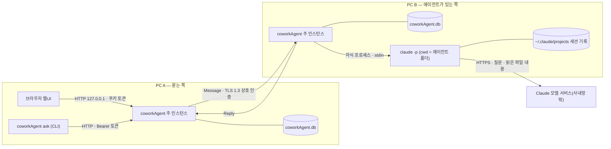
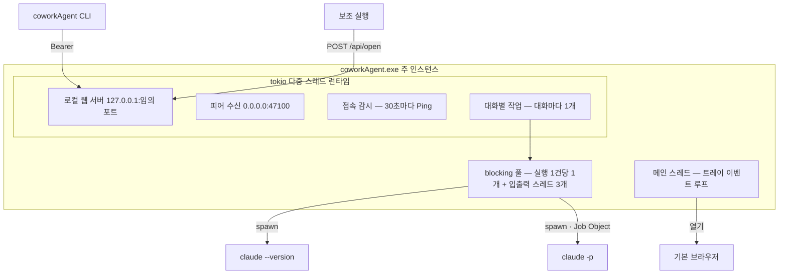
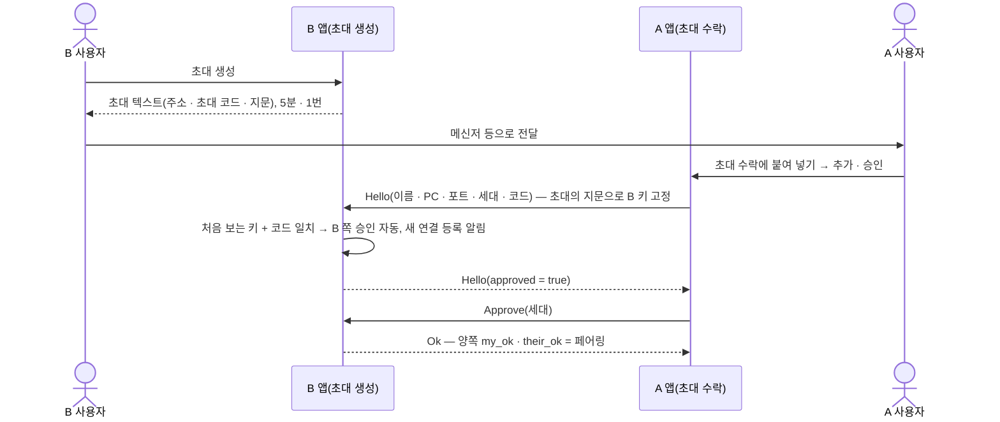
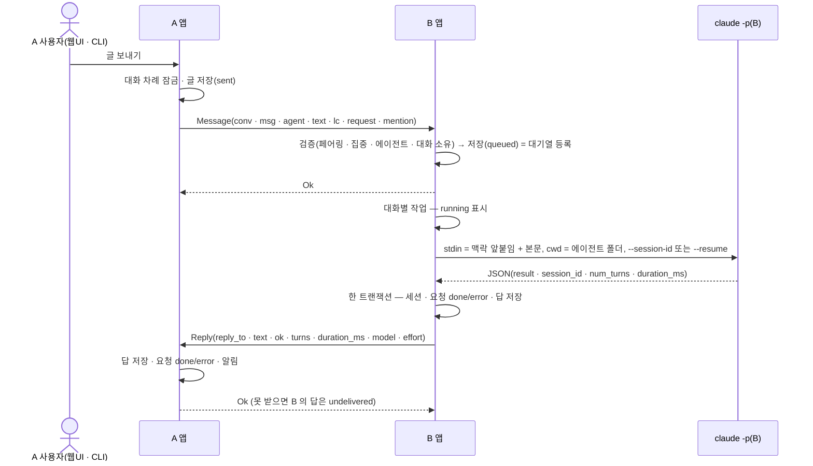
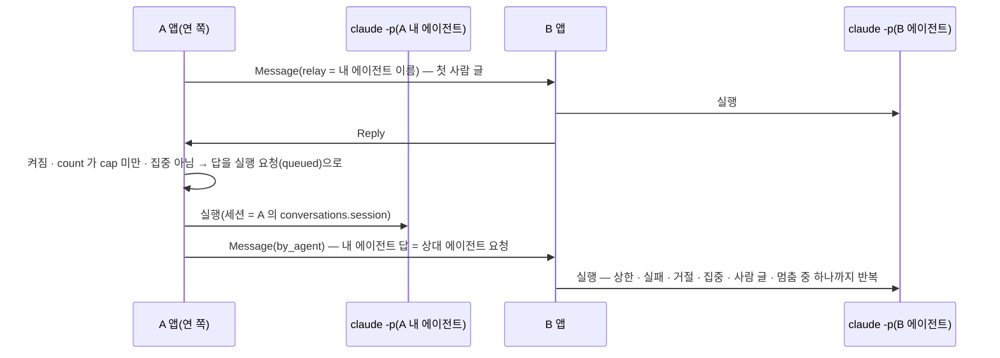
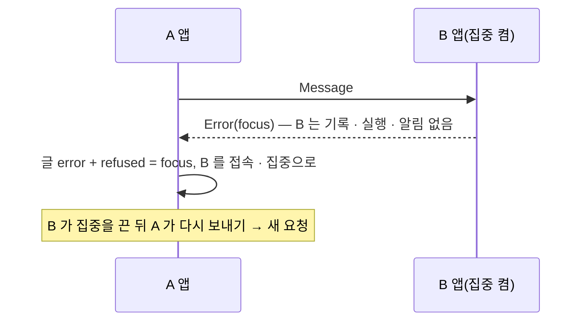
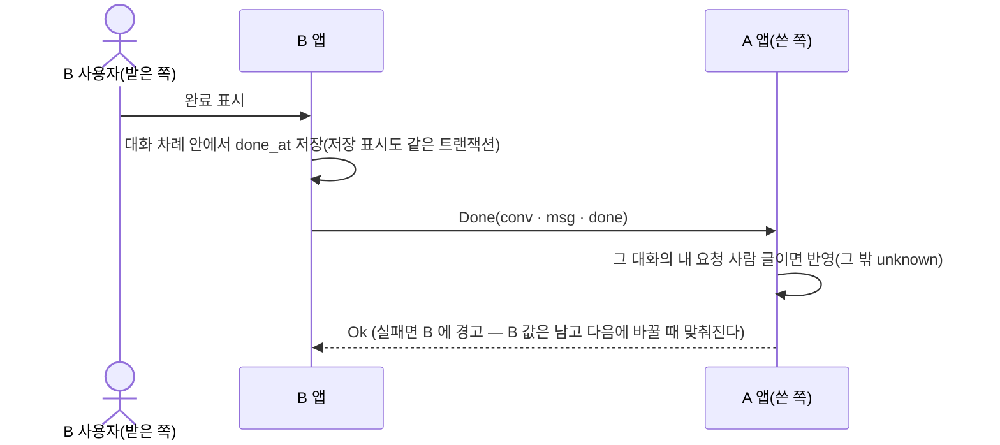
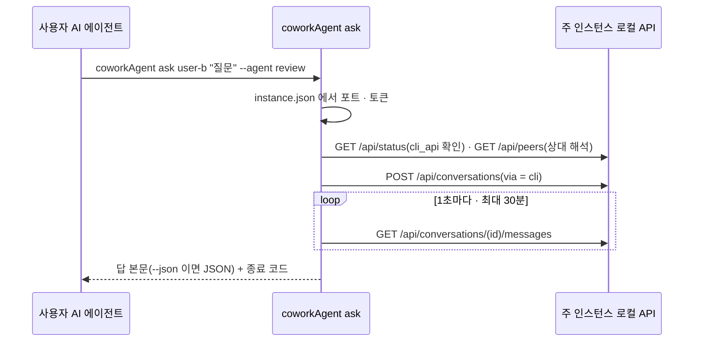
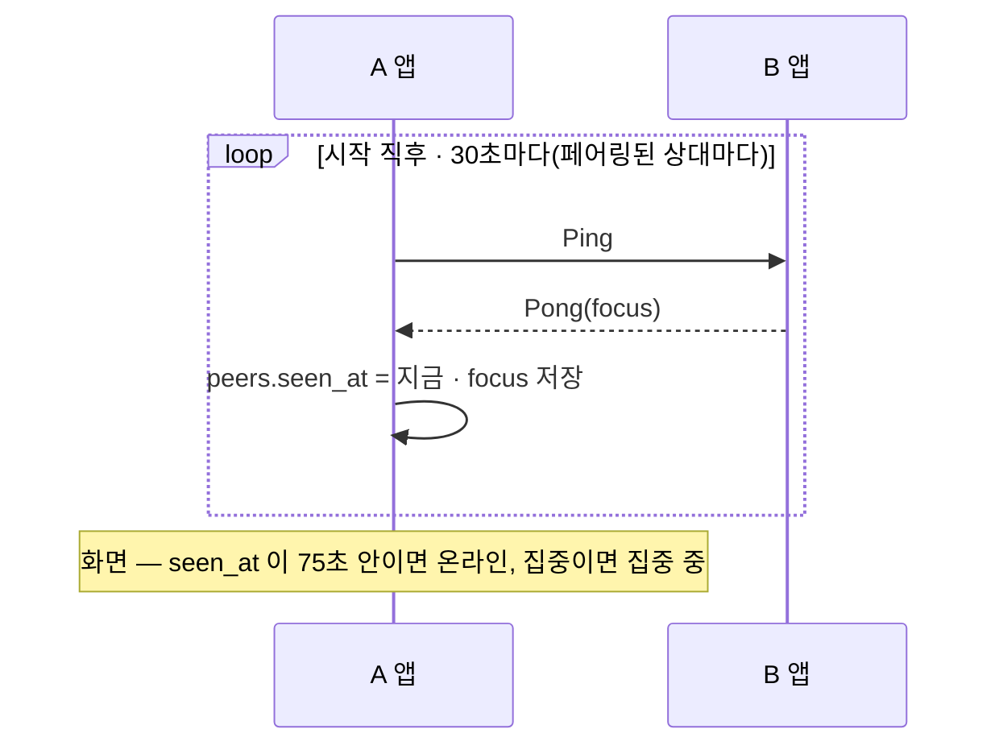

# 개발자 가이드 — 프로세스 · 서비스 · 세션 · 저장소 · 워크플로우

> 절차·운영 문서 — 모듈 매뉴얼 형식(개요 / 공개 계약 / 사용 예)의 예외다([매뉴얼 등록 규약](../README.md)).
> 모듈별 API · 계약의 정본은 [an_core](an_core.md) · [an_net](an_net.md) · [an_agent](an_agent.md) · [an_app](an_app.md) 이고, 여기는
> 그것들이 **실행 중에 어떻게 맞물리는지**를 적는다 — 어떤 프로세스가 생기고, 어떤 서비스가 무슨 역할을 하며, `claude -p` 헤드리스
> 대화의 세션 · 저장소 · 흐름이 어떻게 이어지는가. 결정 번호(D · S)는 [masterPlan](../../masterPlan.md). 수치 · 경로는 스키마 12 ·
> 검증 환경 Windows 11 · Claude Code 2.1.296 기준. 쓰는 사람용 안내는 [사용자 가이드](../user/user-guide.md).

## 1. 한눈에 보기

PC 마다 coworkAgent **주 인스턴스 하나**가 트레이에 상주하며 서버 · 클라이언트를 겸한다(D3). A 의 사람(또는 CLI)이 쓴 글은 B 로
가서 B 의 대기열에 들어가고, B 가 자기 에이전트 폴더에서 `claude -p` 를 실행해 답을 A 로 돌려보낸다. 대화 이력은 전달에 성공하면
**양쪽 SQLite 에 모두** 남고(답 전송 실패는 6.6), Claude 의 대화 맥락(세션)은 **에이전트를 실행한 PC 의 Claude Code 기록 파일에만**
있다 — coworkAgent 는 그 세션 ID 만 갖는다. PC 끼리는 LAN 으로 직접 잇지만, `claude -p` 는 질문과 도구가 읽은 파일 내용을 그 PC 의
Claude 모델 서비스(Claude Code 가 쓰는 제공자 — Max 구독 로그인이면 Anthropic)로 보내 답을 만든다 — 답 생성은 사내망 밖을 거친다.



## 2. 저장소 구조 (코드)

| 경로 | 크레이트 · 산출 | Layer | 담는 것 |
|---|---|---|---|
| `crates/core` | `an-core` | base | 데이터 경로 · SQLite 스키마와 표 접근 · 로그 회전 · 단일 인스턴스 · 실행 옵션 · 화면 설정 검증 |
| `crates/net` | `an-net` | comm | 신원(ed25519) · TLS 1.3 raw public key · 피어 프레임 · 피어 노드(수신 · 발신 · 페어링 · 접속 감시) · 초대 |
| `crates/agent` | `an-agent` | domain | `claude -p` 실행기(`runner`) · 대화 조율(`chat` — 대기열 · 세션 · 자동 왕복 · 멘션 · 완료) |
| `crates/app` | `coworkagent-app`(lib `an_app` · bin `coworkAgent`) | app | 시작 순서(`main.rs`) · 로컬 웹 서버 · API · CLI · 트레이 · 브라우저 열기 · 알림 |
| `crates/app/web` | 실행 파일에 임베드 | app | 빌드 없는 웹UI — `index.html` · `app.js`(조립) · `view.js`(판단 로직, `node --test`) · `app.css` |
| `tools/` | Python | — | 문서 규약 · gate · 크레이트 경계 체커 · 개발 PC 재빌드 실행(`rebuild_run.py`) |
| `docs/` | Markdown | — | DDD 문서 체계(masterPlan · Task · 매뉴얼 · 원장) |

- 의존 방향은 app → domain → comm → base 만(`tools/check_crates.py`). base 는 UI · HTTP · 트레이를 모른다.
- 빌드 · 테스트 · 검사 명령의 정본은 루트 `PROJECT.md` "검증 명령". 자주 쓰는 셋:

```powershell
cargo build --release -p coworkagent-app   # target\release\coworkAgent.exe — 콘솔 창 없는 트레이 앱
cargo run -p coworkagent-app               # 디버그 빌드 — 콘솔 창이 남는다(로그는 똑같이 파일로)
python tools/rebuild_run.py                # 떠 있는 앱 강제 종료 → 위 릴리스 빌드 → 실행(빌드 실패면 꺼진 채)
```

- 자동 테스트는 실제 `claude` 를 부르지 않는다(수신 PC 구독 사용량) — `Chat::new` 의 `Run` 자리에 대역을 넣는다([an_agent](an_agent.md)).
- 데이터 루트는 OS 사용자마다 하나(`%LOCALAPPDATA%\coworkAgent`)이고 경로를 바꾸는 스위치가 없다 — 한 OS 사용자 계정에 주 인스턴스는
  하나뿐이다. 테스트는 임시 루트(`Paths::under`)를 쓴다.

## 3. 프로세스

### 3.1 OS 프로세스

| 프로세스 | 언제 생기나 | 수명 · 개수 | 하는 일 |
|---|---|---|---|
| `coworkAgent.exe`(인자 없음) — **주 인스턴스** | 사용자가 실행 | OS 사용자당 1개(`instance.lock`), 트레이 "종료" 까지 | 트레이 · 로컬 웹 서버 · 피어 노드 · 대화 엔진 · 실행기를 모두 담는다. 시작만으로는 브라우저를 열지 않는다(트레이 "열기") |
| `coworkAgent.exe`(인자 없음) — 보조 실행 | 주 인스턴스가 이미 있을 때 다시 실행 | 보통 수 초(최악 약 53초) | `instance.json` 을 읽어 `POST /api/open`(브라우저 열기)을 넘기고 끝 — 300 ms 간격 최대 10번, 요청당 5초 |
| `coworkAgent.exe <명령>` — CLI | 사용자 · 사용자 AI 에이전트가 `peers` · `ask` · `history` | 명령 하나(`ask` 는 답을 최대 30분 기다린다) | 트레이 · 잠금 · 로거 없이 주 인스턴스의 로컬 API 를 부르고 종료 코드로 끝 |
| `claude --version` | `claude -p` 실행 직전마다 | 30초 상한 | 버전 확인 — 2.1.267(`MIN_CLAUDE`) 미만이면 실행하지 않는다 |
| `claude -p …` | 대기열의 실행 요청 1건마다 | 끝날 때까지 · 30분 상한(`RUN_TIMEOUT`) | 에이전트 폴더(cwd)에서 답을 만든다. 콘솔 창 없음(`CREATE_NO_WINDOW`) |
| `claude` 의 자손 | 도구 실행이 띄울 때 | `claude` 와 한 묶음 | Windows 는 kill-on-close Job Object, macOS 는 프로세스 그룹 — 끝나거나 시간 초과면 묶음째 종료 |
| 기본 브라우저 · 사유 파일 뷰어 | 트레이 "열기" · 핸드오프 · 시작 실패 "오류 보기" | 우리가 관리하지 않음 | Windows `ShellExecuteW` · macOS `open`(D30) |

macOS 에서는 시작 때 PC 이름용 `hostname` 이 한 번, 시간 초과 때 프로세스 그룹 종료용 `kill` 이 돈다.

### 3.2 주 인스턴스 안의 실행 단위



- 메인 스레드는 트레이 이벤트 루프(tao — macOS 는 메인 스레드 필수)만 돈다. 나머지는 tokio 런타임 위의 작업이다.
- `claude -p` 는 `spawn_blocking` 안에서 돌고, 실행마다 표준 입력 쓰기 · 표준 출력 읽기 · 표준 오류 읽기 스레드를 따로 둔다(파이프가
  가득 차 서로 기다리지 않게).
- **동시 실행 상한은 없다**(D24 개정) — 직렬은 대화 안에서만(6.4).

## 4. 서비스 역할

| 서비스 | 위치 · 주소 · 주기 | 역할 | 코드 |
|---|---|---|---|
| 트레이 | 메인 스레드 | 메뉴 "열기" · "종료". 새 요청 건수를 주황 점 · 툴팁 "coworkAgent — 새 요청 N건" 으로. 시작 실패면 오류 모드(붉은 아이콘 · "오류 보기" · "종료") | `app::tray` |
| 로컬 웹 서버 | `127.0.0.1:{임의 포트}` | 웹UI 정적 파일 · `/api/*` · SSE `/api/events` · 핸드오프 `POST /api/open`. 실행마다 새 토큰, Host · Origin 검사(D9) | `app::server` · `*_api` |
| 피어 수신 | `0.0.0.0:47100`(사용 중이면 OS 임의 포트) | 상대 요청 1건 = 연결 1개. TLS 1.3 상호 인증(서로 ed25519 키) → 인가(페어링 여부) → 처리기. 연결당 3초 · 동시 32 · 출처 IP 당 4 | `net::node::serve` |
| 피어 발신 | 상대의 `peers.addr` | 요청마다 새 TCP + TLS 연결, 상대 키 고정, 요청 · 응답 전체 10초 상한 | `net::node::send` |
| 접속 감시 | 시작 직후 + 30초마다 | 페어링된 상대마다 `Ping` → `Pong{focus}` 받은 시각을 `peers.seen_at` 에. 75초 안이면 온라인 | `node::watch_presence` |
| 대화 엔진 | 피어 처리기 + 대화별 작업 | 받은 요청 검증 · 저장(= 대기열 등록) · 대화별 순차 실행 · 답 전송 · 자동 왕복 · 완료 동기화 · 멘션. 피어 처리기는 막히지 않는다 — 실행은 대기열로 | `agent::chat::Chat` |
| 실행기 | blocking 풀 | `claude -p` 인자 · 표준 입력 · 시간 제한 · 출력(JSON) 읽기 | `agent::runner` |
| 알림 | 노드 · 대화 엔진 이벤트 | 설정이 허락하면 건수 +1 → 트레이 표시 · SSE → 브라우저 알림(기본 꺼짐) | `app::notify` |
| 로그 | `logs\coworkAgent.log` | 1 MiB 를 넘기 전에 `.1` 로 회전(1개 보관) | `core::log_file` |
| 단일 인스턴스 | `instance.lock` · `instance.json` | OS 파일 잠금(프로세스가 죽으면 OS 가 푼다) · 핸드오프 정보(포트 · 토큰) | `core::instance` |

웹UI 는 5초마다 목록 · 대화를 다시 읽고(`setInterval`), 알림만 SSE 로 받는다.

### 4.1 시작 · 종료 순서 (`crates/app/src/main.rs`)

1. 인자가 있으면 CLI(`cli::main`)로 끝낸다 — 주 인스턴스가 되지 않는다.
2. 트레이 객체를 만든다(메인 스레드).
3. 데이터 루트(D15) → 개명 전 `agentNetwork` 데이터 이어받기 → 폴더 · `logs` 만들기 → 파일 로거.
4. `instance.lock` 잠금 — 못 잡으면 보조 실행(핸드오프 후 종료).
5. DB 열기(스키마 올리기 · 올리기 전 `.v{N}.bak`) → 신원 키 읽기 · 없으면 생성.
6. tokio 런타임 · 웹 포트(`127.0.0.1:0`) · 실행마다 새 토큰 · 피어 포트(47100, 사용 중이면 임의).
7. 피어 노드 · 알림 · 대화 엔진 — 셋이 같은 DB 파일을 **각자 연결**로 연다(`busy_timeout` 5초). 실행기는 `claude` 를 실행마다 찾는다
   (`%USERPROFILE%\.local\bin\claude.exe`, 없으면 PATH) — 앱을 띄운 뒤 설치해도 된다.
8. `chat.attach()`(노드 요청 처리기) → `chat.recover()`(남은 대기열 — 6.6).
9. 피어 수신 루프 · 접속 감시 · 웹 서버를 띄우고 `instance.json` 을 쓴다 → 트레이 루프.
10. 트레이 "종료": 런타임 정지(1초) → `instance.json` 삭제 → 잠금 해제(마지막 — 그 사이 뜬 새 프로세스는 보조 실행으로 남는다).

## 5. 피어 통신 요약

- 프레임 = 4바이트 big-endian 길이 + JSON(최대 64 KiB), 글 본문은 16 KiB(`MAX_TEXT`). 요청 1건에 응답 1건, 그리고 연결을 닫는다.
- 요청 종류(`proto::Request`): 페어링 `Hello` · `Approve` · `Remove` · 접속 `Ping` · 대화 `Agents` · `Message` · `Reply` · `Post` ·
  `Relay` · `Done`. 응답: `Hello` · `Ok` · `Pong{focus}` · `Agents{names}` · `Error{code}`. 필드 정본은 [an_net](an_net.md).
- 미페어링 상대는 `Hello` · `Approve` · `Remove` 만. 대화 요청은 페어링(`my_ok ∧ their_ok`)된 키만 처리기로 간다(SC2).
- 상대가 준 오류 코드는 영소문자 · `_` 1 ~ 32 자만 남긴다(그 밖 `unknown`) — 원격 문자열은 신뢰하지 않는 입력.

## 6. 세션 관리

### 6.1 세 가지 ID

| ID | 만드는 곳 | 어디에 | 쓰임 |
|---|---|---|---|
| 대화 uuid | 대화를 연 PC(UUID v4) | 양쪽 `conversations.uuid` | 프레임의 `conv` — 두 PC 가 같은 대화를 가리킨다. 다른 상대의 같은 uuid 는 거부 |
| 메시지 uuid | 글 · 답을 만든 PC | 양쪽 `messages.uuid` | 재전송 판별(같은 uuid 는 한 번만 실행) · 답의 `reply_to` |
| Claude 세션 ID | 에이전트를 실행하는 PC | 그 PC 의 `conversations.session` 또는 `agent_sessions.session` | 첫 실행 `--session-id`, 이후 `--resume`. 상대 PC 는 모른다 |

### 6.2 어느 실행이 어느 세션을 쓰나

| 실행 | 실행하는 PC | 세션 저장 위치 |
|---|---|---|
| 상대가 연 대화의 대화 에이전트(보통 요청) | 받은 쪽 | `conversations.session`(`dir = 'in'`) |
| 같은 대화에서 @멘션으로 부른 다른 에이전트 | 받은 쪽 | `agent_sessions`(`conversation_id`, `agent`) — 대화 에이전트 세션과 섞지 않는다(D19 보강) |
| 자동 왕복의 내 에이전트 | 대화를 연 쪽 | `conversations.session`(`dir = 'out'`) |

대화를 연 쪽의 보통 대화(`out`, 자동 왕복 아님)에는 세션이 없다 — 에이전트가 상대 PC 에 있다.

### 6.3 세션 수명

1. **첫 실행** — 저장된 세션이 없으면 coworkAgent 가 UUID v4 를 만들어 `--session-id <uuid>` 로 준다.
2. **기록** — 끝난 실행 출력 JSON 의 `session_id` 를 요청 상태 · 답과 **한 트랜잭션**으로 저장한다. 단 실행한 에이전트의 지금 세대
   (`agents.uid`)가 실행 때와 같을 때만 — 실행 도중 폴더를 바꾸거나 지웠다 다시 등록했으면 남기지 않는다.
3. **이어 쓰기** — `--resume <세션 ID>`. 매 실행 가드 시스템 프롬프트를 다시 붙인다(`--append-system-prompt` +
   `--system-prompt-snapshot off` — 가드가 생기기 전에 만든 세션을 재개해도 지금 가드, D31).
4. **비우기** — 에이전트 폴더 변경 · 삭제 → `agents::forget_sessions(이름)`: 그 이름의 받은 대화(`in` · `agent`) · 자동 왕복 대화
   (`out` · `relay_agent`) 세션을 NULL 로, 멘션 세션(`agent_sessions`)을 지운다 + 새 세대(`uid`). 다음 실행은 새 세션.
5. 대화 내용(맥락)은 Claude Code 기록 파일에 있다 — coworkAgent 는 세션 ID 만 갖는다(7.4).

### 6.4 직렬화 · 순서

- **대화별 실행 작업 하나**(`Chat::wake`) — DB 대기열(`messages.exec = 1 AND state IN ('queued', 'running')`)을 id 순으로 하나씩
  실행한다. 같은 세션이 동시에 재개되지 않는다(공식 문서: 동시 resume 은 잠금 없이 섞인다 — D19). 멘션 실행도 같은 대화 대기열이다.
- **다른 대화끼리는 동시에** — PC 전체 동시 실행 상한 없음(D24 개정).
- **보내는 쪽 대화 차례**(`Chat::turn`) — 사람 글의 저장 → 전송 → 응답까지 대화당 한 번에 하나(보낸 순서 = 상대 도착 순서). 받은
  요청의 완료 표시도 같은 차례 안에서 보낸다.
- **양쪽 표시 순서** — 램포트 시계 `lc`(받은 글은 `observe` 로 맞춘다), 표시는 `(lc, uuid)` 순.

### 6.5 실행 입력 — 맥락 앞붙임

본문은 **표준 입력으로만** 넘긴다(명령 인자 · 셸에 넣지 않는다). 지난 실행 요청 뒤에 실행 없는 사람 글이 있었거나 요청이 상대
에이전트발(자동 왕복)이면 아래 꼴로 감싼다.

```text
[대화 메모 — 실행 요청 아님]
- {발화자}: {글}

[요청 — {발화자}]
{본문}
```

발화자는 `이 PC 사용자` · `{상대 이름} · {PC 이름}` · `상대 에이전트({상대 이름} · {PC 이름})`. 실행 인자는 아래와 같다(정본
`runner::claude_args`).

```text
claude -p --output-format json --restricted --strict-mcp-config --permission-prompts none
  --permission-mode dontAsk --tools <도구> --allowedTools <도구>
  --append-system-prompt <가드 + [수신자 추가 지시]> --system-prompt-snapshot off
  (--session-id <새 UUID> | --resume <세션 ID>) --model <모델> --effort <effort>
```

- 도구는 읽기 전용 목록(`Read` · `Grep` · `Glob` · `LS` · `NotebookRead`) 안의 프로필 값, 비면 `Read,Grep,Glob`(D22 · D31).
- 모델 · effort 는 실행 직전에 정한다 — 그 상대 덮어쓰기 → 전역 설정 → `sonnet` · `high`. 설정을 못 읽으면 기본값으로 돌리지 않고 실패 답.
- `--bare` 는 쓰지 않는다 — 구독 로그인을 읽지 않기 때문(D20).

### 6.6 실패 · 복구

| 상황 | 결과 |
|---|---|
| 앱이 실행 도중 꺼짐 | 다시 켤 때 `recover`: `queued` 는 실행, `running` 은 실패 답 "실행 도중 상대 앱이 종료돼 결과가 없다 — 다시 보내 주세요" |
| 30분 초과 | 자손까지 종료 → "실행 실패: 실행 시간 1800초 초과" |
| Claude Code 버전 낮음 | 실행하지 않음 → "실행 실패: Claude Code x.y.z — 2.1.267 이상이 필요하다(`claude update`)" |
| 세션 기록 파일이 없음 | `--resume` 이 종료 1 · 표준 출력 비움 · stderr "No conversation found with session ID: …"(2.1.296 실측) → 실패 답. 세션 ID 는 남아 **그 대화의 다음 요청도 같은 실패** — [원장](../../overview/ledger.md) `#15 R2-F2r`(열림). 우회는 새 대화 |
| 기록 트랜잭션 실패 | 요청 `error`, 답 "실행 실패: 받는 PC 기록 오류 — …" |
| 답 전송 실패 | 받은 쪽 답이 `undelivered` — 재전송하지 않는다(오프라인 보관 · 재전송은 Phase 2, D7) |
| 보내기 전송 오류 | 보낸 글은 `sent` 그대로 + "전달 확인 안 됨 … 답을 기다린 뒤 다시 보내세요" — 상대가 받았을 수 있으니 늦은 답을 받는다(중복 실행 방지) |
| 상대 거절 | 보낸 글 `error` + 거절 코드(`messages.refused`). `focus` 면 "상대가 집중 중", 다시 보내면 코드를 지운다 |

### 6.7 웹UI · CLI 접속 세션

- **웹UI** — 실행마다 새 토큰(32바이트 hex). 트레이 "열기" URL `/?t={토큰}` → 쿠키 `an_token`(HttpOnly · SameSite=Strict) 심고 `/` 로
  303. 쿠키 인증의 상태 변경 요청은 Origin 필수. 앱을 다시 켜면 이전 탭의 쿠키는 맞지 않는다(401) — 트레이 "열기" 로 다시 연다.
- **CLI** — `instance.json` 의 포트 · 토큰을 `Authorization: Bearer` 로. 보내기 전 `GET /api/status` 의 `cli_api` 로 출처 표시를 아는
  인스턴스인지 확인한다. 앱이 꺼져 파일이 없으면 종료 코드 3.

## 7. 저장소 (데이터)

### 7.1 데이터 폴더 (D15)

```text
%LOCALAPPDATA%\coworkAgent\              macOS: ~/Library/Application Support/coworkAgent/
├── coworkAgent.db                      SQLite — 연결 · 에이전트 · 대화 · 글 · 설정(스키마 12)
├── coworkAgent.db.v{N}.bak             스키마 N 에서 올리기 직전 사본(VACUUM INTO, 버전마다 한 번)
├── identity.key                        설치 신원 ed25519(PKCS#8) — 리포 · 로그 · UI 로 내보내지 않는다
├── instance.lock                       단일 인스턴스 잠금
├── instance.json                       실행 중에만 — {"port":…, "token":"…"}(핸드오프 · CLI)
└── logs\coworkAgent.log(.1)            1 MiB 회전, 1개 보관
```

폴더 밖: 시작 실패 사유 `%TEMP%\coworkAgent-start-error.txt`, Claude Code 기록(7.4).

### 7.2 DB 표 (스키마 12)

| 표 | 한 행 | 주요 열 |
|---|---|---|
| `peers` | 연결한 PC | `spki`(공개키) · `name` · `host` · `addr` · `my_ok` · `their_ok` · `round`(페어링 세대) · `grp` · `model` · `effort` · `alias` · `icon` · `activity_seen_msg` · `activity_seen_event` · `seen_at`(마지막 `Pong`) · `focus` |
| `settings` | 키 · 값 | 아래 키 |
| `agents` | 내 에이전트 | `name`(UNIQUE — 상대가 부르는 이름, 바꾸지 않는다) · `folder` · `tools` · `prompt` · `grp` · `uid`(세대) |
| `conversations` | 대화 | `uuid` · `peer_id` · `agent`(대화 에이전트) · `dir`(`out` 내가 엶 · `in` 상대가 엶) · `session` · `relay_agent` · `relay_cap` · `relay_count` · `relay_on` · `relay_blocked` · `title` · `starred_at` · `read_id` |
| `messages` | 사람 글 · 에이전트 답 | `uuid` · `conversation_id` · `author`(`human` · `agent`) · `text` · `state` · `reply_to` · `turns` · `duration_ms` · `mine` · `exec`(실행 요청) · `lc` · `via`(`cli`) · `saved_at` · `model` · `effort` · `request` · `done_at` · `agent`(멘션) · `refused` |
| `relay_events` | 자동 왕복 시작 · 끝 · 내 글이 실패로 바뀐 순간 | `conversation_id` · `kind` · `detail` · `message_id` |
| `agent_sessions` | 대화 × 멘션 에이전트 세션 | (`conversation_id`, `agent`) → `session` |

- 글 상태 `state`: `sent` 보냄 · `queued` 실행 대기 · `running` 실행 중 · `done` 끝 · `error` 실패 · `undelivered` 답을 상대에 못 보냄.
- `settings` 키: `notify_inbound` · `notify_pair` · `notify_request` · `notify_reply` · `notify_relay` · `notify_preview` · `notify_paused` ·
  `relay_cap_default` · `claude_model` · `claude_effort` · `ui_theme` · `ui_side_width` · `me_alias` · `me_icon` · `focus`.

### 7.3 양쪽에 남는 것 · 이 PC 에만 있는 것

| 양쪽(전달에 성공한 프레임으로) | 이 PC 에만 |
|---|---|
| 사람 글 · 에이전트 답 본문, 순서(`lc`), 질의 · 요청, 완료 표시, 멘션 이름, 출처(`via`), 답의 실행 정보(턴 · 시간 · model · effort) | 대화 제목 · ★ · 저장 · 읽음 · 내 활동 본 표시 · 타일 표시 이름 · 아이콘 · 그룹 · 상대별 model · effort · 알림 설정 · 집중 · 접속 상태 · **Claude 세션 ID** |

답 전송에 실패하면 그 답은 실행한 PC 에만 `undelivered`(화면 "답 미전달")로 남고 다시 보내지 않는다 — 두 DB 가 달라진 채로 남는다(6.6).

### 7.4 Claude Code 쪽 기록 — 헤드리스 대화의 맥락

- `claude -p` 도 세션을 디스크에 남긴다 — 기본 위치 `%USERPROFILE%\.claude\projects\{작업 폴더 경로의 영숫자 밖 글자를 '-' 로 바꾼 이름}\{세션 ID}.jsonl`
  ([공식 문서 — Where transcripts are stored](https://code.claude.com/docs/en/sessions#where-transcripts-are-stored)). 예: 에이전트
  폴더 `D:\work\shop-api` → `D--work-shop-api`. 실측(2026-10-12, 2.1.296): `-p` 기록에는 `"entrypoint":"sdk-cli"` 가 찍힌다.
  비ASCII(한글) · 아주 긴 경로의 이름 규칙은 문서에 없다(확인 필요).
- `claude` 는 coworkAgent 의 환경 변수를 그대로 물려받는다(실행기가 고정 · 차단하지 않는다). `CLAUDE_CONFIG_DIR` 이 있으면 그 아래에 남고,
  세션 저장을 끄는 설정(`CLAUDE_CODE_SKIP_PROMPT_HISTORY` — [공식 문서](https://code.claude.com/docs/en/cli-reference#cli-flags))이면 남지
  않아 다음 `--resume` 이 실패한다.
- coworkAgent 는 이 파일을 읽거나 쓰지 않는다 — 세션 ID 로 `--resume` 할 뿐이다. coworkAgent 데이터를 지워도 이 기록은 남는다(대화
  내용을 다 지우려면 두 곳).
- Claude Code 는 오래된 기록을 지운다 — `cleanupPeriodDays` 기본 30일(최소 1), 세션 시작 때 한 번 정리
  ([공식 문서](https://code.claude.com/docs/en/claude-directory#cleaned-up-automatically)). 나이를 재는 기준은 문서에 없다. 지워진
  세션의 대화는 6.6 "세션 기록 파일이 없음" 으로 계속 실패한다 — 오래 쉰 대화는 새 대화로 시작한다. 더 오래 이어 쓰려면 그 PC 의
  Claude Code 설정에서 `cleanupPeriodDays` 를 늘린다(coworkAgent 밖 설정).
- 공식 문서상 `--resume <ID>` 는 이 PC 의 어느 프로젝트에서든 ID 로 세션을 찾는다
  ([공식 문서](https://code.claude.com/docs/en/sessions#resume-by-session-id-or-name)). 폴더를 바꿀 때 세션을 비우는 것은 에이전트가
  읽던 폴더(맥락)가 바뀌기 때문이다. `crates/core/src/agents.rs` 주석의 "새 폴더에서 `--resume` 하면 찾지 못한다" 는 이 문서와 다르다(확인 필요).

### 7.5 스키마 올리기

- DB 를 열 때 `PRAGMA user_version` 을 보고 순서대로 올린다 — v5 부터는 단계마다 한 트랜잭션이고, v2 ~ v4 는 트랜잭션 없이
  `CREATE TABLE IF NOT EXISTS` 묶음이라 중간에 끊겨도 다시 열면 이어서 끝난다. 올리기 전 **처음 버전**의 사본 하나(`.v{처음}.bak`)만
  남긴다 — 10 → 12 를 한 번에 올리면 `.v10.bak` 하나.
- 이 실행 파일보다 새 스키마면 열지 않는다("DB 스키마 N 가 이 실행 파일(M)보다 새롭다" — 시작 실패). 이전 실행 파일로 돌아가려면
  앱을 끄고 사본을 `coworkAgent.db` 로 바꿔 쓴다 — 사본 뒤에 생긴 데이터는 잃으므로 지금 DB 를 먼저 다른 이름으로 보존한다.
- 같은 버전의 사본이 이미 있으면 새로 뜨지 않는다(`backup_before_migration`) — 되돌린 뒤 다시 올려도 `.v{N}.bak` 은 처음 시점 그대로다.
- 배포 전 하위 호환은 두지 않지만(D32) 사용자 데이터는 순방향 마이그레이션으로 보존한다.

### 7.6 들여다보기

```powershell
# 읽기 전용으로 — 앱과 함께 쓰면 잠금을 기다릴 수 있다
sqlite3 -readonly "$env:LOCALAPPDATA\coworkAgent\coworkAgent.db" "SELECT id, dir, agent, session FROM conversations ORDER BY id DESC LIMIT 5;"
# 세션 ID 로 Claude Code 기록 파일 찾기
Get-ChildItem "$env:USERPROFILE\.claude\projects" -Recurse -Filter "<세션 ID>.jsonl"
```

## 8. 워크플로우

### 8.1 페어링 (초대)



- 아는 키의 다시 추가는 양쪽 승인을 초기화하고 사람 승인을 기다린다. "주소 · 코드로 직접 추가" 는 지문을 고정하지 않는다(D8 개정 —
  사내망 전용 위험 수용).

### 8.2 질의 1왕복



- 받은 쪽 사람이 그 대화에 쓴 글(실행 없음)은 `Post` 로 상대 이력에 미러된다. 다음 실행 때 "대화 메모" 로 함께 넘어간다(6.5).
- 상태 전이 — 보낸 쪽 글: `sent` → `done` | `error`(실패 답 · 상대 거절). 받은 쪽 요청: `queued` → `running` → `done` | `error`.

### 8.3 자동 왕복 (D24)



- 연 쪽이 구동한다. 상한 n = 양쪽 n 번씩(1 ~ 50, 기본 10). 어느 쪽이든 사람이 쓰거나 멈추면 멈추고, 받은 쪽이 멈추면 그 PC 는
  에이전트발 요청을 `stopped` 로 거절한다. 재개는 연 쪽만(카운트 0).

### 8.4 @멘션 (D19 보강)

- 내가 연 대화(자동 왕복 아님)에서 글의 첫 `@이름` 이 상대 PC 에이전트 이름이면 `Message.mention` 으로 싣는다(`agent` 는 늘 대화 에이전트).
- 받은 쪽은 대기열 실행 때 `mention` 의 에이전트를 실행하고 세션은 `agent_sessions` 를 쓴다. 답의 `agent` 는 요청의 값이고, 보낸
  쪽도 답을 받을 때 요청의 값을 붙인다.
- 받은 대화 · 자동 왕복 대화 · 새 대화에는 멘션이 없다(보내는 쪽 400 · 받는 쪽 `bad_request`), 없는 이름은 `unknown_agent`.

### 8.5 집중 거절 · 다시 보내기 (D17 개정)



- 이미 받은 글의 재전송(같은 uuid)은 집중 중에도 `Ok`(한 번만 실행). 진행 중 자동 왕복은 다음 차례에서 멈추고(끝 사유 — 상대가
  집중이면 "상대가 집중 중", 연 쪽이 집중이면 "집중 중"), 집중 동안 알림도 멈춘다.

### 8.6 요청 완료 동기화



### 8.7 CLI `ask` (D14 보강)



- `--conv N` 이면 그 대화에 이어 쓰고(`POST /api/conversations/{N}/messages`), `--agent X` 가 대화 에이전트가 아니면 멘션이다.
- 종료 코드 0 · 2 사용법 · 3 실행 중 아님 · 4 API 거부/전달 불명(다시 보내지 말고 `history` 확인) · 5 답 실패 · 6 시간 초과.

### 8.8 접속 감시



## 9. 보안 경계 요약

| 경계 | 막는 것 | 장치 |
|---|---|---|
| 브라우저 ↔ 로컬 서버 | 다른 사이트 · DNS rebinding | 127.0.0.1 · 실행마다 토큰 · 쿠키 HttpOnly · SameSite=Strict · Host · Origin 검사(D9) |
| CLI ↔ 로컬 서버 | 토큰 없는 호출 | `instance.json` 토큰(Bearer). 같은 OS 사용자의 로컬 프로세스는 부를 수 있다 — 웹UI 와 같은 신뢰 경계(위험 수용, #16) |
| PC ↔ PC | 미페어링 · 사칭 · 도청 | TLS 1.3 상호 인증(ed25519 공개키 고정), 페어링된 키만 대화 요청, 수신 3초 · 동시 32 · IP 당 4 · 미승인 32. 상대 주소가 사내망인지는 검사하지 않는다(`0.0.0.0` 수신 · 아무 주소로 발신) — 사내망 전제 |
| 원격 글 → 화면 | 스크립트 주입 | `textContent` 로만 그림 · markdown sanitize · HTML 은 sandbox iframe |
| 원격 글 → `claude` | 수신 PC 작업 개입 | 표준 입력만 · 가드 프롬프트(D31) · 읽기 전용 도구 · 제한 옵션(D22) · 30분 상한 |
| 자격 증명 | 토큰 수집 · 중개 | coworkAgent 는 Claude 자격 증명을 읽거나 저장하지 않는다 — `claude` 가 그 PC 의 로그인을 스스로 쓴다 |
| 답 생성 → 모델 서비스 | (막지 않음) | `claude -p` 가 질문 · 맥락 · 도구가 읽은 파일 내용을 그 PC 의 Claude 모델 서비스로 보낸다 — 사내망 밖 전송, 보존 · 처리는 그 PC 의 Claude 계정 정책 |

남는 위험: 에이전트 폴더에서 읽을 수 있는 것은 답으로 상대에게 나갈 수 있다 · 원격 요청이 수신 PC 의 Max 사용량을 상한 없이 쓴다
(D24 개정) · 초대 메시지가 새면 5분 창 안에서 제3자가 등록된다(D8 개정) · 수신 포트를 인터넷에 열면 사내망 밖에서도 붙는다(LAN 검사 없음) ·
답을 만들 때 질문 · 읽은 파일 내용이 Claude 모델 서비스(사내망 밖)로 나간다.

## 10. 디버깅 · 운영

- **로그** `logs\coworkAgent.log` — "시작 — 127.0.0.1:{port}" · "피어 수신 0.0.0.0:{port} · 지문 …" · "남은 대화 대기열 N건 복구" · 답
  전달 실패 등. 비밀키 · 초대 코드는 싣지 않는다.
- **실행 실패 원문**은 답 본문("실행 실패: …")에 있다 — `claude` 의 종료 상태 · stderr 를 포함한다.
- **세션 추적** — DB `conversations.session` · `agent_sessions.session` → 7.6 으로 Claude Code 기록 파일을 찾는다.
- **포트** — 피어 수신이 47100 을 못 잡으면 임의 포트로 뜬다. 지금 값은 웹UI 설정 → 내 정보 "수신 주소" 와 로그.
- **두 번째 실행이 아무것도 안 하는 것 같다** — 핸드오프로 기존 인스턴스의 브라우저 열기를 부르고 끝난 것이다. 옛 빌드가 떠 있으면
  새 빌드를 실행해도 옛 인스턴스가 응답한다 — 트레이 "종료" 후 새 빌드를 실행한다.

## 11. 참고

- 모듈 계약: [an_core](an_core.md) · [an_net](an_net.md) · [an_agent](an_agent.md) · [an_app](an_app.md)
- 결정 · 명세: [masterPlan](../../masterPlan.md) — D3(단일 실행 파일 서버 · 클라이언트) · D9(로컬 웹UI) · D15(저장 경로) · D16(`claude -p`) ·
  D19(이어서 작업 · 멘션 세션) · D22 · D31(실행 권한 · 문의 응답 전용) · D24(자동 왕복 · 시간 제한) · D17(집중)
- 제품 규칙 정본: 루트 `PRODUCT.md` "도메인 규칙" · 미조치: [원장](../../overview/ledger.md)
