# 개발자 가이드 — 통신 구성 · 프로세스 · 서비스 · 세션 · 저장소 · 워크플로우 · 빌드 · 개발

> 절차·운영 문서 — 모듈 매뉴얼 형식(개요 / 공개 계약 / 사용 예)의 예외다([매뉴얼 등록 규약](../README.md)).
> 모듈별 API · 계약의 정본은 [an_core](an_core.md) · [an_net](an_net.md) · [an_agent](an_agent.md) · [an_app](an_app.md) 이고, 여기는
> 그것들이 **실행 중에 어떻게 맞물리는지**를 적는다 — 어떤 프로세스가 생기고, 어떤 서비스가 무슨 역할을 하며, `claude -p` 헤드리스
> 대화의 세션 · 저장소 · 흐름이 어떻게 이어지는가. 결정 번호(D · S)는 [masterPlan](../../masterPlan.md). 수치 · 경로는 스키마 23 ·
> 검증 환경 Windows 11 · Claude Code 2.1.296 기준. 쓰는 사람용 안내는 [사용자 가이드](../user/user-guide.md).

## 1. 한눈에 보기

PC 마다 coworkAgent **주 인스턴스 하나**가 트레이에 상주하며 서버 · 클라이언트를 겸한다(D3). A 의 사람(또는 CLI)이 쓴 글은 B 로
가서 B 의 대기열에 들어가고, B 가 자기 에이전트 폴더에서 `claude -p` 를 실행해 답을 A 로 돌려보낸다. 상대에게 가는 대화 프레임은
보내는 PC 의 outbox 에 먼저 적고 응답을 받을 때까지 다시 보낸다(6.6) — 상대가 꺼져 있어도 켜지면 닿는다. 대화 이력은 전달에 성공하면
**양쪽 SQLite 에 모두** 남고, Claude 의 대화 맥락(세션)은 **에이전트를 실행한 PC 의 Claude Code 기록 파일에만**
있다 — coworkAgent 는 그 세션 ID 만 갖는다. PC 끼리는 LAN 으로 직접 잇지만, `claude -p` 는 질문과 도구가 읽은 파일 내용을 그 PC 의
Claude 모델 서비스(Claude Code 가 쓰는 제공자 — Max 구독 로그인이면 Anthropic)로 보내 답을 만든다 — 답 생성은 사내망 밖을 거친다.

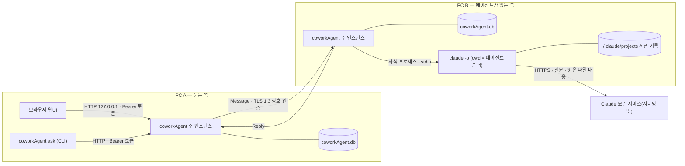

## 2. 저장소 구조 · 빌드 · 개발

### 2.1 코드 구조

| 경로 | 크레이트 · 산출 | Layer | 담는 것 |
|---|---|---|---|
| `crates/core` | `an-core` | base | 데이터 경로 · SQLite 스키마와 표 접근(보내기 보관 `outbox` · CLI 트랜잭션 `cli_tx` 포함) · 로그 회전 · 단일 인스턴스 · 실행 옵션 · 화면 설정 검증 |
| `crates/net` | `an-net` | comm | 신원(ed25519) · TLS 1.3 raw public key · 피어 프레임 · 피어 노드(수신 · 발신 · 페어링 · 시작 알림 · 통신 때 접속 시각) · 초대 |
| `crates/agent` | `an-agent` | domain | 에이전트 실행기(`runner` — `claude -p` · `codex exec`, 단계 요약) · 대화 조율(`chat` — 대기열 · 보내기 보관 · 상대별 보내기 줄 · 세션 · 자동 왕복 · 멘션 · 완료 · CLI 트랜잭션) |
| `crates/app` | `coworkagent-app`(lib `an_app` · bin `coworkAgent`) | app | 시작 순서(`main.rs`) · 로컬 웹 서버 · API · CLI · 트레이 · 브라우저 열기 · 알림 |
| `crates/app/web` | 실행 파일에 임베드 | app | 빌드 없는 웹UI — `index.html` · `js/`(ES 모듈 — 진입 `app.js` · `core/` · 도메인 · `settings/` 는 조립, `logic/` 은 판단 로직 · `node --test`, 목록 = `server::SCRIPTS`) · `app.css` |
| `tools/` | Python | — | 문서 규약 · gate · 크레이트 경계 · README(`check_readme.py`) 체커 · 개발 PC 재빌드 실행(`rebuild_run.py`) · 포트 풀림 실측(`port_check.py`) |
| `docs/` | Markdown | — | DDD 문서 체계(masterPlan · Task · 매뉴얼 · 원장) |

- 의존 방향은 app → domain → comm → base 만(`tools/check_crates.py`). base 는 UI · HTTP · 트레이를 모른다.

### 2.2 빌드 · 실행

| 항목 | 내용 |
|---|---|
| 빌드 도구 | Rust stable(검증 `rustc 1.95.0` · `x86_64-pc-windows-msvc`) |
| 웹UI 화면 로직 시험 | Node 22+ — 개발 PC 에만(웹UI 는 빌드 없는 ES 모듈이라 실행에는 필요 없다) |

```powershell
cargo build --release -p coworkagent-app   # target\release\coworkAgent.exe — 설치 없는 단일 실행 파일 · 콘솔 창 없는 트레이 앱
.\target\release\coworkAgent.exe           # 트레이에 상주 — 창은 뜨지 않는다(트레이 "열기" → 기본 브라우저에 웹UI)
cargo run -p coworkagent-app               # 디버그 빌드 — 콘솔 창이 남는다(로그는 똑같이 파일로)
python tools/rebuild_run.py                # 떠 있는 앱 강제 종료 → 위 릴리스 빌드 → 실행(빌드 실패면 꺼진 채)
python tools/rebuild_run.py --yes          # 빌드 도구(Rust · C 컴파일러)가 없으면 묻지 않고 설치한 뒤 위와 같이
```

- 이미 떠 있을 때 다시 실행하면 웹UI 만 열린다(보조 실행 — 3.1). 데이터는 `%LOCALAPPDATA%\coworkAgent\`(7.1).
- `tools/rebuild_run.py` 는 실행 파일 잠금 때문에 앱을 끄고 빌드한다 — 실행 중이던 요청은 다음 시작 때 실패 답이 되고, 빌드가 실패하면 앱은 꺼진 채로
  남는다. 앱은 탐색기로 띄워 부른 셸의 환경 변수가 앱 · `claude -p` 로 새지 않는다(Claude Code 세션 환경에는 `CLAUDE_CODE_MESSAGING_TOKEN` ·
  `CLAUDE_EFFORT` 등이 있다 — 세션에서 `Start-Process` 로 띄우면 그대로 물려간다).
- macOS 도 같은 명령이다 — `target/release/coworkAgent`(이 PC 아키텍처 하나, universal 은 Phase 4). 종료는 `SIGKILL`(앱이 띄운 `claude -p` 프로세스 그룹
  먼저), 실행은 로그인 기본 변수(`HOME` · `PATH` · `LANG` 등 — 스크립트 `KEEP_ENV`)만 남긴 새 세션이라 세션 변수가 새지 않는다.
- 빌드 도구가 빠졌으면 먼저 설치한다(앱은 끄지 않은 채) — Rust stable 1.85 이상(rustup, `~/.cargo/bin`) · C 컴파일러 · 링커(`ring` · rusqlite
  `bundled`): Windows 는 winget 으로 Visual Studio 2022 Build Tools(C++ — 관리자 승인 창), macOS 는 Xcode Command Line Tools(`xcode-select --install`
  창). 터미널이면 묻고, 터미널이 아닌 곳(Claude Code 세션)은 `--yes` 일 때만 설치한다. crate 는 cargo 가 받는다.
- 버전은 `crates/*/Cargo.toml` 의 `version` 하나 — 화면 상태(`/api/status`)와 실행 파일 속성(파일 · 제품 버전)이 같은 값이다. `crates/app/build.rs` 가
  빌드 때 아이콘 · 버전 리소스를 만들어 넣는다.

### 2.3 개발 — 검증 명령

문서 주도 개발(DDD)로 진행한다 — 시작점은 루트 `CLAUDE.md`. 커밋 · 종결 전 검증(정본은 루트 `PROJECT.md` "검증 명령"):

```powershell
cargo test --workspace
cargo clippy --workspace --all-targets -- -D warnings
node --test --test-reporter=tap "crates/app/web/*.test.mjs"
python tools/check_ddd_docs.py
python tools/check_crates.py
```

- 자동 테스트는 실제 `claude` 를 부르지 않는다(수신 PC 구독 사용량) — `Chat::new` 의 `Run` 자리에 대역을 넣는다([an_agent](an_agent.md)).
- 데이터 루트는 OS 사용자마다 하나(`%LOCALAPPDATA%\coworkAgent`)이고 경로를 바꾸는 스위치가 없다 — 한 OS 사용자 계정에 주 인스턴스는
  하나뿐이다. 테스트는 임시 루트(`Paths::under`)를 쓴다.

### 2.4 릴리스 · 자동 업데이트

#30 · D36 개정 — 개발 PC(Windows)에서 회사 인증서로 서명한 정식 릴리스를 만든다(배포처 `https://github.com/Softcamp-SaaS-RND/coworkAgent/releases`):

```text
1) crates/*/Cargo.toml 의 version 을 올린다(태그 v{X.Y.Z} 와 같은 값) → squash push(origin/main 에 그 코드)
2) cargo build --release -p coworkagent-app
3) 사용자가 target/release/coworkAgent.exe 에 회사 인증서(SOFTCAMP CO.,LTD.) Authenticode 서명을 더해 dist\coworkAgent.exe 로 복사(손으로)
4) 서명 · 버전 확인(dist\coworkAgent.exe) — Get-AuthenticodeSignature = Valid · 서명자 CN = SOFTCAMP CO.,LTD. · 파일 속성 버전 = X.Y.Z · SHA-256
5) gh release create v{X.Y.Z} dist/coworkAgent.exe -R Softcamp-SaaS-RND/coworkAgent --target <origin/main 전체 SHA> --latest
6) 받은 자산 SHA-256 대조 · cargo test -p coworkagent-app --test update -- --ignored real_   (real_github_latest · real_signed_release)
```

- **게시는 `dist\` 의 exe**(1.3.3 뒤 — 사용자 결정) — 빌드 · `tools/rebuild_run.py` 는 지금처럼 `target\release\` 에 만든다. 그 자리의 서명본은 다음 `cargo build`(다시 링크하지
  않아도)가 서명 전 파일로 되돌린다(1.3.3 릴리스 뒤 관측 — cargo 가 `deps\` 산출물을 다시 옮겨 놓는 것으로 추정, 확인 필요). 그래서 서명본은 `dist\` 에 두고 거기서 올린다. `dist/` 는 `.gitignore`.

- **서명 확인**(#30) — 업데이터는 받은 파일을 `{exe}.new` 로 쓴 뒤 `update::authenticode`(WinVerifyTrust · 신뢰 루트 · 코드 서명 용도 · 인증서 폐기 확인)가
  통과하고 서명 인증서 이름(CN)이 `update::SIGNER`(`SOFTCAMP CO.,LTD.`)이며, 서명이 덮는 버전 리소스가 `ProductName` = `coworkAgent`(`update::PRODUCT`) · 파일 버전 = 태그일 때만
  바꾼다(`update::verify` — 적대적 평가 R1: 회사 서명된 옛 버전 · 다른 제품을 높은 태그에 붙여 내려 깔기 차단) — 서명 없는 · 고친 · 다른 회사 서명 · 태그와 버전이 다른 exe 는
  `Skipped`(저장소를 빼앗겨도 깔리지 않는다). 그래서 릴리스 태그는 exe 속성 버전과 같아야 한다.
  그 앞에 이 PC 의 실행 파일 꼴(PE · 같은 아키텍처 — `is_native_pe`)도 본다. 서명하지 않은 exe 를 정식으로 올리면 어느 PC 도 바꾸지 않는다(로그 "서명 확인 실패")
- **정식 릴리스만** — `--latest`. `--prerelease` 로 올리면 자동 업데이트 대상이 아니다(`releases/latest` 가 가리키지 않는다). 태그는 `vX.Y.Z` 꼴만(`v1.0.0-macos` 같은
  꼬리 태그는 무시), macOS 자산(`coworkAgent-macos.zip`)은 자동 업데이트하지 않는다(`update::ASSET` = Windows 만). 처음 업데이터가 든 버전(v1.2.0)은 손으로 설치한다(1.1.1 이하엔 업데이터 없음).
- **확인**(감시 프로세스 — 3.1): `GET {RELEASES}/latest`(넘겨주기 따라가지 않음) → 302 `Location` `…/tag/vX.Y.Z` 의 태그(API 아님 — 사내 공용 IP 의 API 횟수 제한,
  정식 없음 = `…/releases` → 지금이 최신). 지금 버전보다 엄격히 클 때만(`newer`) `…/download/{tag}/coworkAgent.exe` 받기 → `is_native_pe` → `.new` 쓰기 → `verify`(서명 · 제품 · 버전) → `swap`.
- **받기** = `ureq`(rustls · `platform-verifier` — OS 인증서 저장소라 사내 TLS 검사 뒤에서도). 시간 제한 연결 5초 · `latest` 10초 · 받기 120초,
  크기 상한 64 MiB(`MAX_ASSET`). 프록시는 `HTTPS_PROXY` 등 환경 변수만(Windows 시스템 프록시 · PAC 안 봄 — 확인 실패 = 지금 버전). 꺼진 네트워크면 시작이 연결 제한만큼 늦을 수 있다.
- **교체** = (확인한) `{exe}.new` → exe → `.old` 이름 바꾸기 → `.new` → exe(실패면 `.old` 를 되돌림 · 되돌리기도 실패하면 둘 다 알림). 결과 `Outcome`(`Updated` ·
  `UpToDate` · `Skipped(사유)`) — 어떤 실패든 바꾸지 않고 지금 버전으로 뜬다, 로그 "자동 업데이트: …"(7.1 `update.txt`). 두 이름 바꾸기 사이(마이크로초)에 전원이 꺼지면
  exe 자리가 빈다 — 실행 중 이미지는 한 번에 바꿀 수 없어 남는 위험, 그때는 `coworkAgent.exe.old` 를 `coworkAgent.exe` 로 손으로 바꾼다.
- **되돌리기**(적대적 평가 R1) — 교체 뒤 새 exe 를 띄우지 못하거나, 새 버전 앱이 시작 실패(코드 3) · 60초 안 3번 죽음이고 `.old` 가 남아 있으면(아직 한 번도 준비되지
  않음) 감시가 `rollback`(지금 exe → `.bad` · `.old` → 제자리) 뒤 지난 버전을 띄운다. 교체한 감시는 잠금을 먼저 놓고 새 감시를 띄운 뒤 15초 동안 지켜보다
  (`NEW_SUPERVISOR_GRACE`, R2) 새 감시가 앱을 띄우기 전에 실패로 끝나면 직접 되돌린다. 그 태그는 `update-skip.txt` 에 남겨 다시 받지 않는다(다음 태그는 받는다).
  새 버전 앱이 준비되면(`instance.json` 쓴 뒤) `settled` 가 `.old` 를 지운다 — 지난 감시가 아직 `.old` 이미지로 떠 있어 못 지우면 1초마다 다시(최대 60번, 적대적 평가 R2). 다음 시작의 `clean` 은 `.new` · `.bad` 만 지운다.
- **시험**: `crates/app/tests/update.rs`(로컬 HTTP — `update_*` · 확인은 주입, `authenticode_rejects_unsigned` = 서명 · 버전 리소스 없는 시험 exe), `real_github_latest` ·
  `real_signed_release`(실제 배포처의 최신 정식 exe 를 받아 서명 · 제품 · 버전 통과 · 다른 서명자 이름 · 다른 제품 이름 · 더 높은 태그 · 한 바이트 고친 사본 실패)는 `#[ignore]` — 릴리스 뒤 `-- --ignored` 로 손으로.

## 3. 프로세스

### 3.1 OS 프로세스

| 프로세스 | 언제 생기나 | 수명 · 개수 | 하는 일 |
|---|---|---|---|
| `coworkAgent.exe`(인자 없음 · 환경 변수 `COWORKAGENT_SUPERVISED` 없음) — **감시 프로세스**(#1e) | 사용자 · 로그인 자동 실행 · `start` · `open`(8.10) | OS 사용자당 1개(`supervisor.lock`, #1n), 자식이 끝날 때까지 | 같은 실행 파일을 자식(주 인스턴스 또는 보조 실행)으로 띄워 기다린다. 자식이 0 으로 끝나면 함께 끝, 시작 실패 코드 3(`START_FAILED`)이면 다시 띄우지 않음, 그 밖 1초 뒤 다시(변수 = 다시 띄운 횟수) — 60초 안 3번이면 멈춤. 시작 실패 · 멈춤 = 트레이 모드는 오류 트레이(잠금 안 — 하나), 트레이 없는 모드는 사유 파일 · 코드 3. 잠금을 못 잡으면 이미 떠 있는 것 — 트레이 없는 모드 요청은 0, 인자 없는 실행은 화면 넘기기(실패 = 사유 파일 열기 · 1). 로거 · DB 없음 · 자식을 Job 에 넣지 않음. 자동 업데이트(#1y · #30 — 2.4): 트레이 모드 · 릴리스 빌드 · Windows 만 — 잠금 뒤 · 자식 전에 `update::clean` → `update::check`(확인 `update::verify`), 결과 한 줄을 `update.txt` 에 덧붙임(바꾼 감시 · 새 감시 둘 다 — 앱 `start` 가 줄마다 로그로 옮기고 지움), `Updated` 면 잠금을 놓고 새 exe 를 인자 없이 띄우고 0 |
| `coworkAgent.exe`(인자 없음 · 감시의 자식) — **주 인스턴스** | 감시 프로세스가 띄움 | OS 사용자당 1개(`instance.lock`), 트레이 "종료" · `/api/quit` · (트레이 없는 모드) 부모 끝까지 | 트레이 · 로컬 웹 서버 · 피어 노드 · 대화 엔진 · 실행기를 모두 담는다. 시작만으로는 브라우저를 열지 않는다(트레이 "열기"). 감시가 `COWORKAGENT_PARENT` 를 물려주면 트레이 없는 모드(8.10). 시작 실패는 사유 파일 + 코드 3(오류 트레이는 감시가) |
| `coworkAgent.exe`(인자 없음) — 보조 실행 | 주 인스턴스가 이미 있을 때 다시 실행 | 보통 수 초(최악 약 53초) | `instance.json` 을 읽어 `POST /api/open`(브라우저 열기)을 넘기고 끝 — 300 ms 간격 최대 10번, 요청당 5초 |
| `coworkAgent.exe <명령>` — CLI | 사용자 · 사용자 AI 에이전트가 `peers` · `ask` · `wait` · `status` · `history`, 부모 도구가 `start` · `open` · `stop`(8.10 — 감시를 떼어 띄운다) | 명령 하나(`ask` · `wait` 는 앱의 트랜잭션 판정 — 답 · 실패 · 멈춤까지, 안전판 24시간 — 8.7) | 트레이 · 잠금 · 로거 없이 주 인스턴스의 로컬 API 를 부르고 종료 코드로 끝 |
| `claude --version` | `claude -p` 실행 직전마다 | 30초 상한 | 버전 확인 — 2.1.267(`MIN_CLAUDE`) 미만이면 실행하지 않는다 |
| `claude -p …` | 대기열의 실행 요청 1건마다 | 끝날 때까지 · 30분 상한(`RUN_TIMEOUT`) | 에이전트 폴더(cwd)에서 답을 만든다. 콘솔 창 없음(`CREATE_NO_WINDOW`) |
| `claude` 의 자손 | 도구 실행이 띄울 때 | `claude` 와 한 묶음 | Windows 는 kill-on-close Job Object, macOS 는 프로세스 그룹 — 끝나거나 시간 초과면 묶음째 종료 |
| 기본 브라우저 · 사유 파일 뷰어 | 트레이 "열기" · 핸드오프 · 시작 실패 "오류 보기" | 우리가 관리하지 않음 | Windows `ShellExecuteW` · macOS `open`(D30) |

macOS 에서는 시작 때 PC 이름용 `hostname` 이 한 번, 시간 초과 때 프로세스 그룹 종료용 `kill` 이 돈다.
- **실행 구조 · 자동 시작**(S7 · D13 · #1e): 인자 없는 실행 = 감시 프로세스 → 같은 실행 파일을 자식(앱 — 트레이 + 수신 · 실행 한 몸)으로 띄운다.
  자식이 0 으로 끝나면(트레이 "종료" · 핸드오프) 감시도 끝, 비정상 종료면 1초 뒤 다시(남은 일은 `recover`) — 60초 안 3번이면 멈추고 오류 트레이.
  감시도 잠금(`supervisor.lock`, #1n)을 쥐어 OS 사용자당 하나 — 앱 시작 실패(코드 3)는 다시 띄우지 않고 감시가 오류 트레이(하나)를 띄운다.
  인자 있는 실행(CLI)은 감시를 거치지 않는다. 앱은 시작마다 로그인 자동 실행을 설정 `autostart`(기본 켜짐) 값으로 맞춘다(켜짐 = 등록 · 경로 고침, 꺼짐 = 지움
  — 디버그 빌드는 없음). 설정 바꾸기는 켜기 = OS 등록 → 저장, 끄기 = 저장 → OS 지우기
  (중단돼도 "저장 켜짐 · OS 꺼짐" 이 남지 않는다 — 남는 "OS 켜짐" 은 다음 로그인 시작 맞추기가 고친다), 반환된 실패는 되돌린다. 패닉은 메시지 · 위치를 로그에.
- **시작 실패**: 트레이 오류 모드(사유 파일 = 임시 폴더 `coworkAgent-start-error.txt`), 트레이도 못 띄우면 · 감시 잠금 없이 실패하면(두 번째 실행의
  화면 넘기기 실패 등) 그 파일을 OS 기본 앱으로. 트레이 없는 모드는 사유 파일만(`start` · `open` 이 사유를 표준 오류로).

### 3.2 주 인스턴스 안의 실행 단위

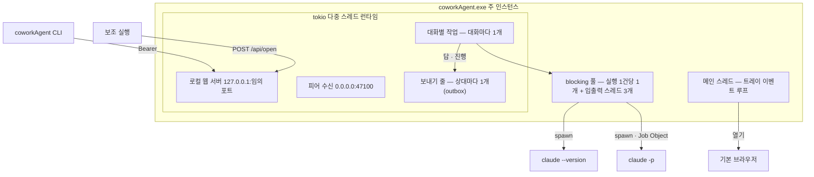

- 메인 스레드는 트레이 이벤트 루프(tao — macOS 는 메인 스레드 필수)만 돈다. 나머지는 tokio 런타임 위의 작업이다.
- `claude -p` 는 `spawn_blocking` 안에서 돌고, 실행마다 표준 입력 쓰기 · 표준 출력 읽기 · 표준 오류 읽기 스레드를 따로 둔다(파이프가
  가득 차 서로 기다리지 않게).
- **동시 실행 상한은 없다**(D24 개정) — 직렬은 대화 안에서만(6.4).
- **실행 한도**(D24 개정 #1b): PC 전체 동시 실행 상한(기본 2 · 1 ~ 8, 설정 `max_runs`) — 실행 문(`an_agent::gate`)이 사람 요청 · 자동 왕복 ·
  이 PC 사람 요청을 한 줄(FIFO)로 묶는다. 넘는 요청은 거절하지 않고 기다리며, 차례가 온 **뒤의** 대화 · 에이전트 · 멈춤 상태로 실행한다. 상대가 보낸
  실행 요청이면 `Progress`(대기 · 앞 사람 수 → 처리 중)를 보내기 줄(outbox, 같은 글은 마지막 값 하나)로 보낸다 — 보낸 쪽은 메모리에만(다시 켜면
  사라짐). 처리 중에는 단계 요약(`Progress.detail` — 턴 · 도구 이름별 횟수(`mcp__*` → "MCP") · 초, #1c)을 `claude -p` stream-json 이벤트에서 세어
  10초에 한 번 이하로 — 입력 · 경로 · 글은 싣지 않고 받은 쪽은 이름을 다시 거른다(24자 · 16개).

## 4. 서비스 역할

| 서비스 | 위치 · 주소 · 주기 | 역할 | 코드 |
|---|---|---|---|
| 트레이 | 메인 스레드 | 메뉴 "열기" · "종료". 새 요청 건수를 주황 점 · 툴팁 "coworkAgent — 새 요청 N건" 으로. 시작 실패면 오류 모드(붉은 아이콘 · "오류 보기" · "종료") | `app::tray` |
| 로컬 웹 서버 | `127.0.0.1:{임의 포트}` | 웹UI 정적 파일 · `/api/*` · SSE `/api/events` · 핸드오프 `POST /api/open` · 종료 `POST /api/quit`(#1n). 실행마다 새 토큰, Host · Origin 검사(D9) | `app::server` · `*_api` |
| 피어 수신 | `0.0.0.0:47100`(사용 중이면 OS 임의 포트) | 상대 요청 1건 = 연결 1개. TLS 1.3 상호 인증(서로 ed25519 키) → 인가(페어링 여부) → 처리기. 연결당 3초 · 동시 32 · 출처 IP 당 4 | `net::node::serve` |
| 실행 문 | `Chat` 안 | PC 전체 `claude -p` 동시 실행 상한(기본 2 · 1 ~ 8, 설정 `max_runs`) — 넘으면 닿은 순서로 대기 · 상대에 `Progress` 알림(#1b) | `agent::gate` · `chat::admit` |
| 피어 발신 | 상대의 `peers.addr` | 요청마다 새 TCP + TLS 연결, 상대 키 고정, 요청 · 응답 전체 10초 상한. 응답을 받으면 그 상대 `peers.seen_at` 갱신 | `net::node::send` |
| 보내기 줄 | `Chat` 안, 상대마다 tokio 작업 1개 | 대화 프레임을 `outbox` 에 먼저 적고 id 순으로 하나씩 응답(ack)까지 다시 보낸다 — 5초부터 두 배 · 최대 5분, 24시간이면 포기(6.6). 한 상대가 막혀도 다른 상대 줄은 따로 간다 | `agent::chat`(`ship` · `enqueue` · `lane`) · `core::outbox` |
| 접속 상태 | 통신할 때만(주기 확인 없음) | 보내기 성공 · 페어링된 상대의 요청 받기마다 `peers.seen_at`(10초에 한 번 쓰기). 시작 때 페어링된 상대마다 `Ping` 1회(`announce` — 주소 알림 · 집중), 웹UI 를 열 때 · 타일을 고를 때 ping(서버가 60초 안 통신이면 거름) — 8.8 | `node::announce` · `node::refresh` · `core::peers::touch` |
| 대화 엔진 | 피어 처리기 + 대화별 작업 | 받은 요청 검증 · 저장(= 대기열 등록) · 대화별 순차 실행 · 답 보관 · 자동 왕복 · 완료 동기화 · 멘션 · 상태 질의 · CLI 트랜잭션. 피어 처리기는 막히지 않는다 — 실행은 대기열로 | `agent::chat::Chat` |
| 실행기 | blocking 풀 | `claude -p` 인자 · 표준 입력 · 시간 제한 · 출력(stream-json 줄 — 단계 요약을 세고 마지막 `result` 줄만 남김) 읽기 | `agent::runner` |
| 알림 | 노드 · 대화 엔진 이벤트 | 설정이 허락하면 건수 +1 → 트레이 표시 · SSE → 브라우저 알림(기본 꺼짐) | `app::notify` |
| 감시 · 자동 시작 | 감시 = 별도 프로세스(3.1), 자동 시작 = HKCU `Run` 값 `coworkAgent` · macOS `com.coworkagent.plist` | 비정상 종료면 다시 띄움 · 로그인 때 실행. 다시 띄워도 남은 일은 `recover`(6.6)가 이어 간다. 감시 잠금 `supervisor.lock`(#1n) | `app::watchdog` · `app::autostart` |
| 로그 | `logs\coworkAgent.log` | 1 MiB 를 넘기 전에 `.1` 로 회전(1개 보관) | `core::log_file` |
| 단일 인스턴스 | `instance.lock` · `instance.json` · `instance.pid` | OS 파일 잠금(프로세스가 죽으면 OS 가 푼다) · 핸드오프 정보(포트 · 토큰) · `stop` 의 강제 종료용 PID | `core::instance` |

웹UI 는 5초마다 목록 · 대화를 다시 읽고(`setInterval`), 알림만 SSE 로 받는다.

### 4.1 시작 · 종료 순서 (`crates/app/src/main.rs`)

1. 인자가 있으면 CLI(`cli::main`)로 끝낸다 — 주 인스턴스가 되지 않는다.
   `COWORKAGENT_SUPERVISED` 가 없으면 감시 프로세스(`supervisor.lock` → 트레이 모드 · 릴리스 빌드 · Windows 면 자동 업데이트 확인(#1y — 2.4) →
   `watchdog::supervise(spawn_app)`)로 돌고 끝낸다(3.1) — 아래는 그 자식.
2. 트레이 객체를 만든다(메인 스레드). 트레이 없는 모드(`COWORKAGENT_PARENT`)면 만들지 않고 종료 채널(`mpsc`)을 둔다 — 부모가 이미 없으면 여기서 끝.
3. 데이터 루트(D15) → 개명 전 `agentNetwork` 데이터 이어받기 → 폴더 · `logs` 만들기 → 파일 로거(패닉 훅 포함 — "패닉: 메시지 — 파일:줄").
   감시가 남긴 `update.txt` 는 "자동 업데이트: …" 로그 줄로 옮기고 지운다(#1y). 감시가 다시 띄운 자식이면 "감시 프로세스가 다시 띄움(n번째)".
4. `instance.lock` 잠금 — 못 잡으면 보조 실행(핸드오프 후 종료). 잡으면 `instance.pid`.
5. DB 열기(스키마 올리기 · 올리기 전 `.v{N}.bak`) → 빈 공간 정리(#1y — `db::vacuum_if_sparse`: 빈 페이지 ≥ 4 MiB(`VACUUM_MIN_FREE`) 이고 ≥ 전체의 1/4 이면
   `VACUUM`, 실패는 `warn` 하고 계속) → 신원 키 읽기 · 없으면 생성.
6. tokio 런타임 · 웹 포트(`127.0.0.1:0`) · 실행마다 새 토큰 · 피어 포트(47100, 사용 중이면 임의).
7. 피어 노드 · 알림 · 대화 엔진 — 셋이 같은 DB 파일을 **각자 연결**로 연다(`busy_timeout` 5초). 실행기는 `claude` 를 실행마다 찾는다
   (`%USERPROFILE%\.local\bin\claude.exe`, 없으면 PATH) — 앱을 띄운 뒤 설치해도 된다.
7.1 릴리스 빌드만: 자동 시작 훅(`autostart::sync`)을 알림에 설치하고, 설정 `autostart` 값으로 맞춘다 — 켜짐 = 등록 · 경로 고침, 꺼짐 = 지움(지난 실행에서 어긋난 것도 고친다, 실패는 `warn`).
8. `chat.attach()`(노드 요청 처리기 · `Ping` 받기 알림) → `chat.recover()`(남은 대기열 · 남은 outbox 의 상대 줄을 지금 다시 · 7일 지난 실패
   보관 지움 — 6.6).
9. 피어 수신 루프 · 시작 알림(`announce`) · 웹 서버를 띄우고 `instance.json` 을 쓴다 → 트레이 루프(트레이 없는 모드는 부모 감시 스레드 + 종료 채널 대기).
10. 트레이 "종료" · `/api/quit` · 부모 끝: 런타임 정지(1초) → `instance.json` · `instance.pid` 삭제 → 잠금 해제(마지막 — 그 사이 뜬 새 프로세스는 보조 실행으로 남는다).
- 2 ~ 9 의 실패는 사유 파일(`write_start_error`) + 종료 코드 3 — 감시가 다시 띄우지 않고 오류를 보인다(3.1).
- **트레이 만들기 실패**(#1h): 60초 동안 다시 시도한다.

## 5. 통신 구성 · 피어 프로토콜

PC 마다 coworkAgent **주 인스턴스 하나**가 트레이에 상주하며 서버와 클라이언트를 겸한다. 웹UI 는 각자 자기 PC 의 앱에만 붙고,
PC 사이는 앱끼리 직접 통신한다.

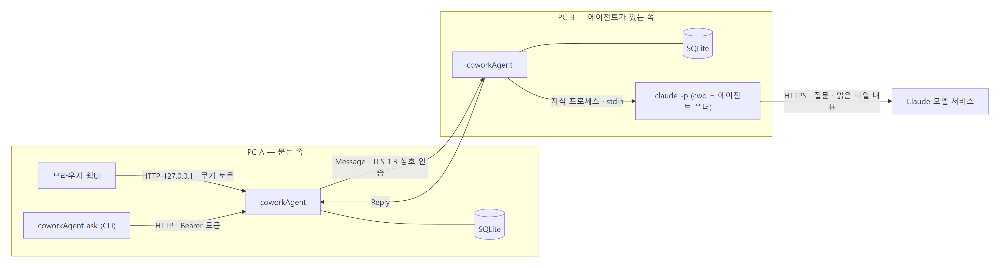

### 5.1 구간

| 구간 | 전송 | 인증 · 보호 | 비고 |
|---|---|---|---|
| 브라우저 ↔ 내 앱 | HTTP `127.0.0.1:{임의 포트}` · 알림은 SSE `/api/events` | 실행마다 새 토큰 → 탭 메모리 · `Authorization: Bearer`(쿠키 없음), Host · Origin 검사 · 보안 헤더(CSP · X-Frame-Options) — 6.7 | 화면은 5초마다 새로 읽는다 |
| CLI ↔ 내 앱 | 같은 로컬 API | `instance.json` 의 토큰을 `Authorization: Bearer` 로 | 앱이 꺼져 있으면 종료 코드 3 |
| 내 앱 ↔ 상대 앱 | TCP `47100`(사용 중이면 임의 포트) 위 TLS 1.3 — 요청 1건 = 연결 1개 | 양쪽 ed25519 공개키(raw public key) 상호 인증, 페어링 때 상대 키 고정 | 요청 · 응답 전체 10초 상한. 대화 프레임은 outbox 에 먼저 적고 응답까지 다시 보낸다(6.6) |
| 상대 앱 → `claude -p` | 자식 프로세스 표준 입력 → stream-json 출력(줄 단위 이벤트, 마지막 줄 `result`) | 에이전트 폴더(cwd) · 읽기 전용 도구 · 문의 응답 전용 지시 | 실행 1건 30분 상한, 대화마다 순서대로 |
| `claude -p` → 모델 서비스 | HTTPS | 그 PC 의 Claude Code 로그인 | 질문 · 읽은 파일 내용이 사내망 밖으로 나간다 |
- **피어 주소**(D7 보강 #1b): 47100 을 못 열면 임의 포트 + 잡은 프로세스 표시. 페어링된 키의 `Ping{port}` 는 (출처 IP, 포트)로 저장 주소를 바꾼다
  (승인 · 세대 그대로). 앱이 연 수신 소켓은 `claude -p` 자식에 물려가지 않는다(강제 종료 뒤 포트가 바로 풀린다 — `tools/port_check.py`).

### 5.2 피어 프로토콜

- **프레임** = 4바이트 big-endian 길이 + JSON(최대 64 KiB), 글 본문은 16 KiB(`MAX_TEXT`). 요청 1건에 응답 1건, 그리고 연결을 닫는다.
- **요청**(`proto::Request`): 페어링 `Hello` · `Approve` · `Remove` · 접속 `Ping` · 대화 `Agents` · `Message` · `Reply` · `Post` ·
  `Relay` · `ReqState`(요청 상태 — #1d) · `Progress`(받는 쪽 차례 · 단계 요약) · `Status`(보낸 쪽 상태 질의) · `Edit` · `Delete`(이력 정리 — #1f) ·
  `Context`(컨텍스트 압축 · 비우기 요청 · 결과 — #1m) · `Share` · `SharePost` · `ShareDelete` · `ShareEnd` · `ShareNotice`(공유 대화 — #1o, 8.11) · `Leave`(대화 나가기 — #1w, 8.12) · `Clear`(대화 기록 모두 지우기 — #1x, 8.12). 답 `Reply` · `Post` 는 `ctx`(그 답 세션의 창 사용량)를 싣는다. **응답**: `Hello` · `Ok` · `Pong{focus, ctx, share, leave, clear}`(`ctx` = `Context` · `share` = 공유 프레임 · `leave` = `Leave` · `clear` = `Clear` 를 앎) ·
  `Agents{names}` · `Status{state, ahead}` · `Error{code}`. 필드 정본은 [an_net](an_net.md).
- 미페어링 상대는 `Hello` · `Approve` · `Remove` 만. 대화 요청은 페어링(`my_ok ∧ their_ok`)된 키만 처리기로 간다(SC2).
- 수신 제한 — 연결당 3초 · 동시 32 · 출처 IP 당 4.
- 상대가 준 오류 코드는 영소문자 · `_` 1 ~ 32 자만 남긴다(그 밖 `unknown`) — 원격 문자열은 신뢰하지 않는 입력.
- 응답 코드 `retry` — 받는 쪽이 처리 중 오류(DB 잠금 등)로 잠시 처리하지 못했다. 거절이 아니다 — 보낸 쪽은 전송 오류처럼 다시 보낸다.
- **outbox 를 거치는 프레임**: `Message` · `Post` · `Reply` · `ReqState` · `Edit` · `Delete` · `Progress` · `Relay{on: false}`(받은 쪽 멈춤 알림) · 공유 프레임 전부(#1o — `Pong.share` 를 같은 방식으로 묻는다) · `Context`
  (#1m — 바로 보내지 않고 줄이 보낸다. 보내기 전 `Ping` 으로 `Pong.ctx` 를 묻는다: 0.4.0 은 모르는 `type` 을 읽지 못해 응답 없이 연결을 끊으므로, 모르면 보내지 않고
  `unsupported` 로 정산 · 닿지 않으면 보통 줄처럼 다시). **바로 보내는 것**: `Hello` ·
  `Approve` · `Remove` · `Agents` · `Ping` · `Status` · `Relay{on: true}`(연 쪽 재개) — 사람이 화면에서 결과를 바로 본다.

### 5.3 순서 그림

미리 그린 PNG 다 — 원본 mermaid 는 1장 · 8.1 · 8.2.

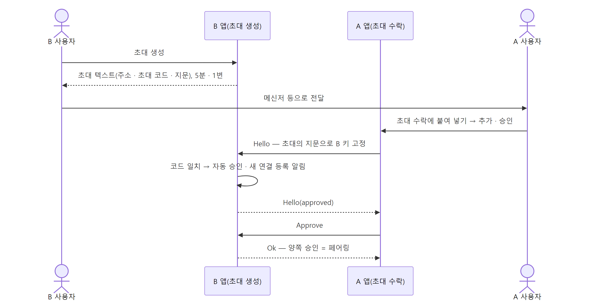

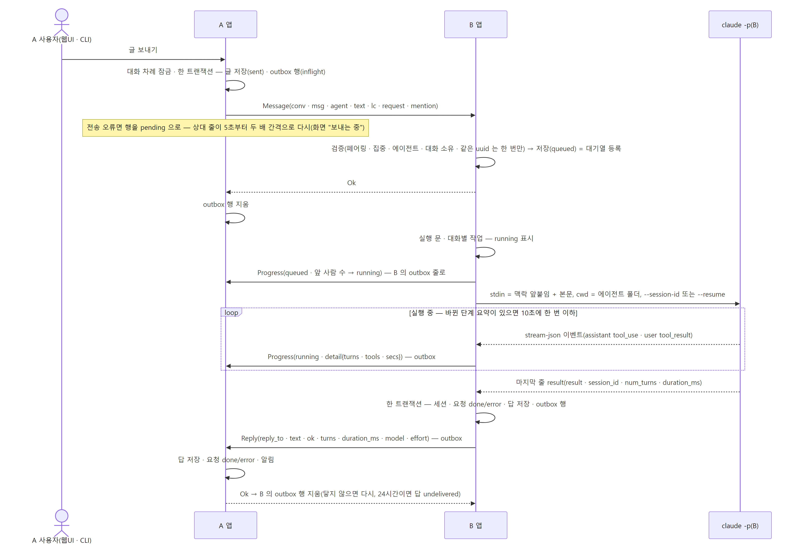

- 질의 그림은 8.2 mermaid 를 그린 것이다(#1c — 보관(outbox) · 처리경과(`Progress`) 포함). 상태 질의(`Status`)는 8.7.

## 6. 세션 관리

### 6.1 세 가지 ID

| ID | 만드는 곳 | 어디에 | 쓰임 |
|---|---|---|---|
| 대화 uuid | 대화를 연 PC(UUID v4) | 양쪽 `conversations.uuid` | 프레임의 `conv` — 두 PC 가 같은 대화를 가리킨다. 다른 상대의 같은 uuid 는 거부 |
| 메시지 uuid | 글 · 답을 만든 PC | 양쪽 `messages.uuid` | 재전송 판별(같은 uuid 는 한 번만 실행) · 답의 `reply_to` |
| Claude 세션 ID | 에이전트를 실행하는 PC | 그 PC 의 `conversations.session` 또는 `agent_sessions.session` | 첫 실행 `--session-id`, 이후 `--resume`. 상대 PC 는 모른다 |

### 6.2 어느 실행이 어느 세션을 쓰나

| 실행 | 실행하는 PC | 세션 저장 위치 |
|---|---|---|
| 상대가 연 대화의 대화 에이전트(보통 요청) | 받은 쪽 | `conversations.session`(`dir = 'in'`) |
| 같은 대화에서 @멘션으로 부른 다른 에이전트 | 받은 쪽 | `agent_sessions`(`conversation_id`, `agent`) — 대화 에이전트 세션과 섞지 않는다(D19 보강) |
| 자동 왕복의 내 에이전트 | 대화를 연 쪽 | `conversations.session`(`dir = 'out'`) |

대화를 연 쪽의 보통 대화(`out`, 자동 왕복 아님)에는 세션이 없다 — 에이전트가 상대 PC 에 있다.

### 6.3 세션 수명

1. **첫 실행** — 저장된 세션이 없으면 coworkAgent 가 UUID v4 를 만들어 `--session-id <uuid>` 로 준다.
2. **기록** — 끝난 실행 출력 JSON 의 `session_id` 를 요청 상태 · 답과 **한 트랜잭션**으로 저장한다. 단 실행한 에이전트의 지금 세대
   (`agents.uid`)가 실행 때와 같을 때만 — 실행 도중 폴더를 바꾸거나 지웠다 다시 등록했으면 남기지 않는다.
3. **이어 쓰기** — `--resume <세션 ID>`. 매 실행 가드 시스템 프롬프트를 다시 붙인다(`--append-system-prompt` +
   `--system-prompt-snapshot off` — 가드가 생기기 전에 만든 세션을 재개해도 지금 가드, D31).
4. **비우기** — 에이전트 폴더 변경 · 삭제 → `agents::forget_sessions(이름)`: 그 이름의 받은 대화(`in` · `agent`) · 자동 왕복 대화
   (`out` · `relay_agent`) 세션을 NULL 로, 멘션 세션(`agent_sessions`)을 지운다 + 새 세대(`uid`). 다음 실행은 새 세션.
5. 대화 내용(맥락)은 Claude Code 기록 파일에 있다 — coworkAgent 는 세션 ID 만 갖는다(7.4).
6. **압축 · 비우기**(#1m) — 대화 머리 단추 · 자동 압축(실행 결과 창 사용량 ≥ 800k, 설정 `auto_compact`). 구분선 글(`author = 'context'` ·
   `ctx_op` = `compact` · `auto_compact` · `clear`)이 그 대화 줄 맨 앞에 서서(`pending` 정렬) 앞 실행이 끝난 뒤 · 다음 글보다 먼저 처리된다.
   비우기 = `chat::clear_sessions`(대화 · 멘션 세션 전부). 압축 = 세션마다 `--resume` 으로 `SUMMARY_PROMPT` 실행(실행 문 통과) → 세션 비움 + 요약을
   `ctx_seeds` 에 → 다음 **새 세션 첫 실행** 앞에 `<대화 요약>` 으로 한 번 붙이고(`execute`) 세션을 남기면 지운다(`record`). 하나라도 요약이 실패하면
   세션은 그대로. 세션이 이 PC 에 있으면(받은 대화 · 자동 왕복 연 쪽) 이 PC 가, 상대에 있을 수 있으면(보낸 대화 · 자동 왕복) `Context` 로 상대에 —
   받은 요청은 다시 넘기지 않는다(자동 왕복 되풀이 없음). 창 사용량 = 결과 `usage.iterations` 마지막 항목의 입력 + 캐시 쓰기 · 읽기 + 출력.
- **컨텍스트 규칙**(#1m · D19 보강): 압축 = 요약 후 새 세션(요약은 다음 첫 실행에 한 번) · 비우기 = 세션만. 답하는 PC 가 80% 넘으면 자동 압축(설정
  `auto_compact`, 기본 켜짐). 상대 쪽 세션이면 `Context` 프레임(outbox — 보내기 전 `Pong.ctx` 확인), 자동 왕복은 두 PC 세션 함께. 스키마 19. 화면은
  [web-ui](web-ui.md).

### 6.4 직렬화 · 순서

- **대화별 실행 작업 하나**(`Chat::wake`) — DB 대기열(`messages.exec = 1 AND state IN ('queued', 'running')`)을 id 순으로 하나씩
  실행한다. 같은 세션이 동시에 재개되지 않는다(공식 문서: 동시 resume 은 잠금 없이 섞인다 — D19). 멘션 실행도 같은 대화 대기열이다.
- **다른 대화끼리는 동시에** — PC 전체 동시 실행 상한 없음(D24 개정).
- **보내는 쪽 대화 차례**(`Chat::turn`) — 사람 글의 저장 → 전송(또는 보관) → 응답까지 대화당 한 번에 하나(보낸 순서 = 상대 도착 순서). 받은
  요청의 상태 바꾸기(#1d)도 같은 차례 안에서 보낸다.
- **보내기 줄 순서** — 같은 대화에 앞선(보내는 중 · 기다리는) outbox 행이 있거나 그 상대에 닿지 않고 있는(다시 보내기를 기다리는 행이 있는)
  동안은 새 글도 바로 보내지 않고 줄 뒤에 선다. 상대 줄은 id 순으로 하나씩 — 앞 행이 못 가면 뒤 행도 기다린다. 진행(`Progress`) · 멈춤 알림
  (`Relay{on: false}`)은 대화 안에서 앞질러도 된다(답보다 늦게 닿은 진행은 받는 쪽이 `unknown` 으로 버린다).
- **양쪽 표시 순서** — 램포트 시계 `lc`(받은 글은 `observe` 로 맞춘다), 표시는 `(lc, uuid)` 순.
- **대화 왕복**: 대화 UUID 를 양쪽이 공유, Claude 세션 ID 는 에이전트 쪽만(첫 `--session-id` → 이후 `--resume`). `message` 는 저장
  (= DB 대기열 등록) 뒤 바로 `ok`, 실행 결과는 `reply`(고정 키)로. 실행 후 기록은 한 트랜잭션(실패 → 오류 답). 답은 `reply_to` 가 답
  없는 내 메시지일 때만. 보내기는 대화별 직렬, 전송 오류는 실패로 확정하지 않는다(ACK 손실 시 중복 실행 방지). 재시작 시 `queued` 는 실행, `running`(실행 도중 종료)은 다시 돌리지 않고 오류 답. 본문 16 KiB.

### 6.5 실행 입력 — 맥락 앞붙임

본문은 **표준 입력으로만** 넘긴다(명령 인자 · 셸에 넣지 않는다). 늘 아래 꼴로 감싼다 — 원격 글이 프롬프트 맨 앞에 오지 않고, 틀 문구를
꾸미지 못하게 원격 글 안의 구분자(`<원격 본문>` · `</원격 본문>` · `<대화 메모>` · `</대화 메모>`)는 지운다(1a). 메모(지난 실행 요청 뒤 실행 없는
사람 글)는 있을 때만, 최근 20개 · 본문 합 32 KiB 까지(넘으면 오래된 것부터 버리고 "(앞의 메모 N개 생략)").

```text
[대화 메모 — 실행 요청 아님]
<대화 메모>
- {발화자}: {글}
</대화 메모>

[요청 — {발화자}]
<원격 본문>
{본문}
</원격 본문>
```

발화자는 `이 PC 사용자` · `{상대 이름} · {PC 이름}` · `상대 에이전트({상대 이름} · {PC 이름})`. 실행 인자는 아래와 같다(정본
`runner::claude_args`).

```text
claude -p --output-format stream-json --verbose --permission-prompts none --permission-mode dontAsk
  --allowedTools Read,Grep,Glob,WebFetch,WebSearch[,Bash,PowerShell] --disallowedTools Edit,Write,NotebookEdit[,Bash,PowerShell]
  [--add-dir <바로 위 폴더>] --append-system-prompt <가드 + [읽기 범위] + [수신자 추가 지시]> --system-prompt-snapshot off
  (--session-id <새 UUID> | --resume <세션 ID>) --model <모델> --effort <effort>
```

- (#1z-9 결정 9 — D22 개정) **로컬 사용과 맞춤 · 편집 도구만 막음**: `--restricted`(설정 무시 · 파일 도구 폴더 가둠) · `--strict-mcp-config` · `--tools` 를 쓰지 않는다 — 그 PC 사용자 ·
  프로젝트 settings(MCP · 스킬 · 훅 · 허용 규칙)가 그대로 걸린다. `dontAsk` 라 허용 규칙 + 미리 허용(`--allowedTools` 읽기 도구)만 돌고, 편집 도구(`Edit` · `Write` · `NotebookEdit`)는
  사용자가 허용했어도 `--disallowedTools` 로 막는다(2.1.309 실측 — "Write is disabled for this session, in subagents as well"). MCP 는 미리 허용하지 않는다(쓰기 · 지우기 도구가 섞임 —
  사용자 허용 규칙만). **파일 도구도 폴더 밖을 읽는다**(실측) — 폴더 · `[읽기 범위]` 는 가드 문구로만 지킨다. 실제 도구 목록(`stream-json` 첫 줄 `system` init 의 `tools`)에 읽기 도구가
  있고 편집 도구(+ 셸 끔이면 셸)가 없는지 — `cargo test -p an-agent --test tools_canary -- --ignored --nocapture`.
- `--add-dir` · `[읽기 범위]` 는 에이전트의 "상위 한단계 탐색 허용"(#05-2)을 켰을 때만 — 바로 위 폴더가 드라이브 루트 · 사용자 홈이거나 데이터 루트를 품으면 붙이지 않는다
  (`an_core::paths::parent_read_dir`, 실행마다 다시 판단).
- 에이전트의 "셸 명령 실행 허용"(#05-3)을 켜면 `Bash` · `PowerShell`(macOS 는 `Bash`)을 미리 허용하고(끄면 막음) 가드는 `SHELL_GUARD_PROMPT`, 실행 환경은 기본 변수 목록만
  (`runner::shell_env` — 앱을 띄운 셸의 키 · 토큰 변수가 넘어가지 않는다). 셸은 작업 폴더 · `--add-dir` 밖도 읽고 쓴다.
  실측 시험 `cargo test -p an-agent --test shell_canary -- --ignored --nocapture`.
- **실행 명령 기록**(#1z-10): `chat::execute` 가 띄우기 직전(세션 다시 실행이면 다시) `runner::launch_line(input)` 을 `conversations.cmd` 에 남긴다 — 실행 파일
  `agent_program` + 인자 `agent_args`(`run_claude` · `run_codex` 가 띄울 때 쓰는 같은 함수), 원격 본문(표준 입력)은 없음. 따옴표 = `shell_line` — Windows PowerShell
  `& '<실행 파일>' …`(작은따옴표 안 `'` · 둥근 따옴표 ‘ ’ ‚ ‛ 는 두 번 — R1 인용 탈출 막음, 쉼표 든 인자는 감쌈, 앞에 확인 줄 없음 — PowerShell 7.3 아래 · 인자 전달 `Legacy` 는 인자 안 큰따옴표 · 빈 인자를 잃는다, 사용자 몫(2026-10-24 사용자 결정 — `PS_MIN_GUARD` 뺌), 실측 시험 `powershell_line_roundtrip`), 그 밖 POSIX(`'…'\''…'`). 압축 요약 실행은 남기지 않는다. 세부정보 '대화 정보' 의 복사가 이 값이다 —
  이어 쓰기 세션 인자(`--resume` · `exec resume <thread>`)가 들어 있어 터미널에서 돌리면 그 대화 세션에 이어진다.
- **Codex 에이전트**(#1z-9 — 등록 때 실행 도구 Codex 를 고른 에이전트, 바꾸지 않음): `runner::run_agent` 가 `run_codex` 로 보낸다. 인자(정본 `runner::codex_args`):

  ```text
  codex exec -C <폴더> -s read-only --json [--skip-git-repo-check] -c developer_instructions=<TOML 문자열> -
  codex exec resume -c sandbox_mode="read-only" --json [--skip-git-repo-check] -c developer_instructions=… <thread_id> -
  ```

  개발자 지시 = `CODEX_GUARD_PROMPT`(읽기 · 조회 셸 명령 · workflow 괜찮음, 삭제 · 편집 · 이동 · 설정 변경 · 외부 전송 금지) + `[읽기 범위] 이 폴더 … 아래만` + 추가 지시. 그 PC 사용자의
  Codex 설정 · 스킬 · MCP 는 그대로(`--ignore-user-config` 없음 — 결정 8), 모델 · effort 인자 없음(Codex 기본값 — 답 meta 에 모델 없음). 쓰기는 읽기 전용 샌드박스가 막고(실측),
  **`-C` 밖 읽기는 막지 못한다**(실측 — 가드 문구만). `--skip-git-repo-check` = 에이전트 옵션 "Git 저장소 아닌 폴더 허용"(기본 켬). 세션 = 첫 줄 `thread.started.thread_id`(우리가 정하지 못함),
  답 = 마지막 `agent_message`, 실패 = `turn.failed` · `error`, 단계 요약 = 끝난 `command_execution`(`Shell`) · `mcp_tool_call`(`MCP`) · `web_search`, 창 사용량 없음(턴 합이라 뜻이 다름).
  없는 thread = stderr `no rollout found for thread id` → 새 세션으로 한 번 다시. 실행 파일 = npm 전역의 실제 `codex.exe`(`codex.cmd` 는 배치 파일이라 띄우지 않음) → PATH `codex.exe`,
  `codex --version` ≥ 0.163.0. 환경 변수는 그대로(Codex 셸 정책이 KEY · TOKEN 변수를 거른다). 실측 `cargo test -p an-agent --test codex_live -- --ignored --nocapture`.
- 모델 · effort 는 실행 직전에 정한다 — 그 상대 덮어쓰기 → 전역 설정 → `sonnet` · `high`. 설정을 못 읽으면 기본값으로 돌리지 않고 실패 답. Codex 에이전트는 쓰지 않는다(#1z-9).
- `--bare` 는 쓰지 않는다 — 구독 로그인을 읽지 않기 때문(D20).
- **출력 = stream-json**(`-p` 에서는 `--verbose` 가 있어야 한다 — 2.1.296 확인). 실행기는 표준 출력을 줄마다 읽어 실시간 이벤트로 **단계
  요약**(`StepDetail{turns, tools, secs}`)을 센다 — `assistant` 이벤트의 `tool_use` 이름별 횟수(`mcp__` 로 시작하면 `MCP` 로 묶음) · 턴(1 에서
  시작, 도구 결과를 담은 `user` 이벤트마다 +1) · 실행 시작부터 초. 도구 입력 · 파일 경로 · 모델 글은 읽지 않는다. 결과 줄(`result`)과 JSON
  아닌 줄만 남기고(이벤트는 쌓지 않는다) 마지막 JSON 줄을 결과로 읽는다(`parse_output`). 단계 요약을 상대에 알리는 일은 8.2.

### 6.6 실패 · 복구

| 상황 | 결과 |
|---|---|
| 앱이 실행 도중 꺼짐 | 다시 켤 때 `recover`: `queued` 는 실행, `running` 은 실패 답 "실행 도중 상대 앱이 종료돼 결과가 없다 — 다시 보내 주세요". 보내다 끊긴 outbox 행(`inflight`)은 `pending` 으로 되돌려 상대 줄을 지금 다시 보낸다 |
| 30분 초과 | 자손까지 종료 → 내 쪽 "실행 실패: 실행 시간 1800초 초과" · 상대 "실행 실패: 받는 PC 의 시간 제한(30분)을 넘겼다" |
| Claude Code 버전 낮음 | 실행하지 않음 → 내 쪽 "실행 실패: Claude Code x.y.z — 2.1.267 이상이 필요하다(`claude update`)" · 상대 "실행 실패: 받는 PC 의 Claude Code 버전이 낮다" |
| 에이전트 폴더가 데이터 폴더를 품음 · 네트워크 경로 | 실행 직전 다시 거른다 — 실행하지 않음 → 상대 "실행 실패: 받는 PC 의 에이전트 폴더를 쓸 수 없다 — 받는 PC 에서 폴더를 바꿔야 한다" |
| 그 밖 실행 오류 | 내 쪽에 원문(종료 상태 · stderr), 상대에게는 "실행 실패: 받는 PC 에서 실행하지 못했다 — 원인은 받는 PC 화면에 있다"(1a — stderr · 경로를 상대에게 보내지 않는다) |
| 세션 기록 파일이 없음 | `--resume` 이 종료 1 — 결과 줄 `is_error` · `errors: ["No conversation found with session ID: …"]`(2.1.299 실측) 또는 표준 출력 비움 · stderr 같은 문장(2.1.296 실측). #1h 부터 `SessionMissing` → **새 세션(`--session-id`)으로 한 번 다시 실행**해 답하고 새 세션을 기록한다(앞 대화 기억 없음 — 대화 메모 앞붙임은 그대로). 다른 실패는 다시 실행하지 않는다 |
| 기록 트랜잭션 실패 | 요청 `error`, 내 쪽 답 "실행 실패: 받는 PC 기록 오류 — …" · 상대 "실행 실패: 받는 PC 기록 오류" |
| 보내기 · 답 전송 오류(상대 꺼짐 · 네트워크) | 오류가 아니다 — outbox 에 보관하고 상대 줄이 다시 보낸다(아래). 글은 `sent` 그대로, 화면 "보내는 중". 같은 uuid 라 몇 번 다시 보내도 상대에서 한 번만 실행 |
| 받는 쪽 처리 오류(DB 잠금 등) | 받는 쪽이 `Error{retry}` — 보낸 쪽은 거절로 확정하지 않고 전송 오류처럼 다시 보낸다 |
| 24시간 닿지 않음 | 그 상대 줄의 행을 모두 실패 보관(`failed`). 내 실행 요청 · 실행 없는 글 · 자동 왕복 넘김은 `error` + 거절 코드 `unreachable`(화면 "보내지 못함 …" · 다시 보내기), 자동 왕복은 꺼지고 넘김이면 끝 사유 "상대에 닿지 않음". 답 · 내 에이전트 답 미러 · 상한 기록은 `undelivered`("답 미전달"). 편집 · 삭제 반영(#1f)은 내 활동 "상대 반영 실패"(`relay_events.kind = sync_failed`). 그 밖(미러 · 진행 · 멈춤 알림)은 로그만 |
| 상대 거절 | 보낸 글 `error` + 거절 코드(`messages.refused`). `focus` 면 "상대가 집중 중", 다시 보내면 코드를 지운다. 답을 상대가 거절하면 `undelivered` |

**보내기 보관(outbox, D7 — #1c)** — 대화 프레임은 `Chat::ship`(바로 한 번 시도) · `Chat::enqueue`(줄에만 — 진행)로 `outbox` 에 먼저 적는다.

- **글과 행은 함께** — 사람 실행 요청 · 미러 · 답 · 자동 왕복 넘김은 글을 적는 DB 트랜잭션 안에서 행(`inflight`)을 적고 커밋 뒤 보낸다(`stage` ·
  `dispatch`). 커밋 뒤 보내기 전에 꺼지면 다시 켤 때 `recover` 가 그 행을 보낸다. 완료 · 멈춤 알림 · 상한 기록은 따로 적는다(미조치 — 원장 #1c R1-T).
- **바로 보내기** — 행을 `inflight` 로 넣고, 같은 대화에 앞선 행이 없고 그 상대에 닿지 않고 있지 않으면 바로 한 번 보낸다(화면이 거절을 바로
  받는다). 응답이면 행을 지운다. 전송 오류 · 앞선 행이면 `pending` 으로 두고 상대 줄을 깨운다. 보내기 · 뒷정리는 따로 띄운 작업이 하므로
  부른 HTTP 처리기가 취소돼도 행이 `inflight` 로 남지 않는다.
- **상대 줄**(`lane`) — 상대마다 tokio 작업 하나가 맨 앞 `pending` 행을 `next_at` 에 보낸다. 응답(`Ok` 든 거절이든)을 받으면 행을 지우고 그 자리의
  응답 처리와 같게 뒷일(`settle` — 거절이면 글 실패 · 자동 왕복 끔, 실행 없는 글 `Ok` 면 `done`).
- **간격 · 한도** — 5초부터 두 배 · 최대 5분. 기다린 합(`waited`)에는 지난 시도부터 실제로 흐른 시간을 직전 간격까지만 더한다 — 앞당긴 재시도가
  한도를 부풀리지 않고, 앱을 꺼 둔 시간은 세지 않는다. 합이 24시간이면 포기(위 표). 시험용 `Chat::set_retry(base, max, give_up)`.
- **앞당기기** — 그 상대에서 무엇이든 받으면(대화 요청 · `Ping`) · 상태 질의가 닿으면 · 앱을 다시 켜면 그 상대 줄을 지금 보낸다(`peer_back` ·
  `outbox::hurry`). 보내는 중인 행은 표시만 하고 그 시도가 실패하면 바로 다시.
- **키 합침** — 진행은 키 `progress:{글 uuid}` — 같은 키의 기다리는 행이 있으면 새 행 대신 프레임만 바꾼다(마지막 값만).
- **실패 보관 정리** — 시작 때 7일 지난 `failed` 행을 지운다.

**상태 질의(`Status`)** — 보낸 쪽이 자기 실행 요청 글의 지금 상태를 묻는다(바로 — 보관하지 않음, CLI 트랜잭션 감시가 쓴다 — 8.7). 받는 쪽은 그
상대 대화의 상대 실행 요청 글이면 `queued`(`ahead` = 실행 대기 목록의 앞 사람 수) · `running` · `done`(끝남 — 그 상대에 남은 답이 있으면 지금
보낸다), 그 밖 `unknown`.
- **보내기 보장**(D7 실현 #1c): 상대에게 보내는 대화 프레임은 먼저 SQLite `outbox` 에 적는다. 상대별 줄 하나가 id 순으로 보내고(같은 대화 순서 —
  진행 · 멈춤 알림은 앞질러도 된다), 응답(거절 포함)을 받으면 행을 지우고 종류별 뒷일(`settle`). 전송 오류 · `retry` 응답(받는 쪽 내부 오류)이면
  5초부터 두 배 · 최대 5분 뒤 다시, 앱이 켜진 동안 24시간 닿지 않으면 그 상대 줄 전부 실패 보관 — 사람 실행 요청 · 자동 왕복 넘김은 글 `error` +
  `refused = unreachable`("보내지 못함"), 답 미러는 `undelivered`. 상대에게서 무엇이든 받으면 그 줄을 바로 다시 보낸다. 실패 행은 7일 뒤 지운다.
  보낸 쪽은 `Status{conv, msg}` 로 요청 상태(대기 · 처리 중 · 끝 · 모름)를 묻고, 끝이면 받는 쪽이 붙든 답을 바로 다시 보낸다.
- **사라진 세션**(#1h): `--resume` 세션이 사라졌으면 새 세션으로 한 번 다시 실행한다.

### 6.7 웹UI · CLI 접속 세션

- **웹UI** — 실행마다 새 토큰(32바이트 hex). 트레이 "열기" URL `/?t={토큰}` → 페이지가 토큰을 **탭 메모리**(sessionStorage)로 가져가고
  주소창에서 지운다(`history.replaceState`). `/api/*` 는 `Authorization: Bearer` 로만, 알림 스트림 `/api/events` 만 `?t=` 도 받는다(`EventSource`
  는 헤더를 못 싣는다). **쿠키는 쓰지 않는다** — 쿠키는 포트를 가리지 않아 같은 PC 의 다른 `127.0.0.1` 포트로도 실린다(1a). 정적 자산(`/` ·
  `/js/` 의 `server::SCRIPTS` 이름 · `app.css` · `favicon.ico` · `/fonts/` 의 `server::FONTS` 이름 — #1p)은 토큰 없이(Host 검사만, 표 밖 이름은 토큰이 있어도 404). 탭을 닫거나 새 탭을 손으로 열거나 앱을 다시 켜면 "연결이 끊겼습니다"
  안내 — 트레이 "열기" 로 다시 연다.
- **CLI** — `instance.json` 의 포트 · 토큰을 `Authorization: Bearer` 로. 보내기 전 `GET /api/status` 의 `cli_api` 로 출처 표시를 아는
  인스턴스인지 확인한다. 앱이 꺼져 파일이 없으면 종료 코드 3.

## 7. 저장소 (데이터)

### 7.1 데이터 폴더 (D15)

```text
%LOCALAPPDATA%\coworkAgent\              macOS: ~/Library/Application Support/coworkAgent/
├── coworkAgent.db                      SQLite — 연결 · 에이전트 · 대화 · 글 · 설정 · 보내기 보관 · CLI 트랜잭션 · 관람자 · 지운 대화 묘비 · 지운 글 uuid(스키마 23)
├── coworkAgent.db.v{N}.bak             스키마 N 에서 올리기 직전 사본(VACUUM INTO, 버전마다 한 번)
├── identity.key                        설치 신원 ed25519(PKCS#8) — 리포 · 로그 · UI 로 내보내지 않는다
├── instance.lock                       단일 인스턴스 잠금
├── instance.json                       실행 중에만 — {"port":…, "token":"…"}(핸드오프 · CLI)
├── instance.pid · supervisor.pid       앱 · 감시의 PID — stop 의 강제 종료용(그 잠금이 잡혀 있을 때만 믿는다)
├── supervisor.lock                     감시 프로세스 잠금(#1n)
├── update.txt                          감시가 남긴 자동 업데이트 결과 한 줄(#1y) — 앱 시작이 로그로 옮기고 지운다
├── update-skip.txt                     뜨지 못해 되돌린 업데이트 태그(#1y) — 그 태그는 다시 받지 않는다
└── logs\coworkAgent.log(.1)            1 MiB 회전, 1개 보관
```

폴더 권한(1a): 주 인스턴스가 시작할 때마다 루트를 **소유자 전용**으로 맞춘다 — Windows 보호 DACL(현재 사용자 · SYSTEM, 하위 상속, 상위 폴더의
상속 끊음) · Unix 루트 · 하위 폴더 0700 + 파일 0600, 프로세스 `umask 077`(새 DB · 사본 · 회전 로그 — macOS 실동작 확인은 Phase 4). 실패하면 로그 경고 후 계속. 확인: `icacls "%LOCALAPPDATA%\coworkAgent\identity.key"` → 두 줄(사용자 · SYSTEM).

폴더 밖: 시작 실패 사유 `%TEMP%\coworkAgent-start-error.txt`(디버그 빌드 + `COWORKAGENT_DATA_DIR` 면 그 폴더 안), Claude Code 기록(7.4).

디버그 빌드만 환경 변수 `COWORKAGENT_DATA_DIR` 가 데이터 루트를 바꾼다(옛 데이터 이어받기 없음) — 시험이 실제 인스턴스 · 데이터를 건드리지 않게
(`crates/app/tests/lifecycle.rs`). 릴리스 빌드는 읽지 않는다.

### 7.2 DB 표 (스키마 23)

| 표 | 한 행 | 주요 열 |
|---|---|---|
| `peers` | 연결한 PC — `id` AUTOINCREMENT(#1h 스키마 17 — 지운 상대의 번호를 다시 쓰지 않는다, 그 대화 · 보낼 글은 그 번호로 남는다) | `spki`(공개키) · `name` · `host` · `addr` · `my_ok` · `their_ok` · `round`(페어링 세대) · `grp`(옛 자유 입력 그룹 — 스키마 18 에서 같은 이름 레일 그룹으로 옮기고 읽지 않음) · `model` · `effort` · `alias` · `icon` · `activity_seen_msg` · `activity_seen_event` · `seen_at`(마지막 통신 — 보내기 성공 · 요청 받기 · `Pong`) · `focus`(마지막 `Pong` · 집중 거절 때 값) · `pos`(레일 자리 — #1i, 새 상대는 맨 뒤) |
| `settings` | 키 · 값 | 아래 키 |
| `agents` | 내 에이전트 | `name`(UNIQUE — 상대가 부르는 이름, 바꾸지 않는다) · `folder` · `tools`(#1d 부터 읽지 않음 — 도구는 읽기 전용 5개 고정) · `prompt` · `grp`(#1j 부터 읽지 않음 — 열만 남음) · `uid`(세대) |
| `conversations` | 대화 — `id` AUTOINCREMENT(#1w 스키마 21 — 지운 대화의 번호를 다시 쓰지 않는다) | `uuid` · `peer_id` · `agent`(대화 에이전트) · `dir`(`out` 내가 엶 · `in` 상대가 엶 · `shared` 남이 나를 관람자로 넣은 사본 — #1o) · `session` · `relay_agent` · `relay_cap` · `relay_count` · `relay_on` · `relay_blocked` · `title` · `starred_at` · `read_id` · `pos`(손으로 놓은 자리 — #1i, 새 대화는 맨 위 `min - 1`) · `share_other` · `share_dir` · `share_ended`(사본 — 원 상대 이름 · 넣은 쪽 방향 · 빠진 시각, #1o) · `watchers`(원 상대 쪽 — 알림 받은 관람자 수) · `left_at`(이 PC 가 나간 시각 — #1w) · `peer_left_at`(상대가 나간 시각 — 받은 `Leave`) |
| `left_convs` | 지운 대화의 묘비(#1w) | (`uuid`, `peer_id`) PRIMARY KEY · `at`. 같은 uuid 로 온 글이 대화를 되살리지 않게(받기 앞에서 `left` 거절). 공유 사본은 남기지 않는다(다시 초대 = 새 사본) |
| `shares` | 관람자 1명(#1o — 넣은 쪽) | (`conversation_id`, `peer_id`) PRIMARY KEY · `sent_upto`(그 관람자 줄에 넣은 마지막 `messages.id` — 커서) · `created_at`. 상대 페어링을 지우면 함께 지운다 |
| `groups` | 레일 그룹(#1i — 이 PC 에만) | `id`(AUTOINCREMENT — 지운 번호를 다시 쓰지 않는다) · `name`(UNIQUE, 1 ~ 40자) · `icon` · `pos` |
| `gone_msgs` | 기록 삭제로 지운 글 · 적용한 `Clear` 의 uuid(#1x 스키마 22) — 같은 uuid 로 늦게 다시 온 글은 되살리거나 다시 실행하지 않고, 같은 지우기는 두 번 적용하지 않는다 | `uuid`(PK) · `conversation_id`(대화를 지우면 함께 지운다) |
| `group_convs` | 그룹 소속(대화 하나씩 — #1w 부터 그룹 = 대화만) | (`group_id`, `conversation_id`) — 외래 키를 켜지 않는 DB 라 그룹을 지우면 `groups::remove` 가, 대화를 지우면 `chat::delete_conversation` 이 함께 지운다. 대화는 여러 그룹에. 상대 단위 소속 표(스키마 18)는 스키마 21 이 그 상대의 대화로 옮기고 지웠다 |
| `messages` | 사람 글 · 에이전트 답 · 컨텍스트 구분선(#1m) — `id` AUTOINCREMENT(#1x 스키마 22) | `uuid` · `conversation_id` · `author`(`human` · `agent` · `context`) · `text` · `state` · `reply_to` · `turns` · `duration_ms` · `mine` · `exec`(실행 요청) · `lc` · `via`(`cli`) · `saved_at` · `model` · `effort` · `request` · `req_state`(`wait` · `accepted` · `rejected` · `done` — #1d) · `req_note` · `req_at` · `done_at`(#1d 부터 읽지 않음) · `agent`(멘션) · `refused` · `edited_at`(편집 시각 — #1f) · `ctx_tokens`(답 세션의 창 사용량 — #1m) · `ctx_op`(구분선 종류) · `owner`(사본 글이 넣은 사람 쪽 글인가 — #1o) · `req_archived`(#1y 스키마 23 — 요청 archive 손 표시: NULL 자동 · 1 손 archive · 0 손 해제, 이 PC 에만) |
| `relay_events` | 자동 왕복 시작 · 끝 · 내 글이 실패로 바뀐 순간 · 상대 반영 실패(`sync_failed` — #1f) · 상대가 내 요청 상태를 바꾼 순간(`req_state` — #1q, 내 활동 안 본 표시) | `conversation_id` · `kind` · `detail` · `message_id` |
| `agent_sessions` | 대화 × 멘션 에이전트 세션 | (`conversation_id`, `agent`) → `session` |
| `ctx_seeds` | 압축 요약(#1m) — 다음 새 세션 첫 실행에 한 번 | (`conversation_id`, `agent` — 빈 글자 = `conversations.session` 주인) → `text` |
| `outbox` | 상대에게 보낼 대화 프레임 1개(#1c) | `peer_id` · `conv_id` · `msg_id` · `kind` · `frame`(직렬화한 요청 JSON) · `key`(진행 합침) · `state`(`pending` 기다림 · `inflight` 보내는 중 · `failed` 실패 보관) · `tries` · `waited`(기다린 초 합) · `next_at` · `last_try` · `last_error` · `created_at`. 응답을 받으면 행을 지운다 |
| `cli_tx` | CLI `ask` 트랜잭션 1개(#1c) | `key`(UNIQUE — `--id`) · `message_id`(보낸 실행 요청 글) · `created_at` · `asked_at`(마지막 상태 질의) · `unreachable_since` · `stalled_at` |

- 글 상태 `state`: `sent` 보냄 · `queued` 실행 대기 · `running` 실행 중 · `done` 끝 · `error` 실패 · `undelivered` 답을 상대에 못 보냄.
- `settings` 키: `notify_inbound` · `notify_pair` · `notify_request` · `notify_reply` · `notify_relay` · `notify_preview` · `notify_paused` ·
  `relay_cap_default` · `claude_model` · `claude_effort` · `ui_theme` · `ui_side_width` · `ui_folded` · `me_alias` · `me_icon` · `focus` · `auto_compact`(#1m — 없으면 켜짐) · `ui_peer_weeks`(#1y — 주고받은 메시지 기간 1 ~ 12주, 없으면 4).
- **레일 그룹 저장**(D37 개정 · #1i · #1w): 그룹의 대화 = 넣은 대화(`group_convs`)만. 상대 단위 소속(스키마 18 · #1j)은 스키마 21 이 그 상대의 그때 대화를
  하나씩 넣어 옮기고 지웠다(뒤에 생긴 대화는 들어오지 않는다). 그룹을 지우면 소속이 함께 지워진다. 옛 자유 입력 그룹(`peers.grp`)은 스키마 18 에서 같은
  이름 레일 그룹으로 옮겼다(`agents.grp` 는 읽지 않음 — 에이전트는 묶지 않는다). 상대 PC 로 가는 프레임은 없다. 화면은 [web-ui](web-ui.md).
- **상대 번호**(#1h): `peers.id` 는 다시 쓰지 않는다(스키마 17 AUTOINCREMENT — 지운 상대의 대화는 그 번호로 남는다).

### 7.3 양쪽에 남는 것 · 이 PC 에만 있는 것

| 양쪽(전달에 성공한 프레임으로) | 이 PC 에만 |
|---|---|
| 사람 글 · 에이전트 답 본문, 순서(`lc`), 질의 · 요청, 요청 상태 · 의견, 멘션 이름, 출처(`via`), 답의 실행 정보(턴 · 시간 · model · effort), "상대 창에도" 를 고른 편집 · 삭제(#1f) | 대화 제목 · ★ · 저장 · 읽음 · 내 활동 본 표시 · 타일 표시 이름 · 아이콘 · 그룹 · 상대별 model · effort · 알림 설정 · 집중 · 접속 상태 · **Claude 세션 ID** |

답이 상대에 닿지 않으면 실행한 PC 의 outbox 가 다시 보낸다. 상대가 답을 거절했거나 24시간 닿지 않아 포기한 답만 실행한 PC 에
`undelivered`(화면 "답 미전달")로 남는다 — 그때는 두 DB 가 달라진 채로 남는다(6.6). 보내는 중인 글 · 실패 보관(`outbox`) · CLI 트랜잭션
(`cli_tx`)은 이 PC 에만 있다. "내 창에서만" 고르거나 지운 글(#1f)도 그때부터 두 DB 가 다르다.

### 7.4 Claude Code 쪽 기록 — 헤드리스 대화의 맥락

- `claude -p` 도 세션을 디스크에 남긴다 — 기본 위치 `%USERPROFILE%\.claude\projects\{작업 폴더 경로의 영숫자 밖 글자를 '-' 로 바꾼 이름}\{세션 ID}.jsonl`
  ([공식 문서 — Where transcripts are stored](https://code.claude.com/docs/en/sessions#where-transcripts-are-stored)). 예: 에이전트
  폴더 `D:\work\shop-api` → `D--work-shop-api`. 실측(2026-10-12, 2.1.296): `-p` 기록에는 `"entrypoint":"sdk-cli"` 가 찍힌다.
  비ASCII(한글) · 아주 긴 경로의 이름 규칙은 문서에 없다(확인 필요).
- `claude` 는 coworkAgent 의 환경 변수를 그대로 물려받는다(실행기가 고정 · 차단하지 않는다). `CLAUDE_CONFIG_DIR` 이 있으면 그 아래에 남고,
  세션 저장을 끄는 설정(`CLAUDE_CODE_SKIP_PROMPT_HISTORY` — [공식 문서](https://code.claude.com/docs/en/cli-reference#cli-flags))이면 남지
  않아 다음 `--resume` 이 실패한다.
- coworkAgent 는 이 파일을 읽거나 쓰지 않는다 — 세션 ID 로 `--resume` 할 뿐이다. coworkAgent 데이터를 지워도 이 기록은 남는다(대화
  내용을 다 지우려면 두 곳).
- Claude Code 는 오래된 기록을 지운다 — `cleanupPeriodDays` 기본 30일(최소 1), 세션 시작 때 한 번 정리
  ([공식 문서](https://code.claude.com/docs/en/claude-directory#cleaned-up-automatically)). 나이를 재는 기준은 문서에 없다. 지워진
  세션의 대화는 6.6 "세션 기록 파일이 없음" 으로 계속 실패한다 — 오래 쉰 대화는 세션 생성으로 새로 시작한다. 더 오래 이어 쓰려면 그 PC 의
  Claude Code 설정에서 `cleanupPeriodDays` 를 늘린다(coworkAgent 밖 설정).
- 공식 문서상 `--resume <ID>` 는 이 PC 의 어느 프로젝트에서든 ID 로 세션을 찾는다
  ([공식 문서](https://code.claude.com/docs/en/sessions#resume-by-session-id-or-name)). 폴더를 바꿀 때 세션을 비우는 것은 에이전트가
  읽던 폴더(맥락)가 바뀌기 때문이다. `crates/core/src/agents.rs` 주석의 "새 폴더에서 `--resume` 하면 찾지 못한다" 는 이 문서와 다르다(확인 필요).

### 7.5 스키마 올리기

- DB 를 열 때 `PRAGMA user_version` 을 보고 순서대로 올린다 — v5 ~ v12 는 단계마다 한 트랜잭션이고, v2 ~ v4 · v13(`outbox` · `cli_tx`)은 트랜잭션 없이
  `CREATE TABLE IF NOT EXISTS` 묶음이라 중간에 끊겨도 다시 열면 이어서 끝난다. 올리기 전 **처음 버전**의 사본 하나(`.v{처음}.bak`)만
  남긴다 — 10 → 13 을 한 번에 올리면 `.v10.bak` 하나.
- 이 실행 파일보다 새 스키마면 열지 않는다("DB 스키마 N 가 이 실행 파일(M)보다 새롭다" — 시작 실패). 이전 실행 파일로 돌아가려면
  앱을 끄고 사본을 `coworkAgent.db` 로 바꿔 쓴다 — 사본 뒤에 생긴 데이터는 잃으므로 지금 DB 를 먼저 다른 이름으로 보존한다.
- v18(#1j)은 한 트랜잭션으로 `group_peers` 를 만들고 옛 `peers.grp` 값을 같은 이름 레일 그룹으로 옮긴다(없으면 만든다 — 이름은 `groups::fit_name`: 제어
  문자 빼고 앞뒤 공백 지운 앞 40자, 남는 글자가 없으면 건너뜀). `agents.grp` 는 읽지 않는다.
- v19(#1m)는 한 트랜잭션으로 `messages.ctx_tokens` · `ctx_op` 열과 `ctx_seeds` 표를 더한다.
- v21(#1w)은 한 트랜잭션으로 `conversations` 를 AUTOINCREMENT 로 다시 만들고(스키마 17 `peers` 와 같은 방법 — 순번 = 대화 · 딸린 표 `conversation_id` ·
  `outbox.conv_id` 최대), `left_at` · `peer_left_at` 열 · `left_convs` 표를 더하고, `group_peers` 소속을 그 상대의 지금 대화(`group_convs`)로 옮긴 뒤 표를 지운다.
- v23(#1y)은 한 트랜잭션으로 `messages.req_archived` 열을 더한다(있으면 건너뜀 — 값은 NULL, 이전 요청은 자동 규칙대로).
- 같은 버전의 사본이 이미 있으면 새로 뜨지 않는다(`backup_before_migration`) — 되돌린 뒤 다시 올려도 `.v{N}.bak` 은 처음 시점 그대로다.
- 배포 전 하위 호환은 두지 않지만(D32) 사용자 데이터는 순방향 마이그레이션으로 보존한다.
- **스키마 올리기**: v5 부터 단계마다 한 트랜잭션(v2 ~ v4 는 `IF NOT EXISTS` 묶음), 올리기 전 `{db}.v{버전}.bak` 사본(롤백용 — 처음 버전 한 번만,
  되돌리면 그 뒤 데이터는 잃는다). 이전 실행 파일은 더 새 스키마를 열지 않는다.

### 7.6 들여다보기

```powershell
# 읽기 전용으로 — 앱과 함께 쓰면 잠금을 기다릴 수 있다
sqlite3 -readonly "$env:LOCALAPPDATA\coworkAgent\coworkAgent.db" "SELECT id, dir, agent, session FROM conversations ORDER BY id DESC LIMIT 5;"
# 세션 ID 로 Claude Code 기록 파일 찾기
Get-ChildItem "$env:USERPROFILE\.claude\projects" -Recurse -Filter "<세션 ID>.jsonl"
```

## 8. 워크플로우

### 8.1 페어링 (초대)

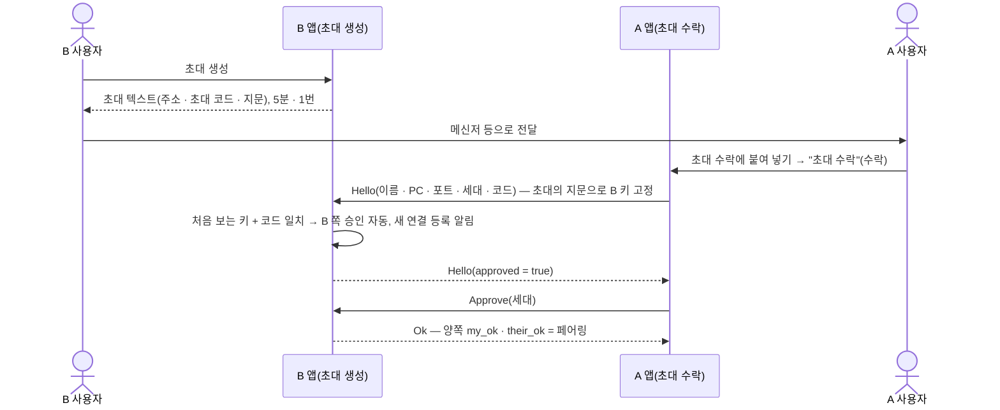

- 아는 키의 다시 추가는 양쪽 승인을 초기화하고 사람 승인을 기다린다. 주소 · 코드 직접 추가(`POST /api/peers {addr, code}`)는 지문을 고정하지 않는다(D8 개정 —
  사내망 전용 위험 수용). 웹UI 의 "주소 · 코드로 직접 추가" 칸은 #1j 에서 없앴다 — 서버 경로만 시험 · 하위 호환으로 남는다.

### 8.2 질의 1왕복

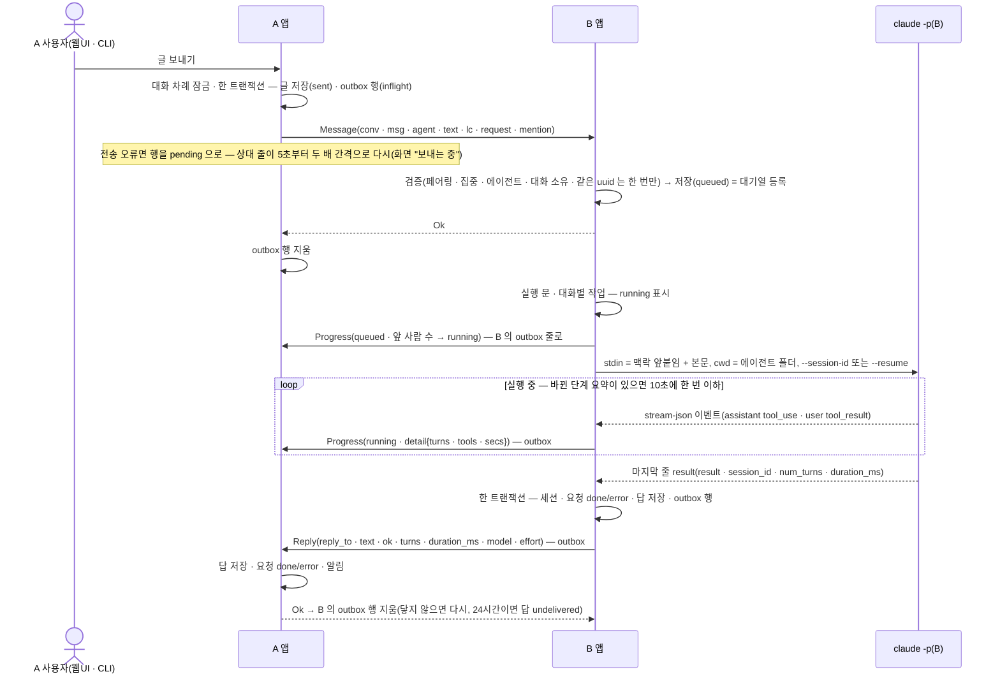

- 받은 쪽 사람이 그 대화에 쓴 글(실행 없음)은 `Post` 로 상대 이력에 미러된다. 다음 실행 때 "대화 메모" 로 함께 넘어간다(6.5).
- 상태 전이 — 보낸 쪽 글: `sent` → `done` | `error`(실패 답 · 상대 거절 · 24시간 닿지 않음 `unreachable`). 받은 쪽 요청: `queued` → `running` →
  `done` | `error`.
- **처리경과** — 받는 쪽 `Chat` 은 상대가 보낸 실행 요청일 때만 실행기 단계 요약(6.5)의 마지막 값을 두고, 작업 하나가 `step_every`(기본 10초)마다
  바뀐 것만 `Progress{state: running, detail}` 로 보낸다(키 `progress:{글 uuid}` — 기다리는 진행은 마지막 값만). 10초 안에 끝난 실행은 단계 요약을
  보내지 않는다. 보낸 쪽은 그 상대 대화의 내 실행 요청 · `sent` 글에만 받고(그 밖 `unknown`), 도구 이름을 `clean_name` 뒤 24자 · 16개까지로 줄여
  메모리에 둔다(답이 오거나 앱을 다시 켜면 사라진다). 화면 문구 "처리 중 · 2턴 · Read 3 · Grep 1 · 41초" · CLI "처리 중 — 2턴 · …"(없는 값은 뺀다). 상대에게는 턴 ·
  도구 이름별 횟수 · 초만 간다(입력 · 경로 · 모델 글 없음).

### 8.3 자동 왕복 (D24)

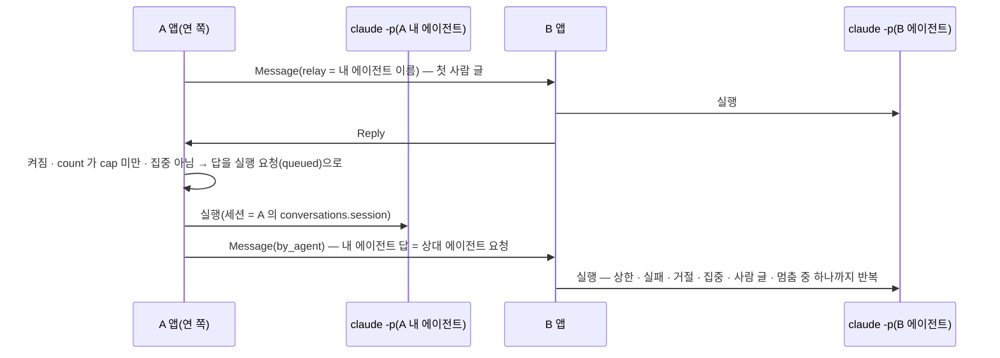

- 연 쪽이 구동한다. 상한 n = 양쪽 n 번씩(1 ~ 50, 기본 10). 연 쪽 사람이 쓰거나 어느 쪽이든 멈추면 멈추고(받은 쪽 사람 글은 멈추지 않는다), 받은 쪽이 멈추면 그 PC 는
  에이전트발 요청을 `stopped` 로 거절한다 — 넘김이 멈춤 알림보다 먼저 닿아 거절돼도 연 쪽 결과는 같다(내 답은 오류 아님 · "상대가 멈춤"). 재개는
  연 쪽만(카운트 0).
- 넘김(`Message{by_agent}`)이 전송 오류여도 멈추지 않는다 — outbox 가 보관했다가 닿으면 이어 간다. 24시간 닿지 않으면 멈춤(끝 사유 "상대에
  닿지 않음"). 재개(`Relay{on: true}`)는 바로 보낸다 — 닿지 않으면 재개 실패.
- **자동 왕복**(D24): 대화를 여는 쪽이 내 에이전트를 함께 고르면 상대 에이전트 답 → 내 에이전트 → 상대 에이전트 실행 요청을 상한(기본 10,
  1 ~ 50 왕복 — 내 에이전트가 한 번 답하면 1)까지 반복. 연 쪽이 구동하고 재개(카운트 0)한다. 연 쪽 사람이 쓰거나 어느 쪽이든 멈추면 멈추고(받은 쪽 사람 글은 멈추지 않는다),
  받은 쪽이 멈추면 그 PC 는 에이전트발 요청을 `stopped` 로 거절 — 연 쪽은 멈춤 알림이 먼저 온 것과 같게 받는다(내 답은 오류가 아니고 "상대가
  멈춤"). 실패 답 · 그 밖 전달 거절이면 멈춤. 에이전트발 요청도 페어링 · 대화 소유 ·
  가드(D31) 그대로.

### 8.4 @멘션 (D19 보강)

- 내가 연 대화(자동 왕복 아님)에서 글의 첫 `@이름` 이 상대 PC 에이전트 이름이면 `Message.mention` 으로 싣는다(`agent` 는 늘 대화 에이전트).
- 받은 쪽은 대기열 실행 때 `mention` 의 에이전트를 실행하고 세션은 `agent_sessions` 를 쓴다. 답의 `agent` 는 요청의 값이고, 보낸
  쪽도 답을 받을 때 요청의 값을 붙인다 — 양쪽 요청 · 답에 이름(`messages.agent`), 답 발화자도 그 이름.
- 받은 대화 · 자동 왕복 대화 · 대화를 여는 첫 글에는 멘션이 없다(보내는 쪽 400 · 받는 쪽 `bad_request`), 없는 이름은 `unknown_agent`.
- **@멘션**(D19 보강 · #18): 내가 연 대화(자동 왕복 아님)에서 글의 첫 `@이름`(상대 PC 에이전트 이름 그대로 · 긴 이름 먼저)이면 그 에이전트를 부른다 —
  받은 쪽은 대화 × 에이전트 세션(`agent_sessions`)으로 실행하고 대화 에이전트 세션은 그대로. 양쪽 요청 · 답에 이름(`messages.agent`), 답 발화자도
  그 이름. 프레임은 `Message.mention`(`agent` 는 늘 대화 에이전트 — 첫 글이 닿지 않았어도 받은 쪽은 대화를 그 에이전트로 연다). 에이전트를 지우거나
  폴더를 바꾸면 그 세션을 비우고 세대(`agents.uid`)를 새로 해, 그때 돌던 실행이 끝나도 옛 세션을 되살리지 않는다. 후보 목록을 받지 못했으면 멘션처럼
  보이는 글은 보내지 않고, 멘션 꼴 `@이름` 이 후보와 맞지 않으면(오타 · 낡은 목록) 한 번 막고 알린다(같은 글을 다시 보내면 멘션 없이 — 대화
  에이전트로 조용히 가지 않게). 받은 대화 · 자동 왕복 대화 · 대화를 여는 첫 글에는 멘션이 없다(보내는 쪽 400, 받는 쪽 `bad_request`). CLI `ask --conv N --agent X`.

### 8.5 집중 거절 · 다시 보내기 (D17 개정)

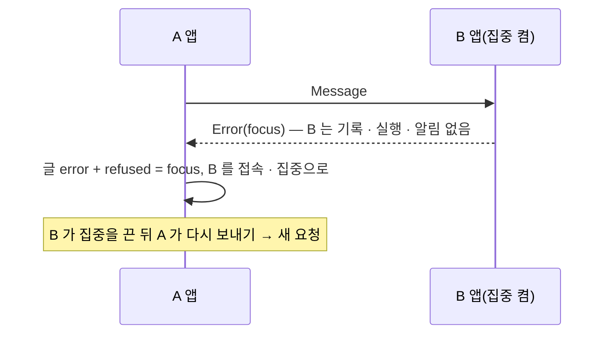

- 이미 받은 글의 재전송(같은 uuid)은 집중 중에도 `Ok`(한 번만 실행). 진행 중 자동 왕복은 다음 차례에서 멈추고(끝 사유 — 상대가
  집중이면 "상대가 집중 중", 연 쪽이 집중이면 "집중 중"), 집중 동안 알림도 멈춘다.
- **집중 · 접속 상태**(D17 개정 · #18): 사용자가 켠 집중(이 PC 설정 `focus`) 동안 상대의 새 실행 요청(자동 왕복 차례 포함)은 받는 순간 `focus`
  로 거부한다(기록 · 실행 · 알림 없음, 이미 받은 글의 재전송은 `Ok`). 진행 중 자동 왕복은 다음 차례에서 멈추고 알림도 멈춘다(알림 일시 중지 값은
  그대로). 보낸 쪽은 거절 코드를 그 글에 남기고(`refused` — 영소문자 · `_` 1 ~ 32 자만, 그 밖 `unknown`, 다시 보내면 지움) 실패 상태일 때만
  "상대가 집중 중" · "상대가 거절({code})". 접속(#1c — 주기 확인 없음) = 마지막 통신 시각 `seen_at`(보내기 성공 · 페어링된 상대에게서 받기 ·
  `Ping`/`Pong` 때만, 10초에 한 번 기록). 시작 때 `announce`(페어링된 상대마다 `Ping` 한 번), 웹UI 를 열 때 · 타일을 고를 때 확인(서버가 60초 안
  중복을 거름). 화면 "방금 통신"(75초 안 — 점 · 집중 표시는 이때만) · "n분 · n시간 · n일 전 통신" · "통신 기록 없음".

### 8.6 요청 목록 — 실행 없음 · 상태 동기화 (#1d)

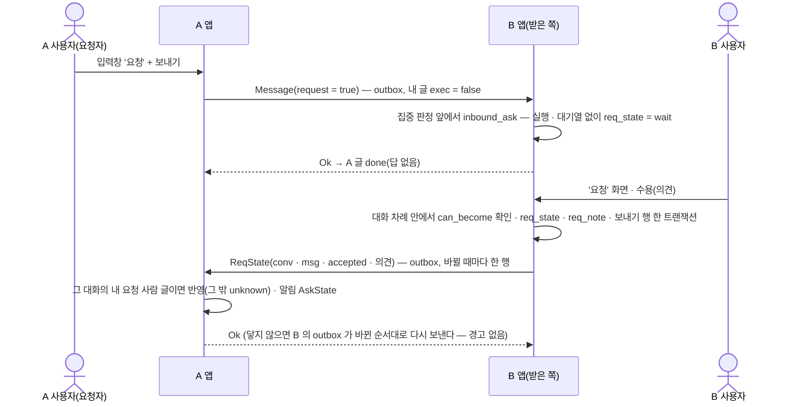

- 옮김은 지금 상태 말고 네 상태 어디로든 — 되돌리기 포함(받은 쪽이 검사, 요청자 쪽은 받은 대로 — 이전 버전 요청자도 받는다). 경고("이 PC 에는 바꿨다 — 상대에 알리지 못했다 …")는 상대가
  거절했을 때만 뜬다.
- 받은 대화(B 가 요청자)에서는 미러 `Post{exec: false, request: true}` 로 같은 규칙.
- **질의 · 요청 목록**(S1 개정 · #18 → #1d): 사람 글마다 종류(기본 질의 · 요청) — 프레임 `request` 로 양쪽 이력에. **요청은 실행하지 않는다** —
  받는 쪽은 집중과 무관하게 `req_state = wait` 로 기록만(대기열 · 실행 없음), 멘션 · CLI · 자동 왕복과 함께 쓰지 않는다. 받은 쪽 사람만 대기 ·
  수용 · 반려 · 완료 사이 어디로든(의견 — 여러 줄 200자, 보낼 때 줄바꿈 → U+2028 · 받을 때 되돌림 — 이전 버전 호환, #1z)으로 바꾸고 상태 · 보내기 행을 한 트랜잭션으로 적어 `ReqState` 프레임으로 쓴 쪽에 보낸다(쓴 쪽은 그 상대
  대화의 자기 요청 사람 글에만 — 그 밖 `unknown`, 같은 상태 · 의견 재전송은 그대로 `Ok`). 오래 닿지 않아 포기 · 요청자 거절이면 그 글 `refused` →
  "다시 알리기"(같은 상태 재전송). 모아 보기 = 왼쪽 메뉴 '요청'(받은 · 보낸 · 상태 거르기 · 대기 수 배지) · 세부정보 '요청'.
- `PATCH /api/messages/{id}` 의 `req_state` 는 `wait` 도 받는다(#1y — 받은 요청을 대기로 되돌리기, 웹UI "↺ 대기" · 보드가 내던 옮김을 서버가 400 으로 막던 결함).
- **요청 archive**(#1y — 이 PC 에만, 프레임 · outbox 없음): archive = 완료(`req_state = 'done'`) + (손 표시 1 | 손 표시 없음 · `coalesce(req_at, created_at)` 가
  `ARCHIVE_DAYS`(7)일 지남) — 따로 도는 작업 없이 조회 조건(`chat::archived_sql` · `Message::archived(now)`). 상태가 바뀌면(`set_req_state`) 손 표시를 지운다 — 완료가
  아니면 바로 목록에, 다시 완료면 7일 셈을 새로. `GET /api/messages?ask=request` 는 archive 제외, `&archived=true` 는 archive 만(`ask=request` 없이 · `side=both` 와
  함께면 400). `req_counts` 의 `done` · `total` 은 archive 제외 + `archived` 수. `POST /api/messages/{id}/archive {archived}` → 메시지 JSON — 사람 요청 글만(공유 사본 ·
  요청 아님 400 · 없음 404), 완료 아닌데 `true` 면 409 "완료된 요청만 archive 할 수 있습니다". 상대 PC 의 요청 · 상태 · 수는 그대로.

### 8.7 CLI `ask` (D14 보강)

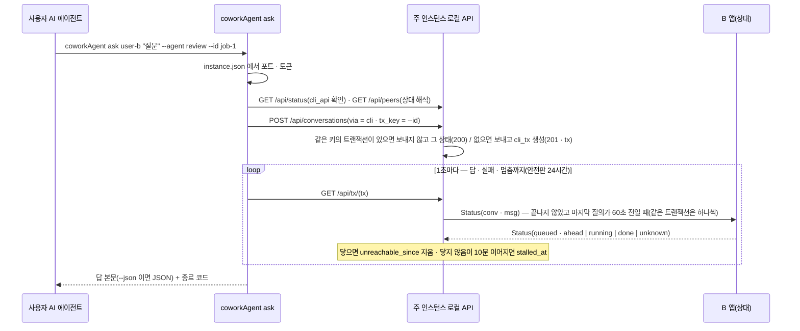

- `ask` 는 앱 DB 의 **트랜잭션**(`cli_tx`) 하나 — 앱이 주인이고 CLI 는 상태를 본다. `--id <키>`(1 ~ 64자 `[A-Za-z0-9._-]`, 이 PC 안에서 고유)로
  다시 실행하면 새로 보내지 않고 그 트랜잭션의 결과를 받는다. CLI 가 죽어도 트랜잭션은 남는다 — `coworkAgent wait <tx>`(`POST /api/tx/{id}/resume`
  으로 멈춤을 풀고 다시 판정) 로 이어 받고, `coworkAgent status <tx>` 는 지금 상태를 한 번 출력(평문 `{tx}\t{state}\t{진행}`).
- **상태**(`GET /api/tx/{id}` 의 `state`) — 순서대로 답이 있으면 `answered` · 실패 답 · 글 실패면 `failed` · 멈췄으면 `stalled` · 실패 보관이면
  `failed` · outbox 에 남았으면 `sending` · 그 밖 상대가 알려 준 진행 `queued` · `running` · 없으면 `sent`. 멈춘 뒤에 답이 오면 답이 이긴다.
- **감시는 조회가 띄운다** — `sending` 이면 상태 질의 없이 그 상대 줄이 닿지 않고 있는지만 보고, 그 밖은 `Status` 를 보낸다. CLI 가 없으면 감시도
  없다(앱이 상대를 계속 두드리지 않는다). 간격 60초 · 멈춤 10분(시험용 `Chat::set_watch(every, stall_after)`).
- 진행이 바뀔 때마다 표준 오류에 한 줄 — "보내는 중 — 상대에 아직 닿지 않아 이 PC 에 보관했다(다시 보냄 n회)" · "대기 중 — 상대 PC 에 처리 중인
  작업이 많다(앞에 k건)" · "처리 중 — 2턴 · Read 3 · 41초"(`--json` 이면 `{"progress":"sending"|"queued"|"running", …}`). `--json` 결과에 `tx`.
- CLI 로 보낸 사람 글은 `via = 'cli'` 로 양쪽 이력에 남고(이전 버전 상대는 사람 글로 본다) 화면에 `AI 에이전트(CLI)` 로 구분된다 — 동작은 사람 글과 같다.
- `--conv N` 이면 그 대화에 이어 쓰고(`POST /api/conversations/{N}/messages`), `--agent X` 가 대화 에이전트가 아니면 멘션이다. `--no-wait` 는
  평문이면 대화 ID, `--json` 이면 `{conversation, asked, tx}`.
- 종료 코드 0 · 2 사용법 · 3 실행 중 아님 · 4 API 거부/전달 불명(다시 보내지 말고 `history` 확인) · 5 답 실패 · 보내지 못함 · 6 안전판 24시간
  초과 · 7 상대에 10분 닿지 않아 멈춤(`EXIT_STALLED` — 트랜잭션은 남는다, `wait <tx>` 로 이어 받기).
- **AI 에이전트용 CLI**(D14 보강 · #15 `say` 삭제): `coworkAgent peers` · `ask` · `history` — 떠 있는 주 인스턴스의 로컬 API 를 `instance.json` 토큰으로
  부른다(웹UI 와 같은 신뢰 경계, 앱을 띄우지 않는다). 인자가 있으면 CLI · 없으면 트레이. 보내기 전 `/api/status` `cli_api` 로 출처 표시를
  아는 주 인스턴스인지 확인. CLI 글은 `via = 'cli'` 로 양쪽 이력에 남고(이전 버전 상대는 사람 글로 본다) 화면에 `AI 에이전트(CLI)` 로
  구분된다. 동작은 사람 글과 같다. 종료 코드 0 · 2 사용법 · 3 실행 중 아님 · 4 API 거부/전달 불명 · 5 답 실패 · 6 시간 초과 · 7 멈춤(#1c).
  트랜잭션(#1c — 표 `cli_tx`): `ask --id <키>` 는 같은 키면 새로 보내지 않고 그 트랜잭션, `wait <tx>` 이어 받기 · `status <tx>` 한 번 출력. 기다리는
  동안 앱이 60초마다 상대에 `Status` 를 묻고 10분 닿지 않으면 멈춤(종료 7 — `wait` 가 풀고 이어 감). 기다림 상한 24시간.

### 8.8 접속 상태 — 통신할 때만

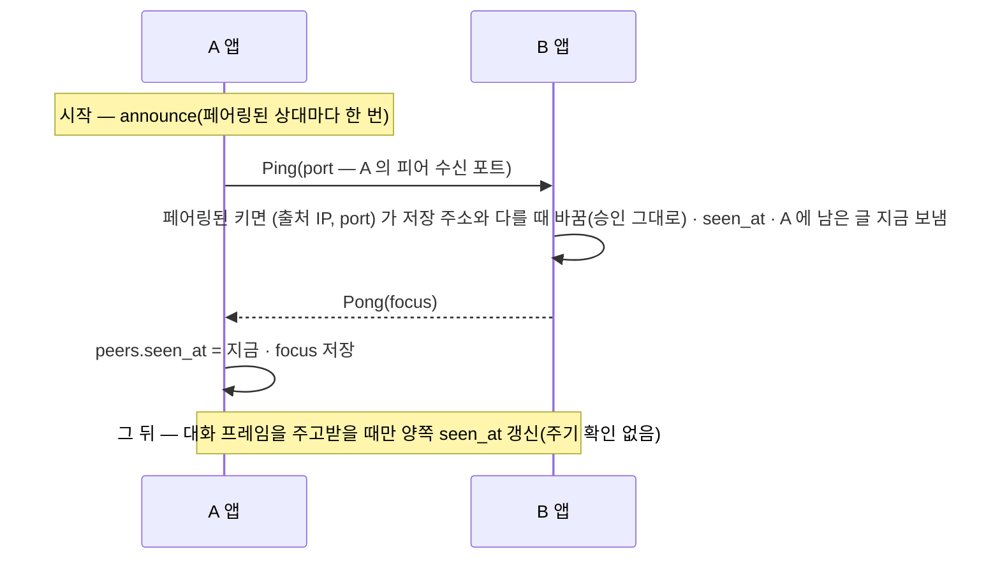

- **갱신** — 보내기에 응답을 받을 때(`Node::send`) · 페어링된 상대의 대화 요청 · `Ping` 을 받을 때 `peers::touch`(10초 안에 이미 적었으면 쓰지
  않는다). `focus` 는 `Pong` · 집중 거절 때만 바뀐다. 유휴 상태에서는 피어 연결이 생기지 않는다.
- **화면 확인** — 웹UI 를 열 때 페어링된 상대 모두 · 레일 타일을 고를 때 그 상대 · 그룹설정 "연결 확인" 이 `POST /api/peers/{id}/ping` →
  `Node::refresh(id, 60)`(마지막 통신이 60초 안이면 보내지 않고 저장된 값). 대가: 상대가 집중을 바꾼 것은 60초 안에는 바로 보이지 않을 수 있다.
- **표시** — 피어 JSON `seen_at`(유닉스 초) · `online`(75초 안) · `focus`(온라인일 때만). 화면이 직접 센다: "방금 통신"(75초 안) · "n분 전 통신" ·
  "n시간 전 통신" · "n일 전 통신" · "통신 기록 없음". 방금 통신했을 때만 점이 켜지고 집중이면 "집중 중 · 방금 통신". 오래 통신이 없던 상대는
  켜져 있어도 "n분 전 통신" 이다 — 보내기는 보관되므로 표시가 보내기를 막지 않는다.
- 바뀐 포트 · IP 따라가기(#1b)는 시작 알림의 `Ping.port` 로 — 이 PC 가 다시 켜질 때 상대가 새 주소를 받는다.

### 8.9 이력 정리 — 편집 · 삭제 (#1f)

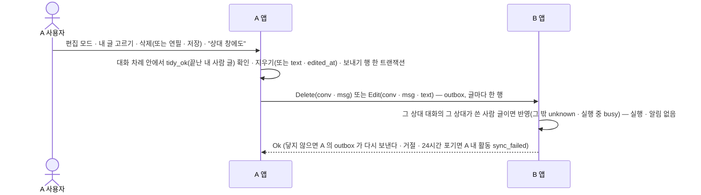

- 편집 · 삭제할 수 있는 글(`Chat::tidy_ok`) = 사람 글 ∧ `mine` ∧ 상태 `done` · `error` · `undelivered` ∧ 그 글을 실어 나르는 outbox 행
  (`pending` · `inflight`)이 없음. 반영 행(`msg_edit` · `msg_delete`)은 글을 "보내는 중" 으로 만들지 않는다(`outbox::for_message` 가 뺀다).
- 지우기 = 글 행 + 그 글의 `cli_tx` · `relay_events` · 실패 보관 outbox 행. 답(`reply_to`)은 남는다. 받는 쪽 삭제는 이미 없으면 `Ok`, 같은 본문
  편집도 `Ok`(재전송 멱등).
- 실행 맥락: 이미 돈 실행은 Claude 세션이 원문을 기억한다. 다음 실행의 앞붙임(`notes_between` — 6.5)은 고친 · 지운 상태의 DB 를 읽는다.
- **이력 정리**(D34 · #1f): 편집 · 삭제는 **끝난 내 사람 글**만(사람 글 ∧ 이 PC 가 씀 ∧ `done` · `error` · `undelivered` ∧ 그 글을 실어 나르는 outbox
  행이 기다리지 않음 — `Chat::tidy_ok` 한 곳). 반영은 그때마다 내 창에서만 · 상대 창에도(프레임 `Edit` · `Delete`, outbox — 받는 쪽은 그 상대 소유
  대화의 그 상대가 쓴 사람 글에만, 실행 대기 · 실행 중이면 `busy`). 삭제는 흔적 없이(답은 남는다), 편집은 `edited_at` "(편집됨)". 실행 · 알림 없음.
  상대 반영 실패(거절 · 24시간 포기)는 내 활동 `sync_failed`. 말풍선 우상단 복사 아이콘은 늘 보인다.

### 8.10 부모 도구 메뉴 — `start` · `open` · `stop` (#1n · D14 보강)

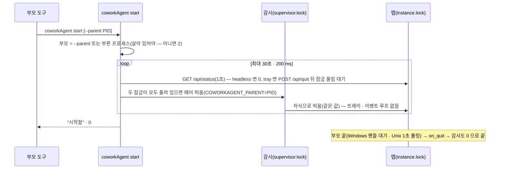

- **떼어 띄우기**(`proc::spawn_detached`) — 표준 입출력 비움(부모 도구의 파이프가 끝나지 않는 일 방지) · `COWORKAGENT_SUPERVISED` 지움 · 새 프로세스
  그룹(부모 콘솔의 Ctrl+C 가 닿지 않음). Windows `CREATE_NO_WINDOW | CREATE_NEW_PROCESS_GROUP` + 자기 표준 핸들 상속 끔, Unix `process_group(0)`.
- **`start`** — 한 30초 되풀이: 응답 → 모드(`/api/status` `mode`), 트레이면 끄기, 띄운 감시가 끝났으면 코드 확인(0 = 겹친 `start` — 다시 판단 · 3 =
  사유 파일의 사유로 8 · 그 밖 8), 잠금이 모두 풀려 있으면 띄우기. 끝에 잠금이 잡혀 있으면 6 "실행 중이지만 응답이 없다 — stop 뒤 다시", 아니면 8.
  겹친 `start` 는 감시 잠금이 하나만 남긴다(나머지 감시는 0). 이미 트레이 없는 모드면 지켜보는 부모는 처음 것 그대로.
- **`open`** — 응답이 없으면 `start` 와 같이 띄운 뒤 `POST /api/open`(204 → 0, 아니면 4).
- **`stop`** — 전체 상한 10초 하나(넘으면 6). 응답 있으면 `POST /api/quit` → 두 잠금 풀림. 404 면 종료 API 없는 이전 버전 — 기다리지 않고 4
  (`start` 도 같다). 응답 없음 + 잠금 잡힘(오류 트레이 · 시작 중 · 멈춘 앱)이면 5초 응답을 기다린 뒤 `supervisor.pid` → `instance.pid` 순으로
  `proc::kill_tree`(그 잠금이 잡혀 있을 때만 — 감시와 그 자식 앱을 함께 끊어 다시 띄우지 않게 · 막 뜬 앱이 잠금을 잡기 전이어도). Windows 는 핸들을
  연 채 실행 파일 이름이 같은지 보고 끊는다(PID 재사용 방지), Unix 는 감시가 프로세스 그룹 우두머리면 그룹째. 끊은 뒤 잠금이 300 ms 풀린 채
  머무는지 보고, 다시 잡혔으면 되풀이. 잠금 풀림 판정은
  `InstanceLock::is_held`(잠깐 잡아 보고 놓기) — 그 사이 진짜 획득자가 보조로 판정되지 않게 `acquire` 는 `WouldBlock` 을 50 ms 간격 4번까지 다시 잡는다.
- **시작 실패 판정** — 코드 3 은 MSVC `abort()` 와 같다. `watchdog::spawn_app` 은 사유 파일을 그 자식이 썼을 때만(끝 줄 `PID: n` —
  자식 핸들을 쥔 채 확인) 시작 실패로 넘기고(`tray::start_error_by`), 아니면 비정상 종료로 다시 띄운다.
- **`/api/quit`** — 같은 토큰 guard, 204 를 먼저 보내고 100 ms 뒤 종료 호출(트레이 모드 = 이벤트 루프에 종료 이벤트, 트레이 없는 모드 = 종료 채널).
  `server::router_control(…, mode, quit, extra)` 에 `quit` 이 있을 때만 경로가 생긴다.
- 출력 · 종료 코드 — 표준 출력 한 줄("시작함" · "이미 실행 중" · "열었음" · "종료함" · "실행 중이 아님"), 실패는 표준 오류. 0 · 2 · 4 · 6 · 8
  (`EXIT_START_FAILED` — 새). handshake(`cli_api`) 없이 동작한다.
- **시험** — `crates/app/tests/lifecycle.rs`(디버그 실행 파일 + 시험마다 임시 `COWORKAGENT_DATA_DIR` + 대역 부모 — 실제 인스턴스 비파괴).
- macOS 는 같은 코드 길(`getppid` · `kill(pid, 0)` 폴링 · `SIGKILL` · `process_group(0)`) — 실기 확인은 원장.
- **부모 도구 메뉴**(#1n · D14 보강): `coworkAgent start [--parent <PID>]` · `open [--parent <PID>]` · `stop` — 꺼져 있어도 동작(handshake 없음).
  `start` · `open` 은 **트레이 없는 모드**(내부 변수 `COWORKAGENT_PARENT` — 트레이 · 이벤트 루프 없음, 브라우저 안 엶)로 띄우고 받을 준비를 기다린다.
  부모(기본 = 부른 프로세스)가 끝나면 앱 · 감시가 정상 종료, 이미 떠 있으면 부모는 처음 것 그대로 · 트레이 모드면 끄고 다시 띄움. `stop` 은 `POST
  /api/quit`(같은 토큰 guard) → 두 잠금 풀림까지, 응답 없으면 잡힌 잠금의 PID 강제 종료. `/api/status` 에 `mode`. 종료 코드 0 · 2 · 4 · 6 · 8(시작 실패).
  어떤 실행 경로로도 앱 · 감시는 하나, 트레이는 많아야 하나.

### 8.11 공유 대화 — 관람자 (#1o)

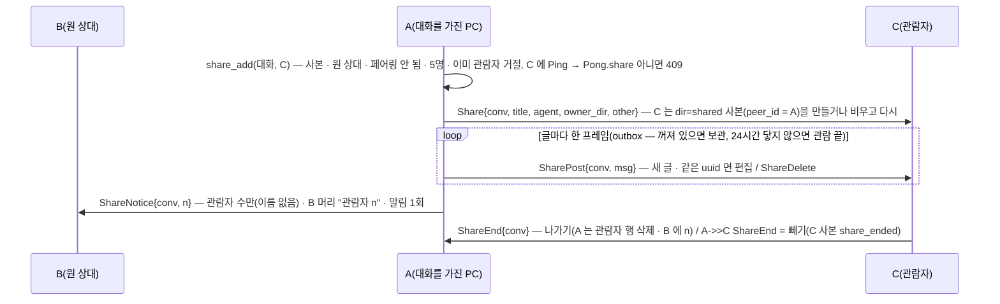

- **퍼뜨리기** — `Chat::fan_share(conv)` 가 관람자마다 `id > sent_upto` 인 글(컨텍스트 구분선 제외)을 `SharePost` 행으로 넣고 커서를 올린다(한 트랜잭션 —
  몇 번 불러도 두 번 가지 않음). 부르는 자리 = `dispatch` · `enqueue` · `handle` 끝. 편집 · 삭제는 `id <= sent_upto` 글만 바로. 행은 `msg_id` NULL(그 글의
  편집 막힘 · 보관 표시에 끼지 않게) · `has_before` 예외. 관람자에 24시간 닿지 않으면 그 관람을 끝낸다(공유 행을 지우고 관람자에서 뺀다 — 꺼진 관람자 몫이 끝없이
  쌓이지 않게) — 빼기 표시(`ShareEnd`) 한 행은 남겨 돌아온 관람자 사본이 "공유 해제됨" 이 된다. 보내기 바로 앞(능력 확인 뒤)에서 아직 관람자인지 보고,
  빠졌으면 그 행을 지운다(`ShareEnd` 는 보낸다 — 확인 ~ 보내기 사이 ms 창은 남는다). 끝 글을 지우면 SQLite 가 id 를 다시 줄 수 있어
  `sent_upto` 를 함께 낮춘다. 64 KiB 를 넘을 것 같은 프레임은 본문을 4 KiB 로 줄인다.
- **사본 막기** — 사본 글은 `share::upsert`(`mine 0 · exec 0 · request 0` — 실행을 깨우지 않음, 같은 uuid 가 이 사본 것일 때만 덮어씀). 글쓰기 · 컨텍스트 ·
  자동 왕복 · 요청 상태 · CLI 보내기는 "공유 대화는 읽기 전용", 내 활동 집계에서 뺀다. 받는 처리기는 그 상대가 보낸 **Shared 사본**인지 본다(A 가 C↔A 자기
  대화에 끼어들지 못하게). C 가 `not_paired` · `unsupported` 로 답하면 그 관람자를 뺀다.
- **API** — `POST /api/conversations/{id}/observers {peer_id}`(204 · 400 · 404 · 409) · `DELETE …/observers/{peer}` · `POST …/leave`. 대화 JSON
  `observers` · `watchers` · `share{other, owner_dir, ended}`, 글 JSON `owner`. 화면 — 목록 셋째 묶음 "공유 대화", 사본은 입력창 · 편집 · 컨텍스트 없음,
  세부정보 "관람자".
- ponytail: share 행마다 `Ping` 한 번 더(능력 확인) · 글 하나 = 연결 하나 — 긴 이력이 느리면 상대별 능력 기억 · 묶어 보내기.
- 남은 것: 페어링 해제로 관람자가 지워질 때 원 상대 관람자 수는 갱신하지 않는다 · 사본 글 상태는 처음 보낼 때 값.
- **공유 대화 규칙**(#1o · D38): 대화를 페어링된 상대(5명까지)에게 읽기 전용으로 — 넣은 PC 가 이력 · 이후 글 · 편집 · 삭제를 `Share*` 프레임(outbox,
  글 하나 = 프레임 하나 · 보내기 전 `Pong.share` · 보내기 직전 관람자 확인)으로, 관람자 PC 사본 `dir = shared`(실행 · 쓰기 · 자동 왕복 · 요청 · 다시 공유
  없음, 내 활동에서 뺌), 원 상대에는 관람자 수만. 끝 = 빼기 · 나가기 · 페어링 해제 · 24시간 닿지 않음 → 사본 "공유 해제됨". 스키마 20(`shares` 커서
  `sent_upto` · 사본 열 · `messages.owner`). 화면은 [web-ui](web-ui.md).

### 8.12 대화 나가기 · 기록 삭제 (#1w · #1x · D40)

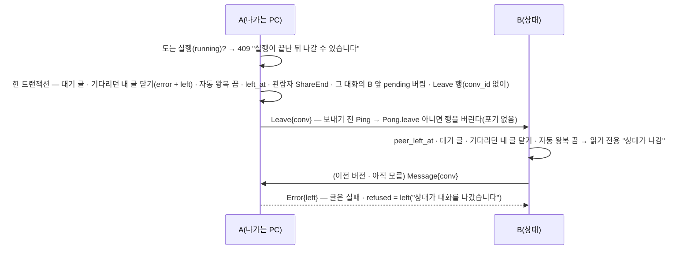

- **나가기**(`Chat::leave_conversation`) — 모든 대화. 공유 사본은 지금 공유 나가기(`share_leave`). 이력은 남고 읽기 전용(`writable` — 글쓰기 · 컨텍스트 · 자동 왕복 ·
  요청 상태 · 이력 정리 · 공유 넣기 막음, "나간 대화는 읽기 전용"). 받기 앞(`handle`)에서 그 대화(`chat::left` — `left_at` 또는 묘비)로 온 요청은 `Leave` ·
  `ShareEnd` 말고 모두 `left`. 나간 뒤 끝난 실행의 답은 이력에만(`record` — 보낼 행 없음), 줄을 서던 대기 글은 실행하지 않는다.
- **삭제**(`Chat::delete_conversation`) — 나가기(아직이면 — 같은 막음) 뒤 `chat::delete_conversation`: 글 · 실행 · 에이전트 세션 기록(`conversations.session` ·
  `agent_sessions`) · `ctx_seeds` · 그룹 소속 · 관람자 · 보낼 글 · `relay_events` · `cli_tx` · 대화 행, 읽음 · 내 활동 본 표시 · 공유 커서를 낮춘다. 끝 알림 행(`Leave` ·
  관람자 앞 `ShareEnd`)은 대화에서 떼어(`conv_id` NULL) 남긴다. 공유 사본이 아니면 묘비(`left_convs`). 상대 PC 사본은 그대로. 실행 중 삭제된 대화의 답은 버린다.
- **번호** — `conversations.id` AUTOINCREMENT(스키마 21) — 지운 가장 큰 번호를 새 대화가 받지 않는다. `messages.id` 도 AUTOINCREMENT(스키마 22 — #1x 기록 삭제 뒤 새 글이
  지운 번호를 받으면 대화 작업이 그 글을 이미 꺼낸 글로 보고 실행하지 않았다, 적대적 평가 R1).
- **API** — `POST /api/conversations/{id}/leave` · `DELETE /api/conversations/{id}`(204 · 404 · 실행 중 409). 대화 JSON · 글의 `conversation` 요약에 `left_at` ·
  `peer_left_at`. 화면은 [web-ui](web-ui.md).
- **웹UI 나가기 = 삭제**(#1x — D40 개정) — ⋯ "나가기" 는 확인("대화방이 목록에서 삭제됩니다.") 뒤 `DELETE` 를 부른다(나가며 이 PC 목록 · 글 삭제). 읽기 전용으로 남기는
  `POST …/leave` 는 CLI · API 호환으로만 남고 웹UI 는 부르지 않는다. 관람자(공유 사본)는 "나가기" 만.

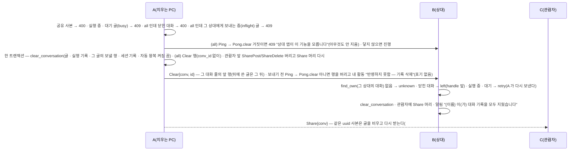

- **기록 삭제**(`Chat::clear_conversation(id, all)` — #1x) — 대화 행 · 제목 · 그룹 · 즐겨찾기 · 공유 · 자동 왕복 설정은 남기고 글만 비운다(`chat::clear_conversation`, 묘비 없음 —
  같은 대화로 계속 쓴다). `all` = 모든 사용자 글 삭제 — 상대 PC 도 그 대화 글을 비운다(`Clear`), 관람자 사본은 공유 머리를 다시 보내 비운다(새 프레임 없음). 받는 쪽은
  그 대화의 참여 상대가 보낸 것만 받는다(`find_own` — 다른 상대가 같은 uuid 로 보내면 `unknown`). 비운 대화의 첫 글은 빈 자동 왕복 대화 규칙(아래 세션 생성)으로 다시 왕복을 연다.
  `POST /api/conversations/{id}/clear` `{all}` — 204 · 400(공유 사본 · 닫힌 대화 + all) · 404 · 409(실행 중 · 상대 앱이 모름).
- **세션 생성**(`Chat::open_session` — #1x) — `POST /api/conversations` 의 `text` 가 비면(`via` · `request` 없이) 글 없이 이 PC 에 대화만 연다(201 · 메시지 없음). 상대 PC 는
  첫 글(`Message` · `Ask`)을 받을 때 대화를 만든다. 자동 왕복 설정(`relay_agent` · `relay_cap`)을 준 빈 대화의 첫 글은 자동 왕복을 연다(`send_with` — 요청이면 400).

## 9. 보안 경계 요약

| 경계 | 막는 것 | 장치 |
|---|---|---|
| 브라우저 ↔ 로컬 서버 | 다른 사이트 · DNS rebinding · 같은 PC 의 다른 포트 · 클릭재킹 | 127.0.0.1 · 실행마다 토큰 · 탭 메모리 + `Authorization: Bearer`(쿠키 없음) · Host · Origin 검사 · 모든 응답 CSP(`frame-ancestors 'none'`) · `X-Frame-Options: DENY` · `nosniff` · `no-referrer`(D9 · 1a) |
| 데이터 폴더 | 같은 PC 의 다른 주체(샌드박스 · 서비스 계정) | 소유자 전용 권한(7.1). 같은 사용자 권한 프로세스는 막지 않는다(한 PC 한 사용자 전제 — 1a) |
| CLI ↔ 로컬 서버 | 토큰 없는 호출 | `instance.json` 토큰(Bearer). 같은 OS 사용자의 로컬 프로세스는 부를 수 있다(`/api/quit` · `stop` 의 강제 종료 포함) — 웹UI 와 같은 신뢰 경계(위험 수용, #16) |
| PC ↔ PC | 미페어링 · 사칭 · 도청 · 초대 코드 추측 | TLS 1.3 상호 인증(ed25519 공개키 고정), 페어링된 키만 대화 요청(id 는 UUID 꼴만 — 아니면 `invalid`), 수신 3초 · 동시 32 · IP 당 4 · 미승인 32 · 한 창에서 IP 당 틀린 초대 코드 10회(넘으면 그 창 동안 거절) · 원격 이름의 제어 · 서식 문자(Cf) 제거. 상대 주소가 사내망인지는 검사하지 않는다(`0.0.0.0` 수신 · 아무 주소로 발신) — 사내망 전제 |
| 공유 대화(#1o) | 사본 위조 · 남의 대화 끼어들기 · 다시 퍼뜨리기 · 관람자 노출 | 페어링된 상대만 관람자 · 받는 쪽은 그 상대가 만든 `shared` 사본에만 적용(같은 uuid 가 다른 소유면 `exists`) · 사본은 다시 공유 · 쓰기 불가 · 원 상대에게는 관람자 **수**만 · 관람자 5명 상한. 관람자에게 간 글은 빼도 회수되지 않는다(원 상대 승인 없음 — 알림만) |
| 원격 글 → 화면 | 스크립트 주입 | `textContent` 로만 그림 · markdown sanitize · HTML 은 sandbox iframe |
| 원격 글 → `claude` | 수신 PC 작업 개입 · 비밀 읽기 · 틀 위장 | 표준 입력만 · 늘 구분자 틀(6.5) · 가드 프롬프트(D31) · 편집 도구 늘 막음(#1z-9 결정 9 — `--restricted` 없음: 사용자 settings 그대로 · 폴더 밖 읽기는 가드 문구만) · Codex 는 `-s read-only` · 데이터 폴더를 품는 에이전트 폴더 거부(등록 · 수정 · 실행 직전) · 30분 상한 |
| 실패 → 상대 | 경로 · 계정 · 버전 노출 | 상대에게는 정해진 실패 문구만(6.6), 원인은 내 쪽 글 · 로그 |
| 처리경과 → 상대 | 도구 입력 · 파일 경로 · 모델 글 노출 | 단계 요약은 턴 · 도구 이름별 횟수 · 초만(`count_step` 은 입력 · 내용을 읽지 않음), 받은 쪽은 이름을 `clean_name` · 24자 · 16개로(8.2) |
| 자동 업데이트(#1y · #30) | 바꿔치기한 실행 파일 · 낮은 버전으로 되돌리기 | 정식 릴리스(`releases/latest`) · 엄격히 큰 버전만 · 이 PC 의 실행 파일 꼴(PE · 같은 아키텍처)만 · 회사 인증서 Authenticode 서명(유효 · 서명자 CN `SOFTCAMP CO.,LTD.`) · 버전 리소스(제품 `coworkAgent` · 파일 버전 = 태그)만 · 뜨지 못하면 지난 버전으로 되돌림 · HTTPS(OS 인증서 저장소) |
| 실행 파일 | DLL 심기 | 정적 C 런타임(`+crt-static`) · DependentLoadFlags 0x800 · `SetDefaultDllDirectories(System32)` |
| 자격 증명 | 토큰 수집 · 중개 | coworkAgent 는 Claude 자격 증명을 읽거나 저장하지 않는다 — `claude` 가 그 PC 의 로그인을 스스로 쓴다 |
| 답 생성 → 모델 서비스 | (막지 않음) | `claude -p` 가 질문 · 맥락 · 도구가 읽은 파일 내용을 그 PC 의 Claude 모델 서비스로 보낸다 — 사내망 밖 전송, 보존 · 처리는 그 PC 의 Claude 계정 정책 |

남는 위험: 에이전트 폴더에서 읽을 수 있는 것은 답으로 상대에게 나갈 수 있다 · 원격 요청이 수신 PC 의 Max 사용량을 상한 없이 쓴다
(D24 개정) · 초대 메시지가 새면 5분 창 안에서 제3자가 등록된다(D8 개정) · 수신 포트를 인터넷에 열면 사내망 밖에서도 붙는다(LAN 검사 없음) ·
답을 만들 때 질문 · 읽은 파일 내용이 Claude 모델 서비스(사내망 밖)로 나간다 · 회사 코드 서명 인증서(개인키)를 빼앗기면 그것으로 서명해 정식 릴리스에 올린 실행 파일이 모든 PC 에 묻지 않고 설치된다(#30 — 서명자 이름만 본다).

쉬운 말 풀이 · 코드 근거 · 실측 · 확인 필요 항목: [외부 공격 노출 검토](../../overview/security-review.md).

**보안 회귀 검사(개발 PC)**

```powershell
# 편집 도구가 막히고 읽기 도구가 실재하는지(실제 claude · 사용량 조금, #1z-9 결정 9) — Claude Code 를 올린 뒤
cargo test -p an-agent --test tools_canary -- --ignored --nocapture
# 릴리스 exe 가 VCRUNTIME 을 가져오지 않는지 · DependentLoadFlags
python tools/pe_imports.py target/release/coworkAgent.exe                   # vcruntime=0 dependent_load_flag=0x800
```

- `.cargo/config.toml` 의 `rustflags` 는 환경 변수 `RUSTFLAGS` · `CARGO_ENCODED_RUSTFLAGS` 가 있으면 **통째로 무시된다** — 릴리스를 만든 뒤 위
  `pe_imports.py` 로 확인한다.

## 10. 디버깅 · 운영

- **로그** `logs\coworkAgent.log` — "시작 — 127.0.0.1:{port}" · "피어 수신 0.0.0.0:{port} · 지문 …" · "남은 대화 대기열 N건 복구" · 답
  전달 실패 · "상대 {id} 에 {n}초 동안 닿지 않아 보내기 포기 — {k}건" · "CLI 트랜잭션 {id} — 상대에 {n}초 닿지 않아 멈춤" 등. 비밀키 · 초대 코드는 싣지 않는다.
- **보관 · 트랜잭션 들여다보기** — `SELECT id, peer_id, kind, state, tries, waited, next_at, last_error FROM outbox;` ·
  `SELECT * FROM cli_tx ORDER BY id DESC LIMIT 5;`(7.6 처럼 읽기 전용으로).
- **실행 실패 원문**은 **답하는 PC** 의 답 본문("실행 실패: …")에 있다 — `claude` 의 종료 상태 · stderr 를 포함한다. 묻는 PC 에는 정해진
  문구만 간다(6.6).
- **세션 추적** — DB `conversations.session` · `agent_sessions.session` → 7.6 으로 Claude Code 기록 파일을 찾는다.
- **포트** — 피어 수신이 47100 을 못 잡으면 임의 포트로 뜨고 잡은 프로세스(이름 · PID)를 로그 · 트레이 툴팁 · 웹UI 프로필 → 사용자 정보
  "피어 포트" 에 보인다(`/api/me` 의 `peer_port_*` · `open_connections`). 페어링된 상대는 시작 알림(`announce`) `Ping` 의 `port` 로 새 주소를 따라온다(8.8). 강제 종료 뒤
  포트 풀림 · 남은 `instance.json` 으로 다시 띄우기는 `python tools/port_check.py`(떠 있는 앱을 강제 종료한다 · `--occupy` 는 47100 을 먼저 잡고
  잡은 프로세스 표시를 잰다).
- **두 번째 실행이 아무것도 안 하는 것 같다** — 핸드오프로 기존 인스턴스의 브라우저 열기를 부르고 끝난 것이다. 옛 빌드가 떠 있으면
  새 빌드를 실행해도 옛 인스턴스가 응답한다 — 트레이 "종료" 후 새 빌드를 실행한다.

## 11. 참고

- 모듈 계약: [an_core](an_core.md) · [an_net](an_net.md) · [an_agent](an_agent.md) · [an_app](an_app.md)
- 결정 · 명세: [masterPlan](../../masterPlan.md) — D3(단일 실행 파일 서버 · 클라이언트) · D9(로컬 웹UI) · D15(저장 경로) · D16(`claude -p`) ·
  D19(이어서 작업 · 멘션 세션) · D22 · D31(실행 권한 · 문의 응답 전용) · D24(자동 왕복 · 시간 제한) · D17(집중) · D7(피어 연결 · 오프라인 상대 보관 · 재전송) · D14(CLI)
- 제품 규칙 정본: 루트 `PRODUCT.md` "도메인 규칙" · 미조치: [원장](../../overview/ledger.md)
