# 사용자 가이드 — coworkAgent

> 쓰는 사람용 따라 하기 안내다. 같은 사내망에 있는 다른 사람 PC 의 Claude 에이전트에게 그 PC 의 프로젝트를 묻고 답을 받는다.
> 동작 원리(프로세스 · 저장 구조 · 자동 업데이트 · 재시작 규칙)는 [개발자 가이드](../dev/developer-guide.md). 화면 글자는 앱에 보이는 그대로 적었다.
> 캡처의 이름(`박지훈` · `이준호` · `review` · `D:\work\shop-api`)은 가상의 것이다. 트레이 메뉴 **"매뉴얼"** 로 언제든 이 문서를 연다.

## 1. 시작하기

### 1.1 무엇을 하는 앱인가

- 두 PC 를 한 번 **연결(페어링)** 해 두면, 내 질문에 **상대 PC 에 등록된 에이전트**가 그 PC 의 Claude Code(또는 Codex)로 답한다.
- 상대 에이전트는 상대가 정한 폴더를 **읽기 전용 · 문의 응답 전용**으로 다룬다(파일을 고치지 않는다). 답은 상대의 Claude 구독 사용량을 쓴다.
- 주고받은 대화는 두 PC 에 모두 남는다. 상대가 꺼져 있으면 내 PC 에 보관했다가 켜지면 보낸다. PC 끼리 중앙 서버 없이 TLS 로 직접 주고받는다.
- ⚠ 답을 만들 때 **질문과 에이전트가 읽은 파일 내용이 Claude 모델 서비스(사내망 밖)로 나간다.** 답하는 PC 는 인터넷 연결이 필요하다.
- **사내망(LAN) 안에서 쓰는 도구**다. 앱은 상대 주소를 검사하지 않으니 수신 포트를 공유기 포트 포워딩 등으로 인터넷에 열지 않는다.

### 1.2 준비

| 항목 | 내용 |
|---|---|
| OS | Windows 10/11 x64 · macOS 12 이상(사전 배포 — 실사용 확인 전) |
| 설치 | 없다 — 실행 파일 하나. [GitHub 릴리스](https://github.com/Softcamp-SaaS-RND/coworkAgent/releases)에서 Windows `coworkAgent.exe`(회사 인증서 서명) · macOS `coworkAgent-macos.zip` 을 받는다 |
| macOS 첫 실행 | 서명이 없어 Gatekeeper 가 막으면 터미널에서 `xattr -d com.apple.quarantine coworkAgent` 로 격리 표시를 지운다 |
| 네트워크 | 상대 PC 와 같은 LAN. 수신 포트(기본 TCP 47100)를 방화벽이 막으면 사내망 쪽만 허용한다(10.3 방화벽 프로필) |
| Claude Code | **답하는 PC**(에이전트를 등록한 PC)에 Claude Code 2.1.267 이상 설치 · 로그인. 낮으면 `claude update`. 묻기만 하는 PC 는 없어도 된다 |

### 1.3 실행 · 트레이 메뉴

1. `coworkAgent.exe` 를 실행한다 → 알림 영역(macOS 는 메뉴 막대)에 **트레이 아이콘**이 생긴다. 창은 뜨지 않는다.
2. 트레이 아이콘을 우클릭한다.

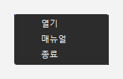

| 메뉴 | 하는 일 |
|---|---|
| 열기 | 기본 브라우저에 웹UI 를 연다. 이미 실행 중일 때 `coworkAgent.exe` 를 다시 실행해도 열린다 |
| 매뉴얼 | 기본 브라우저에 이 문서(GitHub)를 연다 |
| 종료 | 앱을 끈다. 꺼 둔 동안 상대가 보낸 메시지는 상대 PC 에 보관됐다가 다시 켜면 들어온다 |

- 처음 실행하면 **로그인할 때 자동 실행**에 등록된다(Windows 시작 프로그램 · macOS 로그인 항목). 끄기는 설정 → 시작 → **"로그인할 때 자동 실행"**.
- 새 버전은 트레이로 실행할 때 **묻지 않고** 받아 바꾼다(Windows, 회사 서명 확인). 결과는 로그의 "자동 업데이트:" 줄.
- 트레이 아이콘의 **주황 점** · 툴팁 "coworkAgent — 확인할 일 N건" = 받은 요청 · 연결 요청 · 연결 승인 · 내 요청 상태 변경. 웹UI 를 열면 지워진다.
- **붉은 트레이 아이콘** = 시작 실패 — 메뉴 **"오류 보기"** 로 사유를 본다(10.1).
- 탭을 닫았다 다시 들어가면 "연결이 끊겼습니다. 트레이 아이콘 메뉴 '열기' 로 다시 여세요." 가 뜬다 — 트레이 **"열기"** 로 연다.

### 1.4 화면 둘러보기

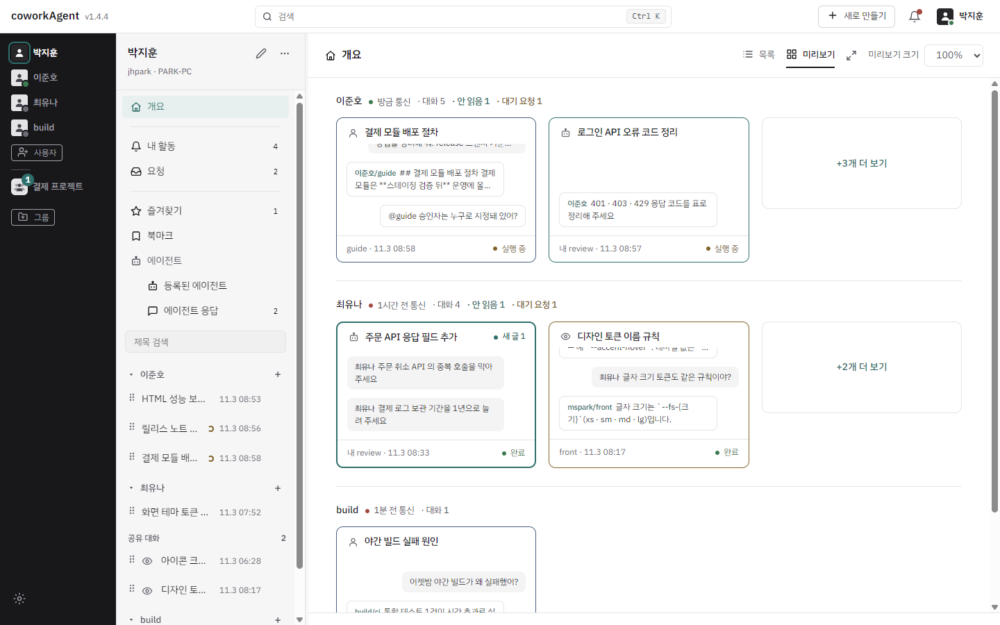

| 영역 | 무엇이 있나 |
|---|---|
| 상단 바 | 버전 · 통합 검색(Ctrl K) · **"새로 만들기"**(세션 생성 · 초대 생성 · 초대 수락 · 에이전트 등록) · 종(내 활동) · 프로필(상태 · 사용자 정보 · 알림 일시 중지 · 설정) |
| 레일(왼쪽 끝) | "나"(모든 상대) · 상대 타일(그 상대만 — 접속 점 · 안 읽음 배지) · **"사용자"**(초대 수락) · 그룹 타일 · **"그룹"**(새 그룹) · 설정 |
| 사이드바 | 고른 타일의 메뉴(개요 · 내 활동 · 요청 · 즐겨찾기 · 북마크 · 에이전트) · 제목 검색 · 상대별 대화 목록 |
| 가운데 | 고른 메뉴 · 대화. '개요' 는 상대마다 대화 카드(최근 글 · 상태 · 안 읽음 "새 글 n") |
| 세부정보(오른쪽) | 대화의 진행 · 대화 정보 · 관람자 · 요청 · 북마크 |

- 대화 유형 아이콘: 로봇 = 내 에이전트가 답한 대화 · 사람 = 내가 문의한 대화 · 눈 = 공유 대화(4.7).
- 타일 우클릭(또는 사이드바 머리 ⋯) = 타일 편집(표시 이름 · 그림 · 아이콘 색) · 옮기기 · 그룹 삭제. 이 PC 에만 저장된다.
- 타일 · 대화 줄은 끌어서(대화는 줄 왼쪽 손잡이 ⠿) 또는 Alt + ↑ / ↓ 로 자리를 옮긴다. 테마(라이트 · 다크)는 설정 → 화면.

### 1.5 그룹 — 프로젝트별 대화 묶음

그룹은 **이 PC 에만** 있는 대화 묶음이다(상대에게 보이지 않는다). 한 대화를 여러 그룹에 넣을 수 있다.

1. 레일 **"그룹"** → 이름 → **"만들기"**.
2. 대화 넣기 — 대화 ⋯ → "그룹" 에서 체크 · 그룹을 고른 채 사이드바 **"대화 추가"** · 대화 손잡이(⠿)를 그룹 타일에 끌어 놓기.
3. 그룹 타일을 고르면 그 그룹 대화만 개요 · 요청 · 즐겨찾기 · 북마크에 보인다. 빼기는 대화 ⋯ → **"그룹에서 빼기"**.

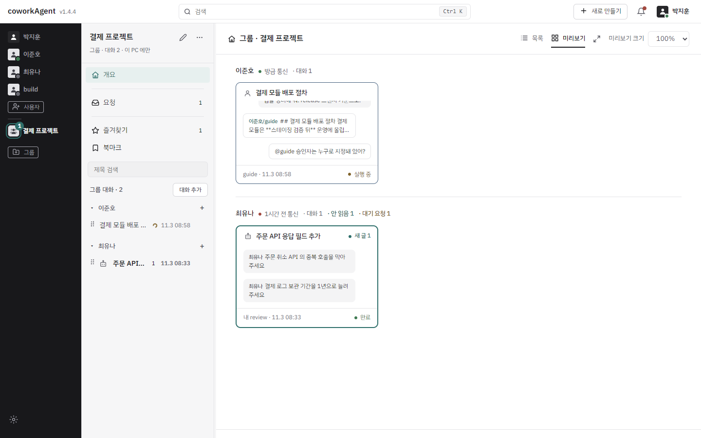

## 2. PC 연결 (페어링)

처음 한 번만 한다. 초대를 **만드는 쪽**과 **받는 쪽**이 있다. 초대는 **5분 안에 한 번**만 쓸 수 있다.

1. 만드는 쪽: **"새로 만들기"** → **"초대 생성"**(또는 설정 → 연결 → **"초대 생성"**) → **"초대 복사"** → 메신저 등으로 상대에게 보낸다.
2. 받는 쪽: 레일 **"사용자"**(또는 **"초대 수락"**) → 받은 초대 메시지를 통째로 붙여 넣기 → **"수락"**.
3. 양쪽 설정 → 연결 목록에 상대가 보인다. 만든 쪽은 따로 승인하지 않아도 등록되고 "새 연결 등록" 알림이 온다.

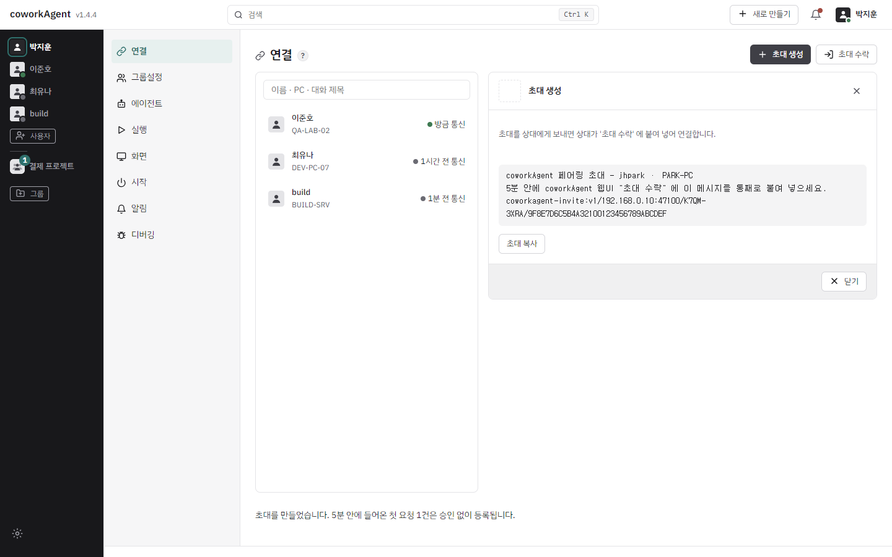

- **지문 확인**: 상대 화면의 프로필 → **"사용자 정보"** 지문과 내 연결 상세의 지문이 같은지 전화 · 대면으로 확인한다.
- 모르는 연결이 생겼으면 연결 목록에서 그 사용자를 골라 바로 **"삭제"** 한다.
- 연결 상세에서 그 상대 요청에 쓸 모델 · effort 를 이 PC 에서만 바꿀 수 있다.

## 3. 에이전트 등록 (답하는 쪽)

상대가 물을 수 있게 내 PC 의 폴더를 에이전트로 등록한다.

1. 설정 → **에이전트** → **"에이전트 등록"**.
2. 실행 도구 **Claude Code** 또는 **Codex** 를 고른다 — **등록 뒤 바꿀 수 없다**. 그 도구가 이 PC 에 설치 · 로그인되어 있어야 한다.
3. 이름(1 ~ 64자, 바꿀 수 없음) · 폴더(절대 경로) · 옵션 · 추가 지시를 쓰고 **"등록"**.

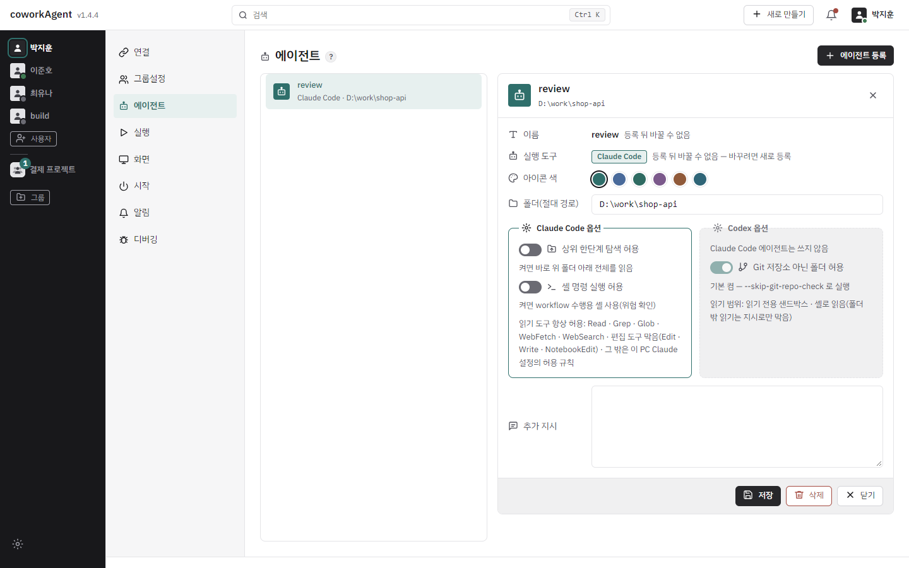

| 칸 | 내용 |
|---|---|
| 폴더 | 에이전트가 읽는 범위이자 답의 맥락. 앱 데이터 폴더를 품는 폴더(사용자 폴더 전체 · `C:\`)와 네트워크 경로는 안 된다 |
| 상위 한단계 탐색 허용 | 켜면 바로 위 폴더 아래 전체도 읽는다. 기본 꺼짐 |
| 셸 명령 실행 허용 | 켜면 이 PC 에 정해 둔 workflow(빌드 · 테스트 등)를 셸 명령으로 수행해 답한다. 기본 꺼짐 · 켤 때 확인 창(아래 경고) |
| Git 저장소 아닌 폴더 허용 | Codex 전용 — 켜면(기본) Git 저장소가 아닌 폴더에서도 실행 |
| 아이콘 색 · 추가 지시 | 타일 색 · 답하는 방식(예: 결론 먼저 세 줄) |

> **경고 — 셸 명령 실행 허용**: 삭제 · 편집 금지는 에이전트에게 주는 규칙이지 막는 장치가 아니다. 켜면 연결된 상대 누구나 사람 승인 없이 이 PC 에서 명령을
> 실행하게 할 수 있고, 셸은 폴더 제한 없이 이 PC 사용자 권한으로 어디든 읽고 쓴다(신원 키 · `~/.claude` · `~/.ssh` 포함). **믿는 상대만 연결된 PC 에서만 켠다.**

- ⚠ 폴더에서 읽을 수 있는 내용은 답에 실려 상대에게 가고, 답을 만드는 동안 Claude 모델 서비스로도 간다. 비밀(키 · 토큰 · 개인정보)이 든 폴더는 등록하지 않는다.
- "폴더 아래만 읽는다" 도 규칙일 뿐이다 — 비밀 파일이 있는 PC 는 믿는 상대만 연결한다.
- 상세에서 아이콘 색 · 폴더 · 옵션 · 추가 지시를 고쳐 **"저장"**. 폴더 · 옵션을 바꾸면 그 에이전트 대화의 맥락이 처음부터 다시 시작된다.

## 4. 대화

### 4.1 세션 생성

1. **"새로 만들기"** → **"세션 생성"**(또는 사이드바 상대 절의 **+**).
2. **상대** · **상대 에이전트** 를 고른다. **내 응답 에이전트** 는 보통 "안 함"(자동 왕복은 6장).
3. **제목**(비우면 첫 메시지 앞부분) → **"생성"** → 열린 대화의 입력창에 첫 메시지를 쓴다.

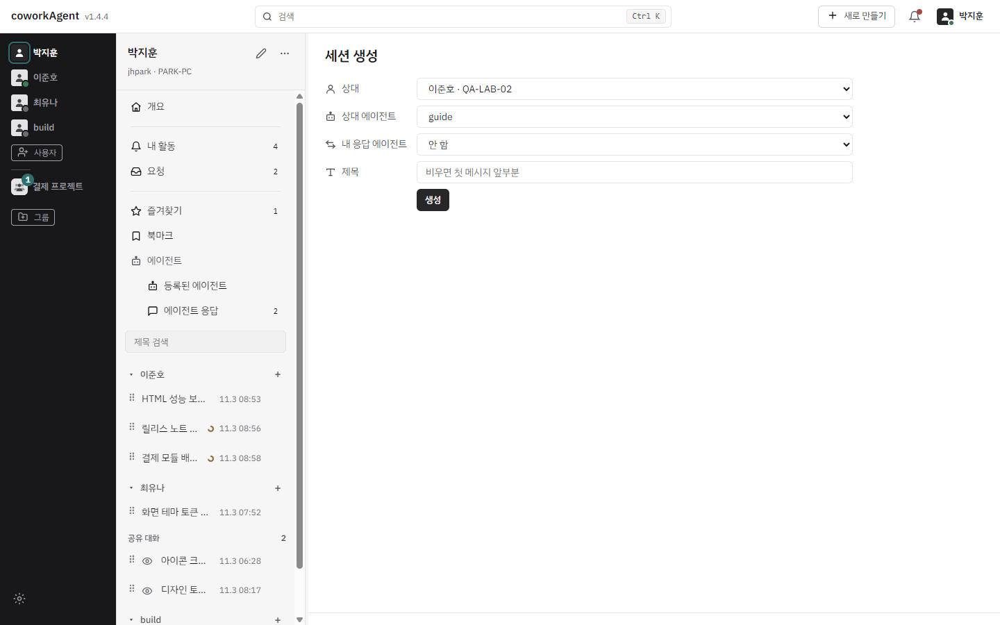

- 상대 PC 에는 첫 메시지가 갈 때 대화가 생긴다. 맥락 없이 새로 묻고 싶으면 세션을 새로 만든다.

### 4.2 보내기 · 답 받기

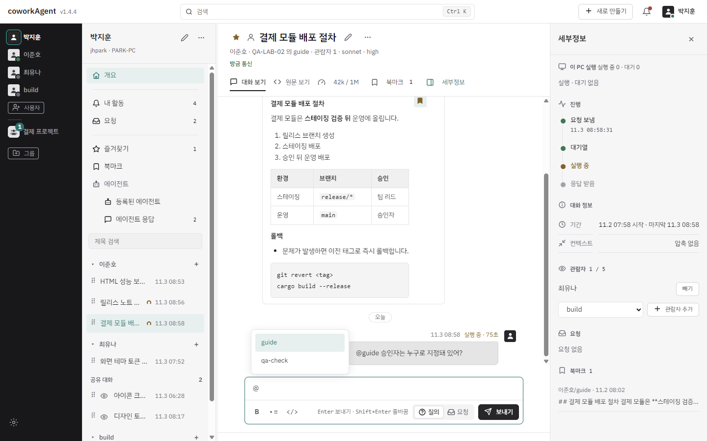

1. 입력창에 쓰고 **Enter**(줄바꿈은 Shift+Enter). 서식 단추(굵게 · 목록 · 코드)와 markdown 을 쓸 수 있다.
2. 내 메시지 아래 상태가 바뀐다 — **"보내는 중"**(상대가 꺼짐 — 켜지면 저절로 보낸다) → **"차례 기다리는 중 · 앞에 k건"** → **"처리 중 · 2턴 · Read 3 · 41초"**.
3. 답이 말풍선으로 온다(모델 · effort · 턴 · 시간 함께). 진행은 세부정보 **'진행'** 에서도 본다.

- 실행은 한 번에 최대 30분. 상대에 24시간 닿지 않으면 **"보내지 못함 · 오래 닿지 않음"** — 입력창에서 다시 보낸다.
- 상대가 연 대화(내 에이전트가 답함)에 내가 쓴 글은 에이전트를 실행하지 않고 그대로 양쪽 창에 남는다.
- 머리글 **"원문 보기"** = markdown 원문, **"대화 보기"** 로 돌아온다. 시각 모양은 설정 → 화면 **"날짜 표시방식"**.

### 4.3 질의 · 요청

입력창 오른쪽 아래에서 고른다(기본 **"질의"**).

| 종류 | 무엇 |
|---|---|
| 질의 | 상대 에이전트가 읽기 전용으로 답한다 |
| 요청 | 고치기 · 만들기처럼 상대 **사람**이 할 일. 에이전트를 실행하지 않고 상대 요청 목록에 "대기" 로 쌓인다 — 상대가 상태 · 의견으로 답한다(5장) |

### 4.4 맥락 · 컨텍스트

- 같은 대화에 이어 쓰면 에이전트가 **앞 대화를 기억한 채** 답한다.
- 대화 머리 **"42k / 1M"** = 지금 세션 크기. 60% 넘으면 주황, 80% 넘으면 붉은색. 누르면:
  - **압축** — 지금까지를 요약해 새 세션으로 잇는다(구분선 "컨텍스트 압축" · "요약 보기").
  - **비우기** — 다음 메시지부터 새 세션(앞 대화 기억 없음). 화면의 메시지는 그대로.
- 답하는 PC 의 설정 → 실행 **"자동 압축"**(기본 켜짐)이면 80% 를 넘을 때 저절로 압축한다.

### 4.5 메시지 작업 · 즐겨찾기 · 내 활동

- 말풍선 오른쪽 위 **북마크**(다시 누르면 해제) · **복사**(markdown 원문). 모은 것은 사이드바 **'북마크'**.
- 대화 머리글 **☆** → ★ = 즐겨찾기(사이드바 **'즐겨찾기'**). ★ 는 대화 하나, 북마크는 메시지 하나.
- **내 활동**(종) = 내가 챙길 일 — **받은 요청 · 내 요청 · 받은 답 · 실패** 탭으로 거른다.
- 제목 · ★ · 북마크 · 읽음 · 그룹은 **이 PC 에만** 남는다.

### 4.6 @멘션 — 같은 대화에서 다른 에이전트 부르기

1. 내가 연 대화 입력창에서 `@` 를 친다 → 상대 PC 의 에이전트 후보.
2. ↑ ↓ 로 고르고 Enter → 이어서 질문을 쓴다(예: "@review 이 변경의 위험을 봐 주세요").

- 부른 에이전트는 이 대화 안에서 자기 맥락을 따로 이어 간다. 받은 대화 · 자동 왕복 대화에는 없다.

### 4.7 관람자 · 공유 대화

대화를 **페어링된 다른 사람**에게 보기만 하게 나눈다(5명까지).

1. 대화를 열고 세부정보 **"관람자"** 에서 사람을 고른다 → **"관람자 추가"**.
2. 관람자 PC 에는 그 대화가 **"공유 대화"** 로 이전 이력과 함께 생기고, 이후 메시지가 따라간다(관람자 쪽은 **"읽기 전용"**).
3. 끝내기 = 관람자 줄의 **"빼기"**(관람자 사본은 읽기 전용으로 남는다 — "공유 해제됨").

### 4.8 기록 삭제 · 나가기

대화 ⋯ 메뉴 끝. 고르면 한 번 더 묻는다.

| 항목 | 하는 일 |
|---|---|
| 기록 삭제 ▸ "내 글만 삭제" | 이 PC 의 그 대화 메시지 · 북마크 · 요청 항목을 지운다. 대화는 남고 다음 메시지는 새 세션 |
| 기록 삭제 ▸ "모든 사용자 글 삭제" | 위 + 상대 PC · 관람자 사본의 메시지도 지운다. 양쪽 대화는 남는다 |
| 나가기 | 이 PC 에서 그 대화를 지운다. 상대 화면은 읽기 전용 "상대가 나감". 다시 들어가는 기능은 없다 |

- 실행 중이거나 차례를 기다리는 메시지가 있으면 막힌다 — 끝난 뒤 다시 한다.

## 5. 요청

사이드바 **'요청'** — 받은 요청 · 보낸 요청을 모아 보고 상태로 답한다.

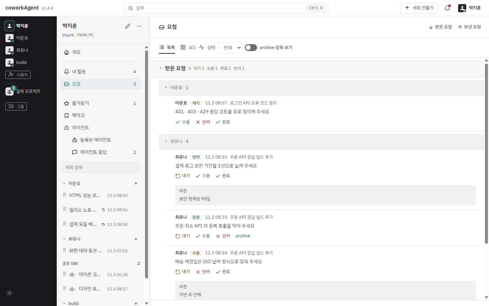

1. 받은 요청 아래 글자 단추로 상태를 바꾼다 — **✓ 수용** · **✕ 반려** · **✓ 완료** · **↺ 대기**(어디로든, 되돌리기 포함).
2. 단추를 누르면 **의견** 칸(선택, 200자)이 열린다 → 확인(또는 Enter).
3. 요청자 화면의 그 메시지 · '보낸 요청' 에 상태 · 의견이 보이고 알림이 간다(꺼져 있으면 켜질 때).

- 위 **"목록"** · **"보드"** 중 **"보드"** = 대기 · 수용 · 반려 · 완료 열. 받은 요청 카드 손잡이(⠿)를 다른 열로 끌어 놓아도 바뀐다.
- 상태는 받은 쪽만 바꾼다. 요청자에게 알리지 못하면 **"다시 알리기"**.
- 완료 7일 뒤 저절로 **archive**(요청 아래 "archive" 단추로 먼저 옮겨도 된다). **"archive 항목 보기"** 스위치로 따로 본다. archive 는 이 PC 에만.

## 6. 자동 왕복 — 내 에이전트 ⇄ 상대 에이전트

내 에이전트와 상대 에이전트가 서로 답을 넘기며 정해진 횟수까지 대화한다.

1. **"세션 생성"** 에서 **"내 응답 에이전트"** 에 내 에이전트를 고른다 → **"최대 응답 횟수"**(1 ~ 50, 기본 10).
2. **"생성"** → 첫 메시지(질의)를 보내면 시작한다(요청으로는 시작할 수 없다).

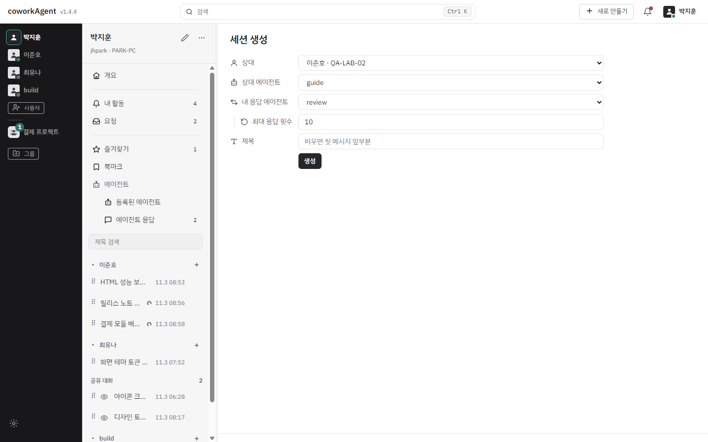

- 멈춤: 연 쪽 사람이 그 대화에 글을 쓰거나, 어느 쪽이든 머리글 **"멈춤"**. 연 쪽은 **"재개"** 로 다시(횟수는 0부터).
- 상한 도달 · 실행 실패 · 상대 거절 · 집중 · 24시간 닿지 않음이면 저절로 멈춘다. 내 에이전트 실행은 **내 PC** 의 Claude 사용량을 쓴다.

## 7. 알림 · 집중

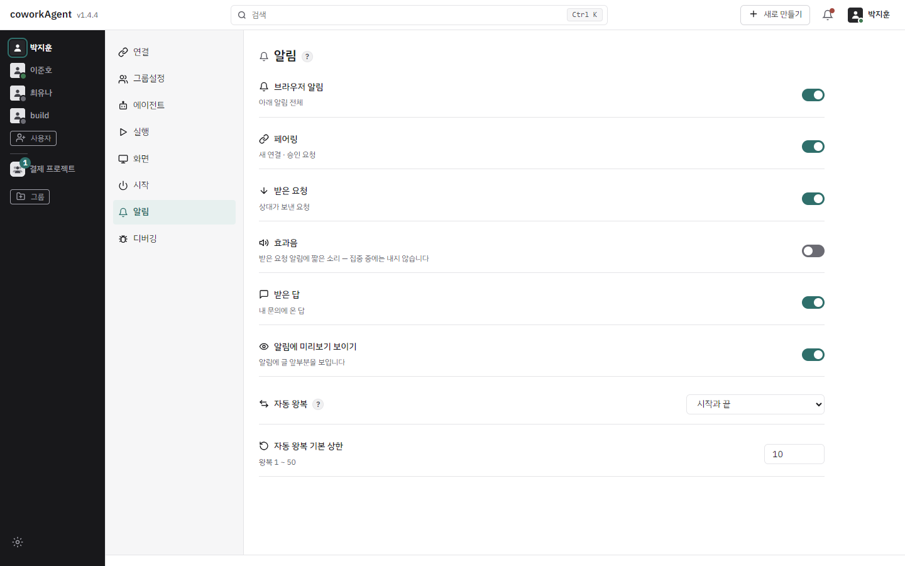

1. 설정 → **알림** → **"브라우저 알림"** 을 켠다 → 브라우저가 묻는 알림 권한을 허용한다.
2. 종류별로 켜고 끈다 — **페어링 · 받은 요청 · 효과음 · 받은 답 · 알림에 미리보기 보이기 · 자동 왕복**("시작과 끝" · "메시지마다" · "알리지 않음").

- 브라우저 알림은 **웹UI 탭이 열려 있을 때만** 뜬다. 트레이 주황 점(1.3)은 알림 설정과 무관하다.
- 잠깐 끄기: 프로필 → **"알림 일시 중지"**(켜 둔 동안 온 알림은 버린다).
- **집중** — 프로필 → **"집중"**(돌아가기 **"받기 가능"**). 집중 동안 상대의 새 질의는 받는 순간 거절되고("상대가 집중 중"), 자동 왕복 · 알림도 멈춘다. 요청은 받는다.
- **접속 상태** = 마지막 통신 — 레일 타일 점 · 대화 머리글 "방금 통신" · "n분 전 통신". 주기 확인은 없다(주고받을 때 · 타일을 고를 때 바뀐다).

## 8. 설정

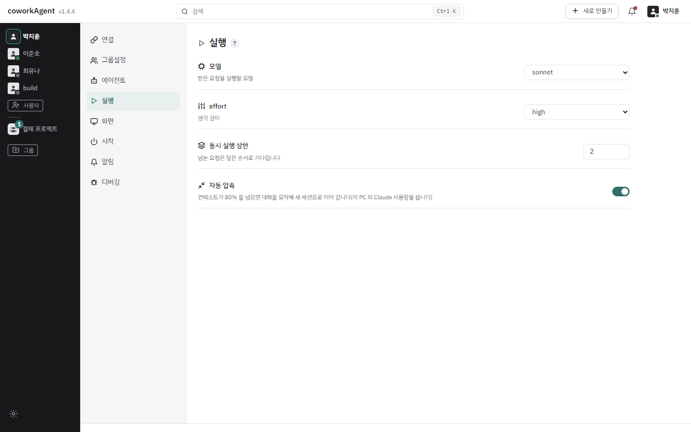

| 메뉴 | 무엇 |
|---|---|
| 연결 | 초대 생성 · 초대 수락 · 상대별 모델 · effort · 삭제(2장) |
| 그룹설정 | 그룹 만들기 · 이름 바꾸기 · 대화 넣기 · 빼기 · 삭제 |
| 에이전트 | 내 에이전트 등록 · 수정 · 삭제(3장) |
| 실행 | 받은 질의의 **모델** · **effort**(기본 `sonnet` · `high`) · **동시 실행 상한**(1 ~ 8, 기본 2 — 넘으면 차례로 기다림) · **자동 압축** |
| 화면 | 테마 · 타일 순서 · 타일 크기 · **날짜 표시방식** |
| 시작 | **로그인할 때 자동 실행** |
| 알림 | 7장 |
| 디버깅 | 버전 · 데이터 폴더 · 로그 보기 · **"진단 정보 복사"**(문의할 때 붙여 넣는다 — 신원 키 · 토큰은 넣지 않는다) |

- 화면마다 제목 옆 **'?'** 에 마우스를 올리면 설명이 뜬다. 내 정보는 프로필 → **"사용자 정보"**.

## 9. AI 에이전트용 CLI

앱이 떠 있는 PC 에서 내 AI 에이전트(또는 사람)가 명령줄로 묻고 이력을 본다. CLI 로 쓴 메시지는 "AI 에이전트(CLI)" 로 표시된다.

```powershell
coworkAgent /?                                                  # 명령 · 옵션 · --json 형식 · 종료 코드
coworkAgent peers                                               # 연결한 상대
coworkAgent ask user-b "이 저장소의 빌드 명령은?" --agent review  # 새 대화로 묻고 답을 기다린다
coworkAgent ask user-b "근거 파일은?" --conv 12                   # 대화 12 에 이어 묻기
coworkAgent wait 7                                              # 트랜잭션 7 의 답을 이어서 기다린다
coworkAgent history user-b --conv 12                            # 대화 이력
```

- `<상대>` = `coworkAgent peers` 의 원래 이름 또는 지문 앞 4자 이상. `--id <키>` 로 다시 실행해도 두 번 보내지 않는다.
- 종료 코드: 0 성공 · 2 사용법 오류 · 3 앱이 실행 중이 아님 · 4 거부 또는 전달 불명(**다시 보내지 말고** `history` 로 확인) · 5 실패 · 6 시간 초과 · 7 상대에 닿지 않음(`wait` 로 이어 받기).

### 9.1 다른 도구의 메뉴에서 켜고 끄기

```powershell
coworkAgent start      # 트레이 아이콘 없이 띄운다(부른 프로세스가 끝나면 함께 끝남, --parent <PID> 로 지정)
coworkAgent open       # 화면 열기 — 꺼져 있으면 트레이 없이 띄운 뒤 연다
coworkAgent stop       # 앱을 끄고 끝날 때까지 기다린다
```

- 결과는 한 줄 — "시작함" · "이미 실행 중" · "열었음" · "종료함" · "실행 중이 아님". 종료 코드 8 = 시작 실패.

## 10. 문제 해결

### 10.1 자주 보는 증상

| 증상 | 할 일 |
|---|---|
| 실행해도 창이 안 뜬다 | 정상 — 트레이 **"열기"** |
| 작업 관리자에 coworkAgent 가 둘 | 정상 — 앱 + 앱이 비정상 종료되면 다시 띄우는 감시 프로세스 |
| 트레이 아이콘이 없다 | 다른 도구의 메뉴로 띄운 트레이 없는 모드(9.1) — `coworkAgent stop` 뒤 실행 |
| 붉은 트레이 아이콘 | 시작 실패 — **"오류 보기"** 의 사유 확인. "60초 안에 3번 비정상 종료" 면 로그의 "패닉: …" 줄 |
| 새 버전이 자동 업데이트되지 않는다 | 로그의 "자동 업데이트:" 줄 — 프록시가 필요한 사내망은 환경 변수 `HTTPS_PROXY`. 릴리스에서 손으로 받아 바꿔도 된다 |
| 초대 수락이 실패한다 | 5분 지남 · 이미 쓴 초대 · 방화벽 · 다른 네트워크 — 새 초대를 받는다 |
| 답이 "실행 실패: 받는 PC 의 Claude Code 버전이 낮다" | 답하는 PC 에서 `claude update` |
| 답이 "실행 실패: 받는 PC 의 시간 제한(30분)을 넘겼다" | 질문 범위를 좁힌다 |
| 답이 "실행 실패: 받는 PC 에서 실행하지 못했다 — 원인은 받는 PC 화면에 있다" | 상대에게 그 대화의 오류를 확인해 달라고 한다 |
| 같은 대화에서 매번 "실행 실패"(No conversation found …) | 상대 PC 의 Claude Code 기록이 정리됐다 — 세션을 새로 만든다 |
| "연결이 끊겼습니다. 트레이 아이콘 메뉴 '열기' 로 다시 여세요." | 트레이 **"열기"** |
| "상대가 집중 중" | 상대가 집중을 끈 뒤 다시 보낸다 |
| 내 메시지 아래 "보내는 중 · 다시 보냄 n회" | 상대가 꺼져 있다 — 그대로 두면 켜질 때 보낸다 |
| 관람자 추가가 "상대 앱 업데이트 필요" | 그 사람이 새 버전을 받은 뒤 다시 |
| 받은 요청 소리가 방해 금지 중에도 난다 | 설정 → 알림 **"효과음"** 을 끈다 |
| 브라우저 알림이 안 온다 | 알림 꺼짐 · 브라우저 권한 차단 · 탭 닫힘 · "알림 일시 중지" · 집중 |
| 사용자 정보 "피어 포트 …(임의 — 47100 사용 중 …)" | 다른 프로그램이 47100 을 잡았다 — 그 프로그램을 끄고 앱을 다시 켠다(임의 포트여도 상대는 따라온다) |

### 10.2 내 데이터

- 위치: `%LOCALAPPDATA%\coworkAgent\`(macOS `~/Library/Application Support/coworkAgent/`) — 대화 DB · 신원 키 · 로그(`logs\`).
- **백업** = 앱을 끄고 폴더째 복사. 신원 키를 잃으면 모든 상대와 다시 연결해야 한다. **다른 PC 로 복사하지 않는다**(같은 신원이 둘).
- **초기화** = 앱을 끄고 폴더를 지운다(앱을 지울 때는 설정 → 시작에서 자동 실행을 먼저 끈다). 상대 PC 의 이력은 남는다.

### 10.3 알아 둘 점

- 상대의 질의는 **내 Claude 구독 사용량**을 쓴다(실행 1번당 30분 상한).
- 초대 메시지가 새면 그 5분 안에 다른 PC 가 등록될 수 있다 — 모르는 연결은 바로 삭제한다.
- 전달된 이력은 두 PC 에 모두 남는다 — 상대 쪽 사본은 이 PC 에서 지울 수 없다("모든 사용자 글 삭제" 제외).
- **방화벽 프로필** — 앱은 방화벽 규칙을 만들지 않는다. 첫 실행 때 Windows 허용 창에서 "공용 네트워크" 까지 허용했으면 공용 Wi-Fi 에서도 그 망의 기기가
  수신 포트에 닿는다(연결은 페어링한 상대만). 공용을 끄려면 관리자 PowerShell(끄는 명령의 효과는 확인 필요):

  ```powershell
  Get-NetFirewallApplicationFilter | Where-Object Program -like '*coworkAgent*' | Get-NetFirewallRule | Set-NetFirewallRule -Profile Domain, Private
  ```
