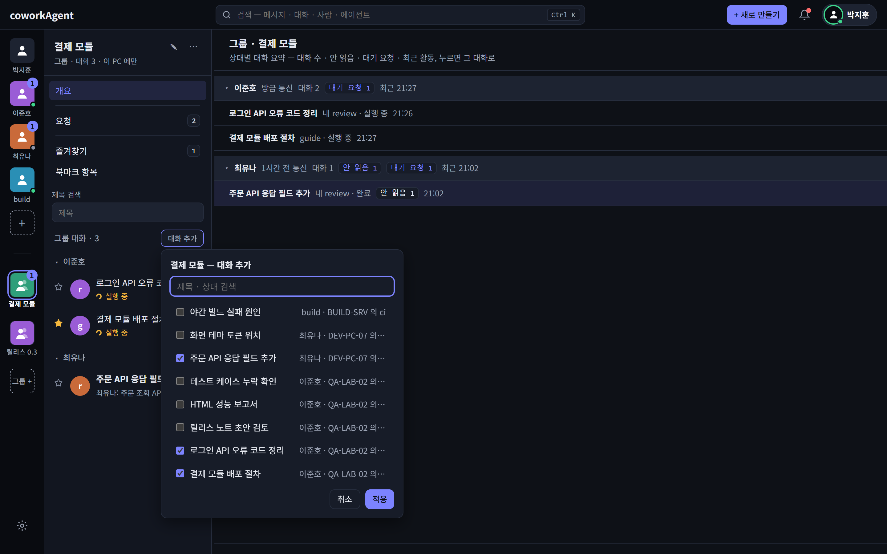
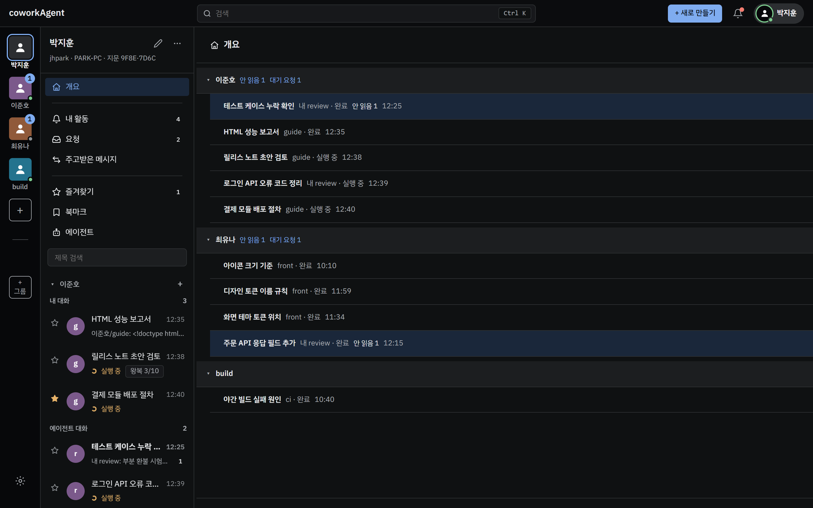

# 사용자 가이드 — coworkAgent

> 쓰는 사람용 실행 안내다. 같은 사내망에 있는 다른 사람 PC 의 Claude 에이전트에게 그 PC 의 프로젝트를 묻고 답을 받는다.
> 동작 원리(프로세스 · 세션 · 저장 구조 · 흐름)는 [개발자 가이드](../dev/developer-guide.md). 화면 글자는 앱에 보이는 그대로 적었다.
> 예시의 이름(`user-b` · `review` · `D:\work\shop-api`)은 가상의 것이다.

## 1. 무엇을 하는 앱인가

- 두 PC 를 한 번 **연결(페어링)** 해 두면, 내가 쓴 질문을 **상대 PC 에 등록된 에이전트**가 그 PC 의 Claude Code 로 답한다.
- 답은 상대 PC 에서 `claude -p`(헤드리스 실행)로 만들어진다 — 상대의 Claude 구독 사용량을 쓰고, 상대가 정한 폴더 안에서
  **읽기 전용 · 문의 응답 전용**으로만 동작한다(파일을 고치거나 명령을 실행하지 않는다).
- 주고받은 메시지와 답은 두 PC 에 모두 남는다. 상대 PC 가 꺼져 있으면 내 PC 에 보관했다가 켜지면 보낸다(7.2). 같은 대화에 이어 쓰면 에이전트가
  앞 맥락을 이어서 답한다.
- PC 끼리는 중앙 서버 없이 직접 암호화(TLS)해 주고받는다. 파일 전송은 없다.
- 다만 답을 만드는 Claude Code 는 **질문과 에이전트가 읽은 파일 내용을 Claude 모델 서비스(그 PC 의 Claude Code 가 쓰는 제공자 — Max 구독
  로그인이면 Anthropic)로 보내** 답을 받는다. 답하는 PC 는 인터넷 연결이 필요하고, 프로젝트 내용이 사내망 밖 모델 서비스로 나간다.
- **사내망(LAN) 안에서 쓰는 도구**다. 다만 앱이 인터넷 주소를 막지는 않는다 — 수신 포트를 공유기 포트 포워딩 등으로 인터넷에 열지 않는다.

## 2. 준비

| 항목 | 내용 |
|---|---|
| OS | Windows 10/11 x64 · macOS 12 이상(Apple Silicon · Intel 공용 universal — 1.0.0 부터, 실사용 확인 전 사전 배포) |
| 설치 | 없다 — 실행 파일 하나. Windows 는 `coworkAgent.exe`, macOS 는 `coworkAgent-macos.zip` 을 풀어 나온 `coworkAgent`. [GitHub 릴리스](https://github.com/Softcamp-SaaS-RND/coworkAgent/releases)에서 받는다(Windows exe 는 회사 인증서(SOFTCAMP CO.,LTD.) 코드 서명. macOS 는 사전 배포 · 코드 서명 없음 — 처음 한 번 막히면 터미널에서 `xattr -d com.apple.quarantine coworkAgent` 로 격리 표시를 지운다). 직접 빌드는 [개발자 가이드](../dev/developer-guide.md) "빌드 · 실행" |
| 네트워크 | 상대 PC 와 같은 LAN. 앱의 수신 포트(기본 TCP 47100 — 프로필 → 사용자 정보 "수신 주소")를 방화벽이 막으면 사내망 쪽만 허용(인터넷 쪽으로 열지 않는다) |
| Claude Code | **답하는 PC**(에이전트를 등록한 PC)에 Claude Code 2.1.267 이상 설치 · 로그인, 그리고 Claude 모델 서비스로 가는 인터넷 연결. 낮으면 `claude update`. 묻기만 하는 PC 는 없어도 된다(자동 왕복으로 내 에이전트를 돌릴 때는 필요) |

## 3. 실행 · 열기 · 종료

1. `coworkAgent.exe` 를 실행한다 → 작업 표시줄 알림 영역에 **트레이 아이콘**이 생긴다. 창은 뜨지 않는다. 실행하면 **로그인할 때 자동 실행**에
   등록된다(Windows 시작 프로그램 · macOS 로그인 항목 — 끄기는 설정 → 시작 → **"로그인할 때 자동 실행"**, 끈 뒤에는 다시 등록하지 않는다). 실행 파일을 옮겼으면
   한 번 실행하면 새 경로로 고쳐진다.
2. 트레이 아이콘 메뉴 **"열기"** → 기본 브라우저에 웹UI 가 열린다. 이미 실행 중일 때 `coworkAgent.exe` 를 다시 실행해도 웹UI 가
   열린다. 두 번째 실행은 열기를 넘기고 끝난다 — 떠 있는 앱이 응답하지 않으면 최대 1분쯤 기다린 뒤 사유 파일(아래)을 열고 끝난다.
3. 트레이 메뉴 **"종료"** → 앱이 끝난다. 꺼 둔 동안 상대가 보낸 메시지는 상대 PC 에 "보내는 중" 으로 보관됐다가, 이 PC 를 다시 켜면 들어온다.
   이 PC 가 보내다 만 메시지도 다시 켜면 이어 보낸다.

- 앱이 비정상 종료되면(작업 관리자 강제 종료 포함) **1초 뒤 저절로 다시 켜지고** 남은 대기열 · 보낼 메시지를 이어 간다. 1분 안에 3번이면 다시 켜지
  않고 붉은 트레이 아이콘 — 사유 "앱이 60초 안에 3번 비정상 종료 — 다시 띄우지 않습니다". 원인은 로그의 "패닉: …" 줄(15장 `logs\`).
- 로그인 직후처럼 작업 표시줄 알림 영역이 아직 준비되지 않아 트레이 아이콘을 만들지 못하면 1 · 2 · 4 · 8 · 15 · 30초 뒤(모두 1분) 다시 만든다 —
  끝내 못 만들면 사유 파일(아래)을 열고 끝난다.
- 다른 도구의 메뉴(14.1 `start` · `open`)로 띄운 앱은 **트레이 아이콘이 없다** — 화면은 그 도구의 메뉴나 `coworkAgent.exe` 다시 실행으로 연다.
- **자동 업데이트**(Windows) — 트레이로 실행할 때(로그인 자동 실행 포함) GitHub 의 정식 릴리스를 확인한다. 새 버전이면 **묻지 않고** 받아
  실행 파일을 바꾸고 새 버전으로 다시 뜬다(옛 파일 `coworkAgent.exe.old` 는 다음 시작에 지워진다). 받기 실패 · 실행 파일이 아님 · 회사 인증서 서명이 아님 · 네트워크 없음이면 바꾸지 않고 지금 버전으로 뜬다.
  사전 배포(Pre-release)는 대상이 아니고, 다른 도구의 메뉴(14.1)로 띄울 때는 확인하지 않는다. 처음 업데이터가 든 버전(v1.2.0)은 손으로 설치한다.
  결과는 로그(15장 `logs\`)의 "자동 업데이트:" 줄. 프록시가 필요한 사내망은 환경 변수 `HTTPS_PROXY` 만 본다(Windows 프록시 설정은 보지 않는다).
- 시작에 실패하면 **붉은 트레이 아이콘**이 뜨고 툴팁에 사유가 보인다. "오류 보기" 를 누르면 사유 파일
  (임시 폴더의 `coworkAgent-start-error.txt`)이 열린다.
- 알림을 켜 두었다면 새 요청이 올 때 트레이 아이콘에 **주황 점**, 툴팁 "coworkAgent — 새 요청 N건". 웹UI 를 열면 지워진다.
- 앱을 다시 켜거나, 탭을 닫았다가 주소로 다시 들어가거나, 새 탭을 직접 열면 화면 위에 "연결이 끊겼습니다. 트레이 아이콘 메뉴 '열기' 로 다시
  여세요." 가 뜬다 — 트레이 "열기" 로 다시 연다(웹UI 열쇠는 그 탭에만 있다).

## 4. 화면 둘러보기

| 영역 | 무엇이 있나 |
|---|---|
| 상단 바 | 이름 **coworkAgent** 뒤 실행 중 버전(예 `v1.3.4`) · 통합 검색(Ctrl K — 메시지 · 대화 · 사람 · 에이전트, 줄마다 종류 아이콘 · 색 — 대화 유형 색과 같다. 결과 위 스위치 **"나간 대화 포함"** 을 켜면 나간 · 상대가 나간 대화도 찾는다(기본 끔). 지운 대화는 이 PC 에 남지 않아 찾을 수 없다) · "+ 새로 만들기"(세션 생성 · 초대 생성 · 초대 수락 · 에이전트 등록) · 알림 종(내 활동) · 프로필 단추(아이콘 — 없으면 사람 모양 + 표시 이름 한 번, 긴 이름은 "…", 마우스를 올리면 전체). 아이콘 테두리 · 점 색 = 내 상태(초록 받기 가능 · 주황 집중 · 붉은 앱과 연결 끊김 — 11장) |
| 레일(왼쪽 끝) | "나"(모든 상대를 상대별로 묶어 봄) · 연결한 PC 타일(그 상대만 — 접속 점 · 안 읽음 배지) · **"사용자"**(사람 + 아이콘 — 설정 → 연결 화면의 오른쪽 칸에 초대 수락 칸을 열어 PC 추가) · 구분선 아래 그룹 타일(4.1) · "그룹"(폴더 + 아이콘) · 설정. 상대 · 그룹 묶음의 앞뒤는 설정 → 화면 "타일 순서"(기본 사용자 → 그룹). 설정 → 화면 "타일 크기" 를 "작게" 로 바꾸면 작은 아이콘 오른쪽에 이름이 한 줄로 보이고 레일이 넓어진다(넓은 화면만 — "크게" · "작게"). 레일 오른쪽 끝을 끌어도 된다 — 넓히면 작은 아이콘, 좁히면 큰 아이콘으로 바뀌고 놓으면 그 크기로 맞춰져 설정에도 남는다(손잡이에 초점을 두고 ← 크게 · → 작게). 타일 = 사람 모양("나" · 상대) · 사람 + 그림자 모양(그룹) 아이콘, 그림을 넣으면 그림 — 이름은 타일 아래(길면 "…", 마우스를 올리면 전체). 타일 우클릭 = 타일 메뉴(4.2) — 레일 어디서든 브라우저 메뉴는 뜨지 않는다 |
| 사이드바 | 고른 타일의 메뉴(이름 앞 아이콘 · 절 사이 구분선 — 아래 표) · 대화 목록 · 제목 검색. 머리의 ✎ = 타일 편집(표시 이름과 아이콘), ⋯ = 타일 메뉴(4.2). 머리 부제 = "나" 는 이름(표시 이름을 바꿨으면 PC 이름도), 상대는 PC 이름(표시 이름을 바꿨으면 원래 이름 · PC) — 접속 상태는 레일 타일의 점으로 본다 |
| 대화 | 말풍선 대화와 입력창(7.2). 머리글에 ☆ · 제목 · 상대 · 에이전트 · 접속 상태 · **"대화 보기 / 원문 보기"** 전환 · **"북마크 n"**(이 대화에서 북마크한 메시지 수 — 누르면 세부정보의 북마크 절) · **"세부정보"** |
| 세부정보(오른쪽) | 진행 · 대화 정보 · 자동 왕복 · 관람자(7.7) · 요청 · 북마크. 창 폭이 1280 미만이면 닫힌 채 시작한다 — 머리글 "세부정보" 로 연다. **대화 정보** = 기간(시작 · 마지막) · 컨텍스트(압축 횟수), 받은 대화(내 에이전트가 답함)는 답하는 도구 · 읽는 폴더 · **실행 명령**(이 PC 가 그 대화에서 마지막으로 띄운 에이전트 실행 명령 — **복사** 로 전체를 클립보드에. 이어 쓰기 세션 인자가 들어 있어 터미널에서 돌리면 그 대화 세션에 이어지고, 프롬프트는 표준 입력으로 받는다. Windows 는 PowerShell 7.3 이상(pwsh)에 붙여 넣는다 — Windows PowerShell 5.1 · 인자 전달 `Legacy` 는 인자를 바꿔 전달해 멈추게 해 두었다) |
| 설정 | 왼쪽 메뉴 8개 — **연결 · 그룹설정 · 에이전트 · 실행 · 화면 · 시작 · 알림 · 디버깅**. 메뉴를 고르면 그 화면만 보인다(처음 = 연결). 연결 · 그룹설정 · 에이전트는 왼쪽 목록에서 줄을 고르면 오른쪽에 상세가 열리고, ✕ · **"닫기"** 로 닫는다. 상세의 단추 줄(수락 · 저장 · 삭제 · 닫기 …)은 내용 바로 아래에 있다. 켜고 끄는 칸은 스위치. 화면 설명은 제목 옆 **'?'** 에 마우스를 올리거나 초점을 두면 뜬다. 내 정보는 설정이 아니라 프로필 → **"사용자 정보"** 팝업 |

**레일 범위** — 무엇을 고르냐에 따라 사이드바 메뉴와 목록이 바뀐다.

| | "나" | 상대 타일 | 그룹 타일 |
|---|---|---|---|
| 메뉴 | 개요 / 내 활동 · 요청 / 즐겨찾기 · 북마크 · 에이전트(등록된 에이전트 · 에이전트 응답) | 개요 / 요청 / 즐겨찾기 · 북마크 · 에이전트(등록된 에이전트만) | 개요 / 요청 / 즐겨찾기 · 북마크 |
| 목록 | 상대별 접이식 절(제목 = 상대 이름 · 건수, 레일 순서, 메시지 없는 상대는 숨김). 에이전트는 '내 에이전트' 절이 맨 앞 | 그 상대 것만 | 그 그룹 대화의 것만, 상대별 접이식 절 |
| 첫 화면 · '개요' | 상대별 요약 — 머리 = 사용자 아이콘 · 이름 · 안 읽음 · 대기 요청, 줄 = 유형 아이콘 · 그 상대 대화 제목 · 로봇 아이콘 + 에이전트(누르면 그 대화 — 레일 · 사이드바도 그 상대로 바뀐다) | 그 상대 하나의 요약("개요 · {이름}") | 그룹 요약 — 그룹에 대화가 있는 상대만 |
| '개요' 미리보기(기본) | 상대마다 절 — 대화방마다 작은 카드(제목 · 상태 · 최근 글 말풍선 · 에이전트 · 시각 · 안 읽음, 누르면 그 대화), 상대마다 한 줄(창 폭만큼 — 넘치면 "+n개" = 그 상대 개요), 대화 없는 상대는 점선 줄 + "세션 생성". 머리 "미리보기 크기" 100 ~ 200%(25% 단계) = 카드 가로 · 세로 크기(말풍선은 어느 크기든 글 2줄까지 · 말풍선 사이 여백, 글자 크기 그대로 — 카드가 넓어지면 한 줄 카드 수는 준다, 기억됨) | 그 상대 카드 전부 | 그룹 대화가 있는 상대마다 절 |
| 사이드바 대화 목록 | 상대별 절(절마다 + = 그 상대와 세션 생성) | 그 상대 대화 | "대화 추가" · 상대별 절 |

- 절 머리를 누르면 접히고, 접은 절은 다음에 열어도 접혀 있다(이 PC 에만).
- 내 활동은 "나" 에만 있다 — 상대 타일 · 그룹 타일을 고른 채 종(내 활동)을 누르면 "나" 로 바뀐다. 상대 · 그룹에서는 대화 목록이
  같은 메시지를 보인다. "주고받은 메시지" 메뉴는 없다(1.3.2 — 내 활동과 겹친다).
- 대화 목록 줄의 ⋯(대화 메뉴)는 줄 끝 시각 오른쪽 제자리에 있어 시각을 가리지 않는다.
- **주고받은 메시지**(메뉴 없음 — 옛 주소 `#p` 로만) — 상대별 절이 처음에는 접혀 있고, 절 머리에 상대 타일 · 이름 · 메시지 수("14건") · 마지막 메시지 한 줄 · 시각이 보인다. 절을 펼치면
  최근 20건, 끝 줄 "20 / 48" 옆 **"더 보기"** 로 20건씩 더 본다. 줄 = 왼쪽 동그란 아이콘(상대 사람 = 주황 사람 · 나 = 파랑 사람 · 에이전트 = 청록 로봇) · 이름 ·
  "사람" 또는 **"에이전트"** 칩 · 대화 제목 · 본문 · 오른쪽 시각 · **북마크** 아이콘(누르면 넣기 · 빼기 — 말풍선의 북마크와 같다). 에이전트 줄은 옅은 청록 바탕이다.
  줄을 누르면 그 대화로. 펼친 절은 이 PC 에 기억한다.
  화면 머리 **"기간"** 에서 1주 ~ 12주(기본 4주)를 고르면 그 기간 안 메시지만 절 · 건수 · 마지막 메시지에 보인다 — 보기만 거르고 메시지는 지우지 않는다(대화에서는
  다 보인다). 고른 값은 이 PC 에 기억한다.
- **에이전트 응답** 화면("나" 에만 — 메뉴 '에이전트' › '에이전트 응답'): 다른 사용자가 연 대화, 곧 **내 에이전트가 어느 사용자에게 응답했는지**를 사용자별 절로 본다(절 머리 = 사용자 이름만 — 안 읽음 수는 대화 줄마다).
  상대 타일에는 이 메뉴가 없다 — 상대 타일을 고르면 그 상대 개요로 바뀌고, 상대 타일 배지도 이 대화의 안 읽음은 세지 않는다("나" 의 메뉴 수가 센다).
- **에이전트** 화면: 상대 에이전트 줄 오른쪽 **"세션 생성"**(또는 줄)를 누르면 그 에이전트로 세션 생성 화면이 열린다(7.1). 내 에이전트 줄 오른쪽 **✎**(또는 줄)를 누르면 설정 → 에이전트에서 그
  에이전트가 골라져 오른쪽에 상세가 열린다(6장).
- **대화 줄** = 한 줄 — 손잡이(⠿ — 끌어 옮기기, 4.3) · 유형 아이콘 · 제목 · 실행 중 점 · 안 읽음 수 · 시각(미리보기 줄은 없다 —
  마우스를 올리면 상대 · 에이전트가 보인다).
- **대화 유형 색** — 대화는 두 가지다: **내 에이전트가 답한 대화**(다른 사용자가 연 대화) = 청록 테두리 · 로봇 아이콘, **내가 다른 에이전트에 문의한 대화** = 파랑
  테두리 · 사람 아이콘(공유 사본은 회색 점선 · 아이콘 없음). 대화 줄 · 개요(미리보기 카드 · 목록 줄) · 대화 화면 머리(제목 앞 아이콘 · 머리 아래 선)가 같은 색이다.
  고른 대화 줄은 그 색을 옅게 깔고, 개요 카드의 안 읽음은 카드 바깥 파란 윤곽선이다. 즐겨찾기는 대화를 열고
  머리글 ☆ 를 누른다(★ 노랑 — 다시 누르면 뺀다). 대화 줄에는 ☆ 가 없다. **'즐겨찾기'** 메뉴는 그 범위의 ★ 대화를 모아 보인다("나" 는 상대별 절, 메뉴에 ★ 수).
- **대화 목록 묶음** — 목록이 **"내 대화 n"**(내가 연 대화 · 내가 연 자동 왕복) · **"에이전트 대화 n"**(상대 PC 사용자가 연 대화 — 내 에이전트가 답) ·
  **"공유 대화 n"**(다른 사람이 나를 관람자로 넣은 대화 — 7.7)로 나뉜다. "나" 에서는 상대별 절 **안에서** 나뉜다. 묶음이 하나뿐이면 머리 없이 한 목록이다.
  n 은 지금 보이는 줄 수(제목 검색 뒤). 즐겨찾기 화면은 나누지 않는다.
- 목록 순서는 손으로 놓은 순서다(4.3) — 새 메시지가 와도 자리가 바뀌지 않고, 세션 생성으로 만든 대화는 맨 위에 생긴다. 새 메시지는 안 읽음 점 · 굵은 제목 · 배지로 알 수 있다.

### 4.1 그룹 — 프로젝트별 대화 묶음

한 프로젝트를 여러 동료와 함께 할 때, 그 프로젝트의 대화만 모아 본다. 그룹은 **이 PC 에만** 있다 — 상대에게 보이지 않고, 메시지는 지금처럼 상대와
1:1 로 오간다. 한 대화 · 한 상대를 여러 그룹에 넣을 수 있다.

- **만들기** — 레일 "+ 그룹" → 이름(1 ~ 40자, 같은 이름은 안 됨) → "만들기". 만든 그룹이 바로 골라진다. 설정 그룹설정 "+ 그룹 추가" 로도 만든다(5장).
- **대화 넣기** — 셋 중 편한 것:
  - 대화 줄에 마우스를 올리면(또는 초점) 보이는 ⋯ · 대화 머리글 ⋯ → "그룹" 아래 그룹마다 체크(누를 때마다 넣고 뺀다).
  - 그룹을 고른 채 사이드바 "대화 추가" → 제목 · 상대로 검색 → 체크 → "적용"(여러 대화를 한 번에, 체크를 풀면 뺀다).
  - 대화 줄 손잡이(⠿)를 끌어 레일의 그룹 타일에 놓는다.
  - 설정 **그룹설정** 사용자 표에서 사용자 줄을 눌러 펼치고, 대화 줄 손잡이(⠿)를 끌어 위 그룹 카드에 놓는다(복사 — 5장).
- 그룹에는 **대화**만 넣는다 — 사람(상대) 단위로 넣는 기능은 없다. 한 대화는 여러 그룹에 넣을 수 있다.
- **빼기** — 그룹 대화 줄 ⋯ → "그룹에서 빼기" · 설정 그룹설정 그룹 카드를 눌러 펼친 대화 줄의 "그룹에서 빼기". 대화 자체는 그대로다.
- 그룹을 고른 채 "+ 새로 만들기" → "세션 생성" 으로 만든 대화는 그 그룹에 들어간다.
- 연결을 지운 상대의 대화도 그룹에 남아 상대 절 뒤에 보인다.
- 예전 버전 설정의 '그룹' 이름표는 새 버전을 처음 켤 때 같은 이름의 레일 그룹으로 옮겨진다(없으면 만든다 — 그 상대가 그 그룹에 들어간다).
  에이전트의 '그룹' 이름표는 없어졌다.



### 4.2 타일 메뉴 — 이름 · 이미지 · 그룹 삭제

레일 타일("나" · 상대 · 그룹)을 우클릭하거나, 타일에 초점을 두고 메뉴 키(또는 Shift + F10), 또는 사이드바 머리 ⋯ 를 누른다.

| 항목 | 하는 일 |
|---|---|
| 타일 편집 | 그 타일을 고르고 사이드바 머리에 편집 칸을 연다 — 표시 이름(그룹이면 그룹 이름) · 아이콘 그림(가운데를 정사각형으로 잘라 작게 저장) |
| 이미지 지우기 | 그림이 있을 때만 — 사람 모양 아이콘으로 돌아간다 |
| 위로 옮기기 · 아래로 옮기기 | 상대 · 그룹 타일 — Alt + ↑ / ↓ 와 같다(4.3). 맨 위 · 맨 아래면 꺼진다 |
| 그룹 삭제 | 그룹 타일에만 — 한 번 더 묻고 그룹만 지운다(대화는 지우지 않는다) |

타일 이름 · 그림은 이 PC 에만 저장된다.

### 4.3 자리 옮기기 — 끌어 놓기 · Alt + ↑ / ↓

따로 정렬 기능은 없다 — 손으로 놓은 자리가 그대로 남는다(앱을 다시 켜도).

- **끌어 놓기** — 상대 타일끼리 · 그룹 타일끼리 · 같은 절(같은 상대 · ★) 안의 대화끼리. 놓을 곳 위쪽 반이면 앞, 아래쪽 반이면 뒤에 들어간다.
  레일 타일은 누른 채 조금(5px) 움직이면 끌기가 되고, 레일 안이면 타일 사이 틈 · 타일 아래 이름 · 맨 앞 위 · 맨 뒤 아래에 놓아도 가장 가까운 타일 앞 · 뒤로 들어간다.
  "나" · "+ 사용자" · "+ 그룹" · 설정은 옮기지 않고, 상대 ↔ 그룹 · 다른 상대 절로는 놓이지 않는다.
  대화는 줄 왼쪽 **손잡이(⠿)** 를 누른 채 끈다 — 줄 사본이 따라오고, 놓을 자리(앞 · 뒤 · 그룹 타일)가 표시된다. 브라우저 끌기 확장(링크 끌어 열기 등)이 있어도 반응하지 않는다.
- **키보드** — 타일이나 대화 줄에 초점을 두고(마우스로 누른 뒤 바로도 된다) Alt + ↑ / ↓ 로 한 칸. 타일 메뉴 "위로 옮기기 · 아래로 옮기기" 도 같다.
  화면 읽기 프로그램에는 "n번째로 옮김" 이 읽힌다.
- 대화 자리는 대화마다 하나다 — 그룹에서 옮긴 앞뒤가 "나" · 상대 타일에서도 같다. 상대 타일을 옮기면 "나" · 그룹의 상대별 절 순서도 따라 바뀐다.
- 상대 타일 색은 자리와 상관없이 그 상대에 붙어 있다.



- 프로필 단추(우상단) 메뉴: 머리 "상태" 아래 **"받기 가능"** · **"집중"**(새 요청은 받는 순간 거절된다 — 11장) 중 하나 고르기 ·
  "앱과 연결 끊김"(자동 표시 — 고를 수 없음, 11장), 그 아래 **"사용자 정보"**(이름 · PC 이름 · 지문 · 수신 주소 · 포트 · 버전 · 데이터 경로 · DB 팝업 — Esc ·
  "닫기") · "프로필 편집" · "알림 일시 중지" · "설정".
- 테마는 설정 → "화면" 에서 라이트(기본) · 다크. 테마를 고른 적이 없으면 라이트로 열린다(다크를 골라 두었으면 그대로).

## 5. PC 연결하기 (페어링)

처음 한 번만 한다. 초대를 **만드는 쪽**과 **받는 쪽**이 있다.

설정 → **연결** 화면 머리의 단추 둘 — **"초대 생성"**(＋) · **"초대 수락"**(→). 누르면 오른쪽 칸에 그 내용이 열리고, ✕ · "닫기" 로 닫는다(메뉴 "초대 수락" · 레일 + 로 와도 초대 수락 칸이 열리고, 다른 설정 메뉴로 가면 닫힌다). 제목 옆 '?' — 초대 · 지문 확인 안내.

1. 만드는 쪽(예: `user-b`): "+ 새로 만들기" → **"초대 생성"**(또는 연결 화면 "초대 생성" — 누르면 바로 초대가 만들어진다) → 오른쪽 칸 **"초대 복사"**.
   복사한 초대 메시지를 메신저 등으로 상대에게 보낸다. 초대는 **5분 안에 한 번**만 쓸 수 있다.
2. 받는 쪽: 레일 **"+ 사용자"**(또는 "+ 새로 만들기" → **"초대 수락"** · 연결 화면 "초대 수락") → 오른쪽 칸에 받은 초대 메시지를 통째로 붙여 넣기 → **"수락"**.
   레일 "+ 사용자" 는 연결 화면을 열고 칸에 바로 초점을 둔다.
3. 양쪽 연결 화면 목록에 상대가 보인다. 초대를 만든 쪽은 따로 승인하지 않아도 자동 등록되고 "새 연결 등록" 알림이 온다.

- **지문 확인**: 처음 잇는 상대라면 상대 화면의 프로필 → **"사용자 정보"** 지문과 내 연결 화면 상세의 지문이 같은지 전화 · 대면으로 확인한다.
- 모르는 연결이 등록됐으면 연결 화면에서 그 사용자를 골라 바로 **"삭제"** 한다.
- 연결 화면 왼쪽 목록(사용자 · PC · 접속 상태, 위 검색 칸 = 이름 · PC · 지문 · 대화 제목)에서 줄을 고르면 오른쪽에 상세(이름 · PC · 접속 상태, 모델 · effort · 상태 · 지문 · 주소 ·
  "대화 n" — 그 사용자와의 대화, 아래 "저장" · "승인" 또는 "다시 알리기" · "연결 확인" · "내 에이전트 편집" · "삭제" · **"닫기"**)가 열린다. ✕ 또는 "닫기" = 상세를 닫고 그 줄로 돌아간다.
- 상세에서 그 상대 요청에 쓸 모델 · effort 를 이 PC 에서만 바꿀 수 있다(저장하지 않고 다른 사용자를 골랐다 돌아와도 고친 값이 남는다). 타일의 표시 이름과 아이콘은 사이드바 ✎ 또는 타일 메뉴(4.2).

**그룹설정** — 왼쪽 그룹 목록(위 검색 칸 = 그룹 이름 · 사용자 · 대화 제목), 그룹을 고르면 오른쪽 상세:

- **"이 그룹의 대화"** — 줄마다 **"빼기"**. **"넣을 수 있는 대화"** — 사용자별 대화 줄마다 **"넣기"**(그 그룹에 **넣기만** — 다른 그룹 · 원래 자리는 그대로, 한 대화는 여러 그룹에).
- 머리 **"그룹 추가"**(만든 그룹이 바로 골라진다) · 상세 아래 **"이름 바꾸기"** · **"삭제"**(한 번 더 묻고 그룹만 지운다, 대화 · 연결은 남는다) · "닫기".
- 바꾼 그룹은 레일 그룹 타일에 바로 반영된다.

## 6. 내 에이전트 등록 (답하는 쪽)

설정 → **에이전트** → 머리의 **"에이전트 등록"**(또는 "+ 새로 만들기" → "에이전트 등록") — 오른쪽 칸에 **"새 에이전트"** 가 두 단계로 열린다.

1. **실행 도구 고르기**(1 / 2) — **Claude Code** 또는 **Codex** 타일을 누른다. 고르지 않으면 등록할 수 없다. **고른 도구는 등록 뒤 바꿀 수 없다** — 이 에이전트와의 대화는 모두 그 도구로만 실행한다(바꾸려면 새로 등록).
   그 도구는 **이 에이전트를 등록하는 PC**(답하는 PC)에 설치 · 로그인되어 있어야 한다 — 묻는 쪽 PC 에는 없어도 된다. 없으면 답 대신 "받는 PC 에서 Codex CLI 를 찾지 못했다" 같은 실패가 온다.
   Codex 계정(ChatGPT 로그인 · API key)으로 남의 문의에 답하는 것이 그 계정 약관에 맞는지는 사용자 책임이다.
2. **이름 · 폴더 · 옵션**(2 / 2) — 고른 도구 칩 · "도구 다시 고르기" · 이름 · 폴더 · 좌우 옵션 블록(**Claude Code 옵션** | **Codex 옵션** — 고르지 않은 도구의 블록은 점선 · 꺼짐 · "… 에이전트는 쓰지 않음") ·
   추가 지시 · "등록" · "취소". 등록하면 그 에이전트가 목록에서 골라진다. 다시 누르거나 "취소" · ✕ 면 닫힌다.

| 칸 | 내용 |
|---|---|
| 이름 | 1 ~ 64자. 상대가 이 이름으로 부른다 — **등록 뒤 바꿀 수 없다**(바꾸려면 새로 등록) |
| 폴더(절대 경로) | 에이전트가 읽을 수 있는 범위이자 답의 맥락. 예 `D:\work\shop-api` |
| 상위 한단계 탐색 허용 | 켜면 폴더 **바로 위 폴더 아래 전체**(옆 폴더 포함)도 읽는다 — 예 `D:\work\shop-api` 면 `D:\work`. 그보다 위는 읽지 않는다. 기본 꺼짐. 바로 위가 드라이브 루트(`D:\`) · 사용자 홈이거나 coworkAgent 데이터 폴더를 품으면 켜도 열지 않는다(상세에 "열지 않음") |
| 셸 명령 실행 허용 | 켜면 에이전트가 **이 PC 에 설정된 workflow**(프로젝트에 정해 둔 스크립트 · 빌드 · 테스트 등)를 셸(Bash · PowerShell) 명령으로 수행해 답한다. 소스 · 문서 · 설정의 삭제 · 편집, 저장소 변경 등 이 PC 를 바꾸는 행동은 허용하지 않는다(에이전트 규칙 — workflow 가 만드는 빌드 · 테스트 산출물 · 로그는 예외). 기본 꺼짐. **켜기 전에 위험을 확인하는 창이 뜬다**(아래 경고) |
| Git 저장소 아닌 폴더 허용(Codex) | 켜면(기본) Git 저장소가 아닌 폴더에서도 Codex 를 실행한다(`--skip-git-repo-check`). 끄면 Git 저장소 폴더에서만 |
| 추가 지시 | 답하는 방식. "추가 지시" 옆 **'?'** 의 사용 예 참고 — 예: 결론 먼저 세 줄, 근거 파일 경로 함께 |

> **경고 — 셸 명령 실행 허용**: 삭제 · 편집 금지는 에이전트 규칙이지 막는 장치가 아니다. 켜면 연결된 상대 누구나(멘션 · 자동 왕복 포함) 사람 승인 없이 이 PC 에서 명령을 실행하게 할 수 있다.
> 셸에는 폴더 · 상위 한단계 탐색 제한이 적용되지 않아 이 PC 사용자 권한으로 어디든 읽고 쓸 수 있다 — coworkAgent 데이터 폴더(신원 키 · 대화 DB),
> Claude 인증 정보(`~/.claude`), `~/.ssh` 같은 비밀 파일도. "바꾸지 않는다" 규칙은 모델에게 주는 안내일 뿐 막는 장치가 아니다. 앱 환경 변수는 기본 변수만 넘기지만
> 프록시 주소(`HTTP(S)_PROXY`)에 든 계정 · 비밀번호는 셸에 보이고, 파일 · 저장소 속 비밀은 막지 못한다. **믿는 상대만 연결된 PC 에서만 켠다.** 켠 에이전트 상세에는 빨간 경고 줄이 보인다.

- **도구는 고르지 않는다** — Claude Code 에이전트는 이 PC 에서 Claude Code 를 쓸 때와 같은 설정(MCP · 스킬 · 허용 규칙)으로 돌고, 읽기 도구(`Read` · `Grep` · `Glob` · 웹 읽기)를 늘 쓰며
  편집 도구(`Edit` · `Write` · `NotebookEdit`)는 늘 막는다. Codex 에이전트는 셸 명령으로 읽고 읽기 전용 샌드박스가 파일 쓰기를 막는다(그 PC Codex 설정 그대로 · 모델은 Codex 기본값).
- **폴더 밖 읽기** — 두 도구 모두 등록 폴더 밖 파일도 읽을 수 있다(1.3.5 부터 — Claude Code 도 로컬 사용과 맞춤). "이 폴더 아래만 읽는다" 는 에이전트에게 주는 규칙일 뿐 막는 장치가 아니다 —
  비밀 파일이 있는 PC 에서는 믿는 상대만 연결한다.
- 에이전트 목록은 묶지 않은 한 목록이다(검색 칸 없음). 줄 = 로봇 타일(고른 색) · 이름 · "실행 도구 · 폴더" · "상위 탐색" · "셸" 표시. 줄을 고르면 오른쪽에 상세 — 이름 · 실행 도구(둘 다 바꿀 수 없음) · **아이콘 색**(6색) · 폴더 ·
  좌우 옵션 블록(Claude Code — 상위 한단계 탐색 허용(켜면 "읽는 위 폴더") · 셸 명령 실행 허용(켜면 경고 줄) · 도구 / Codex — Git 저장소 아닌 폴더 허용, 안 쓰는 도구 블록은 꺼짐) · 추가 지시 · "저장" · "삭제" · **"닫기"**.
  ✕ · "닫기" 는 상세를 닫는다. 저장하지 않은 입력은 다른 에이전트를 골랐다 돌아와도 남지만, 저장하기 전에는 실행에 쓰이지 않는다. 아이콘 색은 '등록된 에이전트' 화면의 그 에이전트 타일에도 보인다(이 PC 에만).
  에이전트 화면의 ✎ · 연결 상세 "내 에이전트 편집" 으로 오면 에이전트 화면이 열린다(✎ 는 그 에이전트를 고른 채).
- 등록한 뒤 아이콘 색 · 폴더 · 상위 한단계 탐색 허용 · 셸 명령 실행 허용 · 추가 지시를 고칠 수 있다(아이콘 색은 맥락에 닿지 않는다). **폴더 · 상위 한단계 탐색 허용 · 셸 명령 실행 허용을 바꾸면** 그 에이전트가 이어 가던 모든 대화의 맥락이 처음부터 다시
  시작된다. 지우고 같은 이름으로 다시 등록해도 같다.
- 에이전트는 항상 "문의 응답 전용" 규칙으로 실행된다 — 파일 생성 · 수정 · 삭제, 명령 실행(셸 명령 실행 허용을 켠 에이전트는 이 PC 에 설정된 workflow 수행 · 조회 명령만), 설정 변경 요청에는 하지 않고 이유를 답한다.
- ⚠ 그래도 **폴더 안에서 읽을 수 있는 내용은 답에 실려 상대에게 갈 수 있고, 답을 만드는 동안 Claude 모델 서비스로도 간다.** 비밀(키 ·
  토큰 · 개인정보)이 든 폴더는 등록하지 않는다.
- 앱 데이터 폴더(`%LOCALAPPDATA%\coworkAgent`)를 품는 폴더(예: 사용자 폴더 전체 · `C:\`)와 네트워크 경로(`\\서버\…`)는 등록할 수 없다.
  예전에 그렇게 등록한 에이전트는 실행하지 않고 상대에게 "에이전트 폴더를 쓸 수 없다" 로 답한다 — 폴더를 바꾼다.

## 7. 대화하기

### 7.1 세션 생성

"+ 새로 만들기" → **"세션 생성"**(또는 사이드바 대화 목록 머리의 + — "나" 에서는 상대별 절마다 하나, "에이전트" 화면에서 상대 에이전트 누르기).
레일에서 상대 타일을 고른 채 열면 "상대" 칸에 그 상대가 골라져 있다("나" · 그룹 타일이면 "상대 선택").

| 칸 | 내용 |
|---|---|
| 상대 · 상대 에이전트 | 연결한 PC 와 그 PC 에 등록된 에이전트 |
| 내 응답 에이전트 | 보통은 "안 함"(상대 에이전트에게만 묻는다). 내 에이전트를 고르면 그 아래 **"최대 응답 횟수"**(기본 10) 줄이 나온다 — 자동 왕복(10장) |
| 제목 | 비우면 첫 메시지 앞부분(첫 메시지 전에는 "{상대 에이전트} 에게") — 이 PC 에만 보인다 |

- **"생성"** 을 누르면 메시지 없는 대화가 이 PC 에 생기고 그 대화가 열린다. 첫 메시지(질의 · 요청 — 7.3)는 그 대화의 입력창에서 쓴다.
- 상대 PC 에는 첫 메시지가 갈 때 대화가 생긴다 — 메시지 없이 만든 대화는 상대에게 보이지 않는다.
- 그룹 타일을 고른 채 만든 대화는 그 그룹에 들어간다(4.1).

### 7.2 보내기 · 답 받기

- 대화는 메신저처럼 말풍선으로 이어진다 — **이 PC 쪽 메시지**(내가 쓴 메시지 · 상대 요청에 내 에이전트가 한 답)는 오른쪽, **상대 사람 · 상대 에이전트 메시지**는
  왼쪽에 아바타 · 이름 · 시각과 함께. 사람과 에이전트를 모양으로 가른다 — 사람 메시지는 색 면(내 메시지 = 강조색을 옅게, 상대 메시지 = 연한 주황), 에이전트 메시지는
  흰 면에 청록 테두리 · 이름 옆 **"에이전트"** 칩 · 로봇 아이콘(내 에이전트 답이 오른쪽에 와도 같다). 대화 목록은 카드 줄이고, 줄마다 유형 아이콘 · 제목 한 줄이다(미리보기 줄 없음 — 유형 색은 4장). 날짜가 바뀌면 구분선("오늘" · "어제" · "10.14" 처럼 월.일)이 들어간다. 말풍선은 대화 칸 폭의 90% 까지 넓어진다.
  머리글 "원문 보기" 를 누르면 모든 메시지가 markdown 원문으로, "대화 보기" 로 돌아온다.
- 입력창: **Enter = 보내기**, Shift+Enter = 줄바꿈(한글 조합 중 Enter 는 보내지 않는다). 한 줄 높이에서 시작해 쓴 만큼 늘어난다. 말풍선 영역과 입력창 사이는 늘 띄어 있다(스크롤해도 붙지 않는다). 서식 버튼(굵게 · 목록 · 코드)과 markdown 을 쓸 수 있다.
  한 메시지는 16 KiB 까지.
- 보낸 메시지는 상대 PC 의 대기열에 들어가 차례대로 실행된다. 실행은 한 번에 최대 30분.
- **상대가 꺼져 있어도 보낸다** — 상대에 닿지 않으면 메시지를 이 PC 에 보관하고 내 메시지 아래에 **"보내는 중"** · **"보내는 중 · 다시 보냄 n회"** 가 보인다. 상대가 켜지면(이 PC 를 다시 켠 경우 포함) 사람이 다시 보내지 않아도 전달 · 실행 · 답이 온다. 같은 메시지는 몇 번 다시
  가도 상대에서 한 번만 실행된다. 답도 같다 — 답할 때 묻는 쪽이 꺼져 있었어도 켜지면 답이 도착한다.
- 상대에 오래(앱이 켜져 있던 시간으로 24시간) 닿지 않으면 보내기를 멈추고 메시지가 실패로 바뀐다 — **"보내지 못함 · 오래 닿지 않음"**. 입력창에 다시 써서 보낸다.
- 상대 PC 가 이미 다른 요청을 실행 중이면(동시 실행 상한) 거절하지 않고 기다린다 — 내 메시지 아래에 **"차례 기다리는 중 · 앞에 k건"**, 실행이 시작되면 **"처리 중"** 이 보인다.
- 실행이 길어지면 상대 에이전트가 하는 일이 단계로 보인다 — 예 **"처리 중 · 2턴 · Read 3 · Grep 1 · 41초"**(턴 수 · 쓴 도구 이름별 횟수 ·
  걸린 초, 10초에 한 번 이하로 바뀐다). 도구에 준 입력 · 파일 경로 · 에이전트가 쓴 중간 내용은 오지 않는다. 대기 · 처리 중 표시는 이 PC 의 앱을 다시
  켜면 다음 알림까지 사라진다.
- 진행은 세부정보 **'진행'**(요청 보냄 · 대기열 · 실행 완료 · 응답 받음)에서 본다. 답에는 실행한 모델 · effort · 턴 · 시간이 함께 남는다.
- 화면은 5초마다 새로 고친다.

### 7.3 메시지 종류 — 질의 · 요청

- 대화 입력창의 **"질의"**(기본) · **"요청"** 중 고른다(세션 생성 화면에는 없다). 보낸 뒤에는 "질의" 로 돌아간다.
- **질의** = 상대 에이전트가 읽기 전용으로 답한다(위 7.2).
- **요청** = 고치기 · 만들기처럼 상대 사람이 해야 하는 일. 에이전트를 **실행하지 않고** 상대 PC 의 **요청 목록**에 "대기" 로 올라간다. 답은 오지 않고, 상대가 바꾼 상태 · 메모가 돌아온다(9장).
  상대가 집중 중이어도 요청은 받는다. 요청에는 @멘션을 쓰지 않는다. 자동 왕복 대화(10장)의 첫 메시지는 요청으로 보낼 수 없다
  ("요청은 자동 왕복을 열지 않는다 — 실행이 없다").
- 요청 모아 보기: 사이드바 **'요청'**(9장) · 세부정보 **'요청'**(그 대화). 요청 메시지 말풍선에는 "요청 · 대기" 같은 표시가 붙는다.

### 7.4 이어 쓰기와 맥락

- 같은 대화에 이어 쓰면 에이전트가 **앞 대화를 기억한 채** 답한다. 상대 쪽 사람이 그 사이 같은 대화에 쓴 메시지도 맥락으로 함께 넘어간다.
- 맥락 없이 새로 묻고 싶으면 **세션 생성**으로 대화를 새로 만든다.
- 답하는 PC 에서 Claude 의 그 대화 기록(세션)이 지워졌으면 그 질문은 **새 세션으로 한 번 다시 실행해** 답한다 — 앞 대화 기억은 없고, 그 뒤로는
  새 세션을 잇는다(예전에는 그 대화의 질문이 계속 실패했다).
- 오래 쉰 대화(약 30일 넘게 — 상대 PC 의 Claude Code 기록 정리 설정에 따름)는 이어 쓰기가 실패할 수 있다 — 세션을 새로 만들어 묻는다(15장).

#### 컨텍스트 — 크기 · 압축 · 비우기

- 대화 머리 **"42k / 1M"** = 그 대화의 Claude 세션이 지금 차지한 크기(토큰) / 상한 1M. 답이 올 때마다 바뀐다. 상한의 60% 를 넘으면 주황,
  80% 를 넘으면 붉은색. 상대가 0.4.0 이하면 크기를 보내지 않아 **"컨텍스트 알 수 없음"**.
- 대화가 길어지면 실행마다 앞 대화 전부를 다시 읽어 답하는 PC 의 Claude 사용량을 더 쓴다. 표시를 누르면 메뉴:
  - **압축**(요약 후 새 세션): 답하는 PC 의 에이전트가 지금까지 대화를 요약하고, 다음 메시지부터 그 요약을 이어 받은 새 세션으로 답한다. 요약은
    대화에 구분선 "컨텍스트 압축" 으로 양쪽에 남고 **"요약 보기"** 로 펼친다. 요약 1회만큼 답하는 PC 의 사용량을 쓴다.
  - **비우기**(세션만, 이력은 그대로): 다음 메시지부터 새 세션(앞 대화 기억 없음). 화면의 메시지는 양쪽 그대로, 구분선 "컨텍스트 비움".
  - 고르면 확인 한 번. 실행 중 · 답을 기다리는 중 · 압축 중이거나 아직 답이 없는 대화에서는 꺼져 있다.
- **자동 압축** — 답하는 PC 에서 세션이 80%(800k)를 넘으면 그 답 직후 자동으로 압축한다(구분선 "자동 압축(80%)"). 끄려면 답하는 PC 의 설정 →
  실행 "자동 압축"(처음 켜짐).
- 상대가 꺼져 있을 때 누른 압축 · 비우기는 보관했다가 상대가 켜지면 실행된다. 상대가 0.4.0 이하면 "상대가 0.5.0 이상이어야 합니다".
- 자동 왕복 대화(10장)는 두 PC 에 세션이 하나씩 — 압축 · 비우기(자동 포함)는 두 세션을 함께 처리한다. @멘션 에이전트 세션(8장)도 함께.

### 7.5 메시지 작업 · 정리

- 말풍선 우상단 아이콘 두 개:
  - **북마크** — 누르면 그 메시지를 '북마크' 에 넣고, 다시 누르면 뺀다("북마크 해제"). 북마크한 메시지는 노란 아이콘이 늘 보이고, 그 밖은 마우스를
    올리거나 Tab 으로 닿을 때 보인다.
  - **복사** — 늘 보인다. 누르면 본문 markdown 원문이 클립보드에 들어가고 "복사했습니다" 가 잠깐 보인다.
- 말풍선 아래 작은 단추: 받은 요청이면 상태에 따라 **"수용"** · **"반려"** · **"완료"**(9장) · 알리지 못한 상태는 **"다시 알리기"**. "다시 보내기" 단추는
  없다 — 같은 메시지를 다시 보내려면 입력창에 다시 쓴다. 웹 화면에는 편집 · 삭제가 없다(7.6).
- 대화 머리글 **"북마크 n"** = 이 대화에서 북마크한 메시지 수 — 누르면 세부정보 패널의 북마크 절이 열린다.
- ☆ → ★ : 그 대화를 즐겨찾기에(대화 머리글 ☆ — 사이드바 '즐겨찾기' 메뉴에 모인다). 북마크한 메시지는 '북마크' 에 모인다 — ★ 는
  **대화 하나**(자주 들어가는 대화), 북마크는 **메시지 하나**(긴 대화 속 쓸 만한 답).
- **내 활동**(상단 바 종 · "나" 사이드바) — 내가 챙길 일만 상대별 절 안에 최신순, 안 본 수 배지:
  - **받은 요청**("받은 요청 · 대기" 등) · **내 요청**(내가 보낸 요청의 지금 상태 "내 요청 · 수용" + 메모 — 상대가 상태를 바꾸면 맨 위로 올라오고 안 본 것으로) ·
    **받은 답**(내 메시지에 온 상대 에이전트 답) · **실패**(보내지 못한 내 메시지 · 상대 반영 실패).
  - 상대 사람의 일반 메시지와 자동 왕복 기록은 없다 — 대화 목록의 안 읽음에서 본다.
  - 위 탭 **전체 · 받은 요청 · 내 요청 · 받은 답 · 실패** 와 본문 검색으로 거른다. 종류마다 색이 있다 — 받은 요청 주황 · 내 요청 파랑 · 받은 답 청록 · 실패 빨강.
    줄의 종류 이름표와 위 탭이 같은 색이고, 고른 탭은 그 색 바탕이다(받은 답이 실패면 빨강).
- 안 읽은 답이 있으면 대화 행이 굵게, 레일 타일에 배지. 대화를 열면 지워진다.
- 제목 · ★ · 북마크 · 읽음 · 내 활동 본 표시 · 타일 표시 이름 · 그룹 · 절 접힘은 **이 PC 에만** 남는다(상대에게 보내지 않는다).

### 7.6 내 메시지 고치기 · 지우기

1.0.0 부터 웹 화면에는 **편집 모드가 없다**(입력창 위 "편집" 단추 · 체크박스 · 본문 연필을 뺐다). 대화의 메시지를 통째로 지우려면 대화 ⋯ **"기록 삭제"**(7.8).

- 이전 버전에서 고친 메시지의 **"(편집됨)"** 표시는 그대로 보인다.
- 상대가 자기 창에서 "상대 창에도" 로 고치거나 지운 메시지(이전 버전 상대)는 이 PC 에도 반영된다. 이미 돈 실행의 에이전트 기억(Claude 세션)은 바뀌지 않는다.

### 7.7 관람자 · 공유 대화 — 대화를 보기만 하게 나누기

내 대화 · 에이전트 대화를 **페어링된 다른 사람**에게 보기만 하게 나눈다. 그 사람(관람자)은 메시지를 쓸 수 없다.

- **넣기** — 대화를 열고 세부정보 **"관람자"** 에서 상대를 골라 **"관람자 추가"**. 한 대화에 **5명까지**. 그 대화의 원 상대 · 이미 관람자인 사람 ·
  페어링하지 않은 사람은 고를 수 없다. 머리글에 **"관람자 n"**.
- 관람자 PC 에는 그 대화가 넣은 사람 타일 아래 **"공유 대화"** 묶음에 **이전 이력 전체**와 함께 생기고, 이후 메시지 · 답 · 편집 · 삭제가 따라간다(실행 중
  진행 표시는 가지 않는다). 관람자가 꺼져 있으면 넣은 PC 가 보관했다가 켜지면 보낸다 — **24시간** 닿지 않으면 그 관람이 끝난다 — 관람자가 돌아오면 사본에 "공유 해제됨" 이 붙고, 꺼진 동안 메시지는 가지 않는다(다시 넣으면 처음부터 받는다).
- **원 상대에게 알림** — 대화의 원 상대(내 대화의 상대 · 에이전트 대화를 연 사람) 화면 머리글에 **"관람자 n"** 과 알림이 뜬다(승인은 받지 않는다,
  관람자 이름은 가지 않는다).
- **공유 대화**(관람자 쪽) — 입력창 · 편집 · 컨텍스트 단추가 없고 머리글에 **"읽기 전용"**. 발화자는 넣은 사람 · 원 상대 · 각자의 에이전트로 보이고, 넣은 사람 쪽 메시지는 오른쪽 · 원 상대 쪽 메시지는 왼쪽이다(오가는 순서를 알기 쉽게).
  다시 다른 사람에게 나눌 수 없다.
- **끝내기** — 넣은 사람이 관람자 줄의 **"빼기"** 를 누르면 그 뒤 메시지는 가지 않고, 관람자 PC 의 사본은 읽기 전용으로 남으며 목록 줄에
  **"공유 해제됨"** 이 붙는다. 상대와 페어링을 지워도 그 상대의 관람은 끝난다. 관람자가 세부정보의 **"나가기"** 또는 대화 ⋯ **"나가기"** 를 고르면
  ("대화방이 목록에서 삭제됩니다.") 공유를 끝내고 사본을 목록에서도 지운다(7.8).
- 상대 앱이 이 기능 이전 버전이면 "상대 앱 업데이트 필요" 로 넣지 못한다.
- 알아 둘 점: 관람자에게 간 메시지는 그 PC 에 남는다 — 빼도 지워지지 않는다. 이 PC 에서 붙인 대화 제목도 그대로 간다.

### 7.8 기록 삭제 · 나가기

대화 줄 ⋯ · 대화 머리글 ⋯ 메뉴 끝에 **"기록 삭제 ▸"** · **"나가기"** 가 있다. 고르면 한 번 더 묻는다.

| 대화 | ⋯ 메뉴 끝 |
|---|---|
| 내 대화 · 에이전트 대화 | 기록 삭제 ▸ "내 글만 삭제" · "모든 사용자 글 삭제", 나가기 |
| 상대가 나간 대화 · 1.0.x 에서 내가 나간 대화 | 기록 삭제 ▸ "내 글만 삭제", 나가기 |
| 공유 대화(관람자 사본) | 나가기 만(읽기 전용 — 기록 삭제 없음) |

- **기록 삭제 ▸** — 누르거나 → 키로 하위 항목을 펼친다(← 로 접는다).
  - **"내 글만 삭제"** — 확인 "이 PC 의 대화 기록을 지웁니다. 대화는 남습니다." → 이 PC 에서 그 대화의 메시지 전부(내 메시지 · 상대 메시지 · 에이전트 답) ·
    실행 기록 · 에이전트 세션 기록 · 북마크 · 내 활동 · 요청 항목을 지운다. 대화는 목록 · 그룹 · 즐겨찾기 · 제목 · 관람자 그대로 남고 이어 쓸 수 있다(다음 메시지는
    새 세션 — 앞 대화 기억 없음). 상대 PC 의 기록은 그대로다.
  - **"모든 사용자 글 삭제"** — 확인 "나와 상대 PC 의 대화 기록을 모두 지웁니다. 대화는 남습니다." → 위에 더해 상대 PC 의 그 대화 메시지와 관람자 사본(7.7)의
    메시지도 비운다. 양쪽 대화는 남는다. 상대 화면에는 알림 "{이름} 이(가) 대화 기록을 모두 지웠습니다"(상대가 알림 "받은 요청" 을 켰을 때).
    - 상대 앱이 이 기능 이전 버전이면 "상대 앱이 이 기능을 모릅니다" 로 거절된다 — 아무것도 지우지 않는다.
    - 상대가 꺼져 있으면 이 PC 는 바로 지우고, 상대 PC 는 켜질 때 지워진다(그 사이 상대가 이전 버전으로 바뀌었으면 상대 쪽 기록은 남는다).
    - 상대 PC 에서 그 대화가 실행 중이면 실행이 끝난 뒤 지워진다.
  - 자동 왕복 대화(10장)는 기록을 지우면 자동 왕복이 꺼진다 — 내 응답 에이전트 · 최대 응답 횟수는 남고, 다음 첫 메시지로 다시 시작한다.
- **나가기** — 확인 "대화방이 목록에서 삭제됩니다." → 그 대화를 끝내고 이 PC 에서 대화 · 메시지 · 에이전트 세션 기록 · 그룹 · 즐겨찾기 · 북마크를 지운다.
  상대 화면의 그 대화는 읽기 전용("상대가 나감")이 되고 상대 PC 의 기록은 남는다. 그 뒤 상대가 그 대화로 보낸 메시지는 "상대가 대화를 나갔습니다" 로 거절된다.
  기다리던 실행 · 보낼 메시지는 취소된다. 다시 들어가는 기능은 없다 — 세션 생성으로 새로 시작한다.
  - 공유 대화(관람자 사본)의 "나가기" 는 공유를 끝내고 사본을 목록에서 지운다(세부정보의 공유 "나가기" 는 사본을 읽기 전용으로 남긴다 — 7.7).
- 그 대화에 실행 중이거나 차례를 기다리는 메시지가 있으면 막힌다 — 기록 삭제 "실행이 끝난 뒤 지울 수 있습니다" · 나가기 "실행이 끝난 뒤 나갈 수 있습니다". 끝난 뒤 다시 한다.
- 이전 버전 상대에게는 나감 알림이 가지 않는다 — 그 상대가 보내면 거절 사유로 안다.

## 8. 같은 대화에서 다른 에이전트 부르기 — @멘션

- 내가 연 대화(자동 왕복 아님)의 입력창에서 `@` 를 치면 상대 PC 의 에이전트 후보가 뜬다(입력창 힌트 "@ 로 상대 에이전트 부르기").
  ↑ ↓ 로 고르고 Enter · Tab 으로 넣는다. Esc 로 닫는다.
- 예: `guide` 와의 대화에서 "@review 이 변경의 위험을 봐 주세요" → 상대 PC 의 `review` 가 답한다. 답에는 실행한 에이전트 이름이 붙는다.
- 부른 에이전트는 이 대화 안에서 **자기 맥락을 따로** 이어 간다. 멘션 없이 쓰면 원래 대화 에이전트가 자기 맥락으로 답한다.
- 상대 목록에 없는 `@이름`(오타 등)은 한 번 막고 알려 준다 — 멘션이 아니라면 같은 메시지를 한 번 더 보내면 멘션 없이 간다.
- 받은 대화 · 자동 왕복 대화에는 멘션이 없다.

## 9. 요청 목록 — 수용 · 반려 · 완료

- 사이드바 **'요청'** — 받은 요청 중 "대기" 수가 배지로 보인다. 누르면 개요: **"받은 요청"** · **"보낸 요청"** 두 절이 함께 보이고, 절 머리에 전체 수와 대기 ·
  수용 · 완료 · 반려 수("받은 요청 5 · 대기 2 · 수용 1 · 완료 1 · 반려 1")가 나온다. 받은 요청은 펼쳐서, 보낸 요청은 접혀서 시작한다(바꾼 접힘은 이 PC 에 기억).
- 화면 위 탭 **"받은 요청"** · **"보낸 요청"** 을 누르면 그 목록만, 눌린 탭을 다시 누르거나 사이드바 '요청' 을 누르면 개요로 돌아간다. "상태" 로 거른다(전체 · 대기 ·
  수용 · 반려 · 완료 — 절 머리 수는 거르기와 무관하게 전체). 행 = 상대 · 상태 · 시각 · 대화 · 본문 앞부분, 그 바로 아래 줄에 상태 단추, 그 아래 의견. 누르면 그
  대화의 그 메시지로.
- 상태는 **받은 쪽**(요청을 받은 PC)만 바꾼다 — 대기 · 수용 · 반려 · 완료 사이 **어디로든**(반려 · 완료를 되돌리기도 한다). 요청 목록의 단추는 글자 단추 —
  **✓ 수용** · **✓ 완료**(초록) · **✕ 반려**(붉음) · **↺ 대기**. 단추를 누르면 **의견** 칸(선택, 3줄 · 200자까지 · 글자 수 표시)이 열리고 확인(또는 Enter)하면 바뀐다. 줄을 바꾸려면 Shift+Enter.
- 바뀐 상태 · 의견은 요청자 화면의 그 메시지 태그("요청 · 수용" 등) · 의견 · '보낸 요청' 목록에 보이고, 요청자에게 알림("요청 상태 — …")이
  간다. 요청자 앱이 꺼져 있어도 이 PC 에 보관했다가 켜지면 바뀐 순서대로 보낸다. 요청자가 거절했을 때만 경고("이 PC 에는 바꿨다 — 상대에
  알리지 못했다 …")가 뜬다. 요청자에 오래(24시간) 닿지 않거나 요청자가 받지 않으면 그 요청에 **"요청자에게 알리지 못함"** 이 보이고
  **"다시 알리기"** 로 같은 상태 · 의견을 다시 보낸다.
- **보드 보기** — 탭 화면 위 **"목록 | 보드"** 에서 보드를 고르면 대기 · 수용 · 반려 · 완료 열(열 머리에 건수)에 카드가 놓인다. 받은 요청 카드 왼쪽 **손잡이(⠿)** 를 눌러
  다른 열로 끌어 놓으면 카드가 그 열로 옮겨진 채 의견 칸이 열리고, 확인해야 바뀐다(취소면 제자리로). 끄는 동안 놓을 수 있는 열은 강조, 못 놓는 열은 흐리게 보인다. 보낸 요청은
  끌 수 없다. 카드의 글자 단추도 그대로 쓴다. 고른 보기는 이 PC 에 기억한다. 브라우저 끌기 확장(링크 끌어 열기 등)이 있어도 손잡이 끌기에는 반응하지 않는다.
- 의견은 카드 · 행 아래 상태 색 띠 상자("의견")로 보인다.
- **archive** — 완료 요청은 완료 7일 뒤 저절로 archive 로 옮겨지고, 그 전에도 요청 아래 **"archive"** 단추로 옮긴다(받은 · 보낸 요청 모두). archive 된 요청은
  개요 · 목록 · 보드에서 숨고, 절 머리 끝에 "archive n" 만 보인다(전체 수 · 완료 수에 들지 않는다). 화면 위 **"archive 항목 보기"** 를 켜면 목록 아래
  "archive — 받은 요청" · "archive — 보낸 요청" 절로 따로 보인다(요청 화면에 들어올 때마다 꺼진다). **"archive 해제"** 하면 다시 목록에 — 그 요청은 다시 저절로
  옮겨지지 않는다. 상태를 바꾸면 archive 가 풀린다(다시 완료하면 7일을 새로 센다). archive 는 이 PC 에만 — 상대 PC 의 요청 · 상태는 그대로다.
- 대기가 아닌 요청은 대화에서 요청 말풍선 바로 아래 **의견 말풍선**(상태 · 의견 · 쓴 사람)으로 보인다.
- 요청은 실시간으로 처리하지 않는다 — 목록에서 모아 보고 처리한 뒤 상태로 답한다.

## 10. 자동 왕복 대화 — 내 에이전트 ⇄ 상대 에이전트

- "+ 새로 만들기" → **"세션 생성"** → **"내 응답 에이전트"** 에서 내 에이전트를 고르고, 그 아래 나오는 **"최대 응답 횟수"**(1 ~ 50, 기본 10) → **"생성"** →
  열린 대화의 입력창에서 첫 메시지(질의) "보내기" — 그 메시지부터 자동 왕복이 시작된다. 첫 메시지를 요청으로는 보낼 수 없다(7.3).
- 상대 에이전트의 답 → 내 에이전트 → 상대 에이전트 … 를 상한까지 자동으로 주고받는다.
- 멈춤: 어느 쪽이든 사람이 그 대화에 메시지를 쓰거나 **"멈춤"**. 대화를 연 쪽은 **"재개"** 로 다시 시작한다(횟수는 0부터).
- 저절로 멈추는 때: 상한 도달 · 실행 실패 · 상대 거절 · 집중 · 상대에 24시간 닿지 않음. 끝 사유는 알림(12장 — "자동 왕복" 알림을 켰을 때)으로 온다
  (1q 부터 내 활동에는 남지 않는다). 넘기는 중 상대가 잠깐 꺼진
  것은 멈추지 않는다 — 보관했다가 켜지면 이어 간다.
- 상한 기본값은 설정 → 알림 "자동 왕복 기본 상한". 내 에이전트 실행은 **내 PC** 의 Claude 사용량을 쓴다.

## 11. 집중 · 접속 상태

- 프로필 메뉴(우상단)에서 **"받기 가능"** · **"집중"** 중 하나를 고른다. 내 상태는 프로필 아이콘 테두리 · 점 색으로 보인다 — 초록 받기 가능 ·
  주황 집중 · 붉은 **앱과 연결 끊김**(이 화면의 요청이 이 PC 의 앱에 연달아 두 번 닿지 못하면 저절로 표시되고, 다시 닿으면 원래 색으로 돌아온다).
  집중 동안 상대의 새 요청은 받는 순간 거절된다 — 이 PC 에는 기록 · 실행 · 알림이 없고, 상대 화면에는 "상대가 집중 중".
- 진행 중인 자동 왕복은 다음 차례에서 멈추고, 집중 동안 알림도 멈춘다. 앱을 다시 켜도 집중은 유지된다.
- 상대가 집중이라 실패한 메시지는 상대가 집중을 끈 뒤 입력창에서 다시 보낸다.
- **접속 상태 = 마지막 통신**: 레일 타일의 점 · 이름 끝 · 대화 머리글에 **"방금 통신"**(75초 안) · **"n분 전 통신"** · **"n시간
  전 통신"** · **"n일 전 통신"** · **"통신 기록 없음"**. 상대가 집중 중이면 **"집중 중 · 방금 통신"**. 점은 방금 통신했을 때만 켜진다.
- 따로 주기적으로 확인하지 않는다 — 메시지 · 답을 주고받을 때, 앱을 켤 때, 웹UI 를 열 때, 레일에서 상대 타일을 고를 때(1분 안에 통신했으면
  다시 묻지 않음) 바뀐다. 그래서 켜져 있는 상대도 오래 주고받지 않았으면 "n분 전 통신" 이다. 상대가 꺼져 있어도 보낸 메시지는 보관됐다가
  닿으므로(7.2) 표시와 상관없이 보낼 수 있다.

## 12. 알림

- 설정 → 알림 → **"알림 받기"**(브라우저 알림 · 트레이 표시)를 켠다(기본 꺼짐) → 브라우저의 알림 권한 묻기에 허용.
- 종류별로 켜고 끈다: "페어링" · "받은 요청" · "받은 답" · "자동 왕복"("시작과 끝" ·
  "메시지마다" · "알리지 않음" — 옆 '?' 에 마우스를 올리면 기능과 세 항목 설명) · "알림에 미리보기 보이기".
- 브라우저 알림은 **웹UI 탭이 열려 있을 때만** 뜬다. 트레이 주황 점은 탭과 무관하다.
- **받은 요청 알림** — 요청이 오면 알림 한 장: 제목 "받은 요청 {대기 수}", 본문 = 대기 중인 받은 요청 최근 3건("{이름} · {첫 줄 앞부분}" — "알림에
  미리보기 보이기" 를 끄면 이름만) + 넘으면 "외 n건". 새 요청이 오면 앞 알림을 바꾼다(쌓이지 않는다). 누르면 요청 보드(9장). 위치 · 모양은 OS 가 정한다
  (Windows 오른쪽 아래 · macOS 오른쪽 위).
- **"효과음"**(받은 요청 아래, 기본 켜짐) — 받은 요청 알림과 함께 짧은 두 음. 집중(11장) 중에는 나지 않는다. 화면을 연 뒤 한 번도 누르거나 키를 치지 않았으면
  브라우저가 소리를 막는다.
- Windows 방해 금지(집중 지원) 중에는 배너를 OS 가 막는다(알림 센터에는 남는다). **효과음은 막지 못한다** — 웹 화면은 OS 방해 금지를 알 수 없다. 소리가
  싫으면 "효과음" 을 끈다.
- 잠깐 끄기: 프로필 → **"알림 일시 중지"**(이 PC 에만 — 켜 둔 동안 온 알림은 버린다).

## 13. 실행 설정 (답하는 쪽)

- 설정 → **"실행"**: 받은 질의를 실행할 때의 기본값(처음 `sonnet` · `high`). 모델은 드롭다운에서 `opus` · `sonnet` ·
  `haiku` 중 고른다.
- 상대별로 다르게 하려면 설정 → 연결에서 그 상대를 골라 덮어쓴다(드롭다운 첫 항목 "기본값(…)" = 전역 기본값).
- **동시 실행 상한**(1 ~ 8, 처음 2): 이 PC 에서 한꺼번에 도는 실행 수. 넘는 요청은 거절하지 않고 닿은 순서로 기다린다(같은 대화는 늘 한 번에 하나).
  지금 실행 중 · 대기 목록은 대화 화면 세부정보 맨 위 **"이 PC 실행"** — 항목을 누르면 그 대화.
- **자동 압축**(처음 켜짐): 이 PC 에서 돈 대화 세션이 컨텍스트 80%(800k / 1M)를 넘으면 요약 후 새 세션으로(7.4 "컨텍스트").

## 14. AI 에이전트용 CLI

앱이 떠 있는 PC 에서 내 AI 에이전트(또는 사람)가 명령줄로 묻고 이력을 본다. 앱 화면과 같은 권한으로 동작하고, CLI 로 쓴 메시지는 양쪽
이력에 "AI 에이전트(CLI)" 로 표시된다.

```powershell
coworkAgent /?                                                # 명령 · 옵션 · --json 형식 · 종료 코드(-h · --help 도 같다)
coworkAgent peers                                             # 연결한 상대
coworkAgent ask user-b "이 저장소의 빌드 명령은?" --agent review  # 대화를 새로 열어 묻고 답을 기다린다
coworkAgent ask user-b "둘째 항목의 근거 파일은?" --conv 12      # 대화 12 에 이어 묻기
coworkAgent ask user-b "위험한 변경이 있나?" --conv 12 --agent guide  # 대화 에이전트가 아니면 멘션
coworkAgent ask user-b "빌드 명령은?" --agent review --id build-q1   # 같은 --id 로 다시 실행해도 새로 보내지 않는다
coworkAgent wait 7                                             # 트랜잭션 7 의 답을 이어서 기다린다
coworkAgent status 7                                           # 트랜잭션 7 의 지금 상태 한 번
coworkAgent history user-b --conv 12                           # 대화 이력
```

- **`coworkAgent /?`** — 앱이 꺼져 있어도 명령 · 옵션 · `--json` 출력 형식 · 종료 코드를 표준 출력에 쓰고 0 으로 끝난다. 다른 AI 도구에 먼저 실행하게
  하면 사용법을 읽고 연동한다. 첫 인자일 때만 도움말이다(`ask` 본문의 `/?` 는 그대로 묻는다). 사람이 명령 프롬프트에서 볼 때는 `coworkAgent /? | more`.
- `<상대>` = `coworkAgent peers` 가 보여 주는 상대의 **원래 이름**(대소문자 무시) 또는 지문 앞 4자 이상. 화면의 표시 이름(별칭)으로는 찾지
  못한다(사용법 오류 2). 옵션 `--json` · `--no-wait`(답을 기다리지 않음) · `--id <키>`(아래).
- **`ask` 하나 = 앱의 트랜잭션 하나**. 앱이 질문의 상태를 지키고 CLI 는 그것을 본다.
  - `--id <키>`(1 ~ 64자 영문 · 숫자 · `.` `_` `-`, 이 PC 안에서 고유) — 같은 키로 다시 실행하면 새로 보내지 않고 그 트랜잭션의 결과를 받는다.
    AI 에이전트가 재시도해도 상대에서 두 번 실행되지 않는다.
  - `wait <트랜잭션>` — CLI 가 중간에 끊겼거나 종료 코드 7 로 끝난 뒤 답을 이어서 기다린다. `status <트랜잭션>` — 지금 상태를 한 번 출력
    (`보내는 중` 단계면 `sending`, 그 밖 `sent` · `queued` · `running` · `answered` · `failed` · `stalled`).
  - 트랜잭션 번호는 `--json` 결과의 `tx`, 그리고 종료 코드 6 · 7 의 안내 문구(`coworkAgent wait <번호>`)에 있다.
- 기다리는 동안 상태가 바뀔 때마다 표준 오류에 한 줄 — "보내는 중 — 상대에 아직 닿지 않아 이 PC 에 보관했다(다시 보냄 n회)" · "대기 중 — 상대
  PC 에 처리 중인 작업이 많다(앞에 k건)" · "처리 중 — 2턴 · Read 3 · Grep 1 · 41초"(`--json` 이면 `{"progress":"sending"|"queued"|"running", …}`
  줄).
- 상대가 대기 · 실행 중으로 확인되는 동안은 계속 기다린다. 상대에 **10분 동안 닿지 않으면** 종료 코드 7 로 끝난다 — 질문은 앱에 남아 있으니
  나중에 `wait <트랜잭션>` 으로 이어 받는다. CLI 자체 대기 상한은 24시간이다.
- 종료 코드: 0 성공 · 2 사용법 오류 · 3 앱이 실행 중이 아님 · 4 API 거부 또는 전달 여부 불명(**다시 보내지 말고** `history` 로 확인) ·
  5 답이 실패 · 질문을 상대에 보내지 못함 · 6 시간 초과(24시간) · 7 상대에 닿지 않아 멈춤(`wait` 로 이어 받기).

### 14.1 다른 도구의 메뉴에서 켜고 끄기 — `start` · `open` · `stop`

앱을 품는 다른 도구(아래 "부모 도구")가 하위 메뉴로 앱을 켜고 끈다. 이 셋은 앱이 꺼져 있어도 된다.

```powershell
coworkAgent start                 # 트레이 아이콘 없이 띄우고, 받을 준비가 되면 끝난다(브라우저는 열지 않는다)
coworkAgent start --parent 4321   # 함께 끝날 부모 프로세스를 PID 로 지정
coworkAgent open                  # 화면 열기 — 꺼져 있으면 트레이 아이콘 없이 띄운 뒤 연다
coworkAgent stop                  # 앱을 끄고, 다 끝날 때까지 기다린다
```

- **트레이 없는 모드** — `start` · `open` 으로 띄운 앱은 트레이 아이콘이 없다. 부모 프로세스(기본 = 명령을 부른 프로세스, `--parent <PID>`
  로 지정)가 끝나면 앱도 함께 정상 종료한다. 앱이 비정상 종료돼 다시 뜰 때 부모가 이미 없으면 다시 뜨지 않는다.
- 이미 트레이 없는 모드로 떠 있으면 `start` 는 "이미 실행 중" 으로 바로 끝난다 — 함께 끝날 부모는 처음 띄운 것 그대로다. 트레이 모드로
  떠 있으면 트레이를 끄고 트레이 없는 모드로 다시 띄운다.
- `open` 은 떠 있으면(트레이 모드 포함) 화면만 연다.
- `stop` 은 트레이 · 트레이 없는 모드 · 붉은 트레이 아이콘을 모두 끈다. 응답하지 않는 앱은 5초 기다린 뒤 강제로 끝낸다. 꺼져 있으면 바로 끝난다.
- 동시에 · 거듭 불러도 앱은 하나, 트레이 아이콘은 많아야 하나다.
- 결과는 표준 출력 한 줄 — "시작함" · "이미 실행 중" · "열었음" · "종료함" · "실행 중이 아님". 실패는 표준 오류에 사유.
- 종료 코드: 0 성공 · 2 사용법 오류("부모 프로세스 <PID> 가 없다" 포함) · 4 화면 열기 실패 · 떠 있는 앱이 이전 버전 · 6 시간 초과("실행 중이지만 응답이 없다 — stop 뒤
  다시" · "10초 안에 끝나지 않았다") · 8 시작 실패("시작 실패 — <사유>" — 사유 파일(3장)과 같은 내용).

## 15. 내 데이터

- 위치: `%LOCALAPPDATA%\coworkAgent\` — 대화 DB(`coworkAgent.db`) · 신원 키(`identity.key`) · 로그(`logs\`) · 업데이트 전 사본
  (`coworkAgent.db.v{N}.bak`).
- **디버깅**: 설정 → **디버깅** 화면에서 버전 · 데이터 폴더 · DB · 로그 파일의 위치와 크기를 보고 복사하고, 로그 끝 200줄을 수준(전체 · INFO · WARN · ERROR)별로 본다.
  **"진단 정보 복사"** 는 버전 · OS · 경로 · 크기 · 포트 · 열린 연결 수를 한 번에 복사한다(신원 키 · 접속 토큰 · 지문은 넣지 않는다 — 문의할 때 붙여 넣는다).
- **백업**: 앱을 끄고 폴더째 복사한다. 신원 키를 잃으면 모든 상대와 다시 연결해야 한다.
- **다른 PC 로 복사하지 않는다** — 같은 신원이 두 PC 에 생긴다.
- 로그인 자동 실행 등록은 데이터 폴더 밖(Windows `HKCU\Software\Microsoft\Windows\CurrentVersion\Run` 의 `coworkAgent` · macOS
  `~/Library/LaunchAgents/com.coworkagent.plist`)에 있다 — 앱을 지울 때는 설정에서 먼저 끈다.
- **초기화**: 앱을 끄고 폴더를 지운다(연결 · 에이전트 · 대화 · 신원이 모두 사라진다). 상대 PC 의 이력은 그대로 남는다. 에이전트가 답한
  대화의 맥락은 Claude Code 기록(기본 `%USERPROFILE%\.claude\projects\…` — 환경 변수 `CLAUDE_CONFIG_DIR` 을 쓰면 그 아래)에 따로
  남으니 함께 지운다.
- 새 버전은 DB 를 올리기 전에 `.v{N}.bak` 사본을 남긴다. 옛 버전으로 돌아가려면 앱을 끄고 그 사본을 `coworkAgent.db` 로 바꿔 쓴다
  (옛 버전은 새 DB 를 열지 않는다).
- ⚠ 사본으로 바꾸면 **사본을 만든 뒤에 생긴 대화 · 연결 · 설정은 사라진다.** 바꾸기 전에 지금의 `coworkAgent.db` 를 다른 이름으로 복사해
  둔다. 같은 버전의 사본은 **처음 한 번만** 만들어진다 — 되돌린 뒤 다시 새 버전을 실행해도 그 사본은 새로 떠지지 않고 옛 시점 그대로다.

## 16. 문제 해결

| 증상 | 원인 · 할 일 |
|---|---|
| 실행해도 창이 안 뜬다 | 정상 — 트레이 아이콘 "열기" |
| 작업 관리자에 coworkAgent 가 둘 | 정상 — 하나는 앱, 하나는 앱이 비정상 종료되면 다시 띄우는 감시 프로세스(트레이 "종료" · `coworkAgent stop` 이면 둘 다 끝난다) |
| 앱은 떠 있는데 트레이 아이콘이 없다 | 다른 도구의 메뉴로 띄운 트레이 없는 모드(14.1) — `coworkAgent.exe` 를 다시 실행하면 화면이 열린다. 트레이로 쓰려면 `coworkAgent stop` 뒤 실행 |
| `start` · `open` 이 종료 코드 6 "실행 중이지만 응답이 없다 — stop 뒤 다시" | 앱이 응답하지 않는다 — `coworkAgent stop` 뒤 다시 |
| `start` · `stop` 이 종료 코드 4 "떠 있는 앱이 종료 명령이 없는 이전 버전이다 …" | 새 버전을 받기 전의 앱이 떠 있다 — 트레이 "종료" 로 끈 뒤 다시 |
| 로그인해도 앱이 켜지지 않는다 | 설정 → 시작 → "로그인할 때 자동 실행" 이 꺼져 있다 · 실행 파일을 옮긴 뒤 한 번도 실행하지 않았다(실행하면 새 경로로 고친다) |
| 붉은 트레이 아이콘 "앱이 60초 안에 3번 비정상 종료" | 로그(`logs\coworkAgent.log`)의 "패닉: …" 줄 · 직전 오류를 확인하고 다시 실행 |
| 새 버전을 실행했는데 화면이 그대로다 | 옛 버전이 아직 떠 있다 — 트레이 "종료" 뒤 새 버전 실행 |
| 새 버전이 나왔는데 자동 업데이트되지 않는다 | 로그(`logs\coworkAgent.log`)의 "자동 업데이트:" 줄 — 받기 · 확인 실패(프록시가 필요한 사내망은 환경 변수 `HTTPS_PROXY`) · 받은 파일이 실행 파일이 아님 · 서명 확인 실패 · 사전 배포(대상 아님) · 다른 도구의 메뉴로 띄움(확인 안 함). 지금 버전은 그대로 쓸 수 있다 — 릴리스에서 손으로 받아 바꿔도 된다 |
| 붉은 트레이 아이콘 | 시작 실패 — "오류 보기" 의 사유(옛 앱(agentNetwork)이 켜져 있음 · 데이터 폴더 권한 · "DB 스키마 N 가 이 실행 파일(M)보다 새롭다" 등) |
| 초대 수락이 실패한다 | 5분 지남 · 이미 쓴 초대 · 방화벽 · 다른 네트워크 — 상대에게 새 초대를 받는다 |
| 답이 "실행 실패: 받는 PC 의 Claude Code 버전이 낮다" | 답하는 PC 에서 `claude update` |
| 답이 "실행 실패: 받는 PC 의 시간 제한(30분)을 넘겼다" | 30분 상한 — 질문 범위를 좁힌다 |
| 답이 "실행 실패: 받는 PC 에서 실행하지 못했다 — 원인은 받는 PC 화면에 있다" | 원인(오류 원문)은 답하는 PC 의 같은 대화에만 있다 — 상대에게 확인을 부탁한다 |
| 답이 "실행 실패: 받는 PC 의 에이전트 폴더를 쓸 수 없다 …" | 답하는 PC 에서 그 에이전트 폴더를 앱 데이터 폴더를 품지 않는 곳으로 바꾼다 |
| "연결이 끊겼습니다. 트레이 아이콘 메뉴 '열기' 로 다시 여세요." | 트레이 "열기" — 새 탭 · 다시 켠 앱에는 열쇠가 없다 |
| 관람자 추가가 "상대 앱 업데이트 필요" | 그 사람의 앱이 공유 대화 이전 버전이다 — 새 버전을 받은 뒤 다시 넣는다 |
| 관람자 추가가 "관람자는 5명까지" | 한 대화에 5명까지 — 다른 관람자를 뺀 뒤 넣는다 |
| "상대가 집중 중" | 상대가 집중을 끈 뒤 입력창에서 다시 보낸다 |
| 내 메시지 아래 "보내는 중 · 다시 보냄 n회" | 상대 앱이 꺼져 있거나 네트워크가 끊겼다 — 그대로 두면 상대가 켜질 때 보낸다(다시 보낼 필요 없다) |
| 내 활동 "상대 반영 실패 · 편집 — …" · "상대 반영 실패 · 삭제" | 편집 · 삭제를 상대 창에 반영하지 못했다 — 상대가 24시간 꺼져 있었거나 상대 쪽에 그 메시지가 없다(상대가 먼저 지움). 이 PC 에는 반영됐다 — 필요하면 상대에게 알린다 |
| "보내지 못함 · 오래 닿지 않음" | 24시간 동안 상대에 닿지 않아 포기했다 — 상대 앱 · 네트워크를 확인하고 입력창에서 다시 보낸다 |
| CLI 종료 코드 7 "상대에 닿지 않아 멈췄다 — 트랜잭션 n 는 남는다 …" | 상대에 10분 닿지 않았다 — 상대가 켜진 뒤 `coworkAgent wait n` 으로 이어 받는다(같은 `ask` 를 `--id` 없이 다시 실행하면 새 질문이 된다) |
| "실행 도중 상대 앱이 종료돼 결과가 없다 — 다시 보내 주세요" | 실행 중 상대 앱이 꺼졌다 — 입력창에서 다시 보낸다 |
| 상대 화면에는 답이 있는데 내 쪽에 안 온다 | 답을 보낼 때 이 PC 가 꺼져 있었다 — 상대 PC 가 보관했다가 다시 보낸다(이 PC 를 켜면 곧 온다). 상대 쪽에 "답 미전달" 이 보이면 24시간 닿지 않아 포기한 것 — 상대에게 받아 보거나 입력창에서 다시 보낸다(다시 실행된다) |
| 같은 대화에서 매번 "실행 실패" (No conversation found …) | 상대 PC 의 Claude Code 대화 기록이 정리 · 삭제됐다 — **세션 생성**으로 대화를 새로 만들어 묻는다(알려진 제한) |
| "모든 사용자 글 삭제" 가 "상대 앱이 이 기능을 모릅니다" | 상대 앱이 이전 버전이다 — 상대가 새 버전을 받은 뒤 다시 한다. 이 PC 만 지우려면 "내 글만 삭제"(7.8) |
| 기록 삭제 · 나가기가 "실행이 끝난 뒤 지울 수 있습니다" · "실행이 끝난 뒤 나갈 수 있습니다" | 그 대화에 실행 중이거나 차례를 기다리는 메시지가 있다 — 끝난 뒤 다시 한다 |
| 방해 금지 중에도 받은 요청 소리가 난다 | 웹 화면은 OS 방해 금지를 알 수 없다 — 설정 → 알림 "효과음" 을 끈다(12장) |
| 받은 요청 알림에 소리가 없다 | "효과음" 꺼짐 · 집중 · 화면을 연 뒤 아직 누르거나 키를 치지 않음(브라우저가 소리를 막는다) |
| 상대가 "n분 전 통신" · "통신 기록 없음" | 주기 확인이 없어 오래 주고받지 않으면 그렇게 보인다(11장) — 레일에서 그 타일을 고르면 다시 확인한다. 계속이면 상대 앱 꺼짐 · 네트워크 · 방화벽 |
| 프로필 → 사용자 정보 "피어 포트 …(임의 — 47100 사용 중: 이름, PID n)" · 트레이 툴팁에 같은 내용 | 다른 프로그램이 47100 을 잡았다 — 그 프로그램을 끄고 앱을 다시 켜면 47100 으로 받는다. 임의 포트여도 페어링된 상대는 이 PC 가 시작할 때 보내는 알림으로 새 주소를 따라온다 |
| 브라우저 알림이 안 온다 | 알림 설정 꺼짐 · 브라우저 권한 차단 · 웹UI 탭 닫힘 · Windows 방해 금지 · "알림 일시 중지" · 집중 |

## 17. 알아 둘 점

- 상대의 요청은 **내 Claude 구독 사용량**을 쓴다. 상한은 실행 1번당 30분뿐이다.
- 내 에이전트 폴더에서 읽을 수 있는 내용은 답으로 상대에게 나갈 수 있다.
- 초대 메시지가 새면 그 5분 안에 다른 PC 가 등록될 수 있다 — 모르는 연결은 바로 삭제한다.
- 사내망 전용 도구다. 앱은 상대 주소가 사내망인지 검사하지 않으므로 수신 포트를 인터넷에 열지 않는다.
- **방화벽 프로필** — 앱은 방화벽 규칙을 만들지 않는다. 처음 실행할 때 Windows 허용 창에서 "공용 네트워크" 까지 허용했으면 카페 · 공용 Wi-Fi 에서도
  그 망의 다른 기기가 수신 포트(47100)에 닿는다(연결은 페어링한 상대만 된다 — [보안 검토](../../overview/security-review.md) 7장). 확인 · 공용(Public)
  끄기(관리자 PowerShell — 끄는 명령의 효과는 이 문서 작성 PC 에서 확인하지 않았다, 확인 필요):

  ```powershell
  # 앱 규칙의 프로필 — Profile 에 Public 이 있으면 공용망에서도 허용
  Get-NetFirewallApplicationFilter | Where-Object Program -like '*coworkAgent*' | Get-NetFirewallRule | Select-Object DisplayName, Direction, Action, Profile
  # 공용 끄기 — 도메인 · 개인 망만 허용
  Get-NetFirewallApplicationFilter | Where-Object Program -like '*coworkAgent*' | Get-NetFirewallRule | Set-NetFirewallRule -Profile Domain, Private
  ```
- 전달된 대화 이력은 두 PC 에 모두 남는다 — 상대 쪽 사본은 이 PC 에서 고치거나 지울 수 없다(7.6).
- 답을 만들 때 질문과 에이전트가 읽은 파일 내용이 Claude 모델 서비스(사내망 밖)로 나간다.
